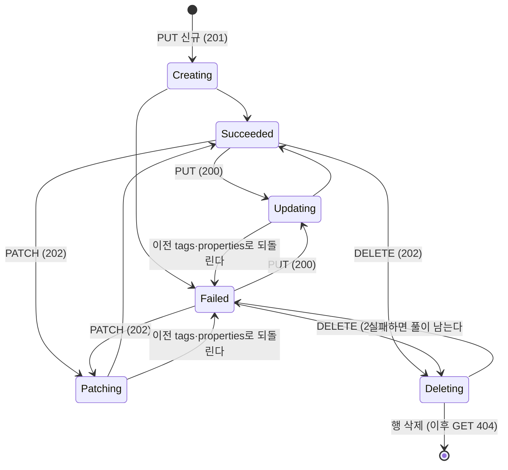

# capacity-pool 설계 (FR-03 용량 풀)

- 확정일: 2026-11-07 (사용자 확인: 선택지 4개 모두 추천안)
- 조사 브리프: [01_researcher_brief.md](01_researcher_brief.md) (조사 상태 `완료`). 녹화 표기 N1~N6, P1~P2는 브리프 머리말을 따른다.
- 공통 계약: 계정 설계 [§4](../netapp-account/02_main_design.md)(작업 상태 URL, 오류 형식, 상관 ID)와 공통 LRO 계층을 그대로 쓴다. 여기에는 풀에서 달라지거나 새로 정하는 것만 쓴다.

## 1. 관련 ID

| 종류 | ID |
| --- | --- |
| PRD | FR-03(용량 풀), FR-02(계정, 이월된 409 기준), FR-01(비동기 작업), FR-08(처리량 제한의 공식 근거), NFR-02(API 충실도), NFR-05(테스트 우선) |
| ADR 요구사항 | AR-02(층 분리), AR-03(비동기 — 바깥 ARM 층만), AR-04(내구성), AR-05(멱등성), AR-07(시험 가능성), AR-10(차이 기록) |
| ADR 결정 | D-05, D-07, D-09, D-13. 새 결정(D-nn)은 없다. ADR §6.4 "풀·볼륨 설계 전에 확정할 규칙"을 이 설계에서 확정한다 (§6) |
| 스파이크 | 필요 없음. 풀은 데이터 플레인을 건드리지 않는다. 참고로 S0는 통과 ([S0.md](../spikes/S0.md)). S1이 저장 방식 C(풀마다 dm-thin 풀)를 고르면 볼륨 사이클에서 풀 처리기에 스토리지 작업을 더할지 다시 본다 |

## 2. 범위

### 재현한다

1. **풀 작업:** PUT(생성·갱신), GET, 계정 안 목록, PATCH(비동기), DELETE.
2. **속성:** `size`, `serviceLevel`(Standard·Premium·Ultra), `qosType`(Auto·Manual), `encryptionType`(Single), `coolAccess`(false), `poolId`, `totalThroughputMibps`(계산값), `utilizedThroughputMibps`.
3. **규칙:**
   - QoS는 Auto → Manual만 된다. Manual → Auto는 거절한다.
   - `serviceLevel`은 볼륨이 없는 풀에서만 바꿀 수 있다 (결정 4).
   - 풀 크기를 볼륨 할당량 합보다 작게 줄이면 거절한다 (결정 3).
   - 볼륨이 남은 풀의 DELETE는 `409 CannotDeleteResource`다.
   - 부모(계정)가 없으면 `404 ParentResourceNotFound`, 부모가 삭제 중이면 `409 Conflict`다 (결정 6).
4. **계정 사이클에서 넘어온 기준:** 풀이 남은 계정 DELETE의 `409 CannotDeleteResource`를 실환경으로 검증한다 (AC-09).
5. **공통 LRO 계층 확장:** PATCH 작업(`action: PATCH`, 진행 중 상태 `Patching`), 결함 주입 키 `{type}/patch`, 실패한 PATCH의 되돌리기.

### 미룬다

- Flexible과 `customThroughputMibps`, StandardZRS, 쿨 액세스(`coolAccess: true`), Double 암호화. 요청에 들어오면 `400 InvalidRequestContent`로 거절한다.
- 512 GiB 풀(preview api-version에만 있는 규칙), 풀 변경(`poolChange`), 계정당 풀 수 한도, ETag·`systemData`, 목록 페이징.
- `utilizedThroughputMibps`의 실제 계산: 볼륨이 생기기 전까지 `0.0`이다. 볼륨 사이클에서 볼륨 처리량 한도의 합으로 계산한다 (녹화 N5의 6.25 = 100 GiB × 64).
- 실제 I/O 제한: FR-08 (스파이크 S2 뒤). 이번에는 처리량을 계산해 보여 주기만 한다.
- 게이트웨이의 늦은 자식 정보 갱신(풀 삭제 직후 계정 DELETE가 몇 초간 409, 녹화 P1·P2): 재현하지 않는다.

## 3. 결정과 버린 대안

| # | 결정 | 버린 대안과 이유 |
| --- | --- | --- |
| 1 | **응답 형식은 녹화를 따른다.** PUT 201은 `Azure-AsyncOperation`만 붙인다. PATCH는 tags만 바꿔도 `202`이고, 본문(`Patching`)과 두 헤더(`Azure-AsyncOperation`, `Location`)를 함께 준다. 작업 상태의 `properties.action`은 `PATCH`다 (녹화 N2에서 리더가 확인). | 스펙(2026-08-01)대로 PUT 201에 `Location` + `final-state-via: location`, PATCH 202에 본문 없음: 실서비스 응답과 다르고, 계정과 풀의 PUT 응답 헤더가 달라져 공통 계층에 생성 흐름이 하나 더 생긴다. 녹화가 preview api-version으로 호출됐다는 점과 스펙과의 차이는 개념 문서에 적는다. |
| 2 | **풀은 storage agent에 아무것도 만들지 않는다.** 처리기는 상태 전이만 한다 (계정 결정 1과 같다). | ONTAP 객체(애그리게이트, SVM, QoS policy group) 생성: 풀에 대응하는 ONTAP 객체는 공개 자료에 없다 [미확인]. 문서상 풀은 "용량·처리량 예산이자 과금 단위"다 [문서 11]. |
| 3 | **풀 쪽 용량 검사는 지금 구현하고, 실환경 검증은 볼륨 사이클로 넘긴다.** 풀 축소 하한 검사와 볼륨이 남은 풀 DELETE 409를 이번에 구현하고, 저장소에 볼륨 행을 직접 넣는 계약 테스트로 확인한다. 볼륨 생성 때의 예약 규칙은 §6에 확정하고 볼륨 사이클에서 구현한다. | 볼륨 사이클에서 구현: 볼륨 사이클이 풀 코드를 다시 고치게 되어 풀의 검증 일부를 다시 해야 한다. 계정의 409를 풀 사이클로 넘긴 것(계정 결정 8)과 같은 방식이다. |
| 4 | **용량 초과 같은 규칙 위반은 요청 즉시 동기 `400`이다.** 검사와 쓰기를 같은 SQLite 트랜잭션에서 하고, 위반이면 작업도 리소스 변경도 만들지 않는다. | 작업을 만든 뒤 `Failed`로 끝내기: 실패한 리소스가 남아 정리 규칙(실패한 볼륨이 할당량을 계속 차지하는지)이 더 필요하다. 실서비스의 형태는 [미확인]이다 (브리프 "오류 상황"). |
| 5 | **`serviceLevel`은 볼륨이 없는 풀에서만 PUT으로 바꿀 수 있다.** 볼륨이 있으면 `400 BadRequest` "ServiceLevel cannot be changed." (ANF RP 오류 문서의 문구). | 생성 뒤 불변: 더 단순하지만, ANF 오류 문서가 "볼륨이 있는 풀"의 변경만 거절한다고 쓴 것과 다르다 [추론]. PATCH 모델에는 `serviceLevel`이 없으므로 PATCH로는 바꿀 수 없다 [스펙]. |
| 6 | **부모 규칙.** 풀 생성은 계정이 있어야 한다. 없으면 `404 ParentResourceNotFound`(녹화 N6의 게이트웨이 문구). 계정이 `Deleting`이면 `409 Conflict`로 거절한다. 두 검사 모두 풀 생성 트랜잭션 안에서 한다. | 삭제 중인 부모를 허용: 계정 삭제가 끝나면 고아 풀이 남는다 (ADR §6.4 "부모 삭제와 자식 생성의 경합"). `409 Conflict`의 코드는 클론의 선택이다. ANF 녹화의 오류 코드 집계에 `Conflict`가 있지만 이 상황의 응답은 [미확인]이다. |
| 7 | **ANF 코드가 확인되지 않은 규칙 위반은 `400 BadRequest`에 ANF 문서의 메시지를 붙인다.** 대상: Manual → Auto, 볼륨이 있는 풀의 서비스 수준 변경, 볼륨 할당량 합보다 작은 크기. 본문 형식 오류(타입, 범위, enum, 모르는 속성, 미룬 속성)는 계정과 같은 `400 InvalidRequestContent`다. | 구체 코드를 지어내기(예: `PoolSizeTooSmall`): 근거가 없다. ANF는 비동기 실패의 최상위 코드로 `BadRequest` 같은 일반 코드를 썼다 (계정 브리프). |
| 8 | **PUT 생성은 `size`와 `serviceLevel`이 필수다** (스펙의 `required`). 없으면 `400 InvalidRequestContent`. **PUT 갱신에서 빠진 속성은 기존 값을 유지한다.** tags는 계정처럼 PUT이 맵 전체를 바꾼다. | 갱신에서 기본값 적용: 녹화 P2와 모순되지 않지만, 실수로 풀을 4 TiB로 줄이거나 Manual 풀을 Auto로 되돌리게 된다. 실서비스 동작은 [미확인]이다. |
| 9 | **PATCH는 PUT 갱신과 같은 방식으로 저장한다.** 요청한 값을 바로 리소스에 쓰고, 이전 tags·properties를 작업에 남겨 실패하면 되돌린다. | 녹화처럼 202 본문에 바뀌기 전 값을 보이고 완료 때 적용: 작업에 요청 내용을 따로 저장해야 해서 스키마가 바뀐다. 202 본문이 새 값을 보이는 차이는 개념 문서에 적는다. |
| 10 | **`totalThroughputMibps`는 2진 TiB로 계산한다.** `size / 2^40 × 단가`(Standard 16, Premium 64, Ultra 128). 4 TiB Premium = `256.0`. | 10진 TB(스펙 예시 281.474): 실서비스 녹화(N1)는 256.0이었다. |
| 11 | **크기 규칙은 stable(2026-08-01)을 따른다.** 1 TiB(`1099511627776`)의 배수, 1~2,048 TiB. 512 GiB는 거절한다. | preview의 512 GiB 허용: 클론은 `2026-08-01`만 지원한다. |

### 아직 확정하지 않은 것

- 볼륨 쪽 오류(볼륨 생성·확장 때 용량 초과, Manual QoS 처리량 초과 "Requested throughput not available")의 메시지와 코드는 볼륨·처리량 설계에서 정한다. 형태는 결정 4(동기 400)를 따른다.
- 리소스 ID의 대소문자: 풀 ID는 요청 경로의 철자를 그대로 쓴다. 찾을 때는 대소문자를 무시한다 (계정 결정 9).

## 4. API 계약

- `{acct}`는 계정 설계 §4와 같다. `{pool}` = `{acct}/capacityPools/{poolName}`. `{opUrl}`도 계정 설계와 같다.
- 풀 이름: `^[a-zA-Z0-9][a-zA-Z0-9\-_]{0,63}$` (1~64자) [스펙].

### 4.1 작업별 응답

| 작업 | 조건 | 코드 | 헤더 | 본문 | 작업 생성 | 근거 |
| --- | --- | --- | --- | --- | --- | --- |
| PUT `{pool}` | 새 리소스 | `201` | `Azure-AsyncOperation` | 풀, `Creating` | CREATE | 녹화 N1 (결정 1) |
| PUT `{pool}` | 기존 리소스(`Succeeded`·`Failed`) | `200` | `Azure-AsyncOperation` | 풀(새 값), `Updating` | UPDATE | 녹화 N3, P2 |
| PUT `{pool}` | 계정이 없음 | `404` `ParentResourceNotFound` | — | ErrorResponse | 없음 | 녹화 N6의 문구 (결정 6) |
| PUT `{pool}` | 계정이 `Deleting` | `409` `Conflict` | — | ErrorResponse | 없음 | 결정 6 |
| PUT `{pool}` | 기존 풀과 `location`이 다름 | `409` `InvalidResourceLocation` | — | ErrorResponse | 없음 | 계정과 같다 |
| GET `{pool}` | 있음 / 없음 | `200` / `404` `ResourceNotFound` | — | 풀 / ErrorResponse | 없음 | 녹화 N1 |
| GET `{acct}/capacityPools` | 계정 있음 / 없음 | `200` / `404` `ResourceNotFound` | — | `{"value": [...]}` / ErrorResponse | 없음 | [스펙]. 계정이 없을 때는 클론의 선택 |
| PATCH `{pool}` | 있음 | `202` | `Azure-AsyncOperation`, `Location: {opUrl}&operationResultResponseType=Location` | 풀(새 값), `Patching` | PATCH | 녹화 N2, P1 (결정 1, 9) |
| PATCH `{pool}` | 없음 | `404` `ResourceNotFound` | — | ErrorResponse | 없음 | — |
| DELETE `{pool}` | 있음 | `202` | `Location`, `Azure-AsyncOperation` | 없음 | DELETE. 풀은 `Deleting` | 녹화 N1 |
| DELETE `{pool}` | 없음 | `204` | — | 없음 | 없음 | [스펙] |
| DELETE `{pool}` | 볼륨이 남아 있음 | `409` `CannotDeleteResource` | — | 메시지에 볼륨 ID | 없음 | 녹화 N5 |
| PUT·PATCH·DELETE `{pool}` | 진행 중 작업이 있음 | `409` `AnotherOperationInProgress` | — | ErrorResponse | 없음 | 계정 결정 6 |
| PUT·PATCH | 규칙 위반 (§4.3) | `400` `BadRequest` | — | ErrorResponse | 없음 | 결정 4, 7 |

- 작업 상태 URL은 계정 설계 §4.2를 그대로 쓴다. `Location` 방식으로 끝난 PATCH를 조회하면 `200`과 풀 본문이다.
- 작업 상태 본문의 `status`: `Creating` | `Updating` | `Patching` | `Deleting` | `Succeeded` | `Failed`. `properties.action`: `CREATE` | `UPDATE` | `PATCH` | `DELETE`.

### 4.2 풀 본문

```json
{
  "id": "/subscriptions/{sub}/resourceGroups/{rg}/providers/Microsoft.NetApp/netAppAccounts/{a}/capacityPools/{p}",
  "name": "{a}/{p}",
  "type": "Microsoft.NetApp/netAppAccounts/capacityPools",
  "location": "westus2",
  "tags": {},
  "properties": {
    "provisioningState": "Succeeded",
    "poolId": "{UUID}",
    "serviceLevel": "Premium",
    "size": 4398046511104,
    "qosType": "Auto",
    "totalThroughputMibps": 256.0,
    "utilizedThroughputMibps": 0.0,
    "encryptionType": "Single",
    "coolAccess": false
  }
}
```

- 저장하는 속성: `poolId`, `serviceLevel`, `size`, `qosType`, `encryptionType`, `coolAccess`. 처리량 두 값은 응답할 때 계산한다.
- 생성 기본값: `qosType: Auto`, `encryptionType: Single`, `coolAccess: false`, `poolId`는 새 UUID.
- 201 본문도 GET과 같은 필드를 모두 준다. 녹화의 201은 `qosType`·`poolId` 등이 비어 있고 `totalThroughputMibps: 0.0`이었는데, 이 차이는 재현하지 않는다.

### 4.3 본문 규칙과 오류

| 상황 | 코드 |
| --- | --- |
| 풀 이름 패턴 위반 | `400 InvalidResourceName` |
| JSON이 아님, `location` 없음, 모르는 속성, 타입이 틀림 | `400 InvalidRequestContent` (계정과 같다) |
| 생성 PUT에 `properties.size` 또는 `properties.serviceLevel`이 없음 | `400 InvalidRequestContent` |
| `size`가 정수가 아니거나 1 TiB의 배수가 아니거나 1~2,048 TiB 밖 | `400 InvalidRequestContent` |
| `serviceLevel`이 Standard·Premium·Ultra가 아님. Flexible·StandardZRS는 "not supported by this ANF clone" | `400 InvalidRequestContent` |
| `qosType`이 Auto·Manual이 아님 | `400 InvalidRequestContent` |
| `coolAccess: true`, `encryptionType: Double`, `customThroughputMibps`가 null이 아님 | `400 InvalidRequestContent` ("not supported by this ANF clone") |
| PATCH 본문에 `serviceLevel`·`encryptionType`이 있음 (PATCH 모델에 없다 [스펙]) | `400 InvalidRequestContent` (모르는 속성) |
| Manual 풀을 Auto로 (PUT·PATCH) | `400 BadRequest` "The QoS type of a capacity pool can't be changed from Manual to Auto." |
| 볼륨이 있는 풀의 `serviceLevel` 변경 | `400 BadRequest` "ServiceLevel cannot be changed." |
| 새 크기 < 볼륨 할당량(`usageThreshold`) 합 (PUT·PATCH) | `400 BadRequest` "The capacity pool size of {new} bytes is too small for the combined volume size of {sum} bytes of the capacity pool. Make sure that the total size of all the volumes in the capacity pool does not exceed the size of the capacity pool." (NetApp KB 문구 [문서 13]) |

- 읽기 전용 필드(`id`, `name`, `type`, `etag`, `systemData`, `properties.provisioningState`, `poolId`, `totalThroughputMibps`, `utilizedThroughputMibps`)는 요청에 있어도 무시한다 (계정과 같은 선택).
- PATCH 본문의 `location`은 PATCH 모델에 있다 [스펙]. 기존 값과 다르면 `409 InvalidResourceLocation`이다.

## 5. 상태 전이



- 계정과 달리 PATCH도 비동기다. 녹화로 확인한 리소스별 차이다 (계정 PATCH는 동기 `200`).
- ANF 오류 문서는 실패 상태의 풀을 "tag를 추가해 update"해서 회복하라고 쓴다 [문서 10]. 클론에서는 PUT과 PATCH 모두 `Failed` 풀을 `Succeeded`로 되돌릴 수 있다.

## 6. 용량 예약과 동시성 규칙 (ADR §6.4 확정)

모든 규칙은 SQLite `BEGIN IMMEDIATE` 트랜잭션 하나 안에서 검사하고 쓴다. 쓰기 잠금이 요청들을 줄 세우므로 검사와 쓰기 사이에 다른 요청이 끼어들 수 없다.

| 규칙 | 확정 내용 | 구현 시점 |
| --- | --- | --- |
| 용량 예약은 원자적으로 | 볼륨 생성 트랜잭션이 풀 아래 모든 볼륨 행의 `usageThreshold` 합 + 새 할당량 ≤ 풀 `size`를 확인하고, 볼륨 행(`Creating`)과 작업을 같은 트랜잭션에 쓴다. **볼륨 행 자체가 예약이다.** 상태와 무관하게(`Creating`, `Failed`, `Deleting` 포함) 모든 볼륨 행이 합계에 들어간다. 넘으면 동기 `400`(결정 4). 볼륨 크기 변경은 (합 − 이전 할당량 + 새 할당량)으로 같은 검사를 한다. | 볼륨 사이클 |
| 풀 축소 하한 | 풀 PUT·PATCH의 새 `size`가 볼륨 할당량 합보다 작으면 `400 BadRequest`. 하한은 사용량이 아니라 할당량 합이다 (브리프: 문서 두 곳과 볼륨 생성 규칙이 할당량 기준이다). | **이번 사이클** (실환경 검증은 볼륨 사이클) |
| 예약 정리 | 볼륨 DELETE가 성공해 행이 지워질 때 예약이 풀린다. 생성에 실패한 볼륨은 `Failed` 행으로 남아 예약을 유지하고, 사용자가 지워야 풀린다. 커널 자원 정리(삭제)가 실패하면 행이 `Failed`로 남으므로 예약도 남는다. 실제 자원이 남아 있을 수 있는 동안에는 용량을 돌려주지 않는다. | 볼륨 사이클 |
| 부모 삭제와 자식 생성의 경합 | 자식 생성은 부모가 없으면 `404 ParentResourceNotFound`, 부모가 `Deleting`이면 `409 Conflict`. 부모 DELETE는 자식 행이 하나라도 있으면(상태 무관) `409 CannotDeleteResource`. 두 검사가 같은 쓰기 잠금 아래에서 돌기 때문에 고아 리소스가 생기지 않는다. | 계정 → 풀: **이번 사이클**. 풀 → 볼륨: 볼륨 사이클에서 같은 함수를 쓴다 |
| 안정적인 작업 식별자, 단계별 복구 | storage job을 쓰는 첫 기능인 볼륨 설계에서 정한다. 풀은 storage job이 없다. | 볼륨 사이클 |

## 7. 내부 구조

| 모듈 | 바뀌는 것 | 짝 테스트 |
| --- | --- | --- |
| `arm_rules.py` | `POOL_TYPE`, `check_pool_name`, `pool_id`, 공통 오류 생성 `not_found` | `test_arm_rules.py` |
| `state_store.py` | `Tx.ensure_no_children`(계정 DELETE의 409를 옮겨 와 공유), `Tx.list_children(parent_id, type)` | `test_state_store.py` |
| `lro.py` | 결함 주입 키 `patch`, PATCH 실패 때 되돌리기 | `test_lro.py` |
| `accounts.py` | 공유 함수 사용으로 정리 (동작 변화 없음) | `test_accounts.py` |
| `capacity_pools.py` (새) | 풀 본문 검사, 응답 본문, PUT·PATCH·DELETE·GET·목록 흐름, 처리기 | `test_capacity_pools.py` |
| `arm_app.py` | 풀 라우트, 종류별 본문 함수(`Location` 방식의 최종 응답) | `test_arm_app.py`. 풀 계약 테스트는 `tests/contract/test_capacity_pools_api.py` |

- 결함 주입 키: `capacityPools/{create|update|patch|delete}`. `netAppAccounts/patch`도 형식상 받지만 계정 PATCH는 동기라 쓰이지 않는다.

## 8. 검증 기준

**공통 조건**
- WSL Ubuntu에서 anf-api를 uvicorn으로 띄우고 HTTP로 검증한다. Docker는 필요 없다.
- 폴링 1초 간격, 제한 시간 30초(지연을 주입했으면 지연 + 30초). 계정 설계 §7과 같다.
- AC-10~AC-12는 `ANF_FAULT_INJECTION`을 켜고 서버를 다시 띄워서 확인한다.

| ID | 층 | 기준 |
| --- | --- | --- |
| AC-01 | 계약·상태 | 계정 아래에 `{size: 4398046511104, serviceLevel: "Premium"}`로 풀을 PUT하면 `201`, `Creating`이 오고 헤더는 `Azure-AsyncOperation`만 있다(`Location` 없음). 폴링하면 `Succeeded`(`action: CREATE`)가 된다. GET 본문에 `name: "{a}/{p}"`, 풀 `type`, UUID 형식 `poolId`, `qosType: Auto`, `encryptionType: Single`, `coolAccess: false`, `totalThroughputMibps: 256.0`, `utilizedThroughputMibps: 0.0`이 있다. |
| AC-02 | 계약 (처리량 계산) | Standard 2 TiB 풀은 `32.0`, Ultra 1 TiB 풀은 `128.0`, Premium 1 TiB 풀은 `64.0`이다. |
| AC-03 | 계약·상태 (PUT 갱신) | 기존 풀에 PUT하면 `200`, `Updating`, `Azure-AsyncOperation`이 오고 폴링하면 `Succeeded`가 된다. tags는 새 맵과 정확히 같다. `size`를 8 TiB로 바꾸면 Premium 풀의 `totalThroughputMibps`가 `512.0`이 된다. `size`·`serviceLevel`을 뺀 PUT은 두 값을 유지한다. 볼륨이 없는 풀의 `serviceLevel`을 Premium → Ultra로 바꾸면 성공하고 처리량이 다시 계산된다. |
| AC-04 | 계약·상태 (PATCH) | tags만 바꾼 PATCH가 `202`를 받는다. 본문은 `Patching`이고 헤더는 `Azure-AsyncOperation`과 `Location`(`operationResultResponseType=Location`)이다. 작업 상태는 `Succeeded`(`action: PATCH`)가 되고 GET의 tags는 새 맵이다. `size` PATCH가 반영된다. `qosType: Manual` PATCH가 반영되고, 이어서 `qosType: Auto`를 PATCH나 PUT으로 보내면 `400 BadRequest`이며 `Manual`이 유지되고 작업이 생기지 않는다. |
| AC-05 | 계약 (조회) | 계정의 풀 목록 `value`에 풀이 있고 다른 계정의 목록에는 없다. 없는 계정의 목록은 `404`다. 없는 풀 GET은 `404 ResourceNotFound`다. 이름의 대소문자만 바꿔 GET해도 같은 풀이 나온다. |
| AC-06 | 계약 (거절) | 다음은 모두 거절되고 작업도 상태 변화도 없다. 잘못된 이름(`-p`, 65자, `a.b`)은 `400 InvalidResourceName`이다. 다음은 `400 InvalidRequestContent`다: 1 TiB 배수가 아닌 `size`(549755813888), `size` 0, 2,049 TiB, 생성에서 `size`나 `serviceLevel` 누락, `serviceLevel` `Gold`·`Flexible`, `coolAccess: true`, `encryptionType: Double`, `customThroughputMibps`, 모르는 속성, PATCH의 `serviceLevel`. 기존 풀에 다른 `location`으로 PUT하면 `409 InvalidResourceLocation`이다. |
| AC-07 | 계약 (부모 규칙) | 없는 계정 아래에 풀을 PUT하면 `404 ParentResourceNotFound`이고 아무것도 생기지 않는다. 계정 삭제에 지연을 주입하고, 계정이 `Deleting`인 동안 그 아래에 풀을 PUT하면 `409 Conflict`이다. 계정 삭제가 끝난 뒤 그 풀은 없다(GET `404`). |
| AC-08 | 계약·상태 (DELETE) | DELETE하면 `202`가 온다. 본문은 없고 `Location`과 `Azure-AsyncOperation`이 있다. 폴링하면 `Succeeded`(`action: DELETE`)가 되고, `Location` GET은 `204`, 풀 GET은 `404`다. 다시 DELETE하면 `204`다. |
| AC-09 | 계약 (FR-02 이월) | 풀이 있는 계정을 DELETE하면 `409 CannotDeleteResource`가 오고, 메시지에 `Microsoft.NetApp/netAppAccounts/{a}/capacityPools/{p}`가 들어 있다. 풀과 계정은 `Succeeded`로 남는다. 풀을 지운 뒤 계정 DELETE는 `202`이고 `Succeeded`로 끝난다. |
| AC-10 | 상태 (진행 중·실패) | 풀 생성·PATCH·삭제에 지연을 주입하면 진행 중 작업 상태가 각각 `Creating`·`Patching`·`Deleting`이고(`percentComplete: 0.0`), 풀 GET도 같은 상태다. PATCH 지연 중 `Location` GET은 `202`다. 생성에 실패를 주입하면 작업이 `Failed`이고 `error`가 있으며 풀은 `Failed`다. 주입을 끈 서버에서 PUT하면 `Succeeded`로 회복한다. PATCH에 실패를 주입하면 풀이 `Failed`가 되고 tags·`size`가 PATCH 전 값으로 돌아간다. |
| AC-11 | 계약 (진행 중 충돌) | 풀 작업이 진행 중일 때 같은 풀에 PUT, PATCH, DELETE를 보내면 각각 `409 AnotherOperationInProgress`이고 새 작업이 생기지 않는다. 진행 중이던 작업은 정상으로 끝난다. |
| AC-12 | 상태 (재시작) | 풀 생성과 PATCH가 지연으로 진행 중일 때 anf-api를 SIGKILL하고 다시 띄우면 두 작업이 제한 시간 안에 `Succeeded`가 되고, 풀 GET도 `Succeeded`다. |
| AC-13 | 데이터 플레인 불변 | 풀 작업(AC-01~AC-09) 전후에 root로 실행한 `exportfs -v` 출력과 `/etc/exports.d/` 목록이 같다. |

**볼륨 사이클로 옮긴 기준.** 이번에는 저장소에 볼륨 행을 직접 넣는 계약 테스트로 로직을 확인하고, 실환경 PASS로 세지 않는다.

- CV-1 (FR-03): 볼륨이 남은 풀을 DELETE하면 `409 CannotDeleteResource`이고, 메시지에 볼륨 ID가 들어 있으며, 풀은 남는다.
- CV-2 (FR-03): 볼륨 할당량 합보다 작은 `size`로 풀을 PUT·PATCH하면 `400 BadRequest`이고 `size`가 바뀌지 않는다.
- CV-3: 볼륨이 있는 풀의 `serviceLevel`을 바꾸면 `400 BadRequest`다.
- 볼륨 생성이 풀 크기를 넘으면 거절되는 FR-03 기준은 볼륨 사이클이 §6의 규칙으로 구현하고 검증한다.

## 구현 중 변경

- **결함 주입 키는 등록된 처리기에서 만든다 (§7).** 설계 §7은 "`netAppAccounts/patch`도 형식상 받는다"였다. 구현에서는 `parse_faults`가 처리기의 (리소스 종류, 작업) 목록에서 받을 키를 만든다. 그래서 `capacityPools/patch`는 받고, PATCH 작업이 없는 계정의 `netAppAccounts/patch`는 서버 시작 때 거절한다. 쓰이지 않는 키를 받으면 검증자가 결함을 걸었다고 착각할 수 있어서다. 계정 사이클의 기존 테스트(`netAppAccounts/patch` 거절)도 그대로 맞는다.
- **공통 함수의 위치 (§7).** 계정과 풀이 함께 쓰는 것을 옮겼다. 계정의 동작은 바뀌지 않았고 기존 계정 테스트로 확인했다.
  - `arm_rules.py`: `not_found`, `location_conflict`, 본문 검사 오류(`invalid_content`, `unknown_property`, `unsupported_property`, `check_tags`).
  - `state_store.py`: `Tx.ensure_no_children`. 계정 DELETE 안에 있던 `409 CannotDeleteResource` 검사를 옮겼다.
- **미룬 값의 오류 메시지 (§4.3, 1회차 검증 뒤).** `serviceLevel: Flexible`·`encryptionType: Double`의 메시지는 "The property 'properties.serviceLevel 'Flexible'' …"처럼 따옴표가 겹쳤다. 값까지 붙인 이름을 속성 이름용 `unsupported_property`에 넘겼기 때문이다. 이 두 경우만 "The value 'Flexible' of 'properties.serviceLevel' is not supported by this ANF clone."으로 바꿨다. 속성 자체를 미룬 경우(`coolAccess`, `customThroughputMibps`)는 그대로다. 오류 코드와 상태 코드는 바뀌지 않았다. 영향받는 기준은 AC-06이다.
- **계정 검증 무효화.** 위 공통 코드 변경으로 계정의 검증 대상 코드(`bf4e61d3…`)가 바뀌었다. 그래서 계정을 `in_progress`로 되돌렸다(무효화 규칙). 이번 실환경 검증에서 계정의 기존 e2e 스크립트(`backend/tests/e2e/test_netapp_account_*_live.py`)를 함께 돌려 AC-01~AC-13을 다시 확인한다. 계정 개념 문서의 코드 인용(줄 번호, 자식 검사 위치)도 고친다.
