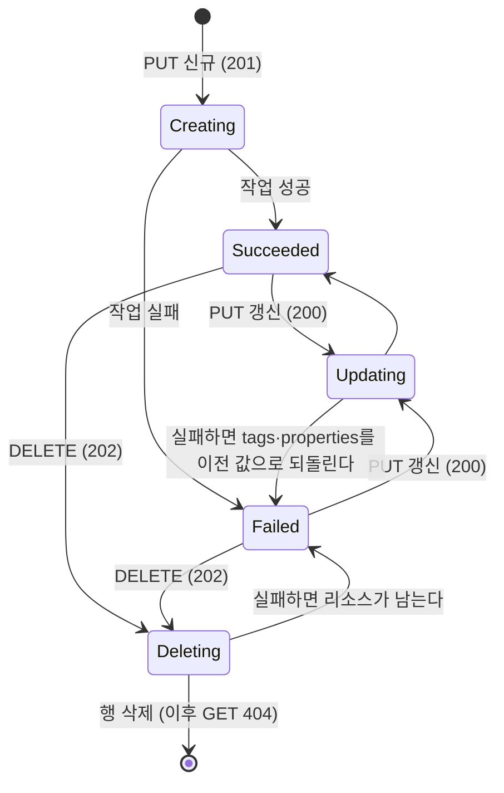

# netapp-account 설계 (FR-01 공통 LRO 계층 + FR-02 계정)

- 확정일: 2026-11-07 (사용자 확인)
- 조사 브리프: [01_researcher_brief.md](01_researcher_brief.md) (보완 조사 포함, 조사 상태 `완료`)

## 1. 관련 ID

| 종류 | ID |
| --- | --- |
| PRD | FR-01(비동기 작업), FR-02(계정), NFR-02(API 충실도), NFR-05(테스트 우선), NFR-07(로컬 전용), NFR-08(추적성) |
| ADR 요구사항 | AR-02(층 분리), AR-03(두 층의 비동기 — 이번에는 바깥 ARM 층만), AR-04(내구성), AR-05(멱등성), AR-07(시험 가능성), AR-10(차이 기록) |
| ADR 결정 | D-01(Python 3.12, FastAPI), D-05(ARM LRO 스타일), D-07(SQLite), D-09(프로세스 안 워커), D-13(인증 없음), D-14(Python 설정) |
| 스파이크 | 필요 없음. 계정은 데이터 플레인을 건드리지 않는다. 참고로 S0는 통과했다 ([S0.md](../spikes/S0.md)) |

## 2. 범위

### 재현한다

1. **계정 작업:** PUT(생성·갱신), GET, 리소스 그룹 목록, 구독 목록, PATCH(tags만), DELETE.
2. **공통 LRO 계층 (이후 기능이 재사용한다):**
   - SQLite의 `resources`·`operations` 테이블
   - anf-api 프로세스 안의 asyncio 작업 워커와 재시작 복구
   - 작업 상태 URL `…/locations/{location}/operationResults/{operationId}` 하나를 `Azure-AsyncOperation` 방식과 `Location` 방식(`&operationResultResponseType=Location`)으로 응답
   - 리소스 하나에 진행 중 작업 하나만 허용
   - 결함 주입(지연, 강제 실패). 기본은 꺼짐
3. **ARM 앞단 역할:**
   - api-version 검사
   - 이름 검사
   - 요청 본문 검사
   - 자식이 남은 리소스의 삭제 거절(`409 CannotDeleteResource`)
   - 상관 ID 헤더(`x-ms-request-id`, `x-ms-correlation-request-id`)

### 미룬다

- AD 연결, CMK(`Microsoft.KeyVault`), `identity`, `nfsV4IDDomain`, `ldapConfiguration`. 요청에 들어오면 `400`으로 거절한다.
- `checkNameAvailability`, 계정 수 한도와 `quotaLimits`, ETag와 `If-Match`, `systemData`, 목록의 `nextLink` 페이징(항상 한 페이지로 전부 돌려준다), 계정 POST 액션.
- 구조화된 JSON 로그와 메트릭. FR-12(metrics)에서 한다.
- storage agent. 첫 사용처는 볼륨 기능이다.

## 3. 결정과 버린 대안

| # | 결정 | 버린 대안과 이유 |
| --- | --- | --- |
| 1 | **계정은 storage agent에 아무것도 만들지 않는다.** 컨트롤 플레인 전용 리소스이고, 계정 LRO 워커는 상태 전이만 한다. | SVM 생성: ANF 계정과 SVM의 1:1 대응을 보여 주는 공개 근거가 없다. 단서를 보면 SVM은 구독·리전·VNet 기준으로 나뉘는 것 같다 [추론, 브리프 "ONTAP 대응 개념"]. 근거 없는 대응을 코드로 굳히지 않는다. |
| 2 | **기존 계정에 PUT하면 비동기 `200`을 준다.** `200`과 `Updating`, `Azure-AsyncOperation` 헤더를 돌려주고, 폴링하면 `Succeeded`가 된다. 녹화 R3와 같다. | 스펙대로 동기 `200`과 `Succeeded`: 스펙은 PUT `200`에 헤더를 정의하지 않는다. 하지만 실서비스는 비동기로 응답했다. "`200`이어도 아직 끝나지 않았을 수 있다"는 점은 개념 문서에 적는다. |
| 3 | **PATCH(tags)는 동기 `200`이다.** 녹화 R2와 Python 녹화의 계정 PATCH와 같다. PATCH는 `provisioningState`를 바꾸지 않는다. `Failed` 상태에서 회복하려면 PUT을 다시 보낸다. | 비동기 `202`와 `Patching`: 스펙 예시에는 있다. 하지만 계정 녹화는 모두 동기 `200`이었다. 풀 PATCH는 `202`였으므로 풀 설계에서 다시 정한다. |
| 4 | **진행 중 작업의 `status`는 작업별 값이다.** 생성은 `Creating`, 갱신은 `Updating`, 삭제는 `Deleting`이다. `percentComplete`는 진행 중 `0.0`, 종결 `100.0`이다. | ARM 예시의 `InProgress`: ANF 녹화 176개에 한 번도 나오지 않았다. 대신 작업별 값을 썼다. |
| 5 | **`Retry-After`를 보내지 않는다.** 클론의 클라이언트(검증 스크립트, 대시보드)는 1초 간격으로 폴링하고, 제한 시간은 30초다. | RPC 범위(10초~10분)로 보내기: ANF 녹화에 0건이다. 그리고 10초 이상이면 검증 시간이 길어진다. |
| 6 | **진행 중 충돌은 `409 AnotherOperationInProgress`다.** 진행 중 작업이 있는 리소스에 PUT, PATCH, DELETE를 보내면 즉시 거절하고 새 작업을 만들지 않는다. | `Conflict` 코드: ANF가 진행 중 충돌에 쓰는 코드는 [미확인]이다. `AnotherOperationInProgress`는 ARM 공통 배포 오류 목록에 "Wait for concurrent operation to complete"로 나온다 [문서: ARM common deployment errors]. HTTP `409`는 클론의 선택이다. 대기열에 넣는 방식은 ANF 문서 문구("Wait until … finished, and then retry")와 맞지 않는다 [추론]. |
| 7 | **실환경에서 진행 중·실패·재시작을 재현하려고 결함 주입을 둔다.** 서버를 띄울 때 `ANF_FAULT_INJECTION`(JSON, 기본 꺼짐)으로 리소스 종류·작업별 지연과 강제 실패를 켠다. 켜져 있으면 시작할 때 경고 로그를 남긴다. | 단위·계약 테스트로만 검증: 그러면 실환경 기준이 볼륨 사이클까지 UNVERIFIED로 남고, 계정이 `partial`이 된다. 계정 작업은 실제 일이 없어서 밀리초 안에 끝난다(실서비스도 약 70ms, 녹화 R1). |
| 8 | **자식 리소스 검사(`409 CannotDeleteResource`)는 지금 일반 규칙으로 구현한다.** 검사는 "이 리소스를 부모로 가진 리소스가 있으면 거절"이고, 지금은 계약 테스트로 확인한다. 실환경 수락 기준은 용량 풀 사이클로 옮긴다(PRD FR-02에 표시). 검사는 리소스 공급자 처리 전 "ARM 앞단" 단계에 둔다. 실서비스에서 이 거절은 ARM 게이트웨이가 냈다(녹화 R4의 `x-ms-failure-cause: gateway`). | 이번 사이클에 수락 기준을 남기기: 용량 풀이 done이 될 때까지 계정이 `partial`이 된다. |
| 9 | **리소스 ID는 대소문자를 구분하지 않고 찾는다.** 이름은 처음 받은 그대로 보존한다. SQLite `COLLATE NOCASE`를 쓴다. | 대소문자 구분: ARM 일반 규칙("리소스 이름은 따로 적지 않는 한 대소문자를 구분하지 않는다")과 다르다 [문서: ARM 이름 규칙, 이번 조사에서 원문은 재확인하지 않음]. |
| 10 | **상태 저장소 파일은 `ANF_API_DB` 환경 변수로 정한다.** 기본값은 `~/.local/state/anf-clone/anf-api.db`(WSL ext4)다. | 저장소(`/mnt/c`, 9P) 안: 9P에서는 SQLite 파일 잠금을 믿을 수 없다 [추론]. |
| 11 | **anf-api는 `127.0.0.1:8080`에 uvicorn 워커 1개로 띄운다.** | 워커 여러 개: D-09의 프로세스 안 워커는 프로세스가 하나라는 전제다. |

### 아직 확정하지 않은 것

- 응답 본문의 `etag`와 `systemData`는 미룬다. 실서비스는 둘 다 돌려준다.
- `location` 값의 정규화(`West US 2` → `westus2`)는 하지 않는다. 받은 문자열을 그대로 저장하고, 대소문자만 무시하고 비교한다.

## 4. API 계약

모든 경로는 `api-version=2026-08-01`이 필요하다. 경로 접두어는 다음과 같다.

- `{acct}` = `/subscriptions/{subscriptionId}/resourceGroups/{resourceGroupName}/providers/Microsoft.NetApp/netAppAccounts/{accountName}`
- `{opUrl}` = `{base}/subscriptions/{subscriptionId}/providers/Microsoft.NetApp/locations/{location}/operationResults/{operationId}?api-version=2026-08-01`. `{base}`는 요청을 받은 서버 주소(예: `http://127.0.0.1:8080`)다. 실서비스의 URL 서명 파라미터(`t`, `c`, `s`, `h`)는 ARM이 붙이는 것이라 재현하지 않는다.

### 4.1 작업별 응답

| 작업 | 조건 | 코드 | 헤더 | 본문 | 작업 생성 | 근거 |
| --- | --- | --- | --- | --- | --- | --- |
| PUT `{acct}` | 새 리소스 | `201` | `Azure-AsyncOperation: {opUrl}` | 계정, `provisioningState: Creating` | CREATE | [스펙 3], 녹화 R1 |
| PUT `{acct}` | 기존 리소스(`Succeeded` 또는 `Failed`) | `200` | `Azure-AsyncOperation: {opUrl}` | 계정(새 tags), `Updating` | UPDATE | 녹화 R3 (결정 2) |
| PUT `{acct}` | 기존 리소스와 `location`이 다름 | `409` `InvalidResourceLocation` | — | ErrorResponse | 없음 | 코드 [문서: ARM 오류 목록], HTTP 코드는 클론의 선택 |
| GET `{acct}` | 있음 / 없음 | `200` / `404` `ResourceNotFound` | — | 계정 / ErrorResponse | 없음 | 녹화 R1 |
| GET `…/resourceGroups/{rg}/providers/Microsoft.NetApp/netAppAccounts` | — | `200` | — | `{"value": [...]}` | 없음 | [스펙 3] |
| GET `/subscriptions/{sub}/providers/Microsoft.NetApp/netAppAccounts` | — | `200` | — | `{"value": [...]}` | 없음 | [스펙 3] |
| PATCH `{acct}` | 있음 | `200` | 없음 | 계정. `provisioningState`는 바꾸지 않는다 | 없음(동기) | 녹화 R2 (결정 3) |
| PATCH `{acct}` | 없음 | `404` `ResourceNotFound` | — | ErrorResponse | 없음 | — |
| DELETE `{acct}` | 있음 | `202` | `Location: {opUrl}&operationResultResponseType=Location`, `Azure-AsyncOperation: {opUrl}` | 없음 | DELETE. 리소스는 `Deleting`이 된다 | [스펙 3], 녹화 R1·볼륨 DELETE |
| DELETE `{acct}` | 없음 | `204` | — | 없음 | 없음 | [스펙 3, 8] |
| DELETE `{acct}` | 자식 리소스가 남아 있음 | `409` `CannotDeleteResource` | — | 메시지에 자식 ID(`Microsoft.NetApp/netAppAccounts/{a}/capacityPools/{p}` 형식)를 넣는다 | 없음 | 녹화 R4 (결정 8) |
| PUT·PATCH·DELETE `{acct}` | 진행 중 작업이 있음 | `409` `AnotherOperationInProgress` | — | ErrorResponse | 없음 | 결정 6 |

### 4.2 작업 상태 URL

| 방식 | 조건 | 코드 | 헤더 | 본문 | 근거 |
| --- | --- | --- | --- | --- | --- |
| `Azure-AsyncOperation` (쿼리에 `operationResultResponseType` 없음) | 항상 | `200` | — | `{id, name, status, startTime, endTime?, percentComplete, properties: {resourceName, action}, error?}` | [문서 24], ANF [녹화] |
| `Location` (`operationResultResponseType=Location`) | 진행 중 | `202` | `Location`(같은 URL) | 없음 | [문서 24] |
| `Location` | 성공. CREATE·UPDATE | `200` | — | 리소스 본문 | [문서 24] |
| `Location` | 성공. DELETE | `204` | — | 없음 | [문서 24]의 예시 흐름 |
| `Location` | 실패 | 저장된 오류 HTTP 코드 | — | ErrorResponse | [추론] "동기로 실행했다면 돌려줬을 응답" 규칙 |
| 두 방식 공통 | 작업 ID가 없음, 구독이 다름, 경로의 `location`이 다름 | `404` `ResourceNotFound` | — | ErrorResponse | [문서 24] |

작업 상태 본문의 필드는 다음과 같다.

- `id`: `/subscriptions/{sub}/providers/Microsoft.NetApp/locations/{loc}/operationResults/{opId}`
- `name`: `{opId}`(UUID)
- `status`: `Creating` | `Updating` | `Deleting` | `Succeeded` | `Failed`
- `properties`: `{resourceName: <리소스 ID>, action: "CREATE" | "UPDATE" | "DELETE"}`. ANF 녹화처럼 진행 중에도 넣는다. `UPDATE`라는 값은 녹화로 확인하지 못했다 [추론].
- `error`: `Failed`일 때만 넣는다. 형식은 `{code, message}`다.

작업 기록은 지우지 않는다. 실서비스의 보존 기간은 [미확인]이고, 클론에서는 데이터가 작다.

### 4.3 공통 오류

오류 본문은 모두 `{"error": {"code", "message"}}`다.

| 상황 | 코드 | 근거 |
| --- | --- | --- |
| api-version 없음 | `400` `MissingApiVersionParameter` | 포럼 단서 [미확인] |
| 지원하지 않는 api-version | `400` `NoRegisteredProviderFound` (메시지에 지원 버전 `2026-08-01`) | ARM 오류 목록에 코드가 있다. 이 상황에서 이 코드가 나온다는 것은 [추론] |
| 계정 이름이 패턴 `^[a-zA-Z0-9][a-zA-Z0-9\-_]{0,127}$`을 어김. 리소스 그룹 이름이 1~90자 `^[-\w._()]+$`를 어김 | `400` `InvalidResourceName` | [스펙 3, 8], 코드는 ARM 오류 목록 |
| 본문이 JSON이 아님, `location`이 없음, 모르는 속성, 범위 밖 속성(`activeDirectories`, `identity`, `nfsV4IDDomain`, `ldapConfiguration`, `encryption.keySource`가 `Microsoft.NetApp`이 아닌 값) | `400` `InvalidRequestContent` | 코드는 ARM 오류 목록. 메시지는 ANF 문구 "Value received for an unknown property '{name}'."를 따른다 |

읽기 전용 필드(`id`, `name`, `type`, `etag`, `systemData`, `properties.provisioningState`, `properties.disableShowmount`, `properties.multiAdStatus`)는 요청에 있어도 무시한다. RPC는 값이 다르면 `400`으로 거절하라고 하지만, SDK가 GET 본문을 그대로 PUT하는 경우를 막지 않으려는 클론의 선택이다.

### 4.4 계정 본문

```json
{
  "id": "/subscriptions/{sub}/resourceGroups/{rg}/providers/Microsoft.NetApp/netAppAccounts/{name}",
  "name": "{name}",
  "type": "Microsoft.NetApp/netAppAccounts",
  "location": "westus2",
  "tags": {"k": "v"},
  "properties": {
    "provisioningState": "Succeeded",
    "encryption": {"keySource": "Microsoft.NetApp"}
  }
}
```

- `tags`는 없으면 `{}`로 돌려준다.
- `encryption.keySource`는 녹화 R1처럼 기본값을 채운다.
- PUT은 tags 전체를 바꾼다. PATCH도 `tags`가 있으면 맵 전체를 바꾸고(녹화 R2), `tags`가 없으면 그대로 둔다.

### 4.5 상관 ID

- 모든 응답에 `x-ms-request-id`(요청마다 새 UUID)를 붙인다.
- `x-ms-correlation-request-id`는 요청에 있으면 그대로 돌려주고, 없으면 새 UUID를 만들어 돌려준다.
- 상관 ID는 작업 기록에 저장한다. storage agent가 생기면 그 호출까지 넘긴다 (ADR §8).

## 5. 상태 전이



- PATCH(동기)는 `provisioningState`를 바꾸지 않는다.
- 진행 중 상태(`Creating`, `Updating`, `Deleting`)에서는 변경 요청을 받지 않는다(`409 AnotherOperationInProgress`).
- 작업 `status`와 리소스 `provisioningState`는 종결 때 같은 값이 된다. 둘은 같은 트랜잭션에서 바꾼다.

## 6. 내부 구조

### 6.1 저장 모델 (SQLite)

- `resources`
  - 열: `id`(PK, `COLLATE NOCASE`), `type`, `parent_id`(`COLLATE NOCASE`, 계정은 NULL), `subscription_id`, `resource_group`, `name`, `location`, `tags`(JSON), `properties`(JSON), `provisioning_state`, `created_at`, `updated_at`
- `operations`
  - 열: `id`(UUID PK), `subscription_id`, `location`, `resource_id`, `action`, `status`, `previous`(갱신 실패 때 되돌릴 tags·properties의 JSON), `error`(JSON `{httpStatus, code, message}`), `correlation_id`, `start_time`, `end_time`
  - 부분 유니크 인덱스: `resource_id`에 걸고, 조건은 `status NOT IN ('Succeeded','Failed','Canceled')`다. "리소스 하나에 진행 중 작업 하나"를 DB가 보장한다.
- **쓰기 규칙:**
  - 쓰기는 `BEGIN IMMEDIATE` 트랜잭션 하나로 한다. 리소스 변경과 작업 생성은 같은 트랜잭션에 넣는다 (ADR §6.4 "저장한 뒤 응답한다").
  - WAL 모드를 쓴다.
  - 연결은 호출마다 짧게 연다.

### 6.2 작업 워커

- FastAPI lifespan이 asyncio 작업 하나를 띄운다.
- 워커는 종결되지 않은 작업을 찾아, 이미 실행 중인 것이 아니면 작업마다 asyncio 태스크로 실행한다. 작업을 기다리는 동안 다른 작업을 막지 않는다.
- 새 작업이 생기면 이벤트로 깨운다. 이벤트를 놓칠 때를 대비해 1초마다 다시 훑는다.
- 작업 처리기는 `(리소스 종류, action)`으로 찾는다. 계정 처리기는 다음과 같다.
  - CREATE·UPDATE: 리소스를 `Succeeded`로 바꾼다.
  - DELETE: 리소스 행을 지운다.
  - 처리기는 멱등이다.
- **재시작 복구 (AR-04):** 시작할 때 종결되지 않은 작업을 모두 처음부터 다시 실행한다. 계정 처리기는 멱등이므로 안전하다. 실제 자원을 만드는 볼륨부터는 ADR §6.4의 "단계별 복구"를 볼륨 설계에서 정한다.

### 6.3 결함 주입

`ANF_FAULT_INJECTION` 환경 변수에 JSON을 넣는다.

```json
{"netAppAccounts/create": {"delaySeconds": 5}, "netAppAccounts/delete": {"fail": true}}
```

- 키는 `{리소스 종류}/{create|update|delete}`다. 값에는 `delaySeconds`(0 이상의 실수)와 `fail`(boolean)을 둔다.
- 지연은 처리기를 실행하기 전에 기다린다.
- 실패는 처리기 대신 작업을 `Failed`로 끝낸다. 오류는 `{httpStatus: 500, code: "InternalServerError", message: "Injected fault: …"}`이고, ANF 녹화의 일반 코드를 따랐다.
- JSON이 잘못됐거나 모르는 키가 있으면 서버가 뜨지 않는다.
- 값이 있으면 시작할 때 경고 로그를 남긴다.

### 6.4 모듈 (`backend/anf_api/`)

TDD 훅은 파일 이름으로 테스트를 짝짓는다. 그래서 이후 `storage_agent/`와 이름이 겹치지 않게 짓는다.

| 모듈 | 맡는 일 | 짝 테스트 |
| --- | --- | --- |
| `arm_ids.py` | 경로 구성, 이름·api-version 검사 | `tests/unit/test_arm_ids.py` |
| `state_store.py` | 스키마, 리소스·작업 읽기와 쓰기, 트랜잭션 | `tests/unit/test_state_store.py` |
| `lro_worker.py` | 워커, 처리기 등록, 결함 주입 | `tests/unit/test_lro_worker.py` |
| `accounts.py` | 계정 본문 검사, 응답 본문 생성, 처리기 | `tests/unit/test_accounts.py` |
| `arm_app.py` | `create_app()`, 라우트, 오류 형식, 상관 ID, lifespan | `tests/contract/test_arm_app.py` (TestClient) |

모듈 경계는 구현하면서 바뀔 수 있고, 바뀌면 "구현 중 변경"에 적는다.

### 6.5 의존성과 실행

- `pyproject.toml`:
  - dependencies: `fastapi`, `uvicorn`
  - dev: `httpx`(TestClient에 필요)
- 실행(WSL):

  ```
  ~/.venvs/anf-clone/bin/python -m uvicorn --factory anf_api.arm_app:create_app --app-dir backend --host 127.0.0.1 --port 8080
  ```

## 7. 검증 기준

**공통 조건**
- 검증은 WSL Ubuntu에서 anf-api를 띄우고 HTTP로 한다. Docker는 필요 없다.
- 폴링은 1초 간격이다. 제한 시간은 30초이고, 결함 주입으로 지연을 넣었으면 그 지연에 30초를 더한다.
- AC-08~AC-11은 `ANF_FAULT_INJECTION`을 켜고 서버를 다시 띄워서 확인한다.

| ID | 층 | 기준 |
| --- | --- | --- |
| AC-01 | 계약·상태 | 새 계정을 PUT하면 `201`이 온다. 본문은 `provisioningState: Creating`이고, 헤더는 `Azure-AsyncOperation`만 있다(`Location` 없음). URL은 §4의 `{opUrl}` 형식이다. 그 URL을 폴링하면 `200`과 `status: Succeeded`, `percentComplete: 100.0`, `properties.action: CREATE`가 온다. 이후 GET은 `200`과 `Succeeded`다. |
| AC-02 | 계약·상태 | 같은 계정에 tags를 바꿔 PUT하면 `200`, `Updating`, `Azure-AsyncOperation`이 온다. 폴링하면 `Succeeded`가 되고, GET의 tags는 새 맵과 정확히 같다. |
| AC-03 | 계약 | GET 본문에 §4.4의 필드가 있다. 없는 계정을 GET하면 `404`와 `error.code: ResourceNotFound`가 온다. 이름의 대소문자만 바꿔 GET해도 같은 계정이 나온다. |
| AC-04 | 계약 | 리소스 그룹 목록의 `value`에 계정이 있다. 다른 리소스 그룹의 목록에는 없다. 구독 목록에는 있다. |
| AC-05 | 계약 | tags가 `{"a":"1"}`인 계정에 `PATCH {"tags":{"b":"2"}}`를 보내면 `200`이 온다. 추적 헤더는 없고, 본문의 tags는 `{"b":"2"}`다. 이후 GET도 같다. 없는 계정을 PATCH하면 `404`다. |
| AC-06 | 계약 | 다음 요청은 모두 거절되고, 작업도 상태 변화도 생기지 않는다. 잘못된 이름(`-abc`, 129자, `a.b`)은 `400 InvalidResourceName`이다. api-version이 없으면 `400 MissingApiVersionParameter`, 다른 버전이면 `400 NoRegisteredProviderFound`다. `location`이 없거나 모르는 속성이 있거나 `identity`가 있으면 `400 InvalidRequestContent`다. 기존 계정에 다른 `location`으로 PUT하면 `409 InvalidResourceLocation`이고 계정은 그대로다. |
| AC-07 | 계약·상태 | DELETE하면 `202`가 온다. 본문은 없고 `Location`과 `Azure-AsyncOperation`이 둘 다 있다. `Azure-AsyncOperation`을 폴링하면 `Succeeded`(`action: DELETE`)가 된다. 완료 뒤 `Location`을 GET하면 `204`다. 계정 GET은 `404`이고, 다시 DELETE하면 `204`다. |
| AC-08 | 상태 (FR-01 진행 중) | 생성과 삭제에 지연을 주입한다. PUT은 `201`을 바로 돌려준다(지연보다 훨씬 짧게). 지연 중에는 작업 상태가 `200`, `status: Creating`, `percentComplete: 0.0`이고, 계정 GET은 `Creating`이다. DELETE 지연 중에는 `Location` GET이 `202`(본문 없음, `Location` 헤더 있음)이고 계정 GET은 `Deleting`이다. 지연이 끝나면 종결 상태에 도달한다. |
| AC-09 | 상태 (FR-01 실패) | 생성에 실패를 주입하면 작업 상태가 `status: Failed`이고 `error.code`와 `error.message`가 있다. `Location` GET은 `500`과 ErrorResponse다. 계정 GET은 `provisioningState: Failed`다. 주입을 끈 서버에서 같은 계정에 PUT하면 `200`, `Updating`을 거쳐 `Succeeded`가 된다. 삭제에 실패를 주입하면 계정이 `Failed`로 남는다. |
| AC-10 | 계약 (진행 중 충돌) | 지연 주입으로 작업이 진행 중일 때 같은 계정에 PUT, PATCH, DELETE를 보내면 각각 `409 AnotherOperationInProgress`가 온다. 새 작업은 생기지 않고, 진행 중이던 작업은 정상으로 끝난다. |
| AC-11 | 상태 (AR-04 재시작) | 지연 주입으로 생성 작업이 진행 중일 때 anf-api를 강제 종료(SIGKILL)하고 다시 띄우면, 그 작업이 제한 시간 안에 `Succeeded`가 된다. 계정 GET도 `Succeeded`다. |
| AC-12 | 데이터 플레인 불변 | 계정 작업(AC-01~AC-07) 전후에 root로 실행한 `exportfs -v` 출력과 `/etc/exports.d/` 목록이 같다. |
| AC-13 | 계약 (추적성) | 모든 응답에 `x-ms-request-id`가 있다. `x-ms-correlation-request-id`를 보내면 같은 값이 돌아오고, 보내지 않으면 새 값이 온다. |

- **용량 풀 사이클로 옮긴 기준:** "용량 풀이 남은 계정을 DELETE하면 `409 CannotDeleteResource`가 오고, 메시지에 풀 ID가 들어 있으며, 풀은 그대로 남는다. 풀을 지운 뒤에는 `202`가 온다."
- 이 사이클에서는 위 기준의 검사 로직을 계약 테스트로 확인한다. 테스트는 자식 행을 저장소에 직접 넣는다. 실환경 PASS로 세지 않는다.

## 구현 중 변경

- **모듈 이름 (§6.4).**
  - `arm_ids.py` → `arm_rules.py`: 경로·이름 검사와 함께 `ArmError`(오류 형식)도 담게 돼서 이름을 넓혔다.
  - `lro_worker.py` → `lro.py`: 워커와 결함 주입에 더해 작업 상태 본문(`operation_status_body`)도 담는다.
  - 짝 테스트는 `test_arm_rules.py`, `test_lro.py`다.
- **자식 리소스 검사의 위치 (결정 8).** 실서비스는 ARM 게이트웨이가 리소스 공급자보다 먼저 검사한다. 클론은 이 검사를 DELETE 트랜잭션 안(`accounts.delete_account`)에 두었다. 검사를 별도 단계로 두면 검사와 삭제 사이에 자식(풀) 생성이 끼어들어 고아 리소스가 생길 수 있다(ADR §6.4 "부모 삭제와 자식 생성의 경합"). 응답(`409 CannotDeleteResource`, 메시지 형식)은 녹화 R4와 같다.
- **진행 중 작업 검사 (결정 6).** `Tx.ensure_no_active_operation` 하나를 작업 생성과 동기 PATCH가 함께 쓴다. 부분 유니크 인덱스는 이 검사가 빠졌을 때를 대비한 DB 수준의 안전장치다.
- **테스트 의존성 (§6.5).** dev 의존성은 `httpx` 대신 `httpx2`다. Starlette 1.10의 TestClient가 `httpx`를 deprecated로 경고하고 `httpx2`를 먼저 찾는다. `httpx2`는 pydantic 조직이 관리하고, 원작자가 httpx와 같다.
