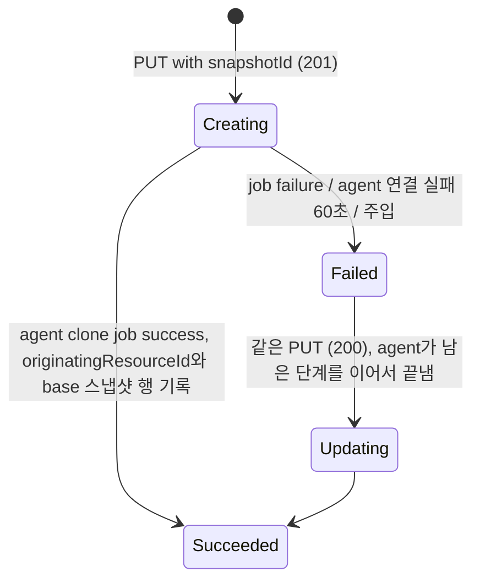

# restore-new-volume 설계 (FR-07 스냅샷에서 새 볼륨으로 복원)

- 작성: 2026-11-08, 메인 세션 (`anf-roadmap` 총괄). 사용자에게 묻는 결정(확정된 D-nn·`CLAUDE.md` "Decided" 변경, PRD 수락 기준 축소, 기기·저장소 설정, 스파이크 실패)은 없었다. 그래서 결정 1~16은 모두 **자동 채택**이다. 버린 대안과 이유를 각 행에 적었고, `_workspace/roadmap.md`의 "검토할 자동 채택 결정"에 같은 목록이 있다.
- 입력: `01_researcher_brief.md`(조사 상태 완료, 허용 범위·크기 하한·거절 코드는 [미확인]), [S6](../spikes/S6.md)(조건부 통과), [S5](../spikes/S5.md) L2, [S4](../spikes/S4.md), [S1](../spikes/S1.md) #9, 볼륨 설계 `_workspace/volume/02_main_design.md`, 스냅샷 설계 `_workspace/snapshot/02_main_design.md`, 되돌리기 설계 `_workspace/snapshot-revert/02_main_design.md`.

## 1. 관련 ID

- PRD: FR-07 (스냅샷에서 새 볼륨으로 복원), FR-04·FR-05·FR-06 (볼륨·스냅샷·되돌리기: 원본 쪽 회귀), FR-01 (LRO 재사용), FR-03 (풀 할당량), NFR-01, NFR-02, NFR-05, NFR-08
- ADR: AR-01~AR-07, D-06, D-09, D-11(볼륨·스냅샷 = thin LV, 새 볼륨 복원은 쓰기 가능 thin 스냅샷), D-12(볼륨마다 knfsd 인스턴스와 IP), §2.3(새 볼륨으로 복원 행), §6.1, §6.4, §7.2, §7.4, R-04, R-07, R-09
- 스파이크: [S6](../spikes/S6.md) (이번에 추가), [S1](../spikes/S1.md) #9, [S5](../spikes/S5.md) L2 (스냅샷의 쓰기 가능 스냅샷)

## 2. 범위

### 재현한다

- ARM 볼륨 PUT에 `properties.snapshotId`(스냅샷 ARM ID)를 넣으면 그 스냅샷 시점 내용을 가진 새 볼륨을 만든다. 응답과 상태 흐름은 일반 볼륨 생성과 같다(`201`, `Creating` → `Succeeded`, `action: CREATE`) [브리프 녹화 R4].
- GET 응답에 `snapshotId`가 남고, 생성이 끝나면 `originatingResourceId`에 같은 ARM ID가 채워진다 [녹화 R4].
- 새 볼륨에 **base 스냅샷**이 생긴다: 원본 스냅샷과 이름이 같고, `snapshotId`가 다르고, `created`가 원본 스냅샷 시각(초 단위)이다 [녹화 R4]. NFS 클라이언트는 `.snapshot/<이름>`으로 읽는다.
- 데이터 효과 (FR-07 수락 기준): 새 볼륨은 스냅샷 시점 내용을 갖고, 새 볼륨에 써도 원본 볼륨과 스냅샷이 바뀌지 않는다. 그 반대도 같다.
- 독립성: 생성이 끝난 뒤에는 원본 스냅샷 삭제, 원본 되돌리기, 원본 볼륨 삭제가 새 볼륨에 영향을 주지 않는다 (S6 I).
- storage agent의 ONTAP 부분집합: `POST /api/storage/volumes`의 FlexClone 필드 `clone.is_flexclone`, `clone.parent_volume.uuid`, `clone.parent_snapshot.uuid` [브리프 문서 8, 10].
- 재시작 안전: 중간에 멈춘 생성은 같은 요청으로 이어서 끝난다.

### 미룬다

| 미룬 것 | 이번 동작 | 여는 사이클 |
| --- | --- | --- |
| `cloneProgress`(백그라운드 복사 진행률) | 응답에 없다. 클론은 블록을 공유해 복사 단계가 없다 (결정 9) | 없음 |
| `deleteBaseSnapshot: true` | `400`(지원하지 않음). `false`나 없음만 받는다 (결정 7) | 후보 |
| 단기 클론(`ShortTermClone`), `splitCloneFromParent`, 백업 복원(`backupId`) | 지금처럼 거절 | FR-18 (클론), 백업은 범위 밖 |
| 원본보다 작은 새 볼륨 | `400` (결정 4) | FR-16 (크기 변경)에서 다시 본다 |
| ONTAP split API(`clone.split_initiated`) | 없음. 생성 즉시 독립이다 | 없음 |

## 3. 결정과 버린 대안

| # | 결정 | 버린 대안과 이유 |
| --- | --- | --- |
| 1 | **자동 채택. ARM 계약은 일반 볼륨 PUT 그대로다.** `properties.snapshotId`는 스냅샷 ARM ID(`format: arm-id`)이고, 생성 때만 쓸 수 있다(`x-ms-mutability [read, create]`, PATCH 모델에 없음) [스펙 1, 2]. 응답은 `201` + `Azure-AsyncOperation`/`Location`, 본문 `Creating`, 작업 `Creating` → `Succeeded`(`action: CREATE`). 끝나면 `originatingResourceId`(읽기 전용)에 같은 ARM ID를 넣는다. | 복원 전용 액션(`POST .../restore`): ANF에 없다 [스펙 2]. |
| 2 | **자동 채택. 원본 스냅샷은 같은 NetApp 계정 안이면 어느 풀이든 된다.** 다른 계정·리소스 그룹·구독의 스냅샷은 `400 BadRequest`. 새 볼륨의 서비스 수준·처리량은 자기 풀을 따른다. 클론은 모든 풀이 같은 씬 풀(aggr0)을 쓰므로 데이터 플레인 제약이 없다. ANF 규칙은 [미확인]이다: 녹화는 같은 풀만 보였고, 문서의 Elastic 절만 "같은 풀"을 요구한다 [브리프]. | 같은 풀만: 근거가 Elastic 주석뿐이고, 다른 풀에 복원하는 데모를 막는다. 제한 없음: 다른 계정의 스냅샷 접근은 ANF가 계정을 권한 경계로 쓰는 것과 맞지 않는다 [추론]. |
| 3 | **자동 채택. `protocolTypes`를 주지 않으면 원본 볼륨 값을 쓰고, 다른 NFS 버전(v3 ↔ v4.1)도 받는다.** 포털 문서는 "The new volume uses the same protocol that the snapshot uses."다 [문서 3]. API 검사는 [미확인]이고, 스펙은 PATCH로 NFS 버전 변경을 허용한다. S6 N5: 원본 v3, 새 볼륨 v4.1이 된다. 같은 이유로 `unixPermissions`를 주지 않으면 원본 볼륨 값을 쓴다. | 늘 기본값(NFSv3, `0770`): 원본이 v4.1이면 포털과 달리 버전이 바뀐다. 다른 버전 거절: 데이터 플레인은 되고 ANF의 거절 근거가 없다. |
| 4 | **자동 채택. 새 볼륨의 `usageThreshold`는 원본 볼륨의 `usageThreshold` 이상이어야 한다.** 작으면 `400 BadRequest`. 같으면 그대로, 크면 agent가 LV와 ext4를 늘린다(S6 Z: `lvextend` 0.18 s, 온라인 `resize2fs` 0.04 s). agent도 스냅샷 LV 크기와 비교해 다시 막는다(작으면 실패 job). 볼륨 크기 변경(FR-16)이 없으니 스냅샷 크기는 원본의 지금 `usageThreshold`와 같다. ANF 규칙은 [미확인]이다 [브리프]. | 작은 크기 허용: ext4 축소는 오프라인뿐이고 최소 크기 검사가 있으며 `lost+found`를 만든다(S6 Z). 데이터보다 작으면 실패한다. 사용량 기준 하한: 사용량은 시간에 따라 바뀌어 검사 시점과 데이터 플레인 시점이 어긋난다. |
| 5 | **자동 채택. 데이터 플레인 = 원본 스냅샷 LV의 쓰기 가능 thin 스냅샷.** `lvcreate -s -kn -p rw -n vol_<uuid32> <볼륨 태그 + 진행 표시> anf/snap_<스냅샷 uuid32>` (S6 C1: 0.12~0.21 s). 저널 재생 없이 rw로 마운트된다(S6 C4). 원본과 블록을 공유하고, 쓴 만큼만 씬 풀에서 나간다(S6 R). 되돌리기의 새 LV와 같은 명령이다 (S5 L2). | 데이터 복사(`cp -a`·`rsync`·블록 복사): 즉시가 아니고, dm-thin 구조의 이점을 버린다. ANF의 "복사 뒤 공간 2배"를 흉내 낼 이유가 없다. |
| 6 | **자동 채택. ext4 UUID는 원본 그대로 둔다.** 새 볼륨 ext4 UUID는 원본 볼륨의 `fileSystemId`와 같다(원본 mkfs `-U`). export `fsid`는 볼륨마다 `fileSystemId`라서 NFS 파일 핸들이 겹치지 않는다(S6 Ua4·Ua5: 한 클라이언트가 둘을 함께 마운트해도 dev가 다르고 데이터가 섞이지 않음). agent는 장치를 `/dev/anf/<lv>`로만 부른다. 영향은 `/dev/disk/by-uuid`·`blkid -U`가 한 장치만 가리키는 것뿐이다(S6 Ua2). | `e2fsck -f` + `tune2fs -U`: `e2fsck`가 `lost+found`를 만들어 지금 `create()`의 "mkfs 직후" 판정을 건드리고, 메타데이터 체크섬을 모두 다시 써 풀을 쓴다(S6 Ub3). `tune2fs -O metadata_csum_seed -U`: 검사 없이 되지만(Ub4) 새 볼륨만 ext4 기능이 달라진다. 스냅샷은 이미 같은 UUID로 돌고 있다(S1 이후). |
| 7 | **자동 채택. base 스냅샷은 새 볼륨의 읽기 전용 thin 스냅샷이다.** 이름 = 원본 스냅샷 이름, 시각 태그 = 원본 스냅샷의 `anf_snap_time`(초 단위, ANF `created`와 같은 모양 [녹화 R4]), uuid = agent가 새로 정함. 크기를 늘린 뒤, 루트 권한을 적용하기 전에 찍는다. 그래서 내용이 원본 스냅샷과 같고(S6 B1), 새 볼륨을 base로 되돌려도 크기가 줄지 않는다(S6 B2: 늘리기 전에 찍으면 되돌릴 때 크기가 돌아갔다). anf-api는 생성이 끝나면 agent 스냅샷 목록에서 새 볼륨 스냅샷을 읽어 `Succeeded` 스냅샷 행을 더한다. `deleteBaseSnapshot`은 `false`만 받는다: 스펙("the snapshot the volume was created from")과 문서("the new volume … contain this base snapshot")가 지우는 대상을 다르게 읽히고 녹화가 없다 [브리프]. | base 스냅샷 없음: ANF의 녹화와 다르다. ONTAP FlexClone처럼 부모와 같은 스냅샷을 공유: dm-thin에는 공유 스냅샷이 없고, 원본 스냅샷을 지우면 새 볼륨 쪽도 사라진다. anf-api가 base uuid를 정해 넘김: ONTAP에 없는 필드를 하나 더 만든다. ONTAP 클라이언트도 클론 뒤 스냅샷 목록으로 찾는다. |
| 8 | **자동 채택. `.snapshot`에 남은 원본의 마운트 지점을 지운다.** 새 볼륨의 `.snapshot`은 원본 스냅샷을 찍던 때의 것이라 그때 있던 다른 스냅샷 이름의 빈 디렉터리가 있고 `+i`를 물려받는다(S6 D4). base 스냅샷을 찍기 전에 `chattr -i` → `rmdir` → `chattr +i`로 지운다(S6 D5, 되돌리기 결정 10과 같은 방법). | 그대로 둠: 새 볼륨에 없는 스냅샷 이름이 빈 디렉터리로 보이고, base 스냅샷에도 남는다. |
| 9 | **자동 채택. 생성이 끝나면 바로 독립이다. 그 전까지만 원본을 지킨다.** dm-thin 스냅샷은 원본 LV를 지워도 남는다(S6 I: `lvremove`가 거절 없이 되고 새 볼륨의 마운트·쓰기·열린 fd가 이어졌다). 그래서 `cloneProgress`는 응답에 없다. 다만 새 볼륨이 아직 한 번도 `Succeeded`가 되지 않은 동안(`originatingResourceId`가 없는 동안)은 원본 스냅샷 DELETE, 원본 볼륨 DELETE·revert를 `409 Conflict`로 거절한다. agent job은 차례로 돌아서, 그사이 원본 스냅샷이 지워지면 생성이 실패하고 같은 PUT으로도 회복할 수 없다. ANF도 복사가 끝날 때까지 원본 볼륨과 스냅샷을 지우지 못한다 [문서 4, 6]. | ANF처럼 몇 분 보호: 클론에는 기다릴 복사가 없다. 보호 없음: 생성 중 원본 스냅샷을 지우면 새 볼륨이 회복할 수 없는 `Failed`로 남는다. |
| 10 | **자동 채택. 재시작 안전은 LVM 태그 진행 표시로 한다.** 새 LV는 볼륨 태그와 함께 진행 표시 `anf_cl_snap=<원본 스냅샷 uuid>`, `anf_cl_name=<이름>`, `anf_cl_time=<시각>`을 만들 때부터 갖는다. 이름·시각은 base 스냅샷에 쓴다(원본 스냅샷이 사라져도 끝낼 수 있게). 모든 단계를 끝내면 진행 표시를 지운다. 같은 uuid의 POST가 다시 오면 진행 표시가 있는 볼륨은 남은 단계를 이어서 하고(각 단계는 실제 상태를 먼저 본다), 진행 표시가 없으면 일반 볼륨 보장이다(클론 필드는 무시). agent 시작 복구는 진행 표시가 있는 볼륨을 올리지 않는다(mkfs 전 볼륨을 건너뛰는 것과 같다). 다음 볼륨 POST가 끝낸다. 진행 표시가 있으면 agent 스냅샷 생성·삭제는 실패 job이다. | 시작 복구에서 끝냄: 요청 크기와 권한이 태그에 없어 태그를 더 늘려야 한다. anf-api는 재시작 때 끝나지 않은 작업을 다시 실행하므로 같은 POST가 온다. |
| 11 | **자동 채택. 새 볼륨 루트 권한은 base 스냅샷 뒤에 `unixPermissions`로 맞춘다.** 루트 inode는 원본 스냅샷에서 오므로(S6 D3: 원본 루트 모드를 물려받음) 그대로 두면 응답의 `unixPermissions`와 다를 수 있다. 일반 볼륨이 만들 때 한 번 적용하는 것과 같은 뜻이다. 기본값은 원본 볼륨 값이다(결정 3). | 적용하지 않음: 원본 클라이언트가 루트 모드를 바꿨으면 응답과 실제가 다르다. |
| 12 | **자동 채택. 재PUT·PATCH의 `snapshotId`는 바꿀 수 없는 속성이다.** 같은 값(대소문자 무시)은 받고, 다르거나 원래 없던 볼륨에 넣으면 `400 BadRequest` "SnapshotId cannot be changed."(기존 불변 속성 문구와 같은 모양). `originatingResourceId`는 읽기 전용이라 요청에 있어도 무시한다(`mountTargets`처럼). | 무시: 사용자가 바뀌었다고 오해한다. ANF 실동작은 [미확인] [브리프]. |
| 13 | **자동 채택. 거절 규칙과 순서 (ANF 근거가 없어 클론 규칙).** 일반 볼륨 생성 검사(이름 → 본문 → 풀 존재·상태 → 경로 중복 → 풀 용량) 안에서, 본문 단계에 `snapshotId` 형식, 풀 상태 뒤에 계정 일치 → 스냅샷 존재 → 스냅샷·원본 볼륨 진행 중 작업 → 스냅샷 상태 → 원본 볼륨 상태 → 크기 하한을 넣는다. 응답은 §4.2 표다. 스냅샷 없음은 revert와 같은 `404 ResourceNotFound`(녹화 R1 문구)다. | 작업 `Failed`로 늦게 실패: 사용자가 폴링해야 오류를 안다. ANF의 실제 응답은 [미확인]. |
| 14 | **자동 채택. agent API = ONTAP FlexClone 모양.** `POST /api/storage/volumes` 본문에 선택 필드 `clone: {"is_flexclone": true, "parent_volume": {"uuid"}, "parent_snapshot": {"uuid"}}`를 더한다 [문서 8, 10]. 없는 부모 볼륨·스냅샷, 그 볼륨의 스냅샷이 아님, 스냅샷보다 작은 `size`는 실패 job이다. 응답은 지금처럼 `202` + job이다. GET 레코드는 바꾸지 않는다. 클론은 split이 필요 없으므로 `clone.split_initiated`와 진행 필드는 없다. | 새 경로(`POST .../volumes/{uuid}/restore`): ONTAP과 다르다. `parent_snapshot.name`도 받기: anf-api는 uuid만 쓴다. |
| 15 | **자동 채택. 결함 주입 키는 기존 `volumes/create`다.** 복원도 볼륨 CREATE 작업이라 같은 처리기를 탄다. | `volumes/restore` 키: 공통 계층에 특례가 생긴다. |
| 16 | **ANF와 다른 점 (개념 문서에 남긴다).** (1) 백그라운드 복사가 없어 `cloneProgress`가 없고, 생성이 끝나면 바로 독립이다. 원본 보호는 생성 작업 동안뿐이다. (2) 새 볼륨이 원본과 블록을 공유해 쓴 만큼만 공간을 쓴다(ANF는 복사가 끝나면 풀 사용량이 두 배 [문서 4]). 대신 씬 풀이 찰 위험(R-09)은 원본과 함께 진다. (3) ONTAP FlexClone + split은 [추론]이고, 클론은 split 없이 처음부터 독립인 thin 스냅샷이다. (4) base 스냅샷은 부모와 공유하는 스냅샷이 아니라 새 볼륨의 별도 스냅샷이다. (5) ext4 UUID가 원본과 같다(NFS에는 보이지 않음). (6) 다른 풀 허용, 크기 하한, 프로토콜 기본값, 거절 코드는 클론 규칙이다. (7) `deleteBaseSnapshot: true`를 받지 않는다. (8) base 스냅샷이 생성 작업 안에서 생긴다(녹화의 base 스냅샷 `systemData`는 약 4분 뒤 바뀌었다). | — |

### 아직 확정하지 않은 것

- 원본과 새 볼륨이 같은 IP를 가질 일은 없다: 새 볼륨도 `VOLUME_IPS`에서 쓰지 않은 IP를 받는다(`_ensure_lv`의 지금 규칙). S6은 같은 IP 태그 둘을 시험하지 않았다.
- `fstrim`: ext4가 discard 없이 마운트돼 새 볼륨에서 지운 블록은 풀로 돌아오지 않는다(S6 R). 일반 볼륨과 같으므로 이번에 다루지 않는다.

## 4. API 계약

### 4.1 작업별 응답 (ARM)

경로: `PUT /subscriptions/{s}/resourceGroups/{rg}/providers/Microsoft.NetApp/netAppAccounts/{a}/capacityPools/{p}/volumes/{v}?api-version=2026-08-01`

| 작업 | 응답 | 본문 | 헤더 | 작업 상태 | 근거 |
| --- | --- | --- | --- | --- | --- |
| PUT (`snapshotId` 포함, 새 볼륨) | `201` | 볼륨, `provisioningState: Creating`, `snapshotId`. `originatingResourceId`·`mountTargets` 아직 없음 | `Azure-AsyncOperation` + `Location` | `Creating` → `Succeeded`/`Failed`, `action: CREATE` | 녹화 R4 엔트리 43~49 |
| 끝난 뒤 볼륨 GET | `200` | `Succeeded`, `snapshotId`, `originatingResourceId`(같은 ARM ID), 새 `fileSystemId`, `mountTargets`(새 IP) | — | — | 녹화 R4 엔트리 50 |
| 새 볼륨 스냅샷 목록 | `200` | base 스냅샷 하나: 이름 = 원본 스냅샷 이름, 새 `snapshotId`, `created` = 원본 스냅샷 `created` | — | — | 녹화 R4 엔트리 64 |
| 재PUT (같은 `snapshotId`) | `200` | `Updating` | 같음 | `Updating` → `Succeeded`, `action: UPDATE` | 볼륨 설계 그대로 |
| 거절 | §4.2 | | | 작업 안 만듦 | 결정 13 |

- 실패하면: 새 볼륨 `Failed`, 작업 `Failed`. 원본은 그대로다. 같은 PUT(`Updating`)이 agent에서 생성을 이어서 끝낸다(결정 10). 원본 보호(결정 9)는 그동안 이어진다. 새 볼륨을 지우면 풀린다.

### 4.2 본문 규칙과 오류

| 조건 | 응답 | 문구 |
| --- | --- | --- |
| `snapshotId`가 문자열이 아님, 스냅샷 ARM ID 모양이 아님 | `400 InvalidRequestContent` | "The 'properties.snapshotId' property must be a snapshot resource ID: /subscriptions/{id}/resourceGroups/{group}/providers/Microsoft.NetApp/netAppAccounts/{account}/capacityPools/{pool}/volumes/{volume}/snapshots/{snapshot}." |
| `deleteBaseSnapshot`가 불리언이 아님 / `true` | `400 InvalidRequestContent` / 공통 `unsupported_property` | 기존 `_FIXED` 규칙 |
| 다른 구독·리소스 그룹·계정의 스냅샷 | `400 BadRequest` | "The snapshot '{snapshotId}' must be in the same NetApp account as the new volume '{volume id}'." |
| 스냅샷 없음 | `404 ResourceNotFound` | 스냅샷 GET과 같은 문구(녹화 R1) |
| 스냅샷이나 원본 볼륨에 진행 중 작업 | `409 Conflict` | "Cannot create volume '{volume id}' from snapshot '{snapshot id}' because an operation is in progress on '{resource id}'. Wait until it is finished, and then retry." |
| 스냅샷이 `Succeeded`가 아님 | `400 BadRequest` | "Volume cannot be created from snapshot '{snapshot id}' because the snapshot isn't in state succeeded." |
| 원본 볼륨이 `Succeeded`가 아님 | `400 BadRequest` | "Volume cannot be created from snapshot '{snapshot id}' because its volume isn't in state succeeded." |
| `usageThreshold` < 원본 볼륨 `usageThreshold` | `400 BadRequest` | "The 'properties.usageThreshold' of a volume created from a snapshot must be at least the source volume's {n} GiB." |
| 재PUT·PATCH에서 다른 `snapshotId` | `400 BadRequest` | "SnapshotId cannot be changed." |
| (원본 보호, 결정 9) 생성이 끝나지 않은 새 볼륨이 있는 원본 스냅샷 DELETE, 원본 볼륨 DELETE·revert | `409 Conflict` | "Cannot {delete\|revert} '{resource id}' because volume '{new volume id}' is being created from snapshot '{snapshot id}'. Wait until it is created, or delete it, and then retry." |
| 그 밖 (경로 중복, 풀 용량, 풀 상태, 서비스 수준 등) | 일반 볼륨과 같음 | 볼륨 설계 |

## 5. 상태 전이

- 원본 보호(결정 9)는 `originatingResourceId`가 기록될 때(처음 `Succeeded`) 풀린다.
- base 스냅샷 행은 `Creating`을 거치지 않고 `Succeeded`로 생긴다.

## 6. storage agent

### 6.1 API (ONTAP REST 부분집합)

| 메서드·경로 | 요청 | 응답 | ONTAP과 다른 점 (R-04) |
| --- | --- | --- | --- |
| `POST /api/storage/volumes` | 지금 본문(`uuid`, `name`, `size`, `nas`) + 선택 `clone: {"is_flexclone": true, "parent_volume": {"uuid": …}, "parent_snapshot": {"uuid": …}}` | `202 {"job": …}`. 없는 부모 볼륨·스냅샷, 그 볼륨의 스냅샷이 아님, 스냅샷보다 작은 `size`는 실패 job | `uuid`는 기존 클론 확장. `parent_*.name`, `parent_svm`, `split_*`는 없다. 만든 볼륨은 처음부터 split된 볼륨처럼 독립이다 |

- 입력 다시 검사(R-07): `clone`은 정확히 세 필드, `is_flexclone`은 `true`, 두 uuid는 소문자 UUID. 그 밖은 `400`.

### 6.2 데이터 플레인 (`FlexVolManager.create`의 클론 경로)

진행 표시: 새 볼륨 LV `vol_<uuid32>`에 `anf_cl_snap`, `anf_cl_name`, `anf_cl_time`(결정 10). 각 단계는 실제 상태를 먼저 본다.

1. **LV** (그 uuid의 볼륨이 없을 때): 부모 볼륨과 그 볼륨의 부모 스냅샷 확인, `size` ≥ 스냅샷 LV 크기, 경로 중복, 씬 풀 여유(`size` 전체를 센다), IP 고르기 → `lvcreate -s -kn -p rw -n vol_<uuid32> <볼륨 태그 + 진행 표시> anf/snap_<uuid32>`.
   - 그 uuid의 볼륨이 있으면: 진행 표시가 있으면 2~9를 이어서 하고, 없으면 일반 보장이다. 기존 비교(경로·크기·프로토콜)는 진행 표시가 있으면 "LV 크기 ≤ 요청 크기"로 본다.
2. **크기**: LV가 요청보다 작으면 `lvextend -L <size>b`.
3. **마운트**: `nodelalloc` (파일시스템이 이미 있으니 mkfs와 `lost+found` 초기화를 건너뛴다).
4. **파일시스템 크기**: ext4가 LV보다 작으면 온라인 `resize2fs`.
5. **`.snapshot` 정리** (결정 8): 새 볼륨의 스냅샷에 없는 이름의 빈 디렉터리를 지운다.
6. **base 스냅샷** (결정 7): 새 볼륨에 `anf_cl_name` 이름의 스냅샷이 없으면 `lvcreate -s -kn -p r` + 스냅샷 태그(uuid 새로, 이름 `anf_cl_name`, 시각 `anf_cl_time`) → `.snapshot/<이름>`에 `ro,noload`.
7. **루트 권한** (결정 11): `chmod <unix_permissions>`.
8. export 파일 + 인스턴스 보장 (일반 볼륨과 같음).
9. 진행 표시를 지운다 (`lvchange --deltag`, 한 명령).

- 시작 복구: 진행 표시가 있는 볼륨은 마운트·인스턴스를 건너뛴다(결정 10).
- 진행 표시가 있으면 그 볼륨의 스냅샷 생성·삭제는 실패 job이다.
- 볼륨 삭제는 지금 그대로다(base 스냅샷도 그 볼륨의 스냅샷이라 함께 지워진다).

## 7. 내부 구조

| 모듈 | 내용 | 짝 테스트 |
| --- | --- | --- |
| `anf_api/volumes.py` | `snapshotId`(생성 때만, 형식, 불변), `originatingResourceId`(읽기 전용), `deleteBaseSnapshot`(`false`만), 복원 검사(결정 2~4, 13), 원본 보호(결정 9), 처리기: agent에 클론 필드 전달, 끝나면 `originatingResourceId`와 base 스냅샷 행 | `test_volumes.py` |
| `anf_api/snapshots.py` | 원본 보호: 생성이 끝나지 않은 새 볼륨이 있는 스냅샷 DELETE `409` | `test_snapshots.py` |
| `anf_api/storage_client.py` | `ensure_volume(..., clone=)`, 새 볼륨 스냅샷 레코드 읽기 | `test_storage_client.py` |
| `anf_api/arm_app.py` | 라우트 변화 없음 (볼륨 PUT 그대로). 필요하면 계약 테스트만 | 계약 `tests/contract/test_restore_new_volume_api.py` |
| `storage_agent/agent_app.py` | `parse_volume`의 `clone` 필드 | `test_agent_app.py` |
| `storage_agent/flexvol.py` | 클론 경로(§6.2), 진행 표시 읽기, 시작 복구에서 건너뛰기, 진행 표시 중 스냅샷 거절 | `test_flexvol.py`, 통합 `test_flexvol_linux.py` |

## 8. 검증 기준

**공통 조건**
- WSL Ubuntu, 준비 스크립트 상태(`fs.leases-enable = 0`). agent root(127.0.0.1:8090), anf-api 일반 권한(127.0.0.1:8080, `ANF_MIN_VOLUME_SIZE_GIB=1`).
- 검증 동안 `wsl` 세션 하나를 띄워 WSL 유휴 종료를 막는다 (S4 환경 주의).
- 마운트 IP는 볼륨 GET의 `mountTargets[0].ipAddress`. 클라이언트는 `anf-nfs-client` privileged 컨테이너, 기본 hard 마운트(v3는 `nolock`).
- 폴링 1초, 제한 시간 60초(지연 주입은 지연 + 60초).
- 데이터 비교: 서버에서 볼륨 트리와 스냅샷 트리의 파일별 sha256 목록(`.snapshot` 제외)을 만든다. 클라이언트에서도 같은 목록을 만들어 비교한다. 명령의 성공·실패는 종료 코드와 stderr 전체로 판정한다.

| ID | 층 | 기준 |
| --- | --- | --- |
| AC-01 | 계약·상태 (성공) | 원본 볼륨 V의 스냅샷 S의 ARM ID로 새 볼륨 N을 PUT → `201`, 헤더 `Azure-AsyncOperation`과 `Location`, 본문 `Creating`과 `snapshotId`. 폴링하면 `Creating`(`action: CREATE`)을 거쳐 `Succeeded`. 지연을 주입하면 그동안 GET이 `Creating`이다. 끝난 뒤 GET: `snapshotId`와 `originatingResourceId`가 S의 ARM ID, `fileSystemId`가 V와 다르고, `mountTargets` IP가 V와 다르며, `cloneProgress`가 없다. `protocolTypes`·`unixPermissions`를 주지 않으면 V의 값이다. N의 스냅샷 목록에 base 스냅샷 하나: 이름 = S, `snapshotId` ≠ S의 것, `created` = S의 `created`. |
| AC-02 | 데이터 (내용, NFSv3) | V(v3)에 파일·디렉터리를 쓴다 → S1 → 바꾼다 → S → 덮어쓰고, 지우고, 새로 만든다 → 그 뒤 N을 S에서 만든다. 클라이언트가 N을 v3로 마운트한다: N 트리 체크섬 = 서버 S 트리 체크섬(덮어쓴 파일은 S 내용, 지운 파일이 있고, S 뒤에 만든 것이 없다). N의 `.snapshot`에는 `S`만 있고(`S1` 빈 디렉터리 없음) `.snapshot/S` 트리 체크섬이 S와 같다. 루트 모드가 N의 `unixPermissions`다. 서버에서 N의 `.snapshot`이 immutable이다. |
| AC-03 | 데이터 (독립성, FR-07) | N에 쓰고, 덮어쓰고, 지운다 → V의 트리 체크섬, V 클라이언트에서 본 `.snapshot/S` 체크섬, N의 base 스냅샷 체크섬이 그 전과 같다. V에 쓰고 지운다 → N의 트리 체크섬이 그 전과 같다. N의 base 스냅샷 `.snapshot/S` 안에서 쓰기는 실패한다(`Read-only file system` 또는 `Permission denied`, errno 기록). |
| AC-04 | 데이터 (NFSv4.1, 다른 프로토콜·다른 풀) | (a) v4.1 볼륨에서 AC-02·AC-03의 핵심(내용 = S, 독립)을 같은 방식으로 확인한다. (b) v3 원본 V의 스냅샷으로 `protocolTypes: ["NFSv4.1"]`인 N을 같은 계정의 **다른 풀**(다른 서비스 수준)에 만든다: v4.1로 마운트되고 내용이 S와 같으며, v3 마운트는 `Protocol not supported`로 실패한다. N의 `serviceLevel`·`actualThroughputMibps`는 자기 풀을 따른다. |
| AC-05 | 데이터 (크기) | V보다 큰 `usageThreshold`로 N을 만든다: 클라이언트 `df`가 N의 크기를 보이고, V의 크기를 넘는 쓰기가 성공하며, N의 크기를 넘는 쓰기는 `No space left on device`다. N을 base 스냅샷으로 되돌려도 `df` 크기가 그대로다. |
| AC-06 | 데이터 (생성 뒤 원본 변경) | N이 마운트돼 클라이언트가 0.2 s마다 읽기·쓰기를 하는 동안 차례로: V를 S보다 오래된 스냅샷 S1으로 되돌린다(S가 지워진다) → V의 남은 스냅샷을 지운다 → V를 지운다. 매 단계 뒤 N의 클라이언트 루프 실패가 0이고, N 트리 체크섬이 예상과 같고, N의 base 스냅샷이 ARM 목록과 `.snapshot/S`에 그대로다. 그 뒤 agent를 다시 시작해도 N과 base 스냅샷이 다시 올라오고 같은 마운트로 이어 쓴다. |
| AC-07 | 계약 (거절) | 모두 거절이고 볼륨 행·작업이 생기지 않으며 원본이 그대로다: `snapshotId` 숫자, 스냅샷 ID가 아닌 문자열 → `400 InvalidRequestContent`. 다른 계정의 스냅샷 → `400 BadRequest`. 같은 볼륨 아래 없는 스냅샷 → `404 ResourceNotFound`. 원본보다 작은 `usageThreshold` → `400 BadRequest`. `deleteBaseSnapshot: true` → `400`. 실패를 주입해 `Failed`가 된 스냅샷 → `400 BadRequest`. 풀 여유보다 큰 N → `400 BadRequest` "Pool size too small for total volume size." 끝난 N의 재PUT·PATCH에 다른 `snapshotId` → `400 BadRequest` "SnapshotId cannot be changed.", 같은 값 재PUT → `200`. 일반 볼륨 재PUT에 `snapshotId` 추가 → `400`. |
| AC-08 | 계약 (진행 중 충돌, 원본 보호) | N 생성에 지연을 주입하고 `Creating`인 동안: S DELETE → `409 Conflict`, V DELETE·revert → `409 Conflict`. 원본에 진행 중 작업이 있을 때(S 생성 지연 중 그 스냅샷으로, V PATCH 지연 중 V의 스냅샷으로) N PUT → `409 Conflict`. N이 `Succeeded`가 된 뒤에는 S DELETE·V revert·V DELETE가 받아진다. |
| AC-09 | 상태 (실패, 회복, 재시작 안전) | (a) N 생성에 실패를 주입하면 작업 `Failed`(`error` 있음), N `Failed`, 원본 그대로, 원본 보호가 이어진다. 주입을 끈 서버에서 같은 PUT → `Succeeded`, 내용이 AC-02와 같고 base 스냅샷이 하나다. (b) agent를 멈춘 채 PUT → 60초 재시도 뒤 `Failed`, agent를 띄우고 같은 PUT → `Succeeded`. (c) 생성 지연 중 anf-api를 SIGKILL하고 다시 띄우면 `Succeeded`로 끝난다. (d) 통합 테스트: 진행 표시를 남기고 멈춘 지점(LV만 만든 뒤, 늘린 뒤 마운트 전, base 스냅샷 뒤 진행 표시 지우기 전)에서 같은 POST가 생성을 끝내고, base 스냅샷이 하나이며, 진행 표시가 사라진다. 진행 표시가 있는 볼륨은 agent 시작 복구에서 올라오지 않고 다음 POST로 끝난다. |
| AC-10 | agent API | `POST /api/storage/volumes` + `clone` → `202` + job `success`, GET 레코드 `online`. 없는 부모 볼륨, 없는 스냅샷, 다른 볼륨의 스냅샷, 스냅샷보다 작은 `size` → job `failure`(메시지에 원인). `clone` 필드 누락·추가, `is_flexclone: false`, 잘못된 uuid → `400`. 진행 표시가 있는 볼륨에 스냅샷 POST → job `failure`. |
| AC-11 | 회귀 | 계정·풀·볼륨·스냅샷·되돌리기 e2e(`backend/tests/e2e`의 모든 `*_live.py`)와 통합 테스트, 단위·계약 테스트가 새 코드에서 통과한다(skip 0). |

## 9. 구현 중 변경

(3단계에서 채운다)
