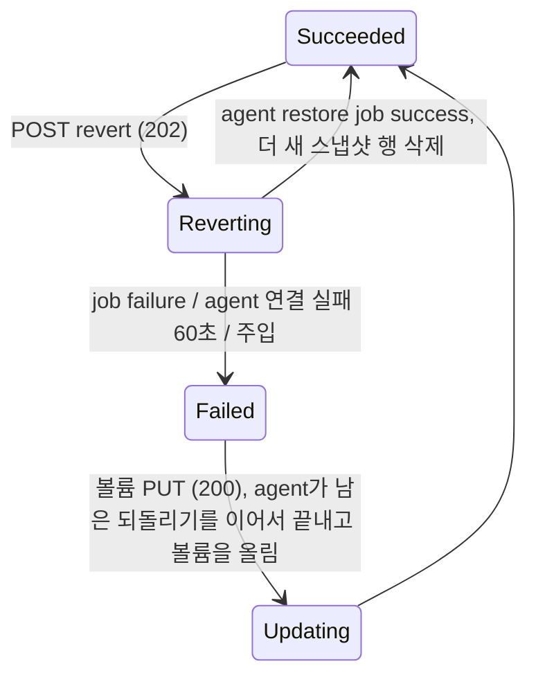

# snapshot-revert 설계 (FR-06 스냅샷으로 되돌리기)

- 작성: 2026-11-08, 메인 세션. 사용자 확인: 2026-11-08. 결정 1~4는 사용자가 선택지 중에서 추천안을 골랐다. 결정 5~16은 메인이 기본안으로 제시했고 사용자가 이견을 내지 않았다.
- 입력: `01_researcher_brief.md`(조사 상태 "한도 도달", 질문 5만 남음), [S5](../spikes/S5.md), [S4](../spikes/S4.md), [S1](../spikes/S1.md) #8, 스냅샷 설계 `_workspace/snapshot/02_main_design.md`, 볼륨 설계 `_workspace/volume/02_main_design.md`.

## 1. 관련 ID

- PRD: FR-06 (스냅샷으로 되돌리기), FR-04·FR-05 (볼륨·스냅샷: 위임 끄기와 agent 변경의 회귀), FR-01 (LRO 재사용), NFR-01, NFR-02, NFR-05, NFR-08
- ADR: AR-01~AR-07, D-06, D-09, D-11(되돌리기 = thin 스냅샷 merge), D-12(볼륨마다 knfsd 인스턴스), §2.3(되돌리기 행), §6.1, §6.4, §7.2, §7.4, R-03(LV 교체와 stale file handle), R-04, R-07, R-08
- 스파이크: [S5](../spikes/S5.md) (조건부 통과, 이번에 추가), [S1](../spikes/S1.md) #8 (끝내지 못한 되돌리기), [S4](../spikes/S4.md) (스냅샷 노출)

## 2. 범위

### 재현한다

- ARM 볼륨 액션 `POST .../volumes/{v}/revert`, 본문 `{"snapshotId": <스냅샷 ARM ID>}`. 공통 LRO 계층을 재사용한다.
- 데이터 효과: 볼륨 내용이 고른 스냅샷 시점과 같아진다. 고른 스냅샷보다 **더 새 스냅샷은 지워진다**(ARM 목록과 `.snapshot` 모두). 고른 스냅샷과 그보다 오래된 스냅샷은 남고 내용이 그대로다.
- 마운트한 클라이언트: 다시 마운트하지 않아도 되돌린 내용을 본다. 되돌리는 동안은 오류 없이 몇 초 멈춘다 (S5).
- storage agent의 ONTAP 부분집합: `PATCH /api/storage/volumes/{uuid}?restore_to.snapshot.uuid=…` (SnapRestore).
- 재시작 안전: 중간에 멈춘 되돌리기는 이어서 끝나고, 끝난 되돌리기는 다시 하지 않는다 (결정 4).
- NFSv4 위임 끄기 (결정 1). 볼륨 인스턴스 전체에 걸린다.

### 미룬다

| 미룬 것 | 이번 동작 | 여는 사이클 |
| --- | --- | --- |
| 크기 규칙 (ONTAP: 현재 크기와 스냅샷 시점 크기 중 큰 값) | `usageThreshold`를 바꾸지 않는다. 크기 변경이 없어 둘은 늘 같다 | FR-16 (볼륨 크기 변경) |
| 백업·복제 기준 스냅샷 제약 | 해당 기능이 없다 | 백업은 범위 밖, 복제는 FR-19 |
| `restoreFiles`(파일 단위 복원) | 라우트 없음 | 후보 |
| 스펙의 동기 `200` | 늘 `202` (녹화에 `200`이 없다) | 없음 |

## 3. 결정과 버린 대안

| # | 결정 | 버린 대안과 이유 |
| --- | --- | --- |
| 1 | **NFSv4 위임을 끈다.** (사용자 선택) 준비 스크립트가 `fs.leases-enable = 0`을 설정하고 `/etc/sysctl.d/90-anf-clone.conf`에 고정한다. agent는 시작할 때(`check_host`) 값이 0인지 확인하고, 아니면 준비 스크립트를 안내하며 뜨지 않는다. knfsd 위임은 VFS lease 위에서 돌아서 lease를 끄면 위임이 나가지 않는다 (S5 B2). ONTAP REST 기본값도 v4.1 읽기·쓰기 위임 꺼짐이다 (`nfs_service` 모델). knfsd에는 인스턴스(netns)별 설정이 없어서 WSL VM 커널 전역 설정이다. 볼륨·스냅샷 e2e로 회귀 검증한다. | knfsd 기본값(위임 켬): 코드 변경은 없지만, 되돌린 뒤 v4.1 클라이언트의 열린 fd가 16~32 s 동안 되돌리기 전 캐시를 읽었다(B2). 위임 없이 같은 동작을 얻을 방법이 없다(회수만 되고 recall이 안 된다). |
| 2 | **되돌리는 동안 볼륨 `provisioningState`는 `Reverting`이다.** (사용자 선택) 작업 상태와 같은 이름이다. ANF의 다른 작업이 작업 상태와 리소스 상태에 같은 이름을 쓴다(`Creating`, `Patching`, `Deleting`). 실패하면 볼륨은 `Failed`이고 같은 볼륨 PUT(`Updating`)이 agent에서 되돌리기를 이어서 끝내고 볼륨을 다시 올린다(결정 4). ANF 실제 값은 [미확인]이다(녹화에 revert 중 볼륨 GET이 없다). | `Succeeded` 유지: 실패해도 볼륨이 `Succeeded`로 남아, 데이터 플레인이 내려가 있어도 정상처럼 보인다. 충돌 검사가 작업 표에만 기댄다. |
| 3 | **데이터 플레인 = 네트워크 차단 + merge + 고른 스냅샷 다시 만들기.** (사용자 선택) 인스턴스는 그대로 두고 그 netns의 입력을 잠깐 막는다(`iptables -I INPUT -i eth0 -j DROP`). 그동안 knfsd 캐시와 상태를 풀고(`exportfs -f`, `unlock_filesystem`) 스냅샷·볼륨을 언마운트한 뒤 `lvconvert --merge`를 한다. merge가 고른 스냅샷 LV를 소비하므로 되돌린 볼륨에서 같은 태그(uuid, 이름, 만든 시각)로 다시 만든다. 다시 마운트하고 export를 적용한 뒤 차단을 푼다. 클라이언트는 hard 마운트 재전송으로 2~5 s 멈췄다 이어 간다 (S5 R: v3·v4.1 오류 0). 볼륨 LV의 이름·태그가 그대로라 agent의 볼륨 식별이 바뀌지 않는다 (L3). | export 제거: v3가 창 동안 `Permission denied`(S5 R). 인스턴스 재시작: v4.1이 23 s 멈추고, 위임 되찾기로 재시작 뒤에도 옛 내용을 65 s 넘게 보였다. LV 교체(스냅샷의 쓰기 가능 스냅샷으로 볼륨 LV를 바꿈): 다시 만들기는 없지만 `lvrename` 두 번에 3 s이고 볼륨 태그를 옮겨야 한다(L2). 마운트한 채 merge: "다음 활성화"로 미뤄지고 그사이 `vgchange -ay`가 merge를 끝내 버린다(L1a). |
| 4 | **재시작 안전: anf-api 작업 ID를 멱등 키로 넘긴다.** (사용자 선택) agent PATCH에 클론 확장 쿼리 `restore_to.request_uuid=<작업 ID>`를 붙인다. agent는 시작할 때 볼륨 LV에 진행 표시 태그(`anf_rv_req`, `anf_rv_snap`, `anf_rv_name`, `anf_rv_time`)를 붙이고, 끝나면 그것을 지우고 `anf_rv_done=<키>`를 남긴다. 같은 키가 다시 오면: 진행 표시가 있으면 이어서 끝내고, `anf_rv_done`이 그 키면 아무것도 하지 않고 성공이다. 다른 키가 왔는데 진행 표시가 남아 있으면 남은 것을 먼저 끝낸다. 진행 표시는 볼륨 POST(볼륨 PUT의 보장)와 agent 시작 복구도 이어서 끝낸다. 볼륨 생성의 uuid 멱등 키(볼륨 결정 9)와 같은 생각이다. | 단순 재실행: anf-api가 agent 완료와 기록 사이에 죽으면 같은 되돌리기를 한 번 더 해서, 첫 되돌리기 뒤에 쓴 데이터가 사라진다. |
| 5 | **ARM 계약은 실서비스 녹화를 따른다.** `202`, 본문 없음, `Azure-AsyncOperation`과 `Location`(`Retry-After` 없음). 작업 상태 `Reverting` → `Succeeded`/`Failed`, `action: POST`, `resourceName` = 볼륨 ID. 끝난 뒤 `Location` 방식 조회는 `200` + 볼륨 본문이다(공통 계층 그대로). 스펙과 다른 점: 스펙의 `202`는 `Location`과 `Retry-After`이고 최종 결과는 `void`다. 녹화를 따르고 차이를 기록한다(풀 설계 결정 1의 규칙). | 스펙대로 `Location`만, 최종 `200` 본문 없음: 실서비스와 다르다. |
| 6 | **본문·거절 규칙 (ANF 근거가 없어 클론 규칙).** 검사 순서: 경로 이름 → 본문 → (트랜잭션 안) 볼륨 존재 → 볼륨 진행 중 작업 → 볼륨 상태 → 스냅샷 존재 → 그 볼륨 스냅샷의 진행 중 작업 → 스냅샷 상태. 응답은 §4.2 표. 스펙상 `snapshotId`는 선택이지만 클론은 필수로 받는다(없으면 무엇으로 되돌릴지 정할 수 없다). | 스펙대로 선택: 빠졌을 때의 ANF 동작이 [미확인]이다. |
| 7 | **되돌리는 동안의 다른 요청.** 볼륨 PUT·PATCH·DELETE·revert: 기존 `409 RequestConflict`(녹화 V6). 새 스냅샷 PUT: 기존 `400 BadRequest`("Snapshot cannot be created on a volume that isn't in state succeeded.", ONTAP `1638532`의 자리). **기존 스냅샷의 다시 PUT·DELETE: 새로 `409 Conflict`** (그 볼륨이 `Reverting`일 때). | 스냅샷 다시 PUT·DELETE를 그대로 받음: agent job은 한 번에 하나라 겹치지는 않지만, 되돌리기가 지울 더 새 스냅샷을 동시에 지우거나 다시 만들게 된다. |
| 8 | **더 새 스냅샷은 agent가 dm-thin 장치 id로 고른다.** 그 볼륨의 스냅샷 중 `thin_id`가 고른 스냅샷보다 큰 것이다. id는 "남은 것 중 최댓값 + 1"이라 남은 스냅샷의 id 순서가 만든 순서다 (S5 L3). agent가 지우고(스냅샷 삭제와 같은 절차), anf-api는 job이 성공하면 **agent 목록에 없는 그 볼륨의 스냅샷 행을 지운다.** 그래서 ARM 목록에서 사라진다. 데이터가 없는 `Failed` 스냅샷 행(LV가 없는 것)도 함께 지워진다. 이것은 클론의 차이로 기록한다. | `anf_snap_time`(만든 시각) 순서: 초 단위라 같은 초에 만든 두 스냅샷을 가르지 못한다(스냅샷 생성은 0.3 s 남짓). anf-api가 `created`로 고름: 같은 문제이고, 데이터 플레인의 사실을 컨트롤 플레인이 추측하게 된다. |
| 9 | **고른 스냅샷의 정체성을 지킨다.** 다시 만든 LV는 같은 `anf_snap_uuid`·`anf_snap_name`·`anf_snap_time` 태그를 가진다. 그래서 ARM `snapshotId`·`created`가 그대로다. 다시 만들 정보는 merge 전에 볼륨 LV의 진행 표시 태그에 적어 둔다(결정 4). 블록은 이전처럼 되돌린 볼륨과 공유한다. | 고른 스냅샷을 잃음(merge 그대로): ANF에서는 고른 스냅샷이 남는다 [브리프 녹화 4, 5]. |
| 10 | **`.snapshot`을 남은 스냅샷에 맞춘다.** 되돌린 볼륨의 `.snapshot`은 고른 스냅샷을 찍던 때의 것이다(그때 있던 스냅샷 이름의 빈 마운트 지점, +i). agent가 남은 스냅샷에 없는 빈 디렉터리를 지우고, 남은 스냅샷의 마운트 지점을 만들고 마운트한다(`chattr -i`/`+i`, 스냅샷 결정 8). | 그대로 둠: 지워진 스냅샷 이름이 빈 디렉터리로 보이고, 고른 스냅샷 자신의 마운트 지점이 없다(S5 R: 비어 있었다). |
| 11 | **작업 입력을 작업 행에 저장한다.** `operations`에 `params` 열(JSON)을 더한다. 되돌리기는 `{"snapshotId": <스냅샷 행 ID>}`를 넣고 처리기가 읽는다. 기존 DB 파일은 시작 때 열이 없으면 `ALTER TABLE ... ADD COLUMN`으로 더한다. | `previous` 재사용: "UPDATE가 실패하면 되돌릴 값"이라는 뜻과 다르다. 볼륨 `properties`에 넣기: 볼륨 본문에 그대로 보인다(`volume_body`가 properties를 펼친다). |
| 12 | **agent API = ONTAP SnapRestore 모양.** `PATCH /api/storage/volumes/{uuid}?restore_to.snapshot.uuid=<스냅샷 uuid>&restore_to.request_uuid=<키>`, 본문 없음(또는 `{}`), `202` + job. ONTAP은 같은 경로에 쿼리 `restore_to.snapshot.uuid` 또는 `.name`이고 `202`다 [브리프 문서 10]. `restore_to.request_uuid`는 클론 확장이다(R-04). job 키는 `PATCH <볼륨 uuid>`. 없는 볼륨·스냅샷은 실패 job이다. | 새 경로(`POST .../revert`): ONTAP과 다르다. `restore_to.snapshot.name`도 받기: anf-api는 uuid만 쓴다. |
| 13 | **창의 차단은 호스트에서 인스턴스 netns로 들어가 한다.** `docker inspect -f {{.State.Pid}}` → `nsenter -t <pid> -n iptables …`. 넣기 전에 `iptables -C`로 있는지 보고, 풀 때는 있는 동안 `-D`한다(재시도에 안전). S5에서 이 방식으로 쟀다. | 인스턴스 이미지에 iptables를 넣고 `docker exec`: 이미 떠 있는 옛 이미지의 인스턴스에는 없다. 시험하지 않았다. |
| 14 | **클라이언트 영향은 S5 측정을 근거로 기록한다.** ANF·ONTAP 원문에 없다 [브리프]. 다시 마운트 불필요. 스냅샷에 있던 파일·디렉터리는 열린 fd·cwd까지 그대로 이어지고(파일 핸들 = `fsid` + inode 번호 + 세대, 셋 다 그대로) 스냅샷 시점 내용을 읽는다. 스냅샷 뒤에 만든 것을 잡은 fd·cwd는 `Stale file handle`, 경로로는 `No such file or directory`. | — |
| 15 | **결함 주입 키 `volumes/post`.** 처리기 키 `(volume, "POST")`에서 자동으로 생긴다. 볼륨의 POST 액션은 지금 revert 하나다. 두 번째 POST 액션(예: FR-19 복제)이 생기면 작업에 액션 이름을 남기는 방식으로 나눈다. | `volumes/revert` 키를 따로 만듦: 공통 계층에 특례가 생긴다. |
| 16 | **ANF와 다른 점 (개념 문서에 남긴다).** (1) 되돌리는 동안 클라이언트가 2~5 s 멈춘다(ANF는 [미확인], 녹화의 작업 시간은 약 2.6 s). (2) NFSv4 위임이 꺼져 있다. ANF의 위임 설정은 [미확인], ONTAP 기본값은 꺼짐. (3) 고른 스냅샷을 merge한 뒤 다시 만든다(같은 uuid·이름·시각). WAFL은 inode 표를 바꿀 뿐이다 [브리프 문서 7]. (4) 더 새 스냅샷을 dm-thin id로 고른다. (5) 데이터 없는 `Failed` 스냅샷 행도 되돌리기 뒤 지워진다. (6) 거절 코드·문구는 클론 규칙이다. (7) 크기 규칙을 아직 따르지 않는다. (8) 끝난 뒤 `Location` 조회가 볼륨 본문을 준다(녹화대로, 스펙은 `void`). | — |

### 아직 확정하지 않은 것

- 클라이언트가 `soft` 마운트(짧은 `timeo`)이면 2~5 s 멈춤에서 `EIO`를 볼 수 있다 [추론]. 검증은 기본 hard 마운트로 하고, soft는 시험하지 않는다.
- revert 중 클라이언트 쓰기: 창 동안 도착한 쓰기는 재전송되어 되돌린 볼륨에 들어간다 [추론]. 되돌리기 시작 전 쓰고 아직 서버에 가지 않은(dirty) 데이터도 마찬가지다. 이것은 "되돌린 뒤 내용 = 스냅샷 시점"의 예외가 아니라 되돌리기 뒤의 새 쓰기로 본다. 검증 AC-04에서 쓰기가 계속되는 경우를 하나 관찰해 기록한다.

## 4. API 계약

### 4.1 작업별 응답 (ARM)

경로: `/subscriptions/{s}/resourceGroups/{rg}/providers/Microsoft.NetApp/netAppAccounts/{a}/capacityPools/{p}/volumes/{v}/revert?api-version=2026-08-01`

| 작업 | 응답 | 본문 | 헤더 | 작업 상태 | 근거 |
| --- | --- | --- | --- | --- | --- |
| POST revert (받음) | `202` | 없음 | `Azure-AsyncOperation` + `Location` | `Reverting` → `Succeeded`/`Failed`, `action: POST` | 녹화 R3 (브리프 녹화 4, 5) |
| 되돌리는 동안 볼륨 GET | `200` | 볼륨, `provisioningState: Reverting` | — | — | 결정 2 [추론] |
| 끝난 뒤 `Location` 조회 | `200` | 볼륨 본문 (`Succeeded`) | — | — | 녹화 R3 #46 |
| 실패한 뒤 `Location` 조회 | 오류의 `httpStatus` | `{"error": …}` | — | — | 공통 계층 |
| 거절 | §4.2 | | | 작업 안 만듦 | 결정 6 |

- 성공하면: 볼륨 `Succeeded`. 더 새 스냅샷의 행이 지워진다(GET `404 ResourceNotFound`). 고른 스냅샷과 그보다 오래된 스냅샷의 `snapshotId`·`created`는 그대로다.
- 실패하면: 볼륨 `Failed`, 작업 `Failed`(`InternalServerError`, 공통 문구). 스냅샷 행은 그대로다. 같은 볼륨 PUT으로 다시 올린다(결정 2).

### 4.2 본문 규칙과 오류

| 조건 | 응답 | 문구 |
| --- | --- | --- |
| 본문이 JSON 객체가 아님 | `400 InvalidRequestContent` | "The request content must be a JSON object." |
| `snapshotId` 밖의 키 | `400 InvalidRequestContent` | 공통 `unknown_property` |
| `snapshotId` 없음·문자열 아님 | `400 InvalidRequestContent` | "The 'snapshotId' property is required and must be a snapshot resource ID." |
| `snapshotId`가 스냅샷 ARM ID 모양이 아님 | `400 InvalidRequestContent` | "The 'snapshotId' property must be a snapshot resource ID: /subscriptions/{id}/resourceGroups/{group}/providers/Microsoft.NetApp/netAppAccounts/{account}/capacityPools/{pool}/volumes/{volume}/snapshots/{snapshot}." |
| 다른 볼륨의 스냅샷 | `400 BadRequest` | "The snapshot '{snapshotId}' does not belong to the volume '{volume id}'." |
| 볼륨 없음 | `404 ResourceNotFound` | 공통 `not_found` |
| 볼륨에 진행 중 작업 | `409 RequestConflict` | 볼륨 공통(녹화 V6) |
| 볼륨이 `Succeeded`가 아님 (`Failed`) | `400 BadRequest` | "Volume cannot be reverted when it isn't in state succeeded." |
| 스냅샷 없음 | `404 ResourceNotFound` | 스냅샷 GET과 같은 문구(녹화 R1) |
| 그 볼륨의 스냅샷에 진행 중 작업 | `409 Conflict` | "Cannot revert volume '{volume id}' because an operation is in progress on its snapshot '{snapshot id}'. Wait until it is finished, and then retry." |
| 고른 스냅샷이 `Succeeded`가 아님 (`Failed`) | `400 BadRequest` | "Volume cannot be reverted to snapshot '{snapshot id}' because the snapshot isn't in state succeeded." |
| (되돌리는 동안) 기존 스냅샷 다시 PUT·DELETE | `409 Conflict` | "Cannot change snapshot '{snapshot id}' because its parent volume '{volume id}' is being reverted." |

## 5. 상태 전이

- 스냅샷: 더 새 스냅샷 행은 작업이 성공하는 트랜잭션에서 지워진다(`Deleting`을 거치지 않는다). 고른 스냅샷·오래된 스냅샷의 상태는 바뀌지 않는다.

## 6. storage agent

### 6.1 API (ONTAP REST 부분집합)

| 메서드·경로 | 요청 | 응답 | ONTAP과 다른 점 (R-04) |
| --- | --- | --- | --- |
| `PATCH /api/storage/volumes/{uuid}` | 쿼리 `restore_to.snapshot.uuid`(필수), `restore_to.request_uuid`(필수). 본문 없음 또는 `{}` | `202 {"job": …}`. 없는 볼륨·스냅샷은 실패 job | `restore_to.request_uuid`는 클론 확장(결정 4). `restore_to.snapshot.name`은 받지 않는다. 볼륨 속성 PATCH(크기 등)는 아직 없다: 다른 쿼리나 본문은 `400` |

- 입력 다시 검사(R-07): 세 uuid는 소문자 UUID, 모르는 쿼리·본문은 `400`.

### 6.2 데이터 플레인 (`FlexVolManager.restore`)

진행 표시(볼륨 LV 태그): `anf_rv_req=<키>`, `anf_rv_snap=<스냅샷 uuid>`, `anf_rv_name=<이름>`, `anf_rv_time=<만든 시각>`. 끝난 표시: `anf_rv_done=<키>`.

1. 볼륨 확인. 진행 표시가 있으면 그것부터 이어서 끝낸다(아래 3~9). 그 키가 이번 키면 끝.
2. `anf_rv_done`이 이번 키면 아무것도 하지 않는다. 고른 스냅샷이 없으면 실패. 진행 표시 태그를 붙인다(`lvchange --addtag`, 한 명령).
3. **더 새 스냅샷 삭제** (고른 스냅샷 LV가 있을 때만): `thin_id`가 고른 스냅샷보다 큰 그 볼륨의 스냅샷마다 스냅샷 삭제 절차(스냅샷 결정 13). merge 전에 끝내므로, 고른 스냅샷이 없으면(이미 merge됨) 지울 것도 없다.
4. **창 열기** (인스턴스가 돌 때): netns 입력 DROP(없을 때만) → 인스턴스 안 `exportfs -f` → `unlock_filesystem`(남은 스냅샷마다, 볼륨).
5. 스냅샷 마운트 → 볼륨 마운트 순서로 `umount`(재시도, 마운트된 것만).
6. **merge** (고른 스냅샷 LV가 있을 때): `lvconvert --merge`. 끝난 뒤 그 LV가 남아 있으면(미뤄진 merge) 실패한다.
7. **고른 스냅샷 다시 만들기** (그 uuid의 LV가 없을 때): 진행 표시의 uuid·이름·시각으로 `lvcreate -s -kn -p r … --addtag …`(스냅샷 결정 5와 같은 인자).
8. 볼륨 마운트 → `.snapshot` 맞추기(결정 10) → 남은 스냅샷 마운트 → export 파일 쓰기 + `exportfs -ra`(돌 때).
9. **창 닫기**: DROP 규칙이 있는 동안 삭제. 진행 표시를 지우고 `anf_rv_done=<키>`(이전 값은 지움)를 남긴다. 인스턴스가 돌지 않으면 시작하고 준비를 기다린다.

- 볼륨 POST(보장)와 시작 복구는 진행 표시가 있으면 3~9를 먼저 한다(결정 4). 시작 복구 때는 인스턴스가 멈춰 있으므로 4와 9의 차단은 건너뛴다.
- 볼륨 삭제는 진행 표시와 무관하게 지금 순서다(인스턴스를 지우면 netns와 DROP 규칙도 사라진다).

### 6.3 호스트 준비

- `scripts/setup-wsl-dataplane.sh`: `sysctl -w fs.leases-enable=0`, `/etc/sysctl.d/90-anf-clone.conf`에 `fs.leases-enable = 0`.
- `NfsInstances.check_host`: `sysctl -n fs.leases-enable`이 `0`이 아니면 `StartupError`("NFSv4 delegations must be off …", 준비 스크립트 안내).

## 7. 내부 구조

| 모듈 | 내용 | 짝 테스트 |
| --- | --- | --- |
| `anf_api/state_store.py` | `Operation.params`, `create_operation(..., params=)`, 기존 DB에 열 더하기 | `test_state_store.py` |
| `anf_api/volumes.py` | `parse_revert_body`, `revert_volume`(검사, `Reverting` + `POST` 작업), revert 처리기(agent 호출 → 사라진 스냅샷 행 삭제) | `test_volumes.py` |
| `anf_api/snapshots.py` | 볼륨이 `Reverting`이면 기존 스냅샷 다시 PUT·DELETE `409 Conflict` | `test_snapshots.py` |
| `anf_api/storage_client.py` | `revert_volume`(PATCH + job → 남은 스냅샷 uuid 목록) | `test_storage_client.py` |
| `anf_api/arm_app.py` | `POST {volume}/revert` 라우트(`202` + 두 헤더) | `test_arm_app.py`, 계약 `tests/contract/test_snapshot_revert_api.py` |
| `storage_agent/flexvol.py` | `restore`, 진행 표시 이어서 끝내기(볼륨 POST·시작 복구), `thin_id` 순서, `.snapshot` 맞추기 | `test_flexvol.py`, 통합 `test_flexvol_linux.py` |
| `storage_agent/nfs_instance.py` | 창 열기·닫기(`block`, `unblock`: nsenter + iptables, `exportfs -f`), `check_host`의 위임 검사 | `test_nfs_instance.py` |
| `storage_agent/agent_app.py` | `PATCH /api/storage/volumes/{uuid}` 입력 검사, job | `test_agent_app.py` |
| `scripts/setup-wsl-dataplane.sh` | `fs.leases-enable = 0` | 통합·e2e |

## 8. 검증 기준

**공통 조건**
- WSL Ubuntu. 준비 스크립트를 다시 실행한 상태(`fs.leases-enable = 0`). agent root(127.0.0.1:8090), anf-api 일반 권한(127.0.0.1:8080, `ANF_MIN_VOLUME_SIZE_GIB=1`).
- WSL 배포판이 유휴 종료되지 않게 검증 동안 `wsl` 세션 하나를 띄워 둔다 (S4 환경 주의).
- 마운트 IP는 볼륨 GET의 `mountTargets[0].ipAddress`. 클라이언트는 `anf-nfs-client`의 privileged 컨테이너, 기본 hard 마운트(v3는 `nolock`).
- 폴링 1초, 제한 시간 60초(지연 주입은 지연 + 60초).
- 데이터 비교: 서버에서 볼륨 트리와 스냅샷 트리의 파일별 sha256 목록(`.snapshot` 제외)을 만든다. 명령의 성공·실패는 종료 코드와 stderr 전체로 판정한다.

| ID | 층 | 기준 |
| --- | --- | --- |
| AC-01 | 계약·상태 (성공) | `Succeeded` 볼륨에 스냅샷 ARM ID로 POST revert → `202`, 본문 없음, 헤더 `Azure-AsyncOperation`과 `Location`(`Retry-After` 없음). `Azure-AsyncOperation`을 폴링하면 `Reverting`(`action: POST`, `resourceName` = 볼륨 ID)을 거쳐 `Succeeded`. 지연을 주입하면 그동안 볼륨 GET이 `Reverting`이다. 끝난 뒤 `Location` 조회는 `200` + 볼륨 본문(`Succeeded`), 볼륨 GET도 `Succeeded`. |
| AC-02 | 데이터 (NFSv3) | v3 볼륨에서 파일·디렉터리를 쓴다 → S1 → 바꾼다 → S2 → 파일을 지우고, 덮어쓰고, 새 파일·디렉터리를 만든다 → S3 → 또 바꾼다. S2로 되돌린다: 볼륨 트리 체크섬이 되돌리기 전 S2 트리 체크섬과 같다(지운 파일이 돌아오고, 덮어쓴 파일은 S2 내용이고, S2 뒤에 만든 것은 없다). S1·S2는 ARM 목록과 `.snapshot`에 남고 트리 체크섬이 되돌리기 전과 같으며 `snapshotId`·`created`가 그대로다. S3는 ARM GET `404`, 목록에 없고, `.snapshot/S3`는 `No such file or directory`, 호스트에 S3의 LV·마운트·export 줄이 없다. 볼륨 루트 `.snapshot`에는 `S1`·`S2`만 있다. 되돌린 볼륨에 새로 쓰고 새 스냅샷을 만들 수 있다. |
| AC-03 | 데이터 (NFSv4.1) | AC-02를 NFSv4.1 볼륨에서 같은 방식으로 확인한다. |
| AC-04 | 데이터 (마운트한 클라이언트, FR-06의 기록) | v3·v4.1 각각, 되돌리기 전에 마운트한 클라이언트가 마운트를 유지한다. 되돌리는 동안 0.2 s마다 하는 기존 파일 읽기가 한 번도 실패하지 않는다(가장 긴 멈춤을 기록). 되돌린 뒤 1 s 안에, 다시 마운트 없이: `ls`가 S2 시점 목록이고, 기존 파일 읽기가 S2 내용이다. 되돌리기 전에 연 fd(S2에 있던 파일)가 S2 내용을 읽는다. S2 뒤에 만든 파일의 fd와 S2 뒤에 만든 디렉터리의 cwd는 `Stale file handle`이고, 그 경로는 `No such file or directory`다. S2에 있던 디렉터리의 cwd는 그대로 쓸 수 있다. 쓰기가 된다. 되돌리는 동안 쓰기를 계속하는 클라이언트 하나의 결과(성공 여부, 되돌린 뒤 그 파일 내용)를 기록한다. |
| AC-05 | 계약 (거절) | 다음은 모두 거절이고 작업이 생기지 않으며 볼륨 트리 체크섬과 스냅샷 목록이 그대로다: 본문이 배열, 모르는 키, `snapshotId` 없음, 숫자, 스냅샷 ID가 아닌 문자열 → `400 InvalidRequestContent`. 다른 볼륨의 스냅샷 → `400 BadRequest`. 같은 볼륨 아래 없는 스냅샷 → `404 ResourceNotFound`(녹화 문구). 없는 볼륨 → `404`. 볼륨 PATCH에 실패를 주입해 `Failed`가 된 볼륨 → `400 BadRequest`. 스냅샷 생성에 실패를 주입해 `Failed`가 된 스냅샷으로 → `400 BadRequest`. |
| AC-06 | 계약 (진행 중 충돌) | revert에 지연을 주입하고 `Reverting`인 동안: 다시 revert, 볼륨 PUT·PATCH·DELETE → `409 RequestConflict`. 새 스냅샷 PUT → `400 BadRequest`. 기존 스냅샷 다시 PUT·DELETE → `409 Conflict`. 새 작업이 없고, 진행 중이던 revert는 `Succeeded`로 끝나며 결과가 AC-02와 같다. 스냅샷 생성에 지연을 주입하고 그동안 revert → `409 Conflict`. |
| AC-07 | 상태 (실패와 회복) | revert에 실패를 주입하면 작업 `Failed`(`error` 있음), 볼륨 `Failed`, 데이터와 스냅샷이 그대로다. 주입을 끈 서버에서 같은 볼륨 PUT → `Succeeded`, 그 뒤 revert가 된다. agent를 멈춘 채 revert하면 60초 재시도 뒤 `Failed`. agent를 띄우고 볼륨 PUT → `Succeeded` → revert가 된다. |
| AC-08 | 상태 (재시작 안전, 결정 4) | (a) revert 지연 중 anf-api를 SIGKILL하고 다시 띄우면 작업이 `Succeeded`로 끝나고 결과가 AC-02와 같다. (b) 같은 `restore_to.request_uuid`로 agent PATCH를 다시 보내면 성공 job이고 아무것도 바뀌지 않는다: 첫 되돌리기 뒤 클라이언트가 쓴 파일이 남아 있다. (c) 중간 상태 복구(통합 테스트): 진행 표시를 붙이고 merge까지 한 볼륨(고른 스냅샷 LV 없음)에 같은 키로 PATCH하거나, agent를 다시 시작하면 되돌리기가 끝나고 고른 스냅샷이 같은 uuid·이름·시각으로 `.snapshot`에 보인다. 볼륨 POST(보장)도 같은 상태를 끝낸다. |
| AC-09 | agent API | `PATCH .../volumes/{uuid}?restore_to.snapshot.uuid=…&restore_to.request_uuid=…` → `202` + job `success`. 없는 볼륨 → job `failure`, 없는 스냅샷 → job `failure`(메시지에 스냅샷 uuid). 잘못된 uuid, `restore_to.request_uuid` 없음, 모르는 쿼리, 본문 필드(`{"size": 1}`) → `400`. |
| AC-10 | 호스트 (위임 꺼짐, 결정 1) | 준비 스크립트 뒤 `sysctl -n fs.leases-enable` = 0이고 `/etc/sysctl.d/90-anf-clone.conf`가 있다. v4.1 클라이언트가 파일을 쓰고 열어 둔 동안 인스턴스의 `/proc/fs/nfsd/clients/*/states`에 `deleg`가 없다. 값을 1로 바꾸고 agent를 띄우면 고칠 방법을 담은 메시지와 함께 뜨지 않는다(검증 뒤 0으로 되돌림). |
| AC-11 | 회귀 | 계정·풀·볼륨·스냅샷 e2e(`test_netapp_account_*_live.py`, `test_capacity_pool_*_live.py`, `test_volume_{contract,data,recovery}_live.py`, `test_snapshot_{contract,data,recovery}_live.py`)와 통합 테스트가 새 코드와 위임 꺼짐에서 통과한다. |

## 9. 구현 중 변경

3단계(구현)에서 설계와 달라졌거나 설계가 정하지 않은 것을 정한 기록이다.
