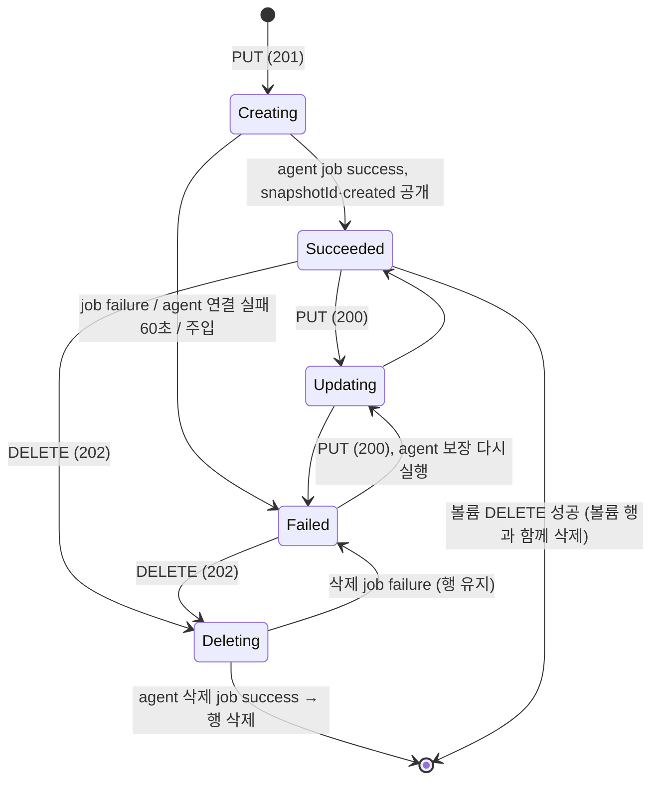

# snapshot 설계 (FR-05 스냅샷)

- 작성: 2026-11-08, 메인 세션. 사용자 확인: 2026-11-08. 결정 1~4는 사용자가 선택지 중에서 추천안을 골랐다. 결정 5~16은 메인이 기본으로 제시했고 사용자가 이견을 내지 않았다.
- 입력: `01_researcher_brief.md`(조사 상태 "완료 (보완 1~3), 보완 4 부분"), [S4](../spikes/S4.md), [S1](../spikes/S1.md), 볼륨 설계 `_workspace/volume/02_main_design.md`.

## 1. 관련 ID

- PRD: FR-05 (스냅샷), FR-04 (볼륨: 결함 수정과 회귀), FR-01 (LRO 재사용), NFR-01, NFR-02, NFR-05, NFR-08
- ADR: AR-01~AR-07, AR-10, D-06, D-11(스냅샷 = thin 스냅샷), D-12(볼륨마다 knfsd 인스턴스), §2.3(스냅샷 행), §6.1, §6.4, §7.2, §7.4, R-03, R-04, R-08
- 스파이크: [S1](../spikes/S1.md)(C 통과), [S4](../spikes/S4.md)(조건부 통과, 이번에 추가)

## 2. 범위

### 재현한다

- ARM 스냅샷 리소스: PUT 생성·재전송, GET, 볼륨 아래 목록, DELETE. 공통 LRO 계층을 재사용한다.
- 볼륨 DELETE가 그 볼륨의 스냅샷을 함께 지운다 (결정 2).
- storage agent의 ONTAP 부분집합: `POST`·`GET /api/storage/volumes/{volume.uuid}/snapshots`, `GET`·`DELETE .../snapshots/{uuid}`.
- 데이터 효과: NFSv3·NFSv4.1 클라이언트가 `<ip>:/<creationToken>/.snapshot/<이름>/`에서 스냅샷 시점의 파일을 읽는다. 스냅샷 안과 `.snapshot` 자체는 바꿀 수 없다. 스냅샷을 지우면 `.snapshot/<이름>`이 사라진다. agent가 재시작해도 스냅샷이 다시 보인다.
- **볼륨 결함 수정 (결정 1).** NFSv4.1 클라이언트 기록이 남은 인스턴스의 재시작 (S4 G).

### 미룬다

| 미룬 것 | 이번 동작 | 여는 사이클 |
| --- | --- | --- |
| 스냅샷 PATCH (`SnapshotPatch`는 빈 모델) | 라우트 없음 (`405`) | 없음. PRD FR-05 범위(생성, 조회, 목록, 삭제) 밖 |
| `restoreFiles` | 라우트 없음 | 후보 (브리프 후속 조사) |
| 볼륨 `snapshotDirectoryVisible: false` (결정 4) | 지금처럼 `400` | 후보. ANF 문서끼리 의미가 다르다 |
| 볼륨 `snapshotId`(스냅샷에서 새 볼륨) | 지금처럼 `400` | FR-07 |
| 되돌리기 (`revert` POST) | 라우트 없음 | FR-06 |
| 스냅샷 공간을 볼륨 할당량에 넣기 | 넣지 않는다 (씬 풀에서 나간다) | 없음. 차이로 기록 (§3 결정 16) |

## 3. 결정과 버린 대안

| # | 결정 | 버린 대안과 이유 |
| --- | --- | --- |
| 1 | **볼륨 결함(S4 G)을 이번 사이클에 고친다.** (사용자 선택) 진입점이 `rpc.nfsd` 뒤 유예 기간(`v4_end_grace = N`)을 볼 때, nfsdcld DB의 `grace.recovery` 시대 기록 표에 클라이언트가 있으면 **정상 유예 기간**으로 보고 끝날 때까지 기다린다. 없을 때만 지금처럼 knfsd를 다시 띄운다(추적 초기화 실패). lease·grace를 ONTAP 기본값 30 s / 45 s로 둔다(knfsd 기본 90 s / 90 s). 진입점의 유예 대기 상한은 100 s, agent의 준비 대기는 60 s → 150 s. 이미지에 `sqlite`를 더한다. 볼륨 `done`을 풀고 볼륨 e2e로 회귀 검증한다 (무효화 규칙). | 별도 버그 수정 사이클: 같은 진입점과 `nfs_instance.py`를 스냅샷 export 때문에 어차피 바꾸므로 회귀 검증을 두 번 하게 된다. 알려진 결함으로 기록만: WSL 재시작 뒤 v4.1 볼륨이 복구되지 않고, FR-06 되돌리기(인스턴스 재시작 가능성)도 같은 경로를 쓴다. lease·grace 기본값 유지: 죽은 클라이언트 기록이 있으면 복구가 100 s 걸린다(S4 G3). |
| 2 | **스냅샷이 남은 볼륨의 DELETE는 스냅샷도 함께 지운다.** (사용자 선택) ANF 문서: "online snapshots, which are part of the volume and are deleted with the volume deletion" [브리프 문서 6]. agent의 볼륨 삭제가 스냅샷 마운트·LV를 먼저 치운다. anf-api는 작업이 끝날 때 볼륨 행과 스냅샷 행을 한 트랜잭션에서 지운다. 스냅샷에 진행 중 작업이 있으면 볼륨 DELETE는 `409 Conflict`다. 실서비스 응답 코드와 스냅샷이 `Deleting`을 거치는지는 [미확인]. | `409 CannotDeleteResource`(계정·풀 방식): 구현은 단순하지만 ANF 문서와 다르다. |
| 3 | **같은 이름으로 다시 PUT하면 `200` + `Updating`, 비동기 `UPDATE` 작업이다.** (사용자 선택) 볼륨 PUT 갱신(녹화 V5)과 같은 모양이다. 바꿀 속성이 없으므로 처리기는 데이터 플레인 보장(agent POST, 멱등)만 다시 한다. 그래서 `Failed` 스냅샷도 다시 PUT하면 복구된다. 근거가 없는 선택이다: 스펙 응답 목록에 200이 없고 [브리프 스펙 1], ARM 실동작은 [미확인]. | `200` 동기(작업 없음): `Failed` 스냅샷을 고칠 길이 지우고 다시 만드는 것뿐이다. `409`(ONTAP `525059`처럼): ARM PUT의 멱등성과 어긋난다. |
| 4 | **볼륨 `snapshotDirectoryVisible` 입력은 계속 미룬다.** (사용자 선택) 기본값 `true`만 받고 `false`는 지금처럼 `400`이다. ANF 문서 둘이 "NFSv3 목록에서만 숨김"(ONTAP `-v3-hide-snapshot`)과 "접근도 차단"(ONTAP `-snapdir-access false`)으로 다르게 쓴다 [브리프]. | 이번에 엶(접근 차단): FR-05 수락 기준에 필요 없고, agent에 볼륨 변경 작업이 늘어난다. |
| 5 | **스냅샷 = 읽기 전용 thin 스냅샷 LV** (D-11). `lvcreate -s -kn -p r -n snap_<uuid 32자리> anf/vol_<볼륨 uuid 32자리>`. 메타데이터는 LVM 태그에 둔다: `anf_snap_uuid`, `anf_snap_name`, `anf_snap_vol`(볼륨 uuid), `anf_snap_time`(만든 시각, UTC ISO 8601). `-kn`은 activation skip을 꺼서 `vgchange -ay`(시작 복구)가 함께 활성화하게 한다. `-p r`은 블록 장치까지 읽기 전용으로 만든다. | 스냅샷 메타데이터를 agent DB에: agent에는 DB가 없다(볼륨 결정 8). `lv_time`을 생성 시각으로: 형식이 로캘·설정에 따라 다르다. 쓰기 가능 스냅샷: 불변성이 마운트 옵션에만 기댄다. |
| 6 | **노출: `ns/<token>/.snapshot/<이름>`에 `mount -t ext4 -o ro,noload`, 인스턴스 안에서 스냅샷마다 자기 export 줄** (S4 E2). 옵션 `ro,sync,no_subtree_check,no_root_squash,secure,mp,fsid=<스냅샷 uuid>`. 볼륨 줄의 `crossmnt`는 그대로다(클라이언트가 하위 마운트로 넘어간다). | 부모 `crossmnt`만: thin 스냅샷의 ext4 UUID가 원본과 같아 v3·v4.1 모두 `Stale file handle` (S4 E1). 스냅샷 ext4 UUID를 `tune2fs -U`로 바꾸기: `metadata_csum`이면 모든 메타데이터 체크섬을 다시 써서 즉시 스냅샷이 아니게 된다 [추론, 시험 안 함]. |
| 7 | **export 표는 볼륨마다 파일 하나다.** agent가 LVM 상태(볼륨 + 그 스냅샷)에서 `<루트>/exports/<볼륨 uuid 32자리>/volume.exports`를 다시 쓰고(임시 파일 + rename), 인스턴스가 돌고 있으면 `docker exec <인스턴스> exportfs -ra`를 실행한다. 인스턴스는 이 디렉터리를 `/etc/exports.d`로 읽기 전용 바인드하고, 진입점은 `exportfs -ra`로 적용한다. 진입점은 볼륨 줄을 더 이상 환경 변수(`ANF_FSID`)로 만들지 않는다. (S4 F1) | 스냅샷마다 `docker exec exportfs -o`, 시작 뒤 agent가 다시 export: 인스턴스가 재시작하면 진입점의 종료 처리(`exportfs -ua`)로 스냅샷 export가 사라지고, 다시 export할 때까지 클라이언트가 ELOOP를 본다 (S4 E5). 회수 중인 v4.1 클라이언트가 스냅샷 파일을 열고 있었다면 그 회수도 실패한다 [추론]. |
| 8 | **`.snapshot`은 볼륨 루트에 항상 있고 `chattr +i`다.** 볼륨 생성의 루트 초기화 단계와 시작 복구에서 "있으면 두고, 없으면 만들고, `+i`"를 한다. 마운트 지점을 넣고 뺄 때만 agent가 `chattr -i` → `mkdir`/`rmdir` → `chattr +i`를 한다. ONTAP의 `.snapshot`은 스냅샷이 없어도 있다(가상 디렉터리). | 평범한 디렉터리: root 클라이언트가 `.snapshot` 안에 파일을 만들고 `.snapshot`을 통째로 `mv`했다 (S4 E3). 읽기 전용 tmpfs를 `.snapshot`에 마운트: export와 파일시스템 경계가 하나씩 더 늘어난다. 스냅샷 안에서 이전 스냅샷 이름이 빈 디렉터리로 보이는 것(결정 16)만 막는다. |
| 9 | **`snapshotId`는 anf-api가 만든 UUID다.** PUT 때 만들어 저장하고, agent `POST`에 `uuid`로 넘긴다(멱등 키, 볼륨 결정 9와 같음). 같은 uuid·이름이 이미 있으면 성공 job, 같은 이름에 다른 uuid면 실패 job(ONTAP `525059` 문구). 워커는 job ID를 저장하지 않는다. 201 본문에는 `snapshotId`·`created`가 없고, 생성 작업이 성공한 뒤 GET에 나온다(녹화 R1). `created`는 agent 레코드의 `create_time`을 UTC로 바꾼 값이다. | agent(ONTAP)가 uuid를 정하고 anf-api가 job 뒤 `GET ?name=`으로 읽음: ONTAP POST와 같지만, 재시도 때 "이름 중복"이 내 요청인지 남의 것인지 구분해야 한다. 볼륨과 같은 방식이 단순하다. 녹화의 `snapshotId`는 v4 모양이 아니어서 ANF는 백엔드 uuid를 쓰는 것으로 보인다 [추론]. 클론 값은 v4이고 스펙 설명("UUID v4")과는 맞는다. |
| 10 | **이름 규칙 `^[a-zA-Z0-9][a-zA-Z0-9\-_.]{0,254}$`.** 위반은 `400 InvalidResourceName`. ARM 스펙에는 패턴이 없다 [브리프 스펙 1]. 이름이 `.snapshot/<이름>` 디렉터리와 export 경로가 되므로 `/`, 공백, `.`·`..`(첫 글자가 영숫자)를 막는다. 길이 255는 ext4 파일 이름 한도다. ONTAP의 금지 접두어 규칙은 [미확인]이라 넣지 않는다. agent도 같은 패턴으로 다시 검사한다 (R-07). | 볼륨 이름 규칙 재사용(`^[a-zA-Z][a-zA-Z0-9\-_]{0,63}$`): 정책 스냅샷 이름(`daily.2020-05-14_0013`, FR-17)의 `.`을 막는다. 검사 없음: 데이터 플레인 경로 주입. |
| 11 | **ANF 코드가 확인되지 않은 규칙은 클론 규칙으로 정한다.** 볼륨 없음 `404 ParentResourceNotFound`(게이트웨이 문구, 볼륨 녹화 N6과 같은 모양), 볼륨 `Deleting` `409 Conflict`, 볼륨이 `Succeeded`가 아님 `400 BadRequest`, 255개 초과 `400 BadRequest`(ONTAP `525062` 문구를 빌림). 진행 중인 스냅샷에 PUT·DELETE는 공통 계층의 `409 AnotherOperationInProgress`다. 검사 순서: 이름 → 본문 → (트랜잭션 안) 부모 존재·상태 → 진행 중 작업 → 개수. | 볼륨의 `409 RequestConflict`(녹화 V6) 재사용: 녹화는 볼륨 사례뿐이고, 스냅샷 녹화에는 409가 없다. 공통 계층 그대로가 코드가 적다. |
| 12 | **본문 규칙.** 최상위 `location`(필수, 문자열), `properties`(선택, 객체). 읽기 전용 키(`id`, `name`, `type`, `systemData`, `properties.provisioningState`·`snapshotId`·`created`)는 무시하고, 그 밖의 키(`tags` 포함)는 `400 InvalidRequestContent`다. 스냅샷 모델에는 `tags`가 없다 [스펙 1]. 기존 스냅샷에 다른 `location`이면 `409 InvalidResourceLocation`(공통). | `tags`를 받아 저장: 모델에 없는 속성이다. |
| 13 | **삭제 순서 (agent).** export 줄 제거(파일 다시 쓰기 + `exportfs -ra`) → 인스턴스 안 `unlock_filesystem /export/<token>/.snapshot/<이름>` → 호스트 `umount` 재시도(0.5 s 간격 60 s, 볼륨과 같은 루프) → `chattr -i; rmdir; chattr +i` → `lvremove`. 없는 것은 건너뛴다. 없는 uuid의 DELETE는 성공 job이다(볼륨과 같은 클론 차이, ONTAP은 `1638600`). 볼륨 삭제는 인스턴스 제거 → 스냅샷마다 umount·`lvremove` → 볼륨 umount → 마운트 지점 → export 디렉터리 → 볼륨 LV 순서다. | 스냅샷 LV를 볼륨 LV 뒤에 지움: 스냅샷 마운트가 볼륨 아래에 있어서 볼륨 umount가 먼저 실패한다. |
| 14 | **시작 복구 순서**: aggregate → `ns` 공유 → (볼륨마다) 볼륨 마운트 → `.snapshot` 보장 → 스냅샷 마운트 → export 파일 쓰기 → 인스턴스 시작. 인스턴스는 **모두 띄운 뒤 준비를 기다린다.** 죽은 v4.1 클라이언트 기록이 있으면 인스턴스마다 유예 기간(약 45~60 s)을 기다리는데, 하나씩 기다리면 볼륨 수만큼 늘어난다. | 볼륨마다 시작하고 기다림(지금 방식): 볼륨 N개면 최대 N × 60 s. |
| 15 | **agent의 job은 지금처럼 한 번에 하나씩 돈다.** 스냅샷 job 키는 `snapshot-create`/`snapshot-delete` + 스냅샷 uuid다. LVM 변경, 마운트, export 파일 쓰기가 볼륨 job과 겹치지 않는다. | 볼륨마다 병렬: export 파일 쓰기와 볼륨 삭제가 경합한다. |
| 16 | **ANF와 다른 점 (개념 문서에 남긴다).** (1) NFSv4.1에서도 `.snapshot`이 목록에 보인다. ANF는 v4.1 목록에서 숨기고 이름으로만 들어가게 한다. (2) `.snapshot`은 볼륨 루트에만 있다. ONTAP은 모든 디렉터리에서 접근된다. (3) 스냅샷 안의 `.snapshot`은 빈 디렉터리이거나, 그 시점에 있던 스냅샷 이름의 빈 디렉터리를 보인다. (4) 스냅샷 공간은 씬 풀에서 나가고 볼륨 할당량·`df`에 잡히지 않는다. ANF는 할당량에 넣는다 [브리프 문서 4]. 그래서 스냅샷이 커져도 볼륨이 가득 차지 않고, 대신 씬 풀(aggregate)이 찰 수 있다 (R-09). (5) 쓰기 거절 errno: v3는 쓰기용 열기가 `EACCES`, 나머지는 `EROFS`다. ANF의 errno는 [미확인]. (6) `snapshotId`는 v4 UUID다. | — |

### 아직 확정하지 않은 것

- lease 30 s / grace 45 s에서 죽은 클라이언트 기록이 있을 때의 실제 대기 시간. 구현 중에 잰다 [추론: 약 45~60 s].
- 스트리밍 쓰기 도중 스냅샷의 일관성: S4 E4는 겹친 구간이 짧았다. thin 스냅샷 생성은 원본 장치를 일시 정지하며 파일시스템을 얼린다(freeze) [추론, LVM 동작]. 검증에서 쓰기 도중 스냅샷을 만들고 `e2fsck -fn`이 깨끗한지 본다 (AC-05).

## 4. API 계약

### 4.1 작업별 응답 (ARM)

경로: `/subscriptions/{s}/resourceGroups/{rg}/providers/Microsoft.NetApp/netAppAccounts/{a}/capacityPools/{p}/volumes/{v}/snapshots/{snap}?api-version=2026-08-01`

| 작업 | 응답 | 본문 | 헤더 | 작업 상태 | 근거 |
| --- | --- | --- | --- | --- | --- |
| PUT 생성 | `201` | 스냅샷, `Creating`, `snapshotId`·`created` 없음 | `Azure-AsyncOperation` + `Location` | `Creating` → `Succeeded`/`Failed`, `action: CREATE` | 녹화 R1, R2 |
| PUT 기존 이름 | `200` | 스냅샷, `Updating` | `Azure-AsyncOperation` | `Updating` → …, `action: UPDATE` | 결정 3 (볼륨 녹화 V5 모양) |
| DELETE 있음 | `202` | 없음 | `Azure-AsyncOperation` + `Location` | `Deleting` → …, `action: DELETE` | 녹화 R1 |
| DELETE 없음 | `204` | 없음 | 없음 | 작업 없음 | 스펙 |
| GET | `200` | 스냅샷 | — | — | 녹화 R1 |
| GET 없음 | `404 ResourceNotFound` | ANF 문구 (§4.3) | — | — | 녹화 R1 |
| 목록 (볼륨 아래) | `200` | `{"value": [...]}`, 이름순 | — | — | 녹화 R1, R2 |
| 목록, 볼륨 없음 | `404` | 공통 `not_found` | — | — | 볼륨 목록과 같음 |
| 진행 중인 스냅샷에 PUT·DELETE | `409 AnotherOperationInProgress` | 공통 | — | 작업 안 만듦 | 결정 11 |
| 볼륨 없음 (PUT) | `404 ParentResourceNotFound` | 게이트웨이 문구 | — | | 결정 11 |
| 볼륨 `Deleting` (PUT·DELETE) | `409 Conflict` | | | | 결정 11 |
| 볼륨이 `Succeeded` 아님 (PUT 생성) | `400 BadRequest` | | | | 결정 11 |
| 255개 초과 (PUT 생성) | `400 BadRequest` | | | | 결정 11 |
| 스냅샷 작업이 진행 중인 볼륨 DELETE | `409 Conflict` | | | | 결정 2 |
| PATCH | `405` | | | | §2 미룬다 |

`Location` 방식(`operationResultResponseType=Location`)은 공통 계층 그대로다: 진행 중 `202`, 생성·갱신이 끝나면 `200` + 스냅샷 본문, 삭제가 끝나면 `204`.

### 4.2 스냅샷 본문

```json
{
  "id": "/subscriptions/{s}/resourceGroups/{rg}/providers/Microsoft.NetApp/netAppAccounts/{a}/capacityPools/{p}/volumes/{v}/snapshots/{snap}",
  "name": "{a}/{p}/{v}/{snap}",
  "type": "Microsoft.NetApp/netAppAccounts/capacityPools/volumes/snapshots",
  "location": "eastus",
  "properties": {
    "provisioningState": "Succeeded",
    "snapshotId": "<uuid>",
    "created": "2026-11-08T23:07:12Z"
  }
}
```

- `snapshotId`와 `created`는 생성 작업이 한 번 성공한 뒤부터 나온다(녹화 R1). `tags`는 없다.

### 4.3 본문 규칙과 오류

| 규칙 | 위반 응답 |
| --- | --- |
| 스냅샷 이름 `^[a-zA-Z0-9][a-zA-Z0-9\-_.]{0,254}$` | `400 InvalidResourceName` |
| 경로의 계정·풀·볼륨 이름 | 기존 규칙 |
| `location` 누락·문자열 아님 | `400 InvalidRequestContent` |
| `properties`가 객체가 아님, 모르는 키(`tags` 포함) | `400 InvalidRequestContent` |
| GET 없음 | `404 ResourceNotFound` "The requested snapshot '{snap}' was not found on the volume '{a}/{p}/{v}'. Please check the requested snapshot. Please note: The snapshot may no longer be available based on configured snapshot policies." (녹화 R1) |
| 볼륨 없음 (PUT) | `404 ParentResourceNotFound` "Failed to perform 'write' on resource(s) of type 'netAppAccounts/capacityPools/volumes/snapshots', because the parent resource '{volume id}' could not be found." |
| 볼륨 `Deleting` | `409 Conflict` "Cannot create or delete snapshot '{id}' because its parent volume '{volume id}' is being deleted." |
| 볼륨이 `Succeeded` 아님 | `400 BadRequest` "Snapshot cannot be created on a volume that isn't in state succeeded." |
| 255개 초과 | `400 BadRequest` "Cannot exceed maximum number of snapshots (255) for the volume." |

## 5. 상태 전이



## 6. storage agent

### 6.1 API (ONTAP REST 부분집합)

| 메서드·경로 | 요청 | 응답 | ONTAP과 다른 점 (R-04) |
| --- | --- | --- | --- |
| `POST /api/storage/volumes/{volume.uuid}/snapshots` | `{"name", "uuid"}` | `202 {"job": {...}}` | `uuid`를 요청에서 받는다(멱등 키, 결정 9). ONTAP 필수 필드는 `name`뿐이다. 같은 uuid·이름이 있으면 성공 job. 같은 이름에 다른 uuid면 실패 job, 메시지 "A snapshot with the specified name already exists."(ONTAP `525059` 문구). 볼륨이 없으면 실패 job. `return_timeout`은 받지 않는다(항상 202) |
| `GET /api/storage/volumes/{volume.uuid}/snapshots` | `?name=` | `{"records": [...], "num_records": n}`. 볼륨이 없으면 `404` | 레코드에 늘 모든 필드가 있다(`fields=` 없음) |
| `GET /api/storage/volumes/{volume.uuid}/snapshots/{uuid}` | | `200` `{"uuid", "name", "create_time", "volume": {"uuid"}}` 또는 `404` | 필드는 이것뿐 |
| `DELETE /api/storage/volumes/{volume.uuid}/snapshots/{uuid}` | | `202` + job. 없으면 성공 job | ONTAP은 없는 스냅샷에 `1638600` |

- 입력 다시 검사(R-07): 두 uuid는 소문자 UUID, `name`은 결정 10 패턴, 모르는 필드는 400.
- `create_time`은 태그 `anf_snap_time`(UTC, 예 `2026-11-08T23:07:12Z`)이다.

### 6.2 데이터 플레인

- 스냅샷 생성 job (단계마다 실제 상태를 보고 된 것은 건너뛴다): (1) 볼륨 확인, 같은 uuid·이름 확인 (2) LV 확인·생성(결정 5) (3) `.snapshot` 보장(결정 8) (4) 마운트 지점·마운트 (5) export 파일 쓰기 + `exportfs -ra`(인스턴스가 돌 때).
- 스냅샷 삭제 job: 결정 13.
- 볼륨 생성 job의 루트 초기화 뒤에 `.snapshot` 보장과 export 파일 쓰기가 더해진다. 인스턴스는 export 디렉터리를 바인드한다.
- 인스턴스 진입점: lease·grace 설정 → (기존) → `exportfs -ra`(파일) → `rpc.mountd` → `rpc.nfsd` → 유예 기간 판정(결정 1) → 준비 표시.

## 7. 내부 구조

| 모듈 | 내용 | 짝 테스트 |
| --- | --- | --- |
| `anf_api/arm_rules.py` | `SNAPSHOT_TYPE`, `check_snapshot_name`, `snapshot_id` | `test_arm_rules.py` |
| `anf_api/snapshots.py` (새) | 본문 규칙, 스냅샷 본문, PUT·GET·목록·DELETE, 처리기(`make_handlers`) | `test_snapshots.py` |
| `anf_api/volumes.py` | DELETE: 스냅샷 작업 진행 중이면 409 | `test_volumes.py` |
| `anf_api/state_store.py` | `delete_resource`가 자식 행도 지운다(연쇄 삭제, 결정 2). 계정·풀은 DELETE 전에 자식을 409로 막으므로 동작이 같다 | `test_state_store.py` |
| `anf_api/storage_client.py` | `ensure_snapshot`(POST + job + GET 레코드 → `create_time`), `delete_snapshot` | `test_storage_client.py` |
| `anf_api/arm_app.py` | 스냅샷 라우트, 본문 함수 등록 | `test_arm_app.py`, 계약 `tests/contract/test_snapshots_api.py` |
| `storage_agent/flexvol.py` | 스냅샷 생성·삭제·목록, `.snapshot` 보장, export 줄 계산, 볼륨 삭제의 스냅샷 정리, 시작 복구 | `test_flexvol.py`, 통합 `test_flexvol_linux.py` |
| `storage_agent/nfs_instance.py` | export 파일 쓰기·적용, 인스턴스 바인드, 스냅샷 `unlock`, 준비 대기 150 s, 시작과 대기 분리 | `test_nfs_instance.py` |
| `storage_agent/nfs_server/` | 진입점(파일 export, lease·grace, 유예 판정), Dockerfile(`sqlite`) | 통합 테스트 |
| `storage_agent/agent_app.py` | 스냅샷 경로, 입력 검사 | `test_agent_app.py` |

- 결함 주입 키: `snapshots/{create|update|delete}` (처리기에서 자동).

## 8. 검증 기준

**공통 조건**
- WSL Ubuntu. agent root(127.0.0.1:8090), anf-api 일반 권한(127.0.0.1:8080, `ANF_MIN_VOLUME_SIZE_GIB=1`). 준비 스크립트를 다시 실행해 이미지 `anf-nfs-server`를 새로 빌드한 상태.
- WSL 배포판이 유휴 종료되지 않게 검증 동안 `wsl` 세션 하나를 띄워 둔다 (S4 환경 주의).
- 마운트 IP는 볼륨 GET의 `mountTargets[0].ipAddress`. 클라이언트는 `anf-nfs-client`의 privileged 컨테이너.
- 폴링 1초, 제한 시간 60초(지연 주입은 지연 + 60초, 유예 기간이 걸린 인스턴스 시작은 150초).
- 명령의 성공·실패는 종료 코드와 stderr 전체로 판정한다. 스냅샷 쪽 서버 내용은 호스트에서 스냅샷 마운트를 직접 읽어 확인한다.

| ID | 층 | 기준 |
| --- | --- | --- |
| AC-01 | 계약·상태 (생성) | `Succeeded` 볼륨 아래에 `{"location"}`로 PUT하면 `201`, 본문 `provisioningState: Creating`(`snapshotId`·`created` 없음), 헤더 `Azure-AsyncOperation`과 `Location`. 폴링하면 `Succeeded`(`action: CREATE`). GET에 UUID `snapshotId`와 ISO 8601 `created`, `name` = `{a}/{p}/{v}/{snap}`, `type`이 있고 `tags`가 없다. 볼륨 아래 목록에 있고, 스냅샷이 없는 볼륨의 목록은 `{"value": []}`. |
| AC-02 | 데이터 (NFSv3) | v3 클라이언트가 파일 A·디렉터리 안 파일 B를 쓴다 → 스냅샷 S → A를 지우고 B를 덮어쓴다 → `cat .snapshot/S/A`와 `.snapshot/S/d/B`가 스냅샷 전 내용이다. 볼륨 루트 `ls -a`에 `.snapshot`이 있고, `stat`의 장치 번호가 볼륨 루트와 다르다. 다른 v3 클라이언트도 같은 내용을 읽는다. |
| AC-03 | 데이터 (NFSv4.1) | AC-02를 NFSv4.1 볼륨에서 같은 방식으로 확인한다. |
| AC-04 | 데이터 (불변) | v3·v4.1 root 클라이언트에서 `.snapshot/S/` 안의 덧붙이기, 덮어쓰기(`dd conv=notrunc`), `touch` 새 파일, `rm`, `mv`, `mkdir`, `chmod`가 모두 0이 아닌 종료 코드이고, 호스트에서 본 스냅샷 내용(파일 sha256)이 그대로다. `.snapshot` 자체에 파일 만들기, `mkdir`, `mv .snapshot x`, `chmod`, `rmdir .snapshot/S`도 실패하고 `.snapshot`이 그대로 있다. 스냅샷이 없는 새 볼륨에도 빈 `.snapshot`이 있다. |
| AC-05 | 데이터 (시점) | 스냅샷 S1 → 파일 수정 → S2 → 수정: S1과 S2가 각자 시점의 내용이고 활성 파일은 마지막 내용이다. 클라이언트가 `dd`로 계속 쓰는 동안 S3를 만들어도 `dd`가 성공하고, 호스트에서 S3 장치의 `e2fsck -fn`이 깨끗하다. |
| AC-06 | 데이터·상태 (DELETE) | 클라이언트 하나가 `.snapshot/S1/` 안에 cwd·열린 파일을 둔 채 S1을 DELETE: `202`(본문 없음, 두 헤더) → `Succeeded`(`action: DELETE`) → GET `404 ResourceNotFound`(녹화 문구) → 다시 DELETE `204`. 그 뒤 v3·v4.1 클라이언트의 `.snapshot/S1`은 `No such file or directory`이고 S2는 그대로 읽힌다. 호스트에 S1의 LV·마운트·export 줄이 없다. 같은 이름으로 다시 만들면 새 시점의 내용이다. |
| AC-07 | 계약 (거절) | 다음은 모두 거절이고 작업·LV가 생기지 않는다: 이름 `.a`, `-a`, `a/b`(경로가 달라 404 가능, 기록), `a b`, 256자 → `400`. `location` 누락, `tags` 포함, 모르는 `properties` 키 → `400`. 없는 볼륨 아래 PUT → `404 ParentResourceNotFound`. 볼륨 삭제에 지연을 주입하고 `Deleting`인 볼륨 아래 PUT → `409 Conflict`. 볼륨 생성에 지연을 주입하고 `Creating`인 볼륨 아래 PUT → `400 BadRequest`. PATCH → `405`. 255개 한도는 계약 테스트(가짜 agent)로 확인한다. |
| AC-08 | 계약·상태 (재전송 PUT) | `Succeeded` 스냅샷에 같은 PUT → `200`, `Updating` → `Succeeded`(`action: UPDATE`). `snapshotId`·`created`가 그대로이고 LV가 하나뿐이며 내용이 첫 시점 그대로다. 다른 `location`이면 `409 InvalidResourceLocation`. |
| AC-09 | 계약 (진행 중 충돌) | 스냅샷 생성에 지연을 주입하고, 진행 중인 스냅샷에 PUT·DELETE → `409 AnotherOperationInProgress`, 그 볼륨의 DELETE → `409 Conflict`이고 새 작업이 없다. 진행 중이던 작업은 `Succeeded`로 끝난다. |
| AC-10 | 데이터·상태 (볼륨 연쇄 삭제) | 스냅샷 두 개가 있는 볼륨(클라이언트가 스냅샷 하나를 읽은 상태)을 DELETE → `202` → `Succeeded` → 볼륨 GET `404`, 스냅샷 GET·목록 `404`. 호스트에 그 볼륨의 스냅샷 LV·마운트·export 디렉터리·인스턴스가 없다. 같은 `creationToken`으로 다시 만든 볼륨의 `.snapshot`은 비어 있다. |
| AC-11 | 상태 (실패와 회복) | 생성에 실패를 주입하면 작업 `Failed`(`error` 있음), 스냅샷 `Failed`, LV 없음. 주입을 끈 서버에서 같은 PUT → `200`, `Updating` → `Succeeded`이고 `.snapshot`에 보인다. agent를 멈춘 채 생성하면 60초 재시도 뒤 `Failed`, agent를 띄운 뒤 PUT하면 `Succeeded`. |
| AC-12 | 상태 (재시작 복구) | (a) 스냅샷 생성 지연 중 anf-api를 SIGKILL하고 다시 띄우면 작업이 `Succeeded`가 되고 `.snapshot`에 보인다. (b) agent를 멈추고 인스턴스 정지·스냅샷과 볼륨 언마운트(WSL 재시작 흉내) 뒤 agent를 띄우면, NFSv3·NFSv4.1 볼륨의 스냅샷이 모두 다시 읽힌다(새로 마운트한 클라이언트 기준). |
| AC-13 | agent API | `POST .../snapshots`가 `202` + job, job `success`. 같은 `uuid`·`name`으로 다시 POST → `success`, LV 하나. 같은 `name`에 다른 `uuid` → `failure`, 메시지에 "already exists". `GET ?name=`이 레코드 하나, `GET .../{uuid}`가 `create_time` 포함 레코드, 없는 uuid는 `404`. 없는 uuid DELETE → `success`. 잘못된 `name`(`../x`, `a/b`, `.a`)·uuid → `400`. 없는 볼륨에 POST → job `failure`. |
| AC-14 | 회귀 | 계정·풀·볼륨 e2e(`test_netapp_account_*_live.py`, `test_capacity_pool_*_live.py`, `test_volume_{contract,data,recovery}_live.py`)와 통합 테스트가 새 코드로 통과한다. 볼륨 인스턴스 코드가 바뀌었으므로 볼륨 e2e는 전체를 돈다. |
| AC-15 | 데이터 (v4.1 인스턴스 재시작, 결정 1) | (a) v4.1 클라이언트가 마운트를 유지한 채 인스턴스를 `docker stop`·`docker start`(agent 경유 또는 직접): 인스턴스가 준비되고, 그 클라이언트가 다시 마운트 없이 읽고 쓴다(유예 종료 시간 기록). (b) 클라이언트 기록만 남기고(클라이언트 제거) 재시작: 인스턴스가 150초 안에 준비되고 새 클라이언트가 마운트해 쓴다(대기 시간 기록). (c) 인스턴스 안 lease·grace가 30·45다. |
