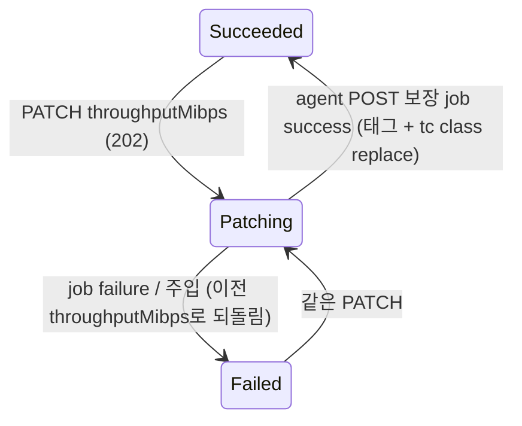

# throughput-limit 설계 (FR-08 처리량 제한)

- 작성: 2026-11-09, 메인 세션 (`anf-roadmap` 총괄). 사용자에게 묻는 결정(확정된 D-nn·`CLAUDE.md` "Decided" 변경, PRD 수락 기준 축소, 기기·저장소 설정, 스파이크 실패)은 없다고 판단했다. 그래서 결정 1~19는 모두 **자동 채택**이다. 각 행에 버린 대안과 이유가 있고, 같은 목록이 `_workspace/roadmap.md`의 "검토할 자동 채택 결정"에 있다.
  - 결정 9(tc를 인스턴스 netns 안에 둠)는 ADR §7.3 T1n 행의 "인스턴스의 호스트 쪽 veth"라는 문구를 다듬는다. D-12의 결정문("인스턴스 veth를 tc HTB로 제한한다, 읽기·쓰기 합산")과 `CLAUDE.md`("one tc HTB class per instance veth, both directions through one IFB")는 그대로 성립한다. netns 안의 `eth0`도 같은 veth 쌍의 한쪽 끝이기 때문이다. S7에서 정확도, 실시간 변경, 되돌리기 창과의 공존이 호스트 쪽 방식과 같았다(S7 M1~M7). 그래서 묻는 결정이 아니라 다듬기로 봤다. 되돌리기도 쉽다: agent 안의 tc 명령 위치만 바뀌고 API는 같다.
- 입력:
  - `01_researcher_brief.md`. 조사 상태는 "한도 도달"이다. 기본값, 예산 초과 코드, Auto → Manual 전환 값은 [미확인]이다.
  - [S7](../spikes/S7.md) (조건부 통과), [S2](../spikes/S2.md) T1n.
  - 볼륨 설계 `_workspace/volume/02_main_design.md`(결정 9·17·18).
  - 되돌리기 설계 `_workspace/snapshot-revert/02_main_design.md`(결정 3·13, 창).
  - 새 볼륨 복원 설계 `_workspace/restore-new-volume/02_main_design.md`.
  - 풀 설계 `_workspace/capacity-pool/02_main_design.md`(결정 7·10).

## 1. 관련 ID

- PRD: FR-08 (처리량 제한), FR-03 (풀 총 처리량·qosType), FR-04·FR-06·FR-07 (볼륨·되돌리기·복원: 회귀와 한도 유지), FR-01 (LRO 재사용), NFR-01, NFR-02, NFR-05, NFR-06, NFR-08
- ADR: AR-01~AR-07, D-06, D-09, D-11, D-12(T1n), §2.3(처리량 제한 행), §6.1, §6.4, §7.3, §7.4, §8(IFB 카운터), R-04, R-07, R-08
- 스파이크: [S7](../spikes/S7.md) (이번에 추가), [S2](../spikes/S2.md)

## 2. 범위

### 재현한다

- **Auto QoS:** 볼륨 한도 = 할당량(2진 TiB) × 서비스 수준 단가(16/64/128 MiB/s per TiB) [브리프 문서 D1]. `actualThroughputMibps`가 그 값이다. 소수 셋째 자리로 반올림해 보인다 [녹화 R3]. 이 값이 실제 I/O 상한이다.
- **Manual QoS:** Manual 풀의 볼륨은 `throughputMibps`(1~4,500 MiB/s)를 생성(PUT)과 갱신(PUT·PATCH)에서 받는다 [스펙 S1, 문서 D4]. 볼륨 한도의 합은 풀 `totalThroughputMibps`를 넘을 수 없다 [문서 D7, D5].
- **풀 `utilizedThroughputMibps`:** 볼륨 한도의 합이다 [녹화 R1, R2, 문서 D6]. 지금은 늘 `0.0`이다.
- **Auto → Manual 전환:** 기존 볼륨에 직전 한도를 `throughputMibps`로 채운다 [추론, 브리프 §Auto → Manual 전환].
- **데이터 효과 (PRD FR-08 수락 기준):**
  - 클라이언트에서 잰 처리량이 한도 이하다. 읽기와 쓰기는 한도 하나를 나눠 쓴다.
  - 한도를 바꾸면(Manual `throughputMibps` PATCH) 다시 마운트하지 않아도, I/O 오류 없이 잰 값이 바뀐다.
  - 제한이 사실상 없는 볼륨(4,500 MiB/s)과 비교하면 차이가 측정으로 드러난다.
  - 볼륨마다 따로 제한된다.
- **storage agent의 ONTAP 부분집합:** 볼륨 POST의 `qos.policy.max_throughput_mbps` [ONTAP O1, `models/volume_qos.py`].
- **수명 주기와 재시작 안전:** 볼륨 생성, 같은 요청의 재전송, 시작 복구, agent 재시작, 되돌리기, 새 볼륨 복원 뒤에도 한도가 걸려 있다.

### 미룬다

| 미룬 것 | 이번 동작 | 여는 사이클 |
| --- | --- | --- |
| 할당량 변경으로 Auto 한도 바꾸기 | `usageThreshold` 변경은 지금처럼 거절한다. agent 경로(결정 8)는 FR-16이 그대로 쓴다 | FR-16 (볼륨 크기 조정) |
| Flexible 풀 `customThroughputMibps`, Elastic(shared QoS), 대용량 볼륨(12,800 MiB/s) | 지금처럼 거절한다 | 범위 밖 |
| 다른 풀로 볼륨 옮기기(서비스 수준 바꾸기) | 없음 | 범위 밖 |
| 볼륨별 처리량 메트릭(Throughput limit reached 등) | 없음. 카운터 읽는 자리만 정한다(§6.3) | FR-12 |
| Auto 공식 값이 4,500을 넘는 볼륨(Premium 70.3 TiB 초과 등)의 표시 상한 | 공식 값을 그대로 보이고 건다. 전환 때도 그대로 옮긴다 (결정 6) | 후보 |

## 3. 결정과 버린 대안

| # | 결정 | 버린 대안 |
| --- | --- | --- |
| 1 | **자동 채택. 범위는 Auto와 Manual 둘 다다.** PRD FR-08이 둘을 모두 적었다. "제한을 바꾸면 잰 값도 바뀐다"는 Manual 볼륨의 `throughputMibps` PATCH(그리고 재PUT)로 보인다. 할당량 PATCH로 Auto 한도 바꾸기는 FR-16에 둔다. | 할당량 PATCH를 당겨 옴(브리프 선택지 1 b·c): FR-16의 ext4 온라인 확장, 축소 거절, 풀 용량 재검사가 함께 딸려 와 범위가 두 배가 된다. Auto만: PRD 범위를 줄이게 된다. |
| 2 | **자동 채택. Auto 한도는 공식 그대로다. 클론에 하한을 두지 않는다.** 반올림은 소수 셋째 자리이고 Python `round`(half-even)를 쓴다(101 GiB Premium 6.3125 → 6.312 [녹화 R3]). 응답에 보이는 값이 tc에 거는 값이다(하나의 값). 1 GiB Premium(검증 전용 크기, `ANF_MIN_VOLUME_SIZE_GIB`)은 0.062 MiB/s다. S7 Q4에서 이 한도로도 마운트, 읽기·쓰기, v4.1 lease가 오류 없이 됐다. 대신 같은 연결의 메타데이터가 1분을 넘고 커널 로그에 RPC 시간 초과가 나온다. 이것은 검증 전용 크기의 결과로 기록한다. | 클론 하한(브리프 선택지 2 c): ANF와 응답·동작이 달라진다. 검증 볼륨을 위해 제품 규칙을 바꾸는 것이다. 버림(truncate): 값 하나로는 half-even과 구분되지 않는다. Python 기본을 쓰는 쪽이 설명이 쉽다. |
| 3 | **자동 채택. Manual 풀 볼륨은 `throughputMibps`가 필수다.** 생성(새 볼륨 복원 포함)에서 없거나 `null`이면 `400 InvalidRequestContent`다. 값은 숫자(불리언 아님)이고 1 이상 4,500 이하다. 소수를 받고 받은 값을 그대로 저장한다. 실서비스 기본값은 [미확인]이므로 클론 규칙이다. | Auto 공식 값으로 채움(브리프 선택지 3 b): 사용자가 Manual 풀을 고른 이유(용량과 처리량을 따로 정함)와 맞지 않는다. 숨은 값이 예산을 쓴다. 남은 예산 전부: 다음 볼륨이 바로 예산 초과가 된다. |
| 4 | **자동 채택. Auto 풀 볼륨에 `throughputMibps`(null이 아닌 값)를 보내면 `400 BadRequest`다.** Auto 볼륨 응답에는 `throughputMibps`가 없다(파이썬 녹화 R4·R6). 스펙은 "accepted as input only for manual qosType volume"이라고만 쓴다 [스펙 S1]. 클론 규칙이다. | 무시(브리프 선택지 4 b): 사용자는 한도가 바뀐 줄 안다. .NET 녹화처럼 `0.0`을 보임: 파이썬 녹화와 다르고, 0을 다시 보내는 왕복 요청을 따로 다뤄야 한다. |
| 5 | **자동 채택. Manual 볼륨의 `actualThroughputMibps` = `throughputMibps`** [녹화 R1 항목 35]. 풀 `utilizedThroughputMibps`는 풀의 모든 볼륨 행(상태와 무관)의 한도 합이다. Auto 풀은 Auto 값의 합, Manual 풀은 `throughputMibps`의 합이다 [녹화 R1·R2]. | 스펙 설명대로 Manual 볼륨의 `actualThroughputMibps`를 비움: 녹화의 볼륨 리소스 응답과 다르다. |
| 6 | **자동 채택. Auto → Manual 전환은 같은 풀 PATCH 트랜잭션에서 각 볼륨 행에 `throughputMibps` = 직전 `actualThroughputMibps`를 쓴다.** 값이 같으므로 데이터 플레인 작업이 없다(풀 PATCH는 지금처럼 agent를 부르지 않는다). 같은 풀 안에서는 할당량 합 ≤ 풀 크기이고 단가가 같으므로 예산을 넘지 않는다 [브리프 추론]. 4,500을 넘는 값은 자르지 않는다(§2 미룬다). 자식 볼륨에 진행 중 작업이 있으면 전환은 `409 Conflict`다. 그 작업이 실패해 이전 properties로 되돌리면 전환이 쓴 값이 사라지기 때문이다. | 4,500으로 자름: 한도가 바뀌어 풀 PATCH가 agent 작업을 가져야 한다. 해당하는 볼륨은 검증 범위 밖의 큰 볼륨뿐이다. 전환 때 값을 비워 둠: Manual 규칙(결정 3)이 깨진다. 진행 중 작업 무시: 위의 되돌리기 문제. |
| 7 | **자동 채택. 예산 검사는 동기 `400 BadRequest`이고 문구는 문서 D5의 "Requested throughput not available"로 시작한다.** 대상은 생성(복원 포함)과 갱신(PUT·PATCH)이다. 검사식은 "같은 풀의 다른 모든 볼륨 행의 한도 합 + 새 값 > 풀 `totalThroughputMibps`"이고, 소수 셋째 자리에서 비교한다. Manual 풀 크기를 줄여 총 처리량이 배정 합보다 작아지는 PATCH·PUT도 `400 BadRequest`다. 풀 설계 결정 7("실서비스 코드가 [미확인]인 규칙 위반은 400 BadRequest와 ANF 문서의 문구")과 같은 방식이다. 거절이면 볼륨 행과 작업이 생기지 않고, 기존 값과 tc 한도가 그대로다. | 비동기 작업 `Failed`: 사용자가 폴링해야 안다. 새 오류 코드(`PoolThroughputExceeded` 등): 근거 없이 이름을 짓게 된다. 풀 축소 허용: 배정 합이 예산보다 큰 상태가 생긴다. |
| 8 | **자동 채택. agent API = 볼륨 POST의 ONTAP 인라인 QoS 필드 `qos: {"policy": {"max_throughput_mbps": N}}`** [ONTAP O1]. 차이는 둘이다. 클론은 값을 **MiB/s**로 읽고 소수를 받는다(ONTAP은 정수 "Mbps", 단위의 정확한 정의는 [미확인]). Auto 한도가 0.062, 6.312처럼 소수이기 때문이다. 없으면 제한이 없다(ONTAP 볼륨의 기본 = 정책 없음). agent POST는 이미 uuid를 멱등 키로 하는 "보장"이다(볼륨 결정 9). 그래서 anf-api는 CREATE·UPDATE·PATCH 처리기 모두에서 지금 한도를 보내고, agent가 태그와 tc를 그 값에 맞춘다. job 키에 한도를 넣는다(`POST <uuid> qos=<값>`). 그래서 anf-api가 포기한 이전 job에 다른 한도의 요청이 합쳐지지 않는다(되돌리기의 요청 키와 같은 이유). GET 레코드에 `qos.policy.max_throughput_mbps`를 보인다. | `/api/storage/qos/policies` 정책 객체 + 볼륨 `qos.policy.uuid`(브리프 선택지 9 a): 볼륨마다 한도 하나인데 객체 수명(만들기·지우기·고아 정리)이 하나 더 생긴다. ANF Manual은 공유 정책이 아니다. ONTAP처럼 변경은 볼륨 PATCH로 따로: 재시작 뒤 이어 하기에 호출 두 개와 순서 규칙이 필요하다. 기존 처리기는 모든 작업에서 POST 보장을 다시 보낸다. 클론 확장 필드 `max_throughput_mibps`: ONTAP 이름을 버린다. 단위 차이는 문서로 설명하는 편이 낫다. |
| 9 | **자동 채택. tc는 인스턴스 netns 안에 둔다 (S7 P8 방식).** 인스턴스 `eth0`에 `clsact`를 단다. ingress·egress 모두 `matchall action mirred egress redirect dev ifb0`이다. netns 안 `ifb0`에 `htb default 1`, 클래스 `1:1 rate = ceil`, leaf `fq_codel`을 둔다. 명령은 호스트의 `ip`·`tc`를 `nsenter -t <pid> -n`으로 쓴다. 되돌리기 창의 iptables와 같은 경로(`_pid`)이고 이미지는 바꾸지 않는다(S7 N5). IFB 이름이 모든 인스턴스에서 `ifb0`이다. 인스턴스가 사라지면 tc도 함께 사라져 정리할 것이 없다(M4·M7). 정확도·실시간 변경·되돌리기 창 공존은 호스트 쪽 방식과 같았다(M1~M3, M6). | 호스트 쪽 veth + 호스트 IFB(ADR §7.3에 적힌 S2 방식): 시작할 때마다 veth를 찾아야 한다(V1·V4). IFB 이름은 15자라 uuid를 못 쓴다(N2·N3). IFB가 볼륨 삭제 뒤에도 남는다(L7). 지우는 순서를 틀리면 트래픽이 끊긴다(L6). 남은 IFB에 다시 걸 때 `qdisc replace`가 실패한다(N8). 장점인 "카운터를 호스트에서 이름으로 읽기"는 `/proc/<pid>/net/dev`로 대신한다(§6.3). 진입점에서 걸기: 이미지에 iproute2를 넣고 한도를 환경 변수로 넘겨야 한다. 실시간 변경은 여전히 밖에서 해야 해서 두 곳이 tc를 다룬다. |
| 10 | **자동 채택. 인스턴스를 띄우는 모든 경로에서 `start` → 한도 걸기 → `wait_ready` 순서다.** `NfsInstances.ensure()`(생성, 재전송, 복원)와 `FlexVolManager.recover()`(시작 복구)가 이 순서를 따른다. `docker run -d`·`docker start`는 컨테이너가 시작된 뒤 돌아온다. knfsd는 그 뒤 진입점이 띄우므로 서비스 전에 제한이 걸린다 [S7 추론, 검증 AC-07]. 걸기는 멱등이다. 이미 있는 `ifb0`·HTB 루트·leaf·`clsact`·필터는 건드리지 않고, 클래스만 `tc class replace`로 rate를 맞춘다(HTB 루트에 `qdisc replace`는 실패한다, N8). 순서는 `ifb0`·HTB 먼저, 필터 나중이다(없는 장치로 redirect하면 트래픽이 버려진다, L6). agent만 재시작하면 tc가 남고(L4) 복구가 같은 값을 다시 맞춘다. 볼륨 삭제는 인스턴스를 지우므로 정리할 것이 없다. 되돌리기는 인스턴스를 그대로 두므로 tc가 그대로다(L3·M6). | 준비가 끝난 뒤 걸기: S7 L1·L2·L5처럼 그사이 제한 없이 흐른다. anf-api가 따로 다시 걸기 요청: anf-api는 agent·WSL 재시작을 모른다. |
| 11 | **자동 채택. 한도는 볼륨 LV 태그 `anf_qos=<MiB/s>`로 둔다.** 경로·uuid·IP·프로토콜 태그와 같은 곳이다(`_Volume.tags()`). 그래서 되돌리기의 새 LV(`vol_<uuid>_new`, "볼륨 태그를 처음부터 가짐")와 시작 복구가 그대로 물려받는다. POST에 `qos`가 없으면 태그를 바꾸지 않는다. 처음부터 없으면 제한이 없다. 이 FR 전에 만든 볼륨에는 태그가 없어 다음 보장(PUT·PATCH) 전까지 제한이 없다. 이전 작업은 하지 않는다. 개발 기기에는 그런 볼륨이 없다(S7 정리 뒤 비어 있음). | anf-api가 다시 보냄(S7 선택지 3 나): 재시작 사이 제한 없는 창이 생긴다. 별도 파일: agent는 DB 없이 LVM 상태만 진실로 쓴다(볼륨 결정). |
| 12 | **자동 채택. HTB rate = 한도 ÷ 0.9564.** 0.9564 = 1448 / 1514다. `anf-vnet` MTU 1500, TCP 타임스탬프 MSS 1448에서 데이터 바이트 대 wire 바이트의 이론 상한이다(S7 Q7). 그래서 어떤 I/O 모양에서도 데이터가 한도를 넘지 않는다 [S7 추론]. 예상 데이터는 한도의 97~99%다. rate는 bit/s 정수(반올림)로 건다. | 보정 없음: 데이터가 92~95%다(S7 Q2). 오차 범위가 −10%로 넓어진다. 측정값 0.9534로 보정: 98~99%였지만 읽기의 데이터/wire가 0.9551이라 이론상 100.2%까지 갈 수 있다(S7 Q7). |
| 13 | **자동 채택. leaf는 `fq_codel`이다** (S2 선택). 낮은 한도에서 같은 인스턴스의 다른 연결을 큰 흐름 뒤에 줄 세우지 않는다(S7 Q4: 0.062 MiB/s에서도 다른 연결의 `ls`가 0.6 s 이내). 30 MiB/s 쓰기에서 드롭과 재전송이 있지만 처리량은 pfifo와 같았다(P2c). | `pfifo`: 드롭이 없지만 대기열이 한 줄이라 그 이점이 없다. HTB 기본 leaf: pfifo와 같다. |
| 14 | **자동 채택. `ifb` 모듈은 agent가 시작할 때 없으면 `modprobe ifb numifbs=0`으로 올린다.** 모듈이 저절로 올라가면 호스트 netns에 `ifb0`·`ifb1`이 덤으로 생긴다(S7 N1). 이미 올라와 있으면 그대로 둔다. 준비 스크립트와 `/etc/modprobe.d`는 바꾸지 않는다. 다른 모듈(`sch_htb`, `cls_matchall`, `act_mirred`, `sch_ingress`, `sch_fq_codel`)은 tc가 필요할 때 올린다. HTB의 `quantum … is big` 경고(stderr, rc 0)는 무시한다. `Runner.run`은 종료 코드로 판정한다(N7). | 준비 스크립트에서 올리고 modprobe 옵션 파일 고정: 사용자 기기 설정을 하나 더 바꾼다. agent가 없으면 올리는 것으로 충분하다. |
| 15 | **자동 채택. 허용 오차: 데이터 처리량이 한도의 90% 이상, 101% 이하.** fio 직접 I/O의 순차 읽기·쓰기를 게스트 단조 시계(`clock_gettime`)로 잰다. 첫 회는 버리고, 그 뒤 5회 이상의 중앙값으로 본다. 위쪽 1%는 시계와 측정 구간의 여유다. 바뀐 한도와 멈춤은 netns 안 HTB 카운터의 1초 창으로 판정한다. fio 초당 로그는 완료가 없는 초를 건너뛰어 멈춤을 숨긴다(S7 L6). 30 MiB/s 이상 쓰기의 서버 쪽 저하 회(S7 Q2, 제한기 원인 아님)는 따로 세고, 아래쪽 판정은 읽기와 10 MiB/s 쓰기로 한다. 검증 때 게스트/호스트 시계 비율을 다시 재 기록한다(S2 0.908, S7 0.9948~1.0009). | 0~−10%(보정 없음 기준): 결정 12로 필요 없다. 평균: 저하 회 하나가 값을 크게 끌어내린다. |
| 16 | **자동 채택. "제한이 없는 볼륨"은 Manual 4,500 MiB/s 볼륨이다.** ANF에는 한도 없는 볼륨이 없고 4,500이 일반 볼륨의 최대다 [문서 D4]. 이 값은 클론의 데이터 경로(S7: tc 없이 약 2 GB/s)보다 커서 사실상 제한이 없다. 같은 클라이언트에서 10 MiB/s 볼륨과 함께 재 차이를 보인다(AC-05). | agent에 `qos` 없이 만든 볼륨: ARM 경로로는 만들 수 없는 상태다. 보조 근거로만 쓸 수 있다. tc를 손으로 지움: 제품 상태가 아니다. |
| 17 | **자동 채택. 기존 e2e는 Auto 한도에 묶이지 않게 바꾼다.** 기존 데이터 e2e는 1 GiB Premium 볼륨에 많은 데이터를 쓴다(볼륨 채우기 1,229 MiB, 스트림 900 MiB, 200 MiB 등). 0.062 MiB/s면 몇 시간이 걸린다. 데이터를 쓰는 볼륨은 Manual 풀에서 충분한 `throughputMibps`로 만든다. 공유 풀을 Manual로 바꿀지 시험별로 Manual 풀을 쓸지는 구현자가 고른다. 조건이 셋이다. 기존 시험이 검사하던 동작은 그대로 검사한다. Auto 값을 단언하는 시험은 Auto 풀을 쓰고 반올림(결정 2)에 맞춘다. 전체 e2e 시간이 크게 늘지 않는다. 작은 데이터만 쓰는 계약 시험은 Auto 1 GiB 그대로 둬도 된다(S7: 부하 없는 `ls` 0.01~0.03 s). | 검증용 한도 끄기 손잡이(`ANF_...`): 회귀가 tc를 지나지 않게 되고, 제품에 끄는 길이 생긴다. 기본 볼륨을 크게(예: 100 GiB): 크기를 단언하는 시험과 채우기 시험이 깨지고, ext4 lazy init이 실제 공간과 I/O를 쓴다. |
| 18 | **자동 채택. 결함 주입 키는 기존 키다** (`volumes/create`, `volumes/update`, `volumes/patch`, `capacityPools/patch`). 한도 변경도 볼륨 UPDATE·PATCH 작업이라 같은 처리기를 탄다. | 새 키(`volumes/throughput`): 공통 계층에 특례가 생긴다. |
| 19 | **자동 채택. 측정 도구.** 검증과 FR-08 e2e는 fio(S7 방식) 또는 직접 I/O `dd`를 쓴다. `anf-nfs-client`에 fio가 없으면 준비 스크립트의 클라이언트 이미지에 더하는 것을 허용한다. 저장소 안의 검증 이미지이고, 준비 스크립트를 다시 돌리면 다시 만들어진다. | S7의 `anf-s2-client:spike` 이미지: 저장소 밖에 남은 실험 이미지라 재현할 수 없다. |

### 아직 확정하지 않은 것

- `throughputMibps`를 받을 때의 정밀도(예: 10.12345)는 받은 그대로 저장한다. float32 반올림은 흉내 내지 않는다. 표시는 받은 값이다.
- 한도를 건 뒤 `wait_ready`가 실패하면 그 작업은 `Failed`가 되고 워커가 이전 값을 되돌린다. tc는 새 값으로 남을 수 있다. 다음 보장(같은 요청의 재PUT 등)이 맞춘다. 이때 인스턴스는 이미 고장 난 상태다.

## 4. API 계약

### 4.1 작업별 응답 (ARM)

경로: 볼륨 `PUT|PATCH /subscriptions/{s}/resourceGroups/{rg}/providers/Microsoft.NetApp/netAppAccounts/{a}/capacityPools/{p}/volumes/{v}?api-version=2026-08-01`, 풀 `PATCH .../capacityPools/{p}`

| 작업 | 응답 | 본문 | 헤더 | 작업 상태 | 근거 |
| --- | --- | --- | --- | --- | --- |
| Manual 풀 볼륨 PUT (`throughputMibps` 포함, 새 볼륨) | `201` | `Creating`, `throughputMibps`, `actualThroughputMibps` = `throughputMibps` | 일반 볼륨 생성과 같음(`Azure-AsyncOperation`. 스냅샷에서 만들면 + `Location`) | `Creating` → `Succeeded`, `action: CREATE` | 볼륨 PUT과 같다 [추론, 브리프 §비동기] |
| Manual 볼륨 PATCH `{"properties": {"throughputMibps": Y}}` | `202` | `Patching`, 새 `throughputMibps` | 볼륨 PATCH와 같음 | `Patching` → `Succeeded`, `action: PATCH` | [추론], 볼륨 PATCH 녹화 V3 모양 |
| Manual 볼륨 재PUT (다른 `throughputMibps`) | `200` | `Updating` | 같음 | `Updating` → `Succeeded`, `action: UPDATE` | 볼륨 설계 그대로 |
| Auto 볼륨 GET | `200` | `actualThroughputMibps` = round(공식, 3), `throughputMibps` 없음 | — | — | 녹화 R2·R3·R4·R6 |
| 풀 GET | `200` | `utilizedThroughputMibps` = 볼륨 한도 합 | — | — | 녹화 R1·R2 |
| 풀 PATCH `qosType: Manual` (볼륨 있음) | `202` | `Patching` | 풀 PATCH와 같음 | `Patching` → `Succeeded`. 볼륨 행에 `throughputMibps`가 채워진다 | 녹화 P1, 결정 6 |
| 거절 | §4.2 | | | 작업 안 만듦 | 결정 3·4·6·7 |

- PATCH가 실패하면: 볼륨 `Failed`, 작업 `Failed`. 워커가 이전 properties(이전 `throughputMibps`)로 되돌린다(기존 규칙). 같은 PATCH를 다시 보내면 된다.
- 한도 변경 PATCH는 agent의 POST 보장 하나다(결정 8). agent가 태그를 바꾸고 `tc class replace`를 한다. 마운트와 I/O는 끊기지 않는다(S7 Q3).

### 4.2 본문 규칙과 오류

| 조건 | 응답 | 문구 |
| --- | --- | --- |
| `throughputMibps`가 숫자가 아님(불리언 포함), 1 미만, 4,500 초과 | `400 InvalidRequestContent` | "The 'properties.throughputMibps' property must be a number from 1 to 4500." |
| Manual 풀 볼륨 생성에 `throughputMibps`가 없거나 `null` | `400 InvalidRequestContent` | "The 'properties.throughputMibps' property is required for a volume in a Manual QoS capacity pool." |
| Auto 풀 볼륨의 생성·갱신에 `throughputMibps` 값(null이 아님) | `400 BadRequest` | "The 'properties.throughputMibps' property can be set only for a volume in a Manual QoS capacity pool." |
| 다른 볼륨 한도 합 + 새 값 > 풀 `totalThroughputMibps` (생성·복원·PUT·PATCH) | `400 BadRequest` | "Requested throughput not available. Capacity pool '{pool}' has {total} MiB/s in total and {free} MiB/s left for this volume." |
| Manual 풀 크기 PATCH·PUT으로 새 총 처리량 < 배정 합 | `400 BadRequest` | "The capacity pool throughput of {new total} MiB/s is too small for the combined volume throughput of {utilized} MiB/s of the capacity pool." |
| 자식 볼륨에 진행 중 작업이 있을 때 Auto → Manual 전환 | `409 Conflict` | "Cannot change the QoS type of capacity pool '{pool id}' because an operation is in progress on volume '{volume id}'. Wait until it is finished, and then retry." |
| Manual → Auto | `400 BadRequest` | 기존 문구 그대로 |
| 그 밖 (경로 중복, 풀 용량, 풀 상태, 서비스 수준, 진행 중 작업 등) | 일반 볼륨과 같음 | 볼륨 설계 |

- 검사 순서: 본문 형식(`throughputMibps` 타입·범위)은 본문 단계에서 한다. 풀에 기대는 검사(필수 여부, Auto 풀 거절)는 풀 존재·상태 검사 뒤에, 예산은 풀 용량 검사 뒤에 한다.
- 지금의 거절 "Volumes in a Manual QoS capacity pool are not supported by this ANF clone."은 없어진다. `throughputMibps`는 미룬 기능 목록(`_NOT_YET`)에서 빠진다.

## 5. 상태 전이

볼륨과 풀의 상태 기계는 바뀌지 않는다. 한도 변경은 기존 `Patching`·`Updating` 흐름을 탄다.

## 6. storage agent

### 6.1 API (ONTAP REST 부분집합)

| 메서드·경로 | 요청 | 응답 | ONTAP과 다른 점 (R-04) |
| --- | --- | --- | --- |
| `POST /api/storage/volumes` | 지금 본문 + 선택 `qos: {"policy": {"max_throughput_mbps": N}}` | `202 {"job": …}` | 값이 MiB/s이고 소수를 받는다(ONTAP은 정수 Mbps). 이미 있는 uuid의 POST는 한도를 맞추는 보장이다(기존 멱등 키 확장). 정책 이름·uuid·IOPS·최소 처리량 필드는 없다 |
| `GET /api/storage/volumes[/{uuid}]` | — | 레코드에 `qos.policy.max_throughput_mbps`(태그가 있을 때) | ONTAP GET은 `qos.policy.{name, uuid}`를 보인다. 클론에는 정책 객체가 없어 값을 보인다 |

- 입력 다시 검사(R-07): `qos`는 정확히 `policy` 하나, `policy`는 정확히 `max_throughput_mbps` 하나다. 값은 불리언이 아닌 유한한 숫자이고 0보다 크다. 위 한도는 두지 않는다(Auto 값은 4,500을 넘을 수 있다). 그 밖은 `400`이다.
- job 키: `POST <uuid>`에 한도를 더한다(결정 8).

### 6.2 데이터 플레인

**태그 (결정 11).** `_Volume`에 `qos: float | None`(`anf_qos` 태그)을 더하고 `tags()`에 넣는다.
- 새 LV는 만들 때 태그를 갖는다. 일반, 클론, 되돌리기의 새 LV 모두다.
- 있는 LV의 값이 요청과 다르면 `lvchange --deltag anf_qos=<옛 값> --addtag anf_qos=<새 값>` 한 명령으로 바꾼다. 끝나지 않은 되돌리기가 있으면 그것을 먼저 끝낸 뒤에 바꾼다.

**걸기 (`NfsInstances`, 결정 9·10·12·13).** 한도가 있을 때 pid로 netns에 들어가 차례로 한다.
1. `ip link show ifb0`가 없으면 `ip link add ifb0 type ifb`. 그다음 `ip link set ifb0 up`.
2. `tc qdisc show dev ifb0`에 HTB 루트가 없으면 `tc qdisc add dev ifb0 root handle 1: htb default 1`.
3. `tc class replace dev ifb0 parent 1: classid 1:1 htb rate <R>bit ceil <R>bit`. R = round(한도 × 1048576 × 8 / 0.9564).
4. leaf가 없으면 `tc qdisc add dev ifb0 parent 1:1 handle 10: fq_codel`.
5. `eth0`에 `clsact`가 없으면 `tc qdisc add dev eth0 clsact`.
6. ingress·egress 필터가 없으면 각각 `tc filter add dev eth0 {ingress|egress} matchall action mirred egress redirect dev ifb0`.

- 한도가 없으면(태그 없음) 아무것도 하지 않는다. 이미 걸린 tc를 지우는 경로는 없다. anf-api는 늘 한도를 보낸다.
- `ensure(uuid, token, ip, protocol, qos)`: `start` → 걸기 → `wait_ready`.
- `recover()`: 모든 인스턴스를 `start` → 걸기 한 뒤 한꺼번에 `wait_ready`.
- 시작 검사: `ifb` 모듈이 없으면 `modprobe ifb numifbs=0`(결정 14).
- 명령은 셸 없이 `Runner`로 돈다. pid를 못 얻으면(인스턴스가 돌지 않음) 실패 job이다. `start` 직후라 정상 경로에서는 없는 상황이다.

### 6.3 카운터 읽기 (FR-12를 위한 자리)

카운터는 둘이고 값이 다르다(§9-12에서 고침, 처음에는 같은 값이라고 썼다).
- netns 안 `ifb0`의 송신 바이트(호스트에서 `/proc/<pid>/net/dev`의 `ifb0` 줄): skb 길이를 세므로 GSO 묶음마다 헤더를 한 번만 센다. 데이터 바이트에 가깝다(FR-08 e2e에서 fio 값보다 0.5% 안팎 크다).
- HTB 클래스의 `Sent N bytes`(`nsenter … tc -s class show dev ifb0`): 세그먼트마다 헤더를 더한 wire 바이트이고, rate가 이 값에 걸린다. `ifb0` 송신보다 4.24~4.35% 크다.

이번 FR은 검증에서만 쓰고(e2e 1초 창은 `ifb0` 송신), 어느 값을 메트릭으로 할지는 FR-12가 정한다. ADR §8도 같은 내용으로 고쳤다.

## 7. 내부 구조

| 모듈 | 내용 | 짝 테스트 |
| --- | --- | --- |
| `anf_api/volumes.py` | Manual 풀 허용, `throughputMibps` 규칙(결정 3·4), 한도 계산(Auto 반올림, Manual 값), 예산 검사(결정 7, 생성·복원·갱신), 처리기가 한도를 agent에 보냄 | `test_volumes.py` |
| `anf_api/capacity_pools.py` | `utilizedThroughputMibps`(결정 5), Auto → Manual 전환 때 볼륨 값 채우기와 진행 중 작업 `409`(결정 6), Manual 풀 축소 거절(결정 7) | `test_capacity_pools.py` |
| `anf_api/storage_client.py` | `ensure_volume(..., qos=)` → POST 본문 `qos.policy.max_throughput_mbps` | `test_storage_client.py` |
| `storage_agent/agent_app.py` | `parse_volume`의 `qos`, job 키 | `test_agent_app.py` |
| `storage_agent/flexvol.py` | `anf_qos` 태그(만들기, 바꾸기, 읽기), `ensure`·`recover`에 한도 전달 | `test_flexvol.py`, 통합 `test_flexvol_linux.py` |
| `storage_agent/nfs_instance.py` | 걸기(§6.2), `ensure`의 순서, 시작 검사의 `ifb` 모듈 | `test_nfs_instance.py`, 통합 |
| `backend/tests/e2e/` | 기존 데이터 e2e를 Manual 풀로(결정 17), FR-08 계약·데이터 e2e (`test_throughput_limit_*_live.py`) | — |

- 풀 본문의 `utilizedThroughputMibps`는 자식 볼륨이 필요하다. `pool_body`가 받는 인자나 호출 쪽 계산은 구현자가 정한다. `capacity_pools` ↔ `volumes`의 순환 import를 만들지 않는다.

## 8. 검증 기준

**공통 조건**
- WSL Ubuntu, 준비 스크립트 상태(`fs.leases-enable = 0`). agent는 root(127.0.0.1:8090), anf-api는 일반 권한(127.0.0.1:8080, `ANF_MIN_VOLUME_SIZE_GIB=1`)으로 띄운다.
- 검증 동안 `wsl` 세션 하나를 띄워 WSL 유휴 종료를 막는다. 메모리가 작으므로 e2e 파일은 하나씩 돌리고 묶음마다 `free -m`을 적는다.
- 측정 (결정 15·19):
  - 클라이언트는 privileged 컨테이너, 기본 hard 마운트(v3는 `nolock`)다.
  - fio `--direct=1 --bs=1M --iodepth=16 --ioengine=libaio --clocksource=clock_gettime`, 순차 쓰기·읽기를 쓴다. 읽기 전마다 `sync; echo 3 > /proc/sys/vm/drop_caches`를 한다.
  - 첫 회는 버리고 5회 이상의 중앙값으로 본다. 크기는 한도 × 15 s다.
  - 바뀐 한도와 멈춤은 netns `ifb0` 카운터(또는 HTB 클래스 카운터)의 1초 창으로 본다.
  - 게스트/호스트 시계 비율을 재서 적는다.
- 허용 오차: 데이터 처리량이 한도의 90% 이상, 101% 이하다. 30 MiB/s 이상 쓰기의 서버 쪽 저하 회는 따로 센다.

| ID | 층 | 기준 |
| --- | --- | --- |
| AC-01 | 계약·데이터 (Auto) | (a) 응답 값: Auto Premium 풀에 볼륨을 만든다. GET `actualThroughputMibps` = round(할당량 TiB × 64, 3)이고 `throughputMibps`가 없다. 101 GiB → 6.312, 1 GiB → 0.062. 다른 서비스 수준도 하나 확인한다(예: Standard 1 GiB → 0.016). 풀 GET `utilizedThroughputMibps` = 볼륨 값의 합이다. (b) 데이터: 한도가 잴 만한 Auto 볼륨 하나(예: Premium 160 GiB = 10 MiB/s, 또는 Ultra 80 GiB)를 v3와 v4.1로 하나씩 만든다. 순차 쓰기·읽기가 허용 오차 안이다. 인스턴스 netns의 HTB rate가 결정 12의 값이다. |
| AC-02 | 계약·데이터 (Manual 생성) | Manual 풀(예: Ultra 40 TiB, 총 5,120 MiB/s)에 `throughputMibps: 10`(v4.1), `20`(v3) 볼륨을 PUT한다. `201` → `Creating` → `Succeeded`다. GET `throughputMibps` = `actualThroughputMibps` = 요청 값이고, 풀 `utilizedThroughputMibps` = 30이다. 순차 쓰기·읽기가 허용 오차 안이다. 소수 값(예: 12.5)도 받고 그대로 건다. |
| AC-03 | 데이터 (합산) | 한 볼륨에 읽기 job 하나와 쓰기 job 하나를 15 s 동안 함께 돌린다. 둘의 합이 허용 오차 안이다(v3, v4.1). |
| AC-04 | 데이터 (한도 변경, PRD) | 시간 기반 쓰기(v4.1)와 읽기(v3)를 각각 돌리는 중에 PATCH `throughputMibps` 10 → 30, 이어서 30 → 5를 보낸다. 매번 `202` → `Patching` → `Succeeded`다. `Succeeded` 뒤 2 s 안의 1초 창이 새 한도의 90~101%다. 끊긴 창(0에 가까운 창)이 없고, 다시 마운트하지 않으며, fio 오류가 0이다. 재PUT(`Updating`)으로 바꾸는 것도 한 번 확인한다. |
| AC-05 | 데이터 (제한 없는 볼륨과의 차이, 독립성) | 같은 클라이언트가 10 MiB/s 볼륨 A와 4,500 MiB/s 볼륨 B를 마운트한다. 함께 읽는 동안 B가 A의 10배 이상이고, A는 허용 오차 안이다. A만 읽을 때와 A·B를 함께 읽을 때 A의 값 차이가 허용 오차 안이다. (처음에는 "쓰는 동안"이었다. **자동 채택(리더, 4단계 1회차 뒤): 읽기로 판정한다.** 4,500 MiB/s 쓰기는 회마다 수 GB를 같은 aggregate에 쓰고, 검증 쓰기 표본에서 A가 한도보다 적게 보냈는데도 71~86%로 떨어졌다(A의 큐가 자주 비어 있었다). 한도는 상한이고 같은 aggregate의 디스크 경합을 막지 않는다. 이것은 개념 문서에 적는다. PRD 수락 기준 "제한이 없는 볼륨과의 차이가 측정으로 드러난다"는 읽기로 충족한다.) |
| AC-06 | 데이터 (작은 Auto 한도) | 1 GiB Premium Auto 볼륨(0.062 MiB/s)을 v3와 v4.1로 마운트한다. 작은 파일 쓰기·읽기·`ls`가 오류 없이 된다. 큰 직접 쓰기의 처리량이 0.062 × 1.01 이하다. 같은 연결과 다른 연결의 메타데이터 지연, mountstats timeouts, dmesg를 기록한다(판정은 오류 0과 상한). |
| AC-07 | 데이터 (수명 주기) | 한도를 건 볼륨에서 각 단계 직후(10 s 안에 시작한 측정) 한도가 허용 오차 안이다. 제한 없는 창이 있으면 길이를 기록한다. 단계: (a) agent만 재시작(인스턴스는 돎). (b) 인스턴스 `docker stop` → agent 재시작 = 복구의 `docker start`. (c) 인스턴스 `docker rm` → 같은 볼륨의 재PUT = agent `docker run`. (d) 쓰는 중 스냅샷 되돌리기: 창 뒤 한도로 돌아온다. (e) 한도 건 볼륨의 스냅샷에서 새 볼륨 복원: Manual 풀에 `throughputMibps` X로 하면 X가 걸리고, Auto 풀에 하면 공식 값이 걸린다. (f) 볼륨 삭제: 호스트 `ip link`에 IFB가 새로 생기지 않았고, 인스턴스 netns가 사라졌다. |
| AC-08 | 계약 (거절) | §4.2의 각 행이 그 코드와 문구다. 거절이면 볼륨 행·작업이 생기지 않고, 기존 `throughputMibps`·풀 값·netns HTB rate가 그대로다. 대상: Manual 풀 생성에 값 없음·`null`, `0.5`·`4500.5`·`"10"`·`true`, Auto 풀 볼륨에 값, 예산 초과 생성과 PATCH, Manual 풀 크기 축소, 진행 중 볼륨 작업이 있을 때 Auto → Manual 전환. 예산 안의 경계 값(정확히 남은 예산)은 받는다. |
| AC-09 | 계약·데이터 (Auto → Manual 전환) | Auto Premium 풀에 볼륨 둘(예: 160 GiB, 1 GiB)을 두고 풀 PATCH `qosType: Manual`을 보낸다. `Succeeded` 뒤 볼륨 GET `throughputMibps` = 전환 전 `actualThroughputMibps`이고, 풀 `utilizedThroughputMibps`가 그대로다. 160 GiB 볼륨의 잰 처리량이 전환 전과 같다(허용 오차 안). 그 뒤 PATCH `throughputMibps`가 받아지고 한도가 바뀐다. |
| AC-10 | 상태 (실패, 재시작 안전) | (a) `volumes/patch`에 지연을 주입한다. `Patching`인 동안 anf-api를 SIGKILL하고 다시 띄우면 작업이 `Succeeded`로 끝나고, netns HTB rate와 잰 값이 새 한도다. (b) `volumes/patch`에 실패를 주입하면 작업 `Failed`, 볼륨 `throughputMibps`가 이전 값이다. 주입을 끄고 같은 PATCH를 보내면 `Succeeded`이고 새 한도가 걸린다. |
| AC-11 | agent API | `POST`에 `qos`를 주면 job `success`이고, GET 레코드에 `qos.policy.max_throughput_mbps`가 있으며, netns에 `ifb0`·HTB·필터가 있다. 같은 uuid에 다른 값으로 POST하면 태그와 HTB rate가 바뀐다. `qos` 없는 POST면 netns에 tc가 없다. `qos` 필드 모양 오류(추가 필드, 0, 음수, 문자열, 불리언) → `400`. 통합 테스트: 걸기의 멱등성(두 번 걸어도 필터 하나씩), `recover()` 뒤 다시 걸림, 되돌리기 뒤 태그와 tc 유지. |
| AC-12 | 회귀 | 계정·풀·볼륨·스냅샷·되돌리기·복원 e2e(`backend/tests/e2e`의 모든 `*_live.py`, 파일 하나씩), 통합 테스트, 단위·계약 테스트가 새 코드에서 통과한다(skip 0). 기존 데이터 e2e의 걸린 시간을 FR-07 회귀 때와 비교해 적는다(결정 17). |

## 9. 구현 중 변경

3단계(구현)에서 설계와 달라졌거나 설계가 정하지 않은 것을 정한 기록이다.

1. **예산 검사는 Manual 풀에서만, 갱신에서는 한도를 올릴 때만 한다 (결정 7).** Auto 풀은 할당량 규칙(할당량 합 ≤ 풀 크기)이 같은 것을 지킨다. 그런데 반올림한 Auto 한도의 합은 총 처리량을 조금 넘을 수 있다(Premium 4 TiB 풀에 3 GiB 볼륨 341개 = 0.188 × 341 = 64.108 > 64). 그 값을 Auto → Manual 전환으로 옮겨 받은 풀에서도 한도를 줄이거나 같은 값으로 두는 PATCH·재PUT은 받아야 하므로, 예산을 더 쓰지 않는 갱신은 보지 않는다(`volumes._check_throughput_change`).
2. **Manual 풀의 "크기 축소" 검사는 새 크기가 지금보다 작을 때만 한다 (결정 7, §4.2).** 같은 이유다. 태그·같은 크기 PATCH는 배정 합이 총 처리량을 넘는 상태를 새로 만들지 않는다. 문구의 두 수는 소수 셋째 자리로 반올림한 값이다(`capacity_pools._apply_changes`).
3. **`utilizedThroughputMibps`는 소수 셋째 자리로 반올림한 float다.** 반올림하지 않으면 float 합의 오차가 응답에 보인다(0.062 + 0.188). 예산 비교도 셋째 자리에서 하고, 거절 문구의 남은 예산(`free`)은 0 밑으로 내려가지 않게 한다(옮겨 받은 풀은 합이 총량을 넘을 수 있다, 1번). `throughputMibps`도 float로 저장해 `10`은 `10.0`으로 응답한다.
4. **Auto → Manual 채우기는 풀 PATCH 요청의 트랜잭션에서 볼륨 행에 쓴다 (결정 6).** 풀 PATCH 작업이 실패하면(풀 PATCH는 agent를 부르지 않으므로 지금은 결함 주입에서만) 워커가 풀만 이전 properties(Auto)로 되돌리고, 볼륨 행의 `throughputMibps`는 남는다. 값이 Auto 공식과 같아 한도는 바뀌지 않는다. 다만 그 볼륨 GET에 `throughputMibps`가 보이고, 그 본문을 그대로 재PUT하면 Auto 풀 거절(400)을 받는다. 주입 실패에서만 생기는 상태라 되돌리는 코드를 두지 않았다. **자동 채택(리더, 3단계): 그대로 둔다.** 풀 PATCH는 agent를 부르지 않고, 재시작 뒤에는 워커가 작업을 다시 돌려 성공시키므로 실제 운영 경로에서는 생기지 않는다. 한도도 바뀌지 않는다. 버린 대안: 실패 되돌리기에서 볼륨 행도 지우기(주입 전용 상태를 위한 코드), Auto 풀 볼륨 응답에서 값 숨기기(볼륨 본문이 풀을 읽어야 한다).
5. **채운 Auto 값은 1 미만일 수 있다 (결정 3과의 충돌, 미결).** Standard 50 GiB = 0.781, Premium 1 GiB = 0.062처럼 Auto 한도는 1 MiB/s보다 작을 수 있다. 본문 규칙(1~4,500)은 요청 값만 보므로 전환은 되지만, 전환 뒤 GET 본문을 그대로 PUT하면 `400 InvalidRequestContent`다(`throughputMibps`를 빼거나 1 이상으로 바꾸면 된다). 실서비스가 이 경우 어떻게 하는지는 [미확인]이다. **자동 채택(리더, 3단계): 갱신(PUT·PATCH)에서 저장된 값과 같은 값(셋째 자리 비교)이면 1~4,500 범위를 보지 않는다.** 범위 검사는 값을 바꿀 때만 한다. 새 볼륨 생성은 지금대로 1~4,500이다. 이유: ARM 클라이언트(Terraform, Bicep, `az` 재배포)는 GET 본문을 그대로 다시 PUT하므로, 바뀌지 않은 값이 거절되면 전환한 풀의 볼륨을 재배포할 수 없다. 기본 최소 크기(50 GiB)의 Standard 볼륨도 0.781이라 검증 전용 크기만의 문제가 아니다. 버린 대안: (a) 지금대로 400(위 이유), (c) 전환할 때 1로 올림(전환이 한도를 말없이 바꾼다. 결정 6 "직전 한도를 채운다"와 어긋난다).
6. **`throughputMibps: null`은 없는 것으로 본다** (스펙 `x-nullable`). Manual 풀 생성에서는 필수 거절(결정 3), Auto 풀에서는 무시, 갱신에서는 바꾸지 않음이다. e2e의 `vol_body(..., throughputMibps=None)`이 이 규칙으로 Auto 풀 볼륨을 만든다.
7. **`pool_body(res, volumes)`가 자식 볼륨 행을 받는다 (§7 "구현자가 정한다").** `arm_app`이 `store.list_children(res.id, VOLUME_TYPE)`을 넘기는 감싼 함수를 풀 본문으로 등록한다. 한도 공식 `volume_throughput_mibps`는 `capacity_pools`에 두고 `volumes`가 가져다 쓴다(순환 import 없음). 지금의 `volumes.actual_throughput_mibps`는 이것으로 바꿨다.
8. **준비 스크립트: `ip`·`tc` 확인을 더하고 클라이언트 이미지(`anf-nfs-client`)에 fio를 넣었다 (결정 19).** 준비 스크립트를 다시 돌려 이미지를 다시 만들었다. `ifb` 모듈은 결정 14대로 agent 시작 검사(`check_host`)가 올린다.
9. **4,500 MiB/s HTB 클래스는 `tc`가 `burst 0b`와 quantum 경고를 보인다.** rate가 커서 r2q 기본값으로 계산한 quantum이 상한을 넘는다. 걸기는 성공한다(종료 코드 0). 이 클래스로도 B 볼륨 읽기는 약 2,019 MiB/s였다(e2e AC-05, 같은 클라이언트의 10 MiB/s 볼륨은 9.96). 그래서 burst를 따로 정하지 않았다.
10. **기존 데이터 e2e는 `manual_data` 픽스처로 Manual 풀에 만든다 (결정 17).** 데이터를 쓰는 시험 파일 여섯(볼륨 데이터, 스냅샷 데이터, 되돌리기 계약·데이터, 복원 계약·데이터)이 모듈 픽스처를 쓴다. 이때 `setup_pool`은 Premium 4 TiB Manual 풀(256 MiB/s)을 만들고 `vol_body`는 `throughputMibps: 64`를 넣는다(볼륨 4개가 들어간다). Auto 풀이 필요한 곳은 `throughputMibps=None`을 준다. 복원 데이터 AC-04b의 한 줄(새 풀 볼륨의 `actualThroughputMibps`가 Auto 공식 값)은 Manual 값 비교로 바꿨다. Auto 공식은 FR-08 계약 e2e(AC-01a)가 본다. 볼륨 계약 AC-06의 "Manual QoS 미지원" 사례는 `throughputMibps: 0.5` 거절로 바꿨다. 데이터를 조금만 쓰는 파일(볼륨 계약·복구, 스냅샷 계약·복구, 계정·풀)은 Auto 그대로다.
11. **e2e 측정의 해석** (결정 15·19, §8). 판정은 검증 단계가 하고, 아래는 FR-08 e2e가 택한 방식이다.
    - 1초 창은 HTB 클래스 카운터 대신 호스트에서 `/proc/<인스턴스 pid>/net/dev`의 `ifb0` 송신 바이트로 본다. `nsenter`·`tc` 프로세스를 띄우지 않아 표본 시각의 흔들림이 작다. 이 카운터는 데이터 처리량에 가까워서(12번) 창 값을 그대로 데이터 MiB/s로 읽는다. 처음에는 `× 0.9564`로 환산했는데, 그러면 창이 fio 값보다 4% 낮게 나왔다(AC-07 창 중앙값 9.55 대 fio 9.93). 그래서 환산을 뺐다.
    - AC-01 (b)와 AC-09는 Premium 160 GiB 대신 Ultra 40 GiB(5 MiB/s)를 쓴다. ext4는 마운트 뒤 inode 표를 크기에 비례해 0으로 채우므로(160 GiB면 약 2.5 GiB 쓰기) 측정 중 디스크를 쓰고 thin 공간을 차지한다.
    - AC-05는 A·B 모두 **읽기**로 잰다. B는 서버 캐시에서 읽는다. 4,500 MiB/s 쓰기를 6회 돌리면 서버가 COMMIT마다 디스크에 써서 회마다 수십 GB가 된다. 설계 문구 "함께 쓰는 동안"을 "함께 사용하는 동안"으로 읽었다. "A만일 때와 함께일 때의 차이가 허용 오차 안"은 차이가 허용 오차 띠의 너비(한도의 11%) 이하로 본다.
    - AC-06의 큰 직접 쓰기는 bs 64 KiB, iodepth 1, 30 s다. 1 MiB × 16이면 대기열(16 MiB)을 비우는 데만 0.062 MiB/s에서 4분이 넘는다.
    - AC-07은 단계마다 5회 중앙값 대신, 쓰기를 계속 돌리는 중에 단계를 하고 I/O가 다시 흐르기 시작한 때부터 15 s의 1초 창 중앙값을 본다. 단계가 끝난 뒤 다시 흐를 때까지의 지연, 한도를 넘은 창, 표본이 없던 구간을 함께 남긴다. (e)의 Auto 풀 복원(0.125 MiB/s)은 HTB rate와 응답 값만 본다.
    - 게스트/호스트 시계 비율: 0.9987 (300 s, 호출 지연 0.94 s, S7의 `clock.py`를 Windows에서 실행).
12. **§6.3의 "`ifb0` 송신 바이트와 HTB `Sent` 바이트는 같은 값"은 틀렸다 (FR-12에 영향).** 같은 인스턴스에서 `ifb0` 송신 3,024,712,382 B, HTB `Sent` 3,153,075,794 B로 HTB가 4.24% 크다(e2e AC-02, 10 MiB/s v4.1 볼륨; 20 MiB/s v3 볼륨도 4.35%). HTB는 GSO 묶음을 세그먼트 수만큼 헤더를 더해 센다(`qdisc_pkt_len`). 실제 wire 바이트이고, rate가 이 값에 걸린다. `ifb0` 송신 카운터는 skb 길이라 묶음마다 헤더를 한 번만 센다. 그래서 데이터 바이트에 가깝다(같은 시험 fio 값보다 0.5% 안팎 크다). 제품 코드는 어느 카운터도 읽지 않으므로 이번 FR에서 바꿀 것은 없다. FR-12가 "볼륨 처리량" 메트릭을 붙일 때 고를 값이다. 데이터에 가까운 값은 `ifb0` 송신, 한도가 걸리는 wire 값은 HTB `Sent`다. `docs/ADR.md` §8의 "볼륨별 처리량은 … `ifb0`의 송신 바이트 … 양방향 wire 바이트라 … 4.5% 남짓 크다" 문장도 같은 이유로 맞지 않는다(고치지 않았다).
13. **5번 자동 채택의 구현: 범위 검사(1~4,500)를 본문 단계에서 빼 생성과 갱신에 나눠 두었다.** 본문 단계(`_check_property`)는 타입(숫자, 불리언 아님)만 본다. 생성은 `put_volume`이 `_new_volume` 직전에 `_check_throughput_range`로 본다. 갱신(PUT·PATCH)은 `_settle_throughput`이 본다. 새 값과 저장된 값이 소수 셋째 자리로 반올림해 같으면 "바꾸지 않음"으로 보고 저장된 값을 그대로 두며 범위를 보지 않는다. 다르면 범위를 본다. 그래서 셋째 자리 아래만 다른 값(0.125에 0.1254, 10에 10.0004)은 무시되고 저장 값이 남는다(예산·한도 비교와 같은 자리다, 3번). 같은 값 재PUT은 예산도 더 쓰지 않으므로 합이 총량을 넘는 옮겨 받은 풀에서도 통과한다(1번).
    - 오류 우선순위가 바뀌었다. 생성: 범위 오류는 다른 본문 형식 검사 뒤, 풀 존재·상태 검사 앞이다(전과 같이 풀 검사보다 먼저). 갱신: 범위 오류는 리소스 존재(PATCH의 404)·진행 중 작업·location 검사 뒤, 바꿀 수 없는 속성·미지원 변경 검사와 예산 검사 앞이다. 전에는 본문 단계라 이들보다 먼저였다. 예를 들어 없는 볼륨에 `throughputMibps: 0.5` PATCH는 전에는 400, 지금은 404다.
    - 시험: 단위 `test_resending_a_stored_limit_below_1_skips_the_range`·`test_resending_a_stored_limit_passes_an_overcommitted_budget`, 계약 `test_switched_volume_below_1_takes_its_get_body_back`(Standard 50 GiB = 0.781), e2e `test_ac09_switched_volume_below_1_takes_its_get_body_back`(Ultra 1 GiB = 0.125, GET 본문 재PUT 뒤 값과 HTB rate가 그대로인지 본다).
14. **e2e의 1초 창 시각은 `time.monotonic()`이다 (검증 1회차 AC-07 FAIL 수정, 11번 보충).** 그 부팅에서 WSL 벽시계가 약 32 s마다 약 0.85 s씩 뒤로 건너뛰었다. 표본을 `time.time()`으로 찍으면 건너뜀이 든 1초 창의 길이가 실제보다 짧게 계산되어, 창이 한도의 약 1.7배로 읽혔다. 넘은 창은 0.5 s 간격으로 짝지어 31.3~31.7 s마다 나왔고, 인스턴스가 바뀌지 않은 단계에서도 나왔다. 그래서 `Sampler`의 표본 시각과, 창과 비교하는 시각(AC-04의 `t_start`·`t_last`·`t_ok`, AC-07의 `t_step`·`t_done`)을 모두 단조 시계로 바꿨다. `t_ok`는 `fast_poll`이 Succeeded를 보고 돌아온 직후에 따로 찍는다. `fast_poll`이 돌려주는 시각은 FR-06 되돌리기 데이터 e2e가 클라이언트 `date`와 비교하므로 벽시계 그대로 둔다. 제품 코드는 바뀌지 않았다.
