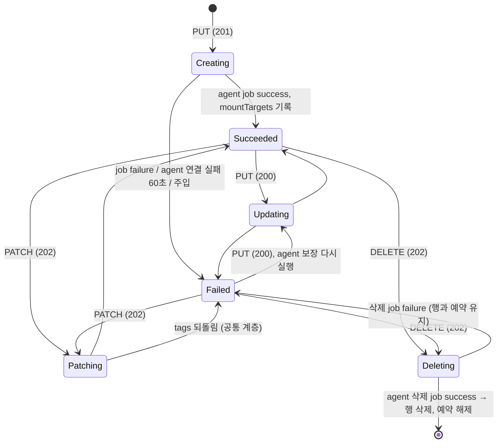

# volume 설계 (FR-04 볼륨, NFS)

- 작성: 2026-11-07, 메인 세션. 사용자 확인: 2026-11-07 (결정 1~4는 사용자가 선택지 중에서 골랐다. 결정 5~16은 메인이 기본으로 제시했고 사용자가 이견을 내지 않았다).
- 입력: `01_researcher_brief.md` (조사 상태 `한도 도달`, 설계를 막는 미확인 없음), `_workspace/spikes/S1.md`, `_workspace/spikes/S0.md`, 풀 설계 `_workspace/capacity-pool/02_main_design.md` §6·§8.
- **변경 (2026-11-07, S2 반영).** 사용자 결정: "설계에 반영해". S2 세션이 고쳤다. 근거는 [S2](../spikes/S2.md)(D-12 = T1n)와 볼륨 세션의 구현 중 실환경 확인(export 클라이언트 `*`, `mp`, unlock 뒤 umount 재시도)이다.
  - 핵심: 볼륨마다 NFS 서버 인스턴스(자기 netns의 knfsd)와 마운트 IP를 하나씩 둔다 (결정 17, 18).
  - 바뀐 곳: 결정 2·7·10·11·12·15·16, §3 "아직 확정하지 않은 것", §4.2, §6, §7, §8.
  - 처리량 제한(tc)은 FR-08에서 인스턴스의 veth에 건다. 이번 사이클에는 넣지 않는다.

## 1. 관련 ID

- PRD: FR-04 (볼륨), FR-03 이월 기준(CV-1~CV-3, 볼륨 생성 용량 검사), FR-01 (LRO 재사용), NFR-01 (실제 효과), NFR-02 (API 충실도), NFR-05 (테스트 우선), NFR-07 (로컬 전용), NFR-08 (상관 ID)
- ADR: AR-01~AR-07, AR-10, D-03, D-06, D-10, **D-11 (이번에 확정: C)**, §5 (스토리지 루트 확정), §6.1, §6.4 (작업 식별자·단계별 복구 확정), §7.1, §7.2, §7.4, R-02, R-04, R-07, R-08
- 스파이크: [S0](../spikes/S0.md) (통과), [S1](../spikes/S1.md) (C 통과)

## 2. 범위

### 재현한다

- ARM 볼륨 리소스: PUT 생성·갱신, PATCH(tags), DELETE, GET, 풀 아래 목록. 공통 LRO 계층을 재사용한다.
- 본문 규칙: 이름, `creationToken`, `usageThreshold`, `protocolTypes`, `subnetId`, 서비스가 채우는 값(`fileSystemId`, `mountTargets`, 기본 export 규칙, `unixPermissions`, `snapshotDirectoryVisible`, `actualThroughputMibps`).
- 부모 규칙과 용량 예약: 풀 설계 §6의 규칙을 볼륨 쪽에서 구현한다. CV-1~CV-3을 실환경에서 검증한다.
- **storage agent (첫 구현).** root로 도는 별도 프로세스가 ONTAP REST 부분집합(`/api/storage/volumes`, `/api/cluster/jobs/{uuid}`)을 제공한다. 볼륨마다 thin LV + ext4를 만들고, 네임스페이스 아래에 마운트하고, NFS로 export한다.
- 데이터 효과: 클라이언트 컨테이너가 `<마운트 IP>:/<creationToken>`을 NFSv3·NFSv4.1로 마운트해 읽고 쓴다. 볼륨 크기를 넘는 쓰기가 실패한다. 삭제하면 마운트되지 않는다.

### 미룬다

| 미룬 것 | 이번 동작 | 여는 사이클 |
| --- | --- | --- |
| `usageThreshold` 변경 (크기 변경) | 값이 바뀌면 `400` (같은 값은 허용) | FR-16 볼륨 크기 변경 |
| `exportPolicy` 입력 (규칙 지정·변경) | `400`. 기본 규칙만 서비스가 채우고 실제 export에 반영한다 | FR-15 export policy |
| `snapshotDirectoryVisible` 입력 | `400` | FR-05 스냅샷 |
| `throughputMibps`, Manual QoS 풀의 볼륨 | `400` | FR-08 처리량 제한 |
| `unixPermissions` 변경 (PATCH·PUT 갱신) | 값이 바뀌면 `400`. 생성 때 값은 볼륨 루트에 실제로 적용한다 | FR-15 또는 별도 |
| `snapshotId`·`backupId`(복원), `dataProtection`, Kerberos·LDAP, large volume, `coolAccess: true`, SMB(`CIFS`), `securityStyle: ntfs`, poolChange | `400` | 각 기능 |
| 풀의 `utilizedThroughputMibps` 합산 | 풀 본문은 지금처럼 `0.0` | FR-08 |

사용자 확인 (결정 4): 미룬 속성은 지금 거절하고, 각 기능 사이클이 데이터 효과를 구현할 때 연다. 받아서 저장만 하면 상태만 바뀌는 시뮬레이션이 되어 NFR-01에 어긋난다.

## 3. 결정과 버린 대안

| # | 결정 | 버린 대안과 이유 |
| --- | --- | --- |
| 1 | **D-11 = C. dm-thin 씬 풀 하나 위에 볼륨마다 thin LV + ext4.** (사용자 선택) | A(btrfs 서브볼륨 + qgroup): S1에서 NFSv3로 읽기 전용 스냅샷 파일이 수정됐고, 클라이언트 `df`가 풀 전체 크기를 보였고, 스냅샷 inode가 볼륨과 겹쳤다. B(볼륨마다 btrfs): 스냅샷 구조가 A와 같고, 새 볼륨 복원에 send/receive 복사가 필요하다. |
| 2 | **마운트 경로는 nfs-utils `[exports] rootdir`로 만든다.** `rootdir=/var/lib/anf-clone/ns`. 볼륨은 `ns/<creationToken>`에 마운트하고 export 경로는 `/<creationToken>`이다. v3·v4.1 모두 `<IP>:/<creationToken>`이다. `ns`가 SVM 루트 볼륨(네임스페이스 진입점), `/<creationToken>`이 junction path에 해당한다 [추론: 브리프 "ONTAP 대응"]. (사용자 선택) | 서버 루트에 직접 마운트(`/<token>`): WSL 루트에 디렉터리가 생기고 `/etc` 같은 이름을 막아야 하며 스토리지 루트 밖에 쓴다. 전체 경로(`/var/lib/anf-clone/.../<token>`): FR-04 수락 기준의 경로와 다르다. 심볼릭 링크: S1에서 v4.1이 안 됐다. **확인 (2026-11-07, 구현 첫 단계):** `/etc/nfs.conf.d/anf-clone.conf`에 `rootdir`를 넣고 nfs-server를 재시작했다(`nfsconf --get exports rootdir` = `/var/lib/anf-clone/ns`). `ns/rdtest`를 `/rdtest`로 export하자 컨테이너가 `172.30.0.1:/rdtest`를 `vers=3,nolock`과 `vers=4.1`로 모두 마운트했고, v4.1로 쓴 파일이 v3에 보였다. **S2 반영 뒤 (결정 17):** 볼륨은 그대로 호스트 `ns/<creationToken>`에 마운트한다. `rootdir`는 호스트가 아니라 볼륨 인스턴스 안에 둔다: 인스턴스는 호스트 `ns`를 `/export`로 바인드하고, 이미지의 `/etc/nfs.conf`에 `[exports] rootdir=/export`가 있다. 호스트의 `/etc/nfs.conf.d/anf-clone.conf`는 더 쓰지 않는다. 짧은 확인(2026-11-07, S2 세션) 결과, 이 배치로 v3 `ip:/<token>` 마운트는 됐다. **v4.1 마운트는 30초 안에 끝나지 않았고 원인은 조사하지 않았다** (§3 "아직 확정하지 않은 것"). |
| 3 | **최소 볼륨 크기는 기본 50 GiB(ANF)이고, 검증할 때만 `ANF_MIN_VOLUME_SIZE_GIB`로 낮춘다.** anf-api 시작 때 읽는다. 기본값과 다르면 경고 로그를 남긴다 (`ANF_FAULT_INJECTION`과 같은 방식). (사용자 선택) | 50 GiB 고정: 초과 쓰기 검증마다 50 GiB 넘게 써야 한다(수 분, 호스트 디스크 50 GB). 데이터 플레인 CI(러너 디스크 약 14 GB)에서는 불가능하다. 1 GiB 고정: ANF 계약과 다르다. |
| 4 | **데이터 효과가 아직 없는 속성 변경은 `400 InvalidRequestContent` "… is not supported by this ANF clone."로 거절한다** (§2 "미룬다"). 같은 값을 다시 보내는 것은 허용한다(PUT 갱신은 필수 속성을 다시 보내야 하므로). (사용자 선택) | 받아서 저장만: NFR-01 위반. `usageThreshold` 확장만 지금 구현: FR-16의 조사(축소 규칙, `maxfiles`)를 건너뛴다. |
| 5 | **씬 풀 하나가 ONTAP aggregate 역할이다.** 스토리지 루트의 희소 파일(`aggr0.img`) → 루프 장치 → VG `anf` → 씬 풀 `aggr0`. 용량 풀은 지금처럼 컨트롤 플레인 예산이고 agent에 아무것도 만들지 않는다 (풀 결정 2 유지). | 용량 풀마다 씬 풀: 풀 생성·삭제·크기 변경이 데이터 플레인 작업이 되어 풀 사이클을 다시 연다. 풀에 대응하는 ONTAP 객체도 공개 자료에 없다(풀 브리프). |
| 6 | **ext4는 `nodelalloc`으로 마운트한다.** `mkfs.ext4 -m 0 -U <fileSystemId>`, 만든 직후 `lost+found`를 지우고 루트 권한을 `unixPermissions`로 바꾼다. | 기본(delalloc): S1에서 클라이언트는 오류를 받았지만, 오류 뒤 남은 데이터가 원본의 앞부분이 아니었다. XFS: 시험하지 않았다. |
| 7 | **export는 볼륨의 인스턴스 안에 하나만 둔다** (결정 17). 인스턴스가 시작할 때 `exportfs -o <옵션> '*:/<creationToken>'`으로 적용한다. 옵션은 `rw,sync,no_subtree_check,no_root_squash,secure,crossmnt,mp,fsid=<fileSystemId>`이다 (ANF 기본 규칙: 전체 허용, 읽기·쓰기, root 허용). 호스트 knfsd에는 export를 만들지 않는다. | 호스트 export 파일 + `exportfs -ra` (S2 반영 전의 결정): 호스트 knfsd 하나를 공유하면 FR-08 처리량 제한이 v4.1에서 볼륨을 구분하지 못한다 (S2 T1). 클라이언트 `0.0.0.0/0`: mountd가 127.0.0.1도 "unmatched host"로 거절했다. `*`는 통과했다 (볼륨 세션 실환경 확인). `mp`: 마운트되지 않은 `ns/<token>`의 export를 mountd가 거절한다 ("request to export an unmounted filesystem"). 부팅 직후 빈 디렉터리가 export되는 것을 막는다 (같은 확인). `fsid`를 명시하는 이유: thin 스냅샷·복원 볼륨이 같은 ext4 UUID를 갖는다 (S1). `crossmnt`는 FR-05의 스냅샷 하위 마운트를 위해 미리 둔다. |
| 8 | **agent는 ARM을 모른다.** 볼륨 메타데이터(이름, junction path, 크기)는 LV 이름과 LVM 태그에 둔다. agent에는 DB가 없고, job 표는 메모리에만 있다. | agent SQLite: 재시작 복구는 LVM에서 실제 상태를 읽는 편이 더 정확하다 (ADR §6.4 "실제 상태와 대조"). |
| 9 | **안정적인 작업 식별자 = 볼륨 UUID(`fileSystemId`).** anf-api는 PUT 때 `fileSystemId`를 만들어 저장하고, agent `POST /api/storage/volumes`에 `uuid`로 넘긴다. agent의 생성은 "있으면 확인, 없으면 만들기"로 멱등이다. 같은 UUID에 진행 중인 job이 있으면 그 job을 돌려준다. 워커는 job ID를 저장하지 않는다. 재시작하거나 job이 404면 다시 POST한다. | job ID를 작업 행에 저장: 저장 전후 어느 시점에 죽어도 같은 결과가 나와야 하므로 결국 멱등 POST가 필요하다. 그러면 저장한 ID는 쓸 데가 없다. ONTAP POST는 `uuid`를 받지 않는다. 이것은 클론의 확장이고 agent API 문서에 표시한다 (R-04). |
| 10 | **단계별 복구.** 생성 job은 다음 순서다. 단계마다 실제 상태를 보고 이미 된 것은 건너뛴다.<br>(1) LV 확인·생성. IP는 이 단계에서 태그로 함께 정한다 (결정 18)<br>(2) 파일시스템 확인(`blkid`)·생성<br>(3) 마운트 확인·마운트<br>(4) 처음 만들 때만 루트 권한·`lost+found` 정리<br>(5) 인스턴스 확인·생성·시작 (결정 17)<br>삭제 job은 다음 순서이고, 없는 것은 건너뛴다.<br>(1) 인스턴스 안에서 `unlock_filesystem` → `rpc.nfsd 0` → 컨테이너 제거<br>(2) 호스트에서 `unlock_filesystem` + `umount`를 0.5초 간격으로 최대 60초 반복<br>(3) `lvremove`<br>(4) 마운트 지점 제거<br>umount가 바로 되지 않는 경우: 볼륨 세션 실환경에서 v4.1 클라이언트가 읽은 뒤 8.4초, S2에서 인스턴스 제거 뒤 1분 안쪽 동안 busy였다. agent가 시작하면 `ns` 공유 마운트를 보장하고(결정 17), 태그가 붙은 모든 LV를 활성화·마운트한 뒤 인스턴스를 시작한다(WSL 재시작 대비). | 실패 때 보상 정리(생성 도중 실패하면 지우기): 같은 UUID로 다시 POST하면 이어서 완성되고, ARM `Failed` 볼륨은 DELETE로 정리된다. 정리 코드가 둘이 될 필요가 없다. |
| 11 | **anf-api 처리기.** CREATE·UPDATE·PATCH 모두 같은 "agent에 볼륨 보장(POST) → job 폴링 → 성공하면 agent `GET /api/storage/volumes/{uuid}`의 `data_lif.ip.address`로 `mountTargets` 기록"이다. 그래서 생성이 `Failed`인 볼륨을 다시 PUT하면 데이터 플레인까지 완성된다. DELETE는 agent DELETE → job 폴링이다. agent 호출은 표준 라이브러리 HTTP(`urllib`, 스레드)로 한다. 연결이 안 되면 60초 동안 재시도한 뒤 작업을 `Failed`로 끝낸다. | 새 HTTP 의존성(httpx): 호출 몇 개에 의존성을 늘릴 필요가 없다. 런타임 의존성이 바뀌면 `pyproject.toml`이 바뀐다. |
| 12 | **`mountTargets`는 생성 작업이 성공한 뒤에 나타난다** (녹화 V1: 201 본문에는 없고 완료 뒤 GET에 있다). `mountTargetId` = `fileSystemId`, `ipAddress`는 그 볼륨 인스턴스의 IP다. agent가 정하고(결정 18) anf-api가 agent에서 읽는다. `ANF_MOUNT_IP`는 없앤다. `fileSystemId`, `protocolTypes`, 기본 export 규칙 등은 201 본문부터 보인다(녹화와의 차이, 개념 문서에 기록). | anf-api가 IP를 정함: IP는 데이터 플레인 자원(인스턴스의 네트워크)이고 재시작 복구 때 agent가 LVM 태그에서 다시 읽어야 하므로 agent 쪽에 둔다. agent의 `/api/network/ip/interfaces`(data LIF) 구현: ONTAP과 더 닮았지만 볼륨당 LIF 하나인 지금은 볼륨 레코드의 확장 필드로 충분하다 (§6.2, R-04). |
| 13 | **ANF 코드가 확인되지 않은 규칙 위반은 동기 `400 BadRequest` + ANF 문서의 메시지다** (풀 결정 4·7과 같음). 경로 중복 "File path already in use.", `creationToken` 변경 "CreationToken cannot be changed.", `fileSystemId` 변경 "FileSystemId cannot be changed.", 풀 용량 초과 "Pool size too small for total volume size.", `Succeeded`가 아닌 풀 "Volume cannot be created in a pool that isn't in state succeeded." 본문 형식 오류와 미룬 속성은 `400 InvalidRequestContent`다. | 작업을 만든 뒤 `Failed`: 실패한 볼륨 행이 예약을 계속 잡아 정리 규칙이 더 필요하다. 코드 지어내기: 근거가 없다. |
| 14 | **진행 중인 볼륨에 PUT·PATCH·DELETE는 `409 RequestConflict`이고 녹화 V6의 메시지를 쓴다.** 볼륨 모듈에서 검사한다. 계정·풀은 지금의 `AnotherOperationInProgress`를 유지한다. | 공통 코드를 바꿔 모든 리소스에 적용: 계정·풀의 확정된 계약이 바뀐다. 녹화 V6은 볼륨 사례뿐이다. |
| 15 | **`creationToken`은 클론 전체에서 유일하다(대소문자 무시).** ANF는 "서브넷마다 유일"이다. 클론은 볼륨마다 IP가 다르지만(결정 18) 호스트 마운트 지점 `ns/<creationToken>`을 모든 볼륨이 나눠 쓰므로 경로가 겹치면 충돌한다. 밑줄은 허용한다(스펙·RP 오류 문서). 16자 최소는 적용하지 않는다(녹화 15자 성공). | `subnetId` 값별 유일: 서로 다른 `subnetId`라도 같은 마운트 IP·경로가 되어 실제로 충돌한다. |
| 16 | **`subnetId`는 ARM 서브넷 ID 형식만 검사하고, 생성 뒤 바꿀 수 없다.** 위임·VNet 존재는 검사하지 않는다 (PRD 비목표). `protocolTypes`는 `["NFSv3"]` 또는 `["NFSv4.1"]` 하나만 받는다. 기본은 `["NFSv3"]`이다. 기본 export 규칙의 `nfsv3`·`nfsv41` 플래그는 `protocolTypes`를 따른다(NFSv4.1 쪽은 [추론]). **볼륨 인스턴스는 `protocolTypes`의 버전만 켠다** (결정 17): `["NFSv3"]`이면 `rpc.nfsd -V 3 -N 4`, `["NFSv4.1"]`이면 `rpc.nfsd -N 3 -N 4.0 -V 4.1 -N 4.2`. 짧은 확인(S2 세션)에서 v3 전용 인스턴스는 v4.1을, v4.1 전용 인스턴스는 v3·v4.0을 `Protocol not supported`로 거절했다. `-N 4.2`는 아직 확인하지 않았다. `serviceLevel`은 풀 값을 물려받고, 다른 값을 보내면 `400`이다(poolChange는 미룸). | 프로토콜 변경 PATCH 허용: 인스턴스의 버전을 바꾸는 데이터 플레인 작업이 필요하다. 이번 범위가 아니다. |
| 17 | **볼륨마다 NFS 서버 인스턴스 하나** (S2 T1n, D-12). 인스턴스는 그 볼륨만 export하는 knfsd이고, 자기 네트워크 네임스페이스에서 돈다. knfsd의 스레드·export 캐시·서버 신원은 netns마다 따로다.<br>**구성.** privileged Docker 컨테이너 `anf-nfs-<uuid 32자리>`, 이미지 `anf-nfs-server`(alpine 3.20 + `nfs-utils`, `/etc/nfs.conf`에 `[exports] rootdir=/export`), 네트워크 `anf-vnet`, 고정 IP(결정 18). 호스트 `ns`를 `/export`로 바인드한다(`bind-propagation=rslave`).<br>**`ns` 공유 마운트.** WSL의 `/`는 private 마운트라 rslave 바인드가 거절된다("not a shared or slave mount"). 그래서 agent가 시작할 때 `ns`를 자기 자신에 바인드하고 `--make-rshared`로 만든다(S2 세션 확인). 그러면 나중에 호스트에서 `ns/<token>` 아래에 하는 마운트(FR-05 스냅샷)가 인스턴스에도 보인다 [추론, 미확인].<br>**진입점.** nfsd 마운트 → `rpcbind -w` → `exportfs`(결정 7) → `rpc.mountd` → `rpc.nfsd <버전>(결정 16) 4` → `v4_end_grace`.<br>**시작 시점.** 재시작 정책은 쓰지 않는다. agent가 호스트 마운트를 끝낸 뒤 시작한다(`mp`가 빈 디렉터리 export를 한 번 더 막는다).<br>**ONTAP 대응 [추론].** 인스턴스의 IP = data LIF, 인스턴스 = 그 LIF로 NFS를 제공하는 SVM의 NFS 서버. ONTAP은 SVM 하나가 여러 볼륨을 서비스하지만, 클론은 볼륨마다 하나를 둔다. | 호스트 knfsd 하나: v4.1 클라이언트가 같은 서버 신원의 IP들을 연결 하나로 합쳐서 FR-08의 볼륨별 제한이 불가능하다(S2). 용량 풀마다 인스턴스 하나: 같은 풀의 볼륨끼리 같은 문제가 생긴다. 볼륨마다 Ganesha(T3): knfsd를 바꾸는 비용에 비해 얻는 것이 없다(S2). 컨테이너 안 tmpfs `fsid=0` 루트: v4.1은 S2에서 됐지만 v3 경로가 `/export/<token>`이 되어 FR-04 경로와 다르다. `rootdir` 방식의 v4.1이 끝내 안 되면 이 대안을 다시 본다. |
| 18 | **볼륨 IP는 agent가 정한다.** `anf-vnet`(172.30.0.0/24)은 준비 스크립트가 `--ip-range 172.30.0.0/25`로 만든다. 클라이언트 컨테이너는 Docker가 .2~.127에서 동적으로 받는다. 볼륨 인스턴스는 172.30.0.128/25(.129~.254, 최대 126개)에서 고정 IP를 받는다. agent는 LV 생성 단계(결정 10의 1)에서 다른 LV 태그에 없는 가장 작은 주소를 골라 태그 `anf_ip=<주소>`로 LV에 함께 기록한다. 그래서 같은 UUID로 다시 POST해도 같은 IP가 된다. 볼륨을 지우면 태그와 함께 IP가 풀린다. | anf-api가 정함: 결정 12의 이유. 컨테이너 IP를 Docker에 맡김: 인스턴스를 다시 만들면 IP가 바뀌어 `mountTargets`와 어긋난다. |

### 아직 확정하지 않은 것

- **S2 반영으로 생긴 미확인 (구현 첫 단계에서 확인한다).** → 네 가지 모두 확인했다. 결과는 아래 "구현 중 변경"의 "S2 미확인 해결"에 있다.
  1. **인스턴스 안 `rootdir`의 v4.1 마운트.** 짧은 확인에서 v3는 됐지만 v4.1 마운트가 30초 안에 끝나지 않았다. 원인은 조사하지 않았다. 볼륨 세션은 호스트 knfsd에서 같은 `rootdir` 방식으로 v4.1이 되는 것을 확인했다. 그래서 인스턴스 쪽 차이(grace, `v4recovery`, pseudo-root가 바인드 디렉터리인 점 등)부터 본다. 끝내 안 되면 결정 17의 대안(tmpfs `fsid=0` 루트)과 FR-04 경로의 차이를 사용자와 정한다.
  2. **`ns` 아래 나중 마운트의 전파** (결정 17). FR-05 전에 확인하면 되지만, 볼륨 마운트 자체도 인스턴스보다 먼저 하므로 이번 통합 테스트에서 함께 본다.
  3. **`-N 4.2`** (결정 16).
  4. **인스턴스당 메모리.** nfsd 스레드 4개, `rpcbind`, `rpc.mountd`. NFR-06(약 7 GB) 안에서 볼륨 몇 개까지 되는지 통합 테스트 때 `docker stats`로 적는다.
- **FR-08로 넘기는 것.** 인스턴스의 호스트 쪽 veth에 clsact를 걸고, 양방향을 IFB 하나로 보내 HTB 클래스 하나로 읽기·쓰기 합산 한도를 건다. 한도 변경은 `tc class change`로 한다 (S2 T1n).
- 씬 풀 크기: 희소 파일 1 TiB를 기본 후보로 둔다. 실제 할당은 쓴 만큼만 늘어난다. 할당량 합이 aggregate를 넘으면 agent job이 실패한다(ANF의 백엔드 용량 한계와 같은 자리). 과할당(overcommit)은 하지 않는다.

## 4. API 계약

### 4.1 작업별 응답 (ARM)

경로: `/subscriptions/{s}/resourceGroups/{rg}/providers/Microsoft.NetApp/netAppAccounts/{a}/capacityPools/{p}/volumes/{v}?api-version=2026-08-01`

| 작업 | 응답 | 본문 | 헤더 | 작업 상태 | 근거 |
| --- | --- | --- | --- | --- | --- |
| PUT 생성 | `201` | 볼륨, `Creating` | `Azure-AsyncOperation`만 | `Creating` → `Succeeded`/`Failed`, `action: CREATE` | 녹화 V1 |
| PUT 갱신 | `200` | 볼륨, `Updating` | `Azure-AsyncOperation` | `Updating` → …, `action: UPDATE` | 녹화 V5 |
| PATCH | `202` | 볼륨, `Patching` | `Azure-AsyncOperation` + `Location` | `Patching` → …, `action: PATCH` | 녹화 V3, V4 |
| DELETE 있음 | `202` | 없음 | `Azure-AsyncOperation` + `Location` | `Deleting` → …, `action: DELETE` | 녹화 V1 |
| DELETE 없음 | `204` | 없음 | 없음 | 작업 없음 | 스펙 |
| GET | `200` | 볼륨 | — | — | |
| 목록 (풀 아래) | `200` | `{"value": [...]}` | — | — | 스펙, 녹화 V1 |
| 진행 중인 볼륨에 PUT·PATCH·DELETE | `409 RequestConflict` | 녹화 V6 메시지 | — | 작업 안 만듦 | 녹화 V6 (결정 14) |
| 없는 풀 아래 PUT | `404 ParentResourceNotFound` | 게이트웨이 문구 | — | | 녹화 N6 |
| 풀이 `Deleting` | `409 Conflict` | | | | 풀 결정 6과 같음 |
| 볼륨이 남은 풀 DELETE | `409 CannotDeleteResource` | 녹화 N5 (이미 구현) | | | CV-1 |

`Location` 방식(`operationResultResponseType=Location`)은 공통 계층 그대로다: 진행 중 `202`, 생성·갱신·PATCH가 끝나면 `200` + 볼륨 본문, 삭제가 끝나면 `204`.

### 4.2 볼륨 본문

```json
{
  "id": "/subscriptions/{s}/resourceGroups/{rg}/providers/Microsoft.NetApp/netAppAccounts/{a}/capacityPools/{p}/volumes/{v}",
  "name": "{a}/{p}/{v}",
  "type": "Microsoft.NetApp/netAppAccounts/capacityPools/volumes",
  "location": "...", "tags": {},
  "properties": {
    "provisioningState": "Succeeded",
    "fileSystemId": "<uuid>",
    "creationToken": "vol1", "usageThreshold": 107374182400,
    "subnetId": "/subscriptions/.../virtualNetworks/{vnet}/subnets/{subnet}",
    "serviceLevel": "Premium", "protocolTypes": ["NFSv3"],
    "networkFeatures": "Basic",
    "exportPolicy": {"rules": [{"ruleIndex": 1, "unixReadOnly": false, "unixReadWrite": true,
      "cifs": false, "nfsv3": true, "nfsv41": false, "allowedClients": "0.0.0.0/0",
      "kerberos5ReadOnly": false, "kerberos5ReadWrite": false, "kerberos5iReadOnly": false,
      "kerberos5iReadWrite": false, "kerberos5pReadOnly": false, "kerberos5pReadWrite": false,
      "hasRootAccess": true, "chownMode": "Restricted"}]},
    "unixPermissions": "0770", "snapshotDirectoryVisible": true, "securityStyle": "unix",
    "actualThroughputMibps": 6.25,
    "mountTargets": [{"mountTargetId": "<fileSystemId>", "fileSystemId": "<fileSystemId>", "ipAddress": "172.30.0.129"}]
  }
}
```

- `actualThroughputMibps` = `usageThreshold / 2^40 × 단가`(Standard 16, Premium 64, Ultra 128). Premium 100 GiB = `6.25` (녹화 V1). 풀 결정 10과 같은 2진 TiB.
- `mountTargets`는 생성 작업이 한 번 성공한 뒤부터 나온다 (결정 12). `ipAddress`는 볼륨마다 다르다 (결정 18).
- `networkFeatures`는 `Basic`·`Standard`를 받아 저장만 한다. Azure 네트워크 개념이라 데이터 플레인 효과가 없다(PRD: Azure 쪽 개념은 부차적). 기본 `Basic`(스펙).

### 4.3 본문 규칙과 오류

| 규칙 | 위반 응답 |
| --- | --- |
| 볼륨 이름 `^[a-zA-Z][a-zA-Z0-9\-_]{0,63}$` | `400 InvalidResourceName` |
| PUT 생성에 `creationToken`·`usageThreshold`·`subnetId` 필수 | `400 InvalidRequestContent` |
| `creationToken` `^[a-zA-Z][a-zA-Z0-9\-_]{0,79}$` | `400 InvalidRequestContent` (RP 오류 문서 문구) |
| `usageThreshold` 정수, 1 GiB 배수, `최소(기본 50 GiB) ~ 100 TiB` | `400 InvalidRequestContent` |
| `protocolTypes` `["NFSv3"]` 또는 `["NFSv4.1"]` | `CIFS` 포함은 미룬 기능 문구, 그 밖은 형식 오류. 모두 `400 InvalidRequestContent` |
| `subnetId` 형식 `/subscriptions/{s}/resourceGroups/{rg}/providers/Microsoft.Network/virtualNetworks/{vnet}/subnets/{subnet}` | `400 InvalidRequestContent` |
| 미룬 속성 (§2), 모르는 속성 | `400 InvalidRequestContent` |
| `creationToken` 중복 (클론 전체, 대소문자 무시) | `400 BadRequest` "File path already in use." |
| `creationToken`·`subnetId`·`fileSystemId`를 다른 값으로 갱신 | `400 BadRequest` ("CreationToken cannot be changed." 등) |
| `usageThreshold`·`unixPermissions`·`protocolTypes`·`serviceLevel`을 다른 값으로 갱신 | `400 InvalidRequestContent` (미룬 기능 문구) |
| 풀 할당량 합 + 새 볼륨 > 풀 `size` | `400 BadRequest` "Pool size too small for total volume size." |
| 풀이 `Succeeded`가 아님 (`Deleting` 제외) | `400 BadRequest` "Volume cannot be created in a pool that isn't in state succeeded." |
| 풀이 Manual QoS | `400 InvalidRequestContent` (Manual QoS 볼륨은 FR-08) |
| 기존 볼륨에 다른 `location` | `409 InvalidResourceLocation` (공통) |

검사 순서: 이름 → 본문 형식 → (트랜잭션 안) 부모 존재·상태 → 진행 중 작업 → 불변 속성 → 경로 중복 → 용량.

## 5. 상태 전이



## 6. storage agent

### 6.1 배치

- 패키지 `backend/storage_agent/`. root로 실행: `sudo ~/.venvs/anf-clone/bin/python -m uvicorn --factory storage_agent.agent_app:create_app --app-dir backend --host 127.0.0.1 --port 8090`.
- anf-api는 `ANF_STORAGE_AGENT_URL`(기본 `http://127.0.0.1:8090`)로 호출한다. 요청마다 `x-ms-correlation-request-id`를 넘기고 agent가 로그에 남긴다 (NFR-08).
- 스토리지 루트 `/var/lib/anf-clone` (ADR §5 확정): `aggr0.img`(희소 파일), `ns/`(볼륨 마운트 지점. 인스턴스 안에서 `/export` = NFS `rootdir`).
- 일회성 준비 스크립트 `scripts/setup-wsl-dataplane.sh` (root). 하는 일:
  - 패키지(`lvm2`, `thin-provisioning-tools`)를 확인하고 `modprobe nfsd`를 한다.
  - 이미지 `anf-nfs-server`를 빌드한다.
  - `anf-vnet`을 `--subnet 172.30.0.0/24 --gateway 172.30.0.1 --ip-range 172.30.0.0/25`로 만든다. 다른 설정으로 이미 있으면 멈추고 알린다.
  - 앞선 구현 단계에서 넣은 호스트 `/etc/nfs.conf.d/anf-clone.conf`를 지운다.
  - 호스트 `nfs-server`는 볼륨에 쓰지 않는다. nfsd 모듈만 필요하다.
- **`rootdir` 확인 위치.** 호스트 `nfsconf` 검사는 없앤다. `rootdir`는 이미지에 들어 있고, 인스턴스 진입점이 `nfsconf --get exports rootdir`가 `/export`인지 확인한 뒤 export한다.
- **agent 시작 검사.** 다음을 확인하고, 아니면 뜨지 않는다.
  - Docker 사용 가능(root라 소켓 접근 가능)
  - 이미지 `anf-nfs-server`가 있음
  - `anf-vnet`의 subnet·ip-range가 위 값과 같음
  - 그다음 `ns` 공유 마운트를 보장한다 (결정 17).

### 6.2 API (ONTAP REST 부분집합)

| 메서드·경로 | 요청 | 응답 | ONTAP과 다른 점 (R-04) |
| --- | --- | --- | --- |
| `POST /api/storage/volumes` | `{"uuid", "name", "size", "nas": {"path": "/<token>", "unix_permissions": 770, "protocols": ["nfs3"] 또는 ["nfs4.1"]}}` | `202 {"job": {"uuid", "_links": {"self": {"href": "/api/cluster/jobs/<uuid>"}}}}` | `uuid`를 요청에서 받는다(멱등 키, 결정 9). `svm`·`aggregates`는 받지 않는다(하나뿐). `nas.protocols`는 클론 확장이다. ONTAP은 프로토콜을 export policy 규칙의 `protocols`로 정한다. 이미 같은 설정으로 있으면 성공 job, 다른 설정이면 실패 job |
| `GET /api/storage/volumes` | `?name=` | `{"records": [...], "num_records": n}` | 필드는 `uuid`, `name`, `size`, `nas.path`, `nas.protocols`, `state`, `data_lif`만 |
| `GET /api/storage/volumes/{uuid}` | | `200` 또는 `404`. `data_lif: {"ip": {"address": "172.30.0.129"}}` 포함 | `data_lif`는 클론 확장이다(결정 12, 18). ONTAP에서는 IP가 볼륨이 아니라 SVM의 네트워크 인터페이스(`/api/network/ip/interfaces`, 필드 `ip.address`)에 있다. 필드 모양은 그것을 따랐다 |
| `DELETE /api/storage/volumes/{uuid}` | | `202` + job. 없으면 성공 job | ONTAP은 없는 볼륨에 오류. 클론은 멱등 삭제 |
| `GET /api/cluster/jobs/{uuid}` | | `{"uuid", "state", "message", "code", "start_time", "end_time"}`. `state`는 `queued`·`running`·`success`·`failure` | job은 메모리에만 있어 agent가 재시작하면 404. 종료 job 보관 시간(ONTAP 300초)은 따른다 |

- ONTAP 볼륨 이름: `vol_<fileSystemId의 하이픈 뺀 32자리>`. LV 이름과 같다. 태그: `anf_path=<token>`, `anf_uuid=<uuid>`, `anf_ip=<주소>`(결정 18), `anf_proto=nfs3|nfs4.1`(결정 16).
- 커널 명령은 셸 없이 인자 목록으로 실행한다 (R-07). 입력은 agent에서 다시 검사한다: `uuid` 형식, `nas.path` 패턴(`creationToken`과 같음), `size` 범위.

### 6.3 테스트 층

| 층 | 대상 | 실행 위치 |
| --- | --- | --- |
| 단위 | anf-api 볼륨 규칙·처리기(가짜 agent), agent의 명령 순서·멱등·복구(가짜 실행기), job 표 | Windows(훅), WSL, CI |
| 계약 | anf-api 볼륨 라우트(가짜 agent), agent 라우트(가짜 볼륨 관리자) | Windows, WSL, CI |
| 통합 (`integration`) | agent가 실제 LVM·ext4와 볼륨 인스턴스(Docker, knfsd)로 볼륨을 만들고 지운다 | WSL root, Docker |
| E2E (`e2e`) | anf-api + agent + 클라이언트 컨테이너 마운트 | WSL (root agent, Docker) |

- 데이터 플레인 테스트에는 새 마커 `dataplane`을 붙이고, CI는 `-m "not dataplane"`으로 뺀다 (CI의 데이터 플레인 작업은 S3 뒤, ADR §9.3). CI는 skip이 있으면 실패하므로 skip이 아니라 선택에서 뺀다.

## 7. 내부 구조

| 모듈 | 내용 | 짝 테스트 |
| --- | --- | --- |
| `anf_api/arm_rules.py` | `VOLUME_TYPE`, `check_volume_name`, `volume_id` | `test_arm_rules.py` |
| `anf_api/volumes.py` (새) | 본문 규칙, 볼륨 본문, PUT·PATCH·DELETE·GET·목록, 처리기 생성(`make_handlers`) | `test_volumes.py` |
| `anf_api/storage_client.py` (새) | agent 호출(POST·DELETE·job 폴링, 재시도, 볼륨 GET의 `data_lif`) | `test_storage_client.py` |
| `anf_api/arm_app.py` | 볼륨 라우트, `ANF_STORAGE_AGENT_URL`·`ANF_MIN_VOLUME_SIZE_GIB` (`ANF_MOUNT_IP`는 없앰, 결정 12) | `test_arm_app.py`, 계약 `tests/contract/test_volumes_api.py` |
| `storage_agent/runner.py` (새) | 인자 목록 명령 실행기 | `test_runner.py` |
| `storage_agent/flexvol.py` (새) | aggregate 보장, 볼륨 생성·삭제·조회·시작 복구, IP 태그(결정 18). export는 `nfs_instance`에 맡긴다 | `test_flexvol.py` (가짜 실행기), 통합 `tests/integration/test_flexvol_linux.py` |
| `storage_agent/nfs_instance.py` (새) | 볼륨 인스턴스 보장·시작·제거(`docker` 명령, 결정 17), `ns` 공유 마운트 보장, 시작 검사(§6.1) | `test_nfs_instance.py` (가짜 실행기), 통합은 `test_flexvol_linux.py`에 포함 |
| `storage_agent/nfs_server/` (새, Python 아님) | `Dockerfile`(alpine 3.20 + `nfs-utils`, `nfs.conf`), `entrypoint.sh`(결정 17 진입점) | 통합 테스트 |
| `storage_agent/jobs.py` (새) | 메모리 job 표, 같은 키 중복 방지 | `test_jobs.py` |
| `storage_agent/agent_app.py` (새) | ONTAP 경로, 입력 검사, rootdir 확인 | `test_agent_app.py` |

- 모듈 이름은 훅의 파일 이름 짝짓기에 겹치지 않게 지었다 (ADR §9.2).
- 결함 주입 키: `volumes/{create|update|patch|delete}` (처리기에서 자동).

## 8. 검증 기준

**공통 조건**
- WSL Ubuntu. agent는 root(127.0.0.1:8090), anf-api는 일반 권한(127.0.0.1:8080). 준비 스크립트(§6.1: 이미지 `anf-nfs-server`, `anf-vnet` ip-range)와 aggregate 준비가 끝난 상태다.
- 마운트 IP는 하드코딩하지 않고 볼륨 GET의 `mountTargets[0].ipAddress`를 쓴다 (아래 `<ip>`).
- 검증용으로 `ANF_MIN_VOLUME_SIZE_GIB=1`을 켠다(결정 3). AC-06은 이 값을 끈 서버에서도 50 GiB 하한을 확인한다.
- 클라이언트: `anf-nfs-client` 이미지(alpine + nfs-utils + coreutils)의 privileged 컨테이너 두 개, 네트워크 `anf-vnet`.
- 폴링 1초 간격, 제한 시간 60초(지연을 주입했으면 지연 + 60초).
- 명령의 성공·실패는 종료 코드와 stderr 전체로 판정한다 (S1의 측정 실수 정정).

| ID | 층 | 기준 |
| --- | --- | --- |
| AC-01 | 계약·상태 | Premium 4 TiB 풀 아래에 `{creationToken, usageThreshold: 107374182400, subnetId}`로 PUT하면 `201`, `Creating`이 오고 헤더는 `Azure-AsyncOperation`만 있다. 폴링하면 `Succeeded`(`action: CREATE`)가 된다. GET에 §4.2의 값이 있다: UUID `fileSystemId`, `mountTargets[0]`(`mountTargetId` = `fileSystemId`, `ipAddress`는 172.30.0.128/25 안), `protocolTypes: ["NFSv3"]`, 기본 export 규칙(`nfsv3: true`), `unixPermissions: "0770"`, `serviceLevel: Premium`, `actualThroughputMibps: 6.25`. 풀 목록에 볼륨이 있다. |
| AC-02 | 데이터 (NFSv3) | 클라이언트 A가 `mount -t nfs -o vers=3 <ip>:/<creationToken>`으로 마운트하고 파일을 쓴다. 클라이언트 B가 같은 경로를 `vers=3`으로 마운트해 그 파일을 읽는다. 마운트 루트의 권한은 `0770`이다. 이 볼륨을 `vers=4.1`로 마운트하면 실패한다(결정 16). |
| AC-03 | 데이터 (NFSv4.1) | `protocolTypes: ["NFSv4.1"]` 볼륨은 기본 규칙이 `nfsv41: true`, `nfsv3: false`다. 클라이언트가 `vers=4.1`로 `<ip>:/<creationToken>`을 마운트하고 읽고 쓴다. 같은 볼륨을 `vers=3`, `vers=4.0`으로 마운트하면 실패한다(결정 16). |
| AC-04 | 데이터 (할당량) | 1 GiB 볼륨을 마운트한 클라이언트의 `df`가 약 1 GiB(ext4 오버헤드 안)를 보인다. 1.2 GiB를 `dd conv=fsync`로 쓰면 `dd`의 종료 코드가 0이 아니고 stderr에 `No space left on device`가 있다. 그 뒤 볼륨의 다른 파일은 그대로 읽힌다. |
| AC-05 | 계약 (용량·부모) | 풀 할당량 합을 넘는 볼륨 PUT은 `400 BadRequest`("Pool size too small …")이고 작업·LV·인스턴스가 생기지 않는다. 없는 풀 아래 PUT은 `404 ParentResourceNotFound`. 풀 삭제에 지연을 주입하고 `Deleting`인 풀 아래 PUT은 `409 Conflict`. **CV-1**: 볼륨이 있는 풀 DELETE는 `409 CannotDeleteResource`이고 메시지에 볼륨 ID가 있다. **CV-2**: 볼륨 할당량 합보다 작은 `size`로 풀 PUT·PATCH는 `400 BadRequest`. **CV-3**: 볼륨이 있는 풀의 `serviceLevel` 변경은 `400 BadRequest`. |
| AC-06 | 계약 (거절) | 다음은 모두 `400`이고 작업·LV·인스턴스가 생기지 않는다: 잘못된 볼륨 이름(`1vol`, 65자), `creationToken` 누락·패턴 위반(`-a`, 81자), `usageThreshold` 1 GiB 배수 아님·최소 미만·100 TiB 초과, `protocolTypes` `["CIFS"]`·`["NFSv3","NFSv4.1"]`·`[]`, 잘못된 `subnetId`, `subnetId` 누락, 미룬 속성(`exportPolicy`, `throughputMibps`, `snapshotDirectoryVisible`, `snapshotId`, `kerberosEnabled: true`), 모르는 속성, 풀과 다른 `serviceLevel`. 최소 크기 주입을 끈 서버에서는 49 GiB가 `400`, 50 GiB가 통과(본문 검사)다. |
| AC-07 | 계약 (경로·불변) | 같은 `creationToken`(대소문자만 다른 것 포함)으로 두 번째 볼륨을 만들면 `400 BadRequest` "File path already in use."이고 첫 볼륨은 그대로 마운트된다. PUT 갱신에서 `creationToken`·`subnetId`를 바꾸면 `400 BadRequest`, `usageThreshold`를 바꾸면 `400 InvalidRequestContent`이고 마운트 경로·크기가 그대로다. 같은 값을 다시 보내는 PUT 갱신은 `200`, `Updating` → `Succeeded`다. |
| AC-08 | 계약·상태 (PATCH) | tags만 바꾼 PATCH가 `202`, `Patching` 본문, 두 헤더를 받고 `Succeeded`(`action: PATCH`)가 된다. GET의 tags가 새 맵이다. 그동안 마운트한 클라이언트는 계속 읽고 쓴다. PATCH의 `usageThreshold` 변경은 `400`이다. |
| AC-09 | 데이터·상태 (DELETE) | DELETE하면 `202`(본문 없음, 두 헤더) → `Succeeded`(`action: DELETE`) → GET `404` → 다시 DELETE `204`. 그 뒤 새 마운트는 실패하고, 인스턴스 컨테이너 `anf-nfs-<uuid>`가 없고, LV와 `ns/<creationToken>`이 없다. 삭제 전에 마운트해 둔 클라이언트가 보는 것(오류 종류)을 기록한다. 같은 `creationToken`으로 새 볼륨을 다시 만들 수 있고, 지운 볼륨의 IP를 다시 쓸 수 있다. |
| AC-10 | 계약 (진행 중 충돌) | 볼륨 생성에 지연을 주입하고, 진행 중인 볼륨에 PUT·PATCH·DELETE를 보내면 `409 RequestConflict`(녹화 V6 메시지)이고 새 작업이 없다. 진행 중이던 작업은 `Succeeded`로 끝난다. |
| AC-11 | 상태 (실패와 회복) | 생성에 실패를 주입하면 작업 `Failed`, `error` 있음, 볼륨 `Failed`이고 할당량 예약이 남는다(같은 풀에 남은 용량이 줄어든 채). 주입을 끈 서버에서 같은 본문으로 PUT하면 `200`, `Updating` → `Succeeded`이고 마운트된다. agent를 멈춘 채 생성하면 60초 재시도 뒤 `Failed`이고, agent를 띄운 뒤 PUT하면 `Succeeded`가 된다. |
| AC-12 | 상태 (재시작 복구) | (a) 생성 지연 중 anf-api를 SIGKILL하고 다시 띄우면 작업이 `Succeeded`가 되고 마운트된다. (b) 생성 job 실행 중 agent를 멈췄다 다시 띄우면 작업이 `Succeeded`가 되고 LV가 하나뿐이다. (c) agent가 떠 있지 않을 때 볼륨 인스턴스를 멈추고 마운트를 손으로 내린 뒤(WSL 재시작 흉내) agent를 다시 띄우면 인스턴스가 같은 IP로 다시 뜨고, 클라이언트가 다시 마운트해 이전에 쓴 파일을 읽는다. |
| AC-13 | agent API | `POST /api/storage/volumes`가 `202` + job 링크를 주고 job이 `success`가 된다. 같은 `uuid`·설정으로 다시 POST하면 `success`이고 LV가 하나뿐이다. 같은 `uuid`에 다른 `nas.path`는 `failure`다. `GET ?name=`이 레코드 하나를 준다. 없는 `uuid` DELETE는 `success`다. `nas.path`에 `../x`나 `/` 포함 값은 `400`이다. |
| AC-14 | 회귀 | 계정·풀 e2e(`test_netapp_account_*_live.py`, `test_capacity_pool_*_live.py`)가 새 코드로 통과한다. |
| AC-15 | 데이터 (볼륨별 서버) | NFSv4.1 볼륨 두 개의 `mountTargets[0].ipAddress`가 서로 다르다. 클라이언트 하나가 둘을 `vers=4.1`로 마운트하면 `/proc/mounts`의 `addr=`가 각자의 IP이고, `ss -tn`에 두 IP로 가는 2049 연결이 따로 있다. FR-08 볼륨별 제한의 전제다 (S2 T1). |

## 구현 중 변경

### S2 미확인 해결 (§3 "아직 확정하지 않은 것")

1. **인스턴스 안 v4.1 마운트가 멈춘 원인은 NFSv4 유예 기간(grace)이었다.** 컨테이너(init 밖 netns)의 knfsd는 NFSv4 클라이언트 추적에 `nfsdcld`만 쓸 수 있다. 추적 수단이 없으면 knfsd가 90초 유예 기간을 돌고, 그동안 v4.1 OPEN이 막힌다. `v4_end_grace`에 쓰면 EBUSY였다(진입점이 `set -e`라 인스턴스가 죽었다). 진입점에서 rpc_pipefs를 마운트하고 `nfsdcld`를 띄우자, 되찾을 클라이언트가 없으면 유예를 건너뛰었고 v4.1 마운트는 0.09초였다. 대가: 추적 기록은 컨테이너 안에만 있어서, 인스턴스를 다시 만들면 이전 NFSv4 상태를 되찾지 못한다(재시작은 `docker start`라 기록이 남는다). 결정 17의 대안(tmpfs `fsid=0` 루트)은 필요 없었다.
   - **검증 1회차 AC-03 FAIL로 보강했다.** nfsdcld를 띄워도 인스턴스 시작의 7~8%는 추적 초기화에 실패해 90초 유예 기간으로 시작했다. 원인 추정: knfsd는 시작할 때 nfsdcld가 추적 파이프를 열기를 약 1초만 기다린다. 그런데 진입점과 agent 모두 결과를 확인하지 않았다. 실패가 남긴 흔적: dmesg "Unable to initialize client recovery tracking! (-2) / Is nfsdcld running?", 인스턴스 로그 `grace_ended=N`, 첫 쓰기 90~102초 지연.
   - 고친 것 (1) 진입점: `rpc.nfsd` 뒤에 `/proc/fs/nfsd/v4_end_grace`가 `Y`인지 본다. 아니면 `rpc.nfsd 0` 하고 1초 뒤 다시 띄운다. 5번 안에 안 되면 0이 아닌 코드로 끝난다. NFSv3 인스턴스에도 적용한다(유예 기간은 같은 netns의 NLM 잠금도 막는다). 다 되면 준비 표시 `/run/anf-ready`를 만든다.
   - 고친 것 (2) agent: `docker run`·`docker start` 뒤에 준비 표시를 0.5초 간격으로 60초까지 기다린다(`docker exec … test -e`). 컨테이너가 끝나면 로그 끝부분을 넣어 job을 실패시킨다. 그래서 `Succeeded`는 "서비스 중"을 뜻한다. 고치기 전에는 진입점이 knfsd를 띄우기 전에 job이 끝날 수 있었다.
   - 확인: `FlexVolManager`로 인스턴스를 45번 띄웠다. 3번(6.7%)이 첫 시도에서 실패했고, 모두 재시작 한 번으로 `Y`가 됐다. 생성 시간은 평균 1.36초, 최대 4.26초였다.
2. **전파.** `ns`를 공유 마운트로 만든 뒤 호스트가 `ns` 아래에 나중에 한 마운트도 인스턴스에 보였다. 다만 v3 클라이언트가 볼륨 안의 하위 마운트(스냅샷 흉내)로 넘어가면 "Stale file handle"이었다. FR-05에서 다룬다.
3. **`-N 4.2`가 된다.** v4.1 전용 인스턴스는 v3, v4.0, v4.2 마운트를 거절했고, v3 전용 인스턴스는 v4.1을 거절했다. 볼륨 IP가 다른 인스턴스끼리는 서로의 볼륨을 export하지 않았다.
4. **인스턴스당 메모리는 약 4 MiB**(`docker stats`, 유휴). 126개(IP 상한)를 띄워도 NFR-06(약 7 GB) 안이다.

### 동작이 바뀐 것

- **export 클라이언트는 `*`다** (결정 7). `0.0.0.0/0`은 mountd가 127.0.0.1도 "unmatched host"로 거절했다(호스트 export 단계의 통합 테스트). 근거는 진입점 주석에 둔다.
- **`mp` 옵션** (결정 7). 호스트 export 단계에서 마운트되지 않은 빈 디렉터리의 export가 "request to export an unmounted filesystem"으로 거절되는 것을 확인했다. T1n에서는 agent가 마운트 뒤에 인스턴스를 띄우므로 순서로도 막고, `mp`는 손으로 인스턴스를 띄운 경우를 막는다.
- **삭제 순서: 인스턴스 제거 → 언마운트(재시도) → 마운트 지점 제거 → LV 제거** (결정 10).
  - 인스턴스의 knfsd가 파일시스템을 잡고 있어서 인스턴스를 먼저 지운다. 호스트에서 `unlock_filesystem`에 쓰는 단계는 없앴다. 인스턴스의 진입점이 `docker stop`(SIGTERM)을 받으면 자기 netns에서 잠금을 풀고 `rpc.nfsd 0`, `exportfs -ua`를 한다.
  - 인스턴스를 지운 뒤에도 umount가 잠시 busy일 수 있어서, 0.5초 간격으로 60초까지 다시 시도한다. 그래도 busy면 job이 실패하고, 다시 DELETE하면 이어서 지운다. 측정값: 호스트 export 단계에서는 잠금을 푼 뒤 v3가 0.02~25초, v4.1이 8.4초 걸렸다. T1n 시제품에서는 인스턴스를 지운 뒤 1초였다.
  - 마운트 지점 제거를 `lvremove` 앞에 둔다. LV가 남아 있는 동안에는 태그로 경로를 알 수 있으므로, 어느 단계에서 멈춰도 다시 DELETE하면 끝난다.
- **시작 복구 순서: aggregate → `ns` 공유 마운트 → 볼륨 마운트 → 인스턴스** (결정 10, 17). `ns`를 자기 자신에 바인드하는 일은 볼륨 마운트보다 먼저 해야 한다. 나중에 바인드하면 그 아래의 기존 마운트를 가린다. WSL 재시작 뒤 인스턴스는 멈춘 채 남아 있으므로(재시작 정책 없음) `docker start`로 같은 IP로 다시 띄운다.
- **루트 초기화(권한, `lost+found` 삭제)는 "`lost+found`가 있는가"로 판단한다.** "이번 호출에서 mkfs를 했는가"로 판단하지 않는다. mkfs 뒤·초기화 전에 멈춰도 다시 POST하면 초기화된다. 초기화가 끝난 볼륨의 권한은 클라이언트가 바꿨을 수 있으므로 다시 바꾸지 않는다. agent가 같은 uuid를 비교할 때는 경로, 크기, 프로토콜만 본다.
- **agent도 과할당을 막고, 경로 중복을 대소문자 없이 검사한다.** 할당량 합이 씬 풀 크기를 넘으면 job이 실패한다. IP 126개를 다 쓰면 job이 실패한다.
- **job 키는 "작업 종류 + 볼륨 UUID"다** (결정 9를 다듬음). UUID만 키로 쓰면, 같은 UUID에 DELETE job이 진행 중일 때 들어온 POST가 그 DELETE job을 받아 성공으로 오인한다. 같은 요청을 다시 보내면 진행 중인 그 job을 받는 동작은 그대로다. job은 여전히 한 번에 하나씩 돈다(LVM 변경과 IP 선택이 겹치지 않게).
- **agent 입력 검사(R-07)**: `uuid`는 소문자 UUID, `name`은 `vol_<uuid 32자리>`와 같아야 한다. `size`는 1 GiB 배수로 1 GiB~100 TiB, `nas.path`는 `/` + `creationToken` 규칙이다. `nas.unix_permissions`는 8진수 숫자 네 자리까지의 정수(ONTAP 형식, `0770` → 770)다. `nas.protocols`는 `["nfs3"]`나 `["nfs4.1"]`이다. 모르는 필드는 400이다.
- **미룬 속성은 생성에서도 "클론이 지금 하는 값과 같으면 받고, 다르면 400"이다** (결정 4를 생성에도 적용). 그래서 AC-06의 미룬 속성 시험은 기본값과 다른 값(예: `snapshotDirectoryVisible: false`, 사용자 지정 export 규칙)으로 보내야 한다.
- **agent 작업이 실패하면 작업 오류는 공통 워커의 `InternalServerError`다.** agent의 job 메시지(예: umount busy)는 anf-api 로그에 남고, 응답에는 작업 ID가 있는 일반 메시지가 나간다. 계정·풀의 처리기 실패와 같은 규칙이다.
- **`ANF_MIN_VOLUME_SIZE_GIB`가 1 이상의 정수가 아니면 anf-api가 뜨지 않는다** (`ANF_FAULT_INJECTION`과 같은 방식).

### 구현 세부

- 명령 실행기는 입력이 없으면 자식 프로세스에 빈 입력(EOF)을 준다. LVM 확인 질문이 root 데몬의 표준 입력을 기다리며 멈추지 않게 하기 위해서다. `lvremove`에는 `-y`를 준다.
- `FlexVolManager`는 자기 `ns` 경로로 `NfsInstances`를 직접 만든다. 그래서 두 모듈의 `ns`가 어긋날 수 없다. agent 시작 검사는 `manager.instances.check_host()`이고, 단위 테스트는 이 속성을 가짜로 바꾼다.
- 검증용 클라이언트 이미지 `anf-nfs-client`(alpine 3.20 + `nfs-utils`, `coreutils`)는 준비 스크립트가 함께 빌드한다(§8의 클라이언트). 준비 스크립트는 호스트 export 단계가 남긴 `/etc/exports.d/anf-clone.exports`도 지운다.
- `.gitattributes`: `*.sh`와 `nfs_server/**`는 LF로 체크아웃한다. `core.autocrlf=true`에서 CRLF이면 `/bin/sh`가 진입점을 읽지 못하고, `nfs.conf` 값 끝에 `\r`이 붙는다.
- 통합 테스트(`tests/integration/test_flexvol_linux.py`)는 anf-vnet의 클라이언트 컨테이너로 볼륨 IP에 마운트한다. 볼륨 하나를 프로토콜별로 만들고, 쓰고, 다른 버전 거절을 보고, 지운다. 재시작 흉내(인스턴스 정지 + 언마운트) 뒤 복구까지 확인한다. WSL root에서 4개 PASS(32.7초).
