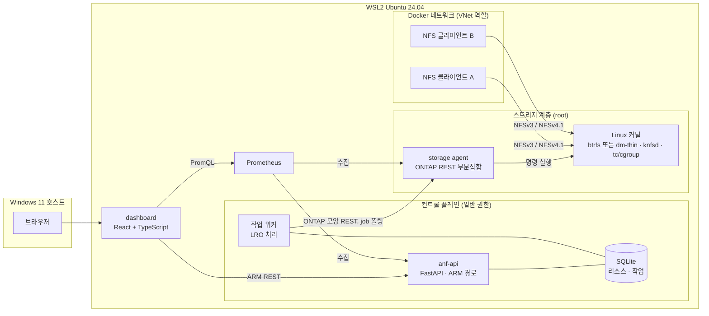
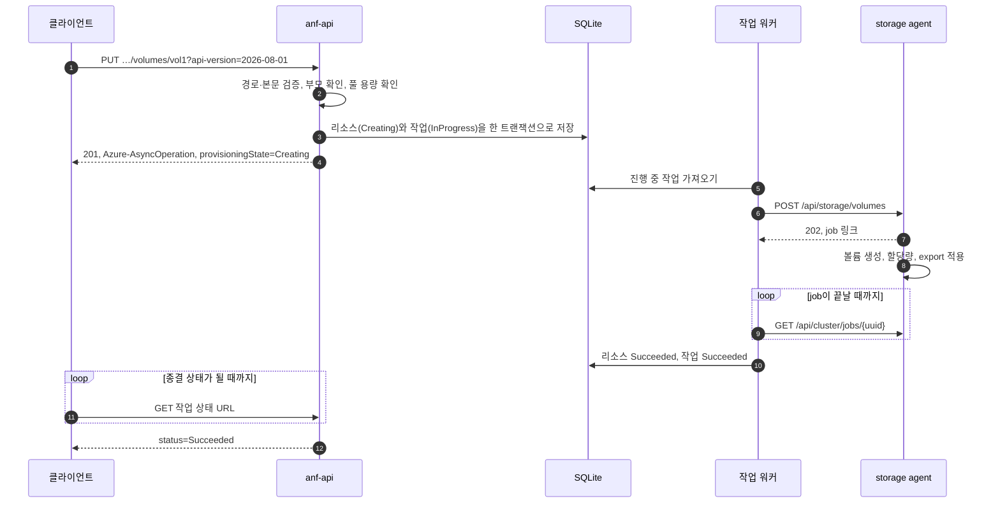
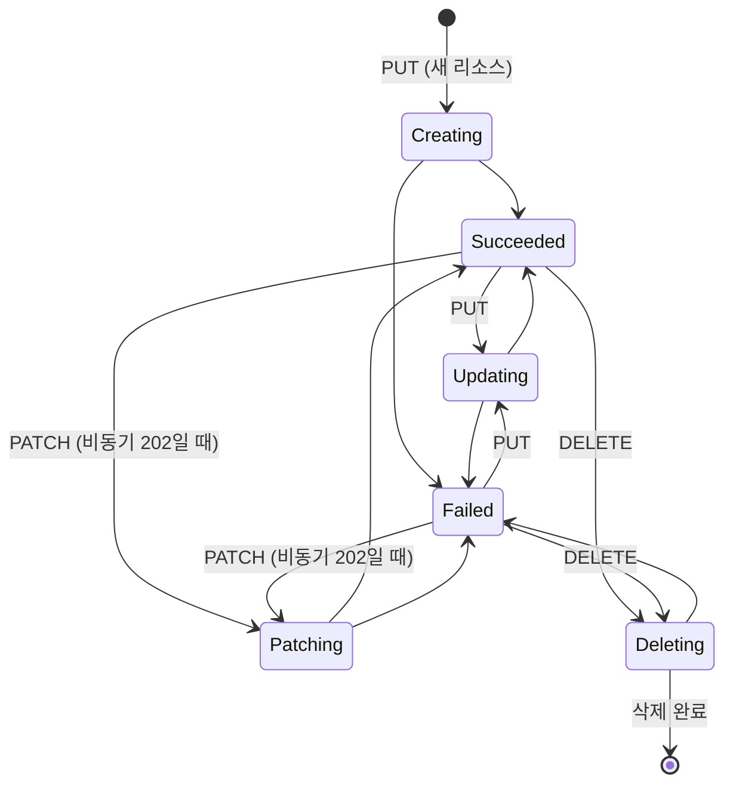

# ANF 클론 — ADR (Architecture Design Requirement, 아키텍처 설계 요구사항)

| 항목 | 내용 |
| --- | --- |
| 버전 | 1.0 |
| 작성일 | 2026-11-07 |
| 상태 | 기획 확정 (2026-11-07). D-11·D-12는 스파이크 S1·S2에서 정한다. 결정별 상태는 [§11](#11-결정-기록)에 있다 |
| 관련 문서 | [PRD](PRD.md), [CLAUDE.md](../CLAUDE.md), `_workspace/netapp-account/01_researcher_brief.md` |

이 문서는 [PRD](PRD.md)의 요구사항을 **어떻게** 만족시킬지 정한다. 결정에는 상태를 붙인다.

- **확정**: 사용자가 정했다.
- **제안**: Claude가 추천했다. 사용자 확인이 필요하다.
- **보류**: 스파이크나 해당 기능의 설계 단계에서 정한다.

> ADR은 흔히 Architecture *Decision Record*의 약자로도 쓰인다. 이 문서는 설계 요구사항 문서다. 그래서 헷갈리지 않도록 안의 결정 항목은 `D-01`처럼 부른다.

근거 표시: `[S숫자]`는 문서 끝의 출처다. 위험 번호 R-nn은 이 문서 §10의 위험이다. `[추론]`은 공개 자료로 확인하지 못한 판단이다. `[확인 필요]`는 스파이크나 조사에서 확인할 기술적 가정이다.

---

## 1. 한눈에 보기

실제 ANF와 같은 층 구조를 따른다. ARM 스타일 컨트롤 플레인이 요청을 받는다. 그다음 스토리지 계층에 ONTAP 모양의 API로 작업을 시킨다. 스토리지 계층은 실제 데이터를 다룬다.



## 2. 실제 ANF 구조와 클론의 대응

### 2.1 실제 ANF (공개 자료 기준)

- 사용자는 ARM에 `Microsoft.NetApp` 리소스 공급자 경로로 요청한다. 변경 요청은 ARM의 비동기 작업(LRO) 규칙을 따른다 [S2].
- 볼륨은 Azure 데이터센터 안에 있는, ONTAP으로 동작하는 베어메탈 장비에서 제공된다 [S1]. 이 노드들은 HA 쌍으로 묶여 있다. 네트워크 계층은 이 장비의 스토리지를 고객 VNet에 넣어 준다 [S3].
- ARM 요청을 ONTAP 작업으로 바꾸는 ANF 서비스 계층의 내부는 공개되지 않았다. 구성요소가 무엇인지, ONTAP과 어떤 API로 통신하는지 알 수 없다 [추론: 공개 자료에서 찾지 못함].

### 2.2 층별 대응

| 층 | 실제 ANF | 클론 | 근거 |
| --- | --- | --- | --- |
| 관리 API | ARM과 `Microsoft.NetApp` 리소스 공급자 | anf-api가 같은 경로, 속성, 응답 코드를 제공한다 | ARM 스펙 (계정 브리프) |
| 비동기 처리 | ARM LRO [S2] | SQLite 작업 테이블과 작업 워커 | 외부 계약은 공개. 내부 구현은 클론 고유 |
| 서비스 → 스토리지 | 비공개 | 워커가 ONTAP REST 모양의 API를 호출한다 | [추론] |
| 스토리지 OS | ONTAP(WAFL), 베어메탈 [S1] | Linux 커널 기능: btrfs 또는 dm-thin, knfsd, tc 또는 cgroup | 클론 고유 |
| 네트워크 | VNet, 위임 서브넷, 마운트 대상 IP | Docker 사용자 정의 네트워크와 그 네트워크 쪽 호스트 IP | 클론 고유 |
| 클라이언트 | 고객 VM | 권한 있는 Docker 컨테이너 | — |

### 2.3 리소스 대응표

ONTAP REST 경로와 필드 이름은 기능마다 조사 단계에서 ONTAP REST 문서 [S7]로 확인한다. 이 표는 기능의 설계를 확정할 때 메인 세션이 고친다 (`anf-feature-cycle` 2단계). 아래 경로는 출발점이다.

| ANF 리소스·기능 | 닮은 ONTAP 개념 | storage agent API (후보) | Linux 구현 후보 | 근거 |
| --- | --- | --- | --- | --- |
| NetApp 계정 | 직접 대응 없음. 가장 가까운 것은 SVM이지만 1:1이 아닐 가능성이 크다 | **계정 설계에서 정할 선택지.** `/api/svm/svms`에 대응시키거나, 백엔드에 아무것도 만들지 않는다 | 선택에 따름 | [추론]. 계정 브리프의 결론 (1:1 대응 자료 없음, 테넌시는 구독·리전·VNet 기준일 가능성) |
| 용량 풀 | 직접 대응이 없어 보임. 용량과 성능의 예산 | 없음. 컨트롤 플레인만 다룬다 | 후보 C라면 dm-thin 풀 | [추론] |
| 볼륨 | FlexVol | `/api/storage/volumes` | [§7.2](#72-볼륨스냅샷-저장-방식-보류-d-11)의 후보 A·B·C와 knfsd export | [추론] |
| 스냅샷 | Snapshot copy (WAFL) | `/api/storage/volumes/{uuid}/snapshots` | btrfs 스냅샷 또는 thin 스냅샷 | 스냅샷 조사에서 확인 |
| 스냅샷으로 되돌리기 | SnapRestore (볼륨 단위) | 볼륨 PATCH로 복원할 스냅샷 지정 | 서브볼륨이나 LV 교체 | [추론] |
| 새 볼륨으로 복원, 클론 | FlexClone | 볼륨 POST에 클론 원본 지정 | 쓰기 가능한 스냅샷 | [추론] |
| 처리량 제한 | QoS policy group (최대 처리량) | `/api/storage/qos/policies` | [§7.3](#73-처리량-제한-방식-보류-d-12)의 후보 T1·T2·T3 | [추론] |
| export policy | export policy와 규칙 | `/api/protocols/nfs/export-policies` | `exportfs`의 클라이언트 규칙 | [추론] |
| 마운트 대상 IP | data LIF | `/api/network/ip/interfaces` | Docker 네트워크 쪽 호스트 IP | [추론] |
| 스냅샷 정책 | snapshot policy | `/api/storage/snapshot-policies` | 작업 워커의 스케줄러 | [추론] |
| 지역 간 복제 | SnapMirror [S3] | `/api/snapmirror/relationships` | btrfs send/receive | SnapMirror 사용은 공개. 구현 대응은 [추론] |

## 3. 아키텍처 요구사항

| ID | 요구사항 | PRD 근거 | 만족시키는 곳 |
| --- | --- | --- | --- |
| AR-01 | **실제 효과.** 볼륨, 스냅샷, 처리량 제한은 커널 수준에서 실제로 동작한다. | NFR-01 | §7 |
| AR-02 | **층 분리.** 컨트롤 플레인은 storage agent의 API만 호출하고 커널 명령을 직접 실행하지 않는다. | G2 | §4, D-06 |
| AR-03 | **두 층의 비동기.** 작업 계약이 비동기인 변경 요청은 작업 완료를 기다리지 않고 응답한다. 바깥은 ARM LRO, 안쪽은 스토리지 job이다. 동기 완료 응답은 작업별 계약을 따른다 (§6.1). | G3, FR-01 | §6 |
| AR-04 | **내구성.** 프로세스가 재시작돼도 진행 중이던 작업을 잃지 않는다. 끝까지 진행하거나 `Failed`로 정리한다. | FR-01 | §6.4 |
| AR-05 | **멱등성.** 같은 요청을 다시 보내도 결과가 같다. storage agent의 작업도 재시도에 안전하다. | FR-01 | §6.4 |
| AR-06 | **권한 분리.** root가 필요한 일은 storage agent에만 둔다. | NFR-07 | §5 |
| AR-07 | **시험 가능성.** 단위 테스트는 Windows에서도 돈다(TDD 훅이 Windows 가상환경으로 실행한다, D-14). 커널이 필요한 테스트는 WSL과 CI에서 돈다. | NFR-05, FR-10 | §9 |
| AR-08 | **관측성.** 모든 백엔드 구성요소가 Prometheus 메트릭을 내고, 로그에 상관 ID를 남긴다. | FR-12, NFR-08 | §8 |
| AR-09 | **자원.** 데모 구성 전체가 WSL 메모리 약 7GB 안에서 돈다. | NFR-06 | §5, R-05 |
| AR-10 | **차이 기록.** 실제 ANF·ONTAP과 다르게 만든 곳은 결정 기록이나 개념 문서에 남긴다. | NFR-02 | §2, §11 |

## 4. 구성요소

| 구성요소 | 맡는 일 | 맡지 않는 일 | 기술 | 권한 |
| --- | --- | --- | --- | --- |
| anf-api | ARM 경로와 본문 검증, 리소스 상태 저장, 작업 생성, 작업 상태 URL 제공, 부모·자식 규칙(자식이 있으면 삭제 거절) | 커널 명령 실행 | FastAPI, pydantic | 일반 |
| 작업 워커 | 진행 중 작업을 가져와 storage agent를 호출하고 job을 폴링한다. `provisioningState`를 갱신하고, 재시작하면 남은 작업을 정리한다 | 데이터 직접 조작 | Python asyncio. anf-api와 같은 프로세스에서 돈다 (D-09) | 일반 |
| 상태 저장소 | ARM 리소스와 작업 기록 | — | SQLite (D-07) | — |
| storage agent | ONTAP REST 부분집합을 제공한다. job을 실행하고, 커널 명령을 실행하고, 볼륨 메트릭을 낸다 | ARM 개념 다루기(구독, 리소스 그룹, `provisioningState`) | FastAPI, subprocess(인자 목록으로 실행) | root |
| dashboard | 리소스 트리, 상태, 메트릭 차트 | 포털 재현 | React + TypeScript, 빌드는 Vite (D-02) | — |
| Prometheus | 메트릭 수집 | — | 컨테이너 | — |
| NFS 클라이언트 | 마운트, 읽기·쓰기, 처리량 측정 | — | 권한 있는 컨테이너, `nfs-common`, `fio` | privileged |
| (선택) CSI 드라이버 | PVC를 받아 anf-api를 호출하고 볼륨을 마운트한다 | — | FR-14를 할 때 정한다 | — |

storage agent가 ARM 개념을 모르게 하는 이유: 실제 ONTAP도 ARM을 모른다. 이 경계를 지켜야 "컨트롤 플레인은 ANF 서비스, agent는 ONTAP"이라는 대응이 성립한다.

## 5. 배치와 권한

- **실행 위치.** 백엔드 프로세스는 모두 WSL2 Ubuntu에서 돈다. knfsd와 btrfs가 커널 기능이기 때문이다. 브라우저는 Windows에서 연다.
- **저장소 위치.** 저장소는 Windows 파일시스템(`C:\Users\mkimh\Projects\ANF-clone`)에 있고, WSL에서는 `/mnt/c/...`로 접근한다 (R-06). WSL 가상환경은 저장소 밖 `~/.venvs/anf-clone`에 둔다 (D-14).
- **스토리지 루트 (제안).** storage agent가 쓰는 데이터(루프 파일, btrfs, thin 풀)는 WSL ext4 안의 고정 경로 `/var/lib/anf-clone` 아래에 둔다. 저장소처럼 `/mnt/c`(9P) 아래에 두면 느리고, 루프 장치 같은 커널 기능이 제대로 동작하는지 보장되지 않는다 [확인 필요]. agent는 이 루트 아래의 경로만 받고 그 밖의 경로는 거절한다. 경로는 S0·S1에서 확정한다.
- **바인딩.** 서비스는 localhost에만 바인딩한다. 예외는 NFS다. 컨테이너가 마운트하려면 NFS 서버가 Docker 네트워크 쪽 인터페이스에서도 요청을 받아야 한다.
- **root 작업.** root로 도는 것은 storage agent뿐이다. 커널 명령은 셸을 거치지 않고 인자 목록으로 실행한다. 리소스 이름은 anf-api가 ARM 이름 규칙으로 먼저 검증한다(예: 계정 이름 `^[a-zA-Z0-9][a-zA-Z0-9\-_]{0,127}$`, 계정 브리프). agent도 스토리지 루트 아래의 경로만 받는다.
- **네트워크.** 클라이언트 컨테이너는 사용자 정의 Docker 네트워크(예: `anf-vnet`)에 붙는다. 그 네트워크 쪽 호스트 IP가 볼륨의 마운트 대상 IP가 된다. Docker Engine은 S0 결과에 따라 Ubuntu 안에 둔다 (D-10). 그래야 브리지가 Ubuntu 네트워크에 있고 서버가 컨테이너마다 다른 IP를 본다.
- **메모리.** 컨트롤 플레인과 agent, Prometheus, 클라이언트 컨테이너 몇 개면 WSL 7GB 안에 충분히 들어갈 것으로 본다 [추론]. 실제 사용량은 FR-13 때 재고, Kubernetes를 띄우는 FR-14 때 다시 잰다.

## 6. 컨트롤 플레인

### 6.1 API 계약 원칙

- **경로.** `/subscriptions/{sub}/resourceGroups/{rg}/providers/Microsoft.NetApp/netAppAccounts/{account}/capacityPools/{pool}/volumes/{volume}/snapshots/{snapshot}`
- **api-version.** `2026-08-01`(최신 stable)을 지원한다 (계정 브리프). 다른 버전은 거절한다. 오류 형식은 계정 기능 설계에서 정한다.
- **Azure 쪽 개념.** 구독과 리소스 그룹은 경로와 리소스 ID에만 쓴다. 존재 여부와 권한은 검사하지 않는다 (PRD 비목표). `Authorization` 헤더도 검사하지 않는다 (D-13).
- **오류 본문.** ARM 형식 `{"error": {"code": ..., "message": ...}}`를 쓴다.
- **응답 코드.** 작업별로 실제 스펙을 따른다 (PRD FR-01). 예를 들어 계정은 다음과 같다 (계정 브리프).
  - PUT: 201과 `Azure-AsyncOperation`
  - PATCH: 200, 또는 202와 `Location`
  - DELETE: 202와 `Location`, 또는 204
- **작업별 응답 표.** 각 기능의 `02_main_design.md`에 최종 응답 표를 쓴다. 아래는 계정 설계의 출발점이다. 이후 기능은 해당하는 행만 정한다.

  | 작업 | 설계에서 정할 항목 |
  | --- | --- |
  | PUT 신규 생성 | `201`, 리소스 본문, `Azure-AsyncOperation`, 초기·최종 상태 |
  | PUT 기존 리소스 갱신 | `200`의 본문·상태·추적 헤더. 스펙(헤더 정의 없음)과 녹화(`Updating` + `Azure-AsyncOperation`)의 차이를 명시 |
  | PATCH | 동기 `200`과 비동기 `202` 중 클론이 제공할 경우, 본문과 추적 헤더 |
  | DELETE 기존 리소스 | `202`, 본문 유무, 추적 헤더, 완료 뒤 GET `404` |
  | DELETE 없는 리소스 | `204`, 본문 없음, 작업 생성 여부 |
  | DELETE 거절 (자식 리소스 있음) | 즉시 `409 CannotDeleteResource`, 작업을 만들지 않음. 실서비스에서는 ARM 게이트웨이가 거절했다 (녹화 R4). 클론에서 이 검사를 어느 계층에 둘지 |
  | 이후 POST 액션 | 스냅샷 되돌리기 등 각 액션의 초기 응답과 완료 조회 방식 |

- **두 층을 섞지 않는다.** 외부 ARM 작업의 상태·헤더와 내부 storage job의 상태·헤더를 섞지 않는다. 실제 서비스와 다르게 선택한 동작은 설계와 개념 문서에 이유를 남긴다. preview api-version 녹화의 관찰을 stable 계약으로 옮길 때는 버전 차이를 명시한다 (계정 녹화 R1~R4는 `2026-08-15-preview`).
- **클론에서 의미가 없는 필수 속성.** 실제 ANF 볼륨의 `subnetId`처럼 클론에서 의미가 없는 필수 속성을 어떻게 다룰지는 그 기능의 설계에서 정한다.

### 6.2 요청 흐름: 볼륨 생성



볼륨 PUT이 계정과 같은 응답 형식(201과 `Azure-AsyncOperation`)이라는 것은 가정이다. 볼륨 조사에서 확인한다.

### 6.3 상태 모델

ARM에서 종결 상태는 `Succeeded`, `Failed`, `Canceled` 셋이다. 나머지 값은 모두 진행 중을 뜻하고, 값 자체는 리소스 공급자가 정한다 [S2]. ANF의 `provisioningState`는 enum이 없는 문자열이다 (계정 브리프). 그래서 아래의 진행 중 상태 이름(`Creating`, `Updating`, `Patching`, `Deleting`)은 기능 조사에서 실제 응답 녹화와 대조해 확정한다. 계정에서는 `Creating`(스펙 예시, 녹화 R1), PUT 갱신의 `Updating`(녹화 R3), PATCH 202의 `Patching`(스펙 예시)이 확인됐고, `Deleting`은 확인하지 못했다.



- 작업(operation) 상태는 `InProgress`에서 시작해 `Succeeded`, `Failed`, `Canceled` 중 하나로 끝난다 [S2].
- storage agent의 job 상태 이름은 ONTAP job 모델을 따른다. 정확한 값은 조사에서 확인한다.

### 6.4 내구성, 멱등성, 동시성

- **저장한 뒤 응답한다.** 리소스 상태와 작업 기록을 한 트랜잭션으로 저장하고 나서 응답한다. 저장 전에 실패하면 아무것도 남지 않는다.
- **재시작하면 조정한다.** 워커가 재시작되면 `InProgress` 작업을 다시 가져온다. storage agent의 실제 상태를 이름으로 조회해 대조한 뒤, 작업을 이어 가거나 `Failed`로 정리한다.
- **agent 작업은 재시도에 안전하다.** 이미 있는 볼륨을 다시 만들라고 하면 같은 설정일 때는 성공으로, 다른 설정일 때는 오류로 답한다.
- **한 리소스에는 작업 하나만.** 같은 리소스에 진행 중인 작업이 있으면 새 변경 요청을 거절한다. 실제 ANF의 오류 코드는 조사에서 확인한다.
- **자식이 있으면 삭제를 거절한다.** 자식 리소스가 남아 있으면 부모 삭제는 409다. 계정에서는 `CannotDeleteResource`가 확인됐다 (계정 브리프, 녹화 R4).

**풀·볼륨 설계 전에 확정할 규칙 (보류).** 아래는 요구사항이다. 상태 저장소(D-07)와 storage agent(D-06)로 만족시킨다. 세부는 용량 풀·볼륨의 `02_main_design.md`에서 정한다.

- **용량 예약은 원자적으로.** 풀 잔여 용량 확인·예약과 볼륨 리소스·작업 생성을 하나의 원자적 처리로 묶는다. 생성 중인 볼륨의 예약도 할당량 합계에 넣는다. 잔여 용량이 두 요청을 모두 받을 수 없는 풀에 동시 생성이 와도 할당량을 넘지 않아야 한다.
- **예약 정리.** 생성 실패·취소·삭제 완료 때 예약과 사용량을 어떻게 정리할지 정한다. 커널 자원 정리가 실패했을 때 용량을 언제 회수하는지도 정한다.
- **부모 삭제와 자식 생성의 경합.** 둘이 동시에 요청돼도 고아 리소스나 모순된 상태가 생기지 않도록 처리 순서와 충돌 응답을 정한다.
- **안정적인 작업 식별자.** storage job은 재시도해도 같은 식별자(멱등 키)로 제출한다. job ID를 저장하기 전후 어느 시점에 재시도해도 자원을 중복 생성하지 않는다.
- **단계별 복구.** 볼륨 생성을 파일시스템 생성, quota 적용, export 적용 단계로 나눈다. 재시작하면 실제 상태와 대조해 단계마다 계속 진행할지, 보상 정리할지, `Failed`로 둘지 정한다. agent 실행 중, job ID 저장 전후, 최종 상태 기록 전에 프로세스를 중단해도 재시작 후 작업이 종결되고, DB 예약과 실제 파일시스템·export 상태가 설명 가능한 상태로 일치해야 한다.

### 6.5 저장 모델 (초안)

- `resources`: ARM 리소스 ID(기본 키), 종류, 부모 ID, 이름, `location`, `properties`(JSON), `provisioningState`, 생성·수정 시각
- `operations`: 작업 ID(UUID), 리소스 ID, 종류(생성·수정·삭제), 상태, 오류, storage job ID, 시작·종료 시각, 상관 ID

스키마는 첫 기능(계정)을 구현할 때 확정한다.

## 7. 스토리지 계층

### 7.1 storage agent API: ONTAP REST 부분집합

- **ONTAP을 따른다.** 경로, 필드 이름, job 모델은 ONTAP REST API를 따르되 기능에 필요한 부분만 만든다.
- **변경 요청은 job으로 답한다.** POST, PATCH, DELETE는 202와 job 링크로 답하고 워커가 job을 폴링한다. ONTAP REST의 비동기 job 모델을 따른 것이며 조사에서 확인한다.
- **다른 점은 표시한다.** 실제 ONTAP과 다르게 만든 필드는 agent API 문서에 표시한다 (R-04).
- **선택: 충실도 테스트.** 나중에 실제 ONTAP에 접근할 수 있게 되면 같은 호출을 실제 ONTAP에 보내 응답을 비교하는 테스트를 추가할 수 있다. 목표가 아니라 선택이다.

### 7.2 볼륨·스냅샷 저장 방식 (보류, D-11)

볼륨 기능을 설계하기 전에 스파이크 S1에서 세 후보로 같은 시나리오를 돌린다. 시나리오는 마운트, `df`, 할당량 초과 쓰기, 스냅샷, `.snapshot` 읽기, 되돌리기다. 그 결과를 비교해 정한다.

| 기준 | A. btrfs 하나 + 볼륨마다 서브볼륨, 할당량은 qgroup | B. 볼륨마다 btrfs 파일시스템 (희소 루프 파일) | C. 용량 풀마다 dm-thin 풀 + 볼륨마다 thin LV |
| --- | --- | --- | --- |
| 클라이언트 `df`가 할당량을 보여 주나 | 아닐 가능성이 큼. 파일시스템 전체 크기가 보인다 [확인 필요] | 예 | 예 |
| 할당량을 넘는 쓰기의 오류 | 할당량 초과(EDQUOT) [확인 필요] | 공간 부족(ENOSPC) | 공간 부족(ENOSPC) |
| 스냅샷 공간이 볼륨 사용량에 잡히나 | qgroup 설정에 따름 | 예 | 아니오. 풀에서 나간다 |
| 즉시 스냅샷 | 예 | 예 | 예 |
| 새 볼륨으로 복원, 클론 | 즉시 (같은 파일시스템 안의 쓰기 가능 스냅샷) | 파일시스템이 달라서 복사가 필요 (send/receive) | 즉시 (thin 스냅샷을 쓰기 가능으로) |
| `.snapshot` 노출 | 중첩 서브볼륨이 NFS로 어떻게 보이는지 확인 필요 (R-02) | A와 같음 | 스냅샷 LV를 볼륨 아래에 읽기 전용으로 마운트하고 하위 마운트를 내보낸다. NFSv3·v4.1 동작은 확인 필요 |
| 크기 변경 | qgroup 한도 변경 | 루프 파일을 늘리고 파일시스템 크기 변경 | `lvextend`와 파일시스템 확장 |
| 용량 풀 대응 | 없음 | 없음 | thin 풀. 단 과할당은 쓰지 않는다. ANF 풀은 볼륨 할당량 합으로 막는다 (FR-03) |

ANF가 스냅샷 공간을 볼륨 사용량에 어떻게 계산하는지는 스냅샷 조사에서 확인하고, 그 결과를 이 표의 판단에 반영한다.

### 7.3 처리량 제한 방식 (보류, D-12)

처리량 기능을 설계하기 전에 스파이크 S2에서 정한다. 실제 ONTAP은 QoS policy group으로 스토리지 계층에서 처리량을 제한한다 [추론: 조사에서 확인]. 클론의 방식이 이와 다르면 그 차이를 개념 문서에 남긴다.

| 후보 | 방식 | 장점 | 위험 |
| --- | --- | --- | --- |
| T1. 네트워크 제한 (tc) | 볼륨마다 마운트 IP를 따로 주고, 그 IP의 송수신 대역폭을 제한한다 | knfsd와 상관없이 동작한다. 클라이언트가 보는 MiB/s에 직접 효과가 있다. tc 카운터가 볼륨별 처리량 메트릭도 된다 | 스토리지 계층이 아니라 네트워크에서 제한한다. IP를 공유하는 볼륨끼리는 구분할 수 없다 |
| T2. 블록 I/O 제한 (cgroup v2 `io.max`) | 블록 장치 I/O를 제한한다 | 스토리지 계층의 제한에 더 가깝다 | knfsd는 커널 스레드라 볼륨별 cgroup에 넣기 어려울 가능성이 크다 [확인 필요]. 캐시에서 읽는 I/O는 블록 계층을 거치지 않는다 |
| T3. 볼륨별 사용자 공간 NFS 서버 | 볼륨마다 NFS-Ganesha 프로세스를 띄우고 각자 cgroup에 넣는다 | `io.max`를 볼륨별로 걸 수 있다 | NFS 서버가 knfsd에서 Ganesha로 바뀐다. 메모리와 구성이 늘어난다 |

### 7.4 NFS

- **서버.** knfsd(`nfs-kernel-server`)로 NFSv3와 NFSv4.1을 제공한다 (D-03).
- **포트.** NFSv3는 rpcbind, mountd, lockd·statd 포트가 필요하다. 컨테이너 네트워크에서 이 포트들이 열려 있어야 한다. NFSv4.1은 2049번 하나만 쓴다.
- **export 적용과 경로.** 볼륨은 `<마운트 IP>:/<creationToken>`으로 마운트한다. export를 어떻게 적용할지(`/etc/exports.d/` 파일과 `exportfs`)와 NFSv4 pseudo-root 구성은 볼륨 기능 설계에서 정한다.

## 8. 관측성

- **메트릭 (Prometheus 형식).**
  - anf-api: 요청 수와 지연 시간(경로 템플릿, 메서드, 상태 코드별), 작업 수와 소요 시간(종류, 결과별), 진행 중 작업 수
  - storage agent: 볼륨 사용량(파일시스템에서 읽은 실제 값), 스냅샷 수, 볼륨별 처리량과 IOPS, knfsd 전체 통계(`/proc/net/rpc/nfsd`)
  - 볼륨별 처리량을 어디서 얻을지는 S2와 함께 정한다. T1이면 tc 카운터를 쓸 수 있다.
  - 메트릭 이름을 ANF의 Azure Monitor 메트릭과 어떻게 대응시킬지는 FR-12 조사에서 정한다.
- **로그.** JSON 구조 로그를 쓴다. ARM 관례인 `x-ms-request-id`, `x-ms-correlation-request-id` 헤더를 받거나 새로 만든다. 그 값을 워커와 storage agent 호출까지 넘긴다.
- **대시보드.** 리소스는 anf-api에서, 시계열은 Prometheus 쿼리 API에서 읽는다 (D-08).

## 9. 테스트와 CI

### 9.1 테스트 층

| 층 | 대상 | 실행 위치 | 필요 조건 |
| --- | --- | --- | --- |
| 단위 | 검증, 상태 전이, 대응 로직. 커널 명령은 가짜 실행기로 바꾼다 | Windows(TDD 훅), WSL, CI | 없음 |
| API 계약 | ARM 경로, 응답 코드, 헤더, LRO 흐름. storage agent는 가짜로 둔다 | Windows, WSL, CI | 없음 |
| 통합 | storage agent가 실제 커널로 볼륨, 스냅샷, export를 만든다 | WSL. S3를 통과하면 CI에서도 | Linux, root, 커널 모듈 |
| E2E | 컨테이너가 마운트해 PRD 수락 기준의 데이터 효과를 확인한다 | WSL. S3를 통과하면 CI에서도 | 위 조건과 Docker |

- 층은 pytest 마커 `integration`, `e2e`로 나눈다. 마커는 루트 `pyproject.toml`에 등록돼 있다 (`--strict-markers`). 조건이 없으면 건너뛰되, 건너뛴 테스트를 통과로 보고하지 않는다. PRD §8의 UNVERIFIED 규칙과 같다. TDD 훅도 수집된 테스트가 모두 skip되면 GREEN이 아니라 SKIPPED로 보고한다.
- real-env-verifier는 E2E 층과 같은 기준으로 검증한다. 검증 스크립트는 `backend/tests/e2e/`에 둔다 (TDD 훅의 면제 대상).

### 9.2 TDD 훅에 맞추기

- **import 시점에 Linux 전용 코드를 쓰지 않는다.** 훅은 Windows에서 `.venv-win`의 Python으로 저장소 루트에서 `python -m pytest`를 돌린다 (D-14). 짝 테스트가 모두 skip되면 훅이 구현 파일 수정을 허용하지 않는다. 그래서 단위 테스트 대상 모듈은 import할 때 Linux 전용 모듈이나 명령을 쓰지 않는다. 커널 명령은 주입받은 실행기 객체로 실행한다.
- **구현 모듈 이름이 겹치지 않게 짓는다.** 훅은 파일 이름으로 테스트를 짝짓는다(`test_models.py`가 모든 `models.py`를 연다).
- **Python 버전은 3.12로 맞춘다 (D-01).** Windows Python과 WSL Ubuntu 24.04의 기본 Python이 모두 3.12이기 때문이다. CI도 3.12로 고정한다.

### 9.3 CI (GitHub Actions)

| 작업 | 트리거 | 내용 |
| --- | --- | --- |
| backend | push, PR | 단위 테스트, 계약 테스트, 린트 (도구는 첫 구현 때 정한다). TDD 훅 테스트(`python -m pytest .claude/hooks/tests`)도 돈다 |
| frontend | push, PR | 타입 검사, 빌드, 단위 테스트 |
| data-plane | S3 통과 뒤 추가 | ubuntu 러너에서 모듈을 로드하고 storage agent를 띄운 뒤 통합·E2E 테스트 |

## 10. 위험과 스파이크

스파이크는 해당 기능을 설계하기 전에 하는 짧은 실험이다. S0처럼 여러 기능에 걸치는 것이 있으므로 결과는 기능 밖의 `_workspace/spikes/S{n}.md`에 판정(통과·실패·조건부)과 함께 남기고, 각 기능의 `02_main_design.md`가 그 파일을 링크한다. 실행은 메인 세션이 맡는다 (`anf-feature-cycle` 0단계). S0의 결과로는 `CLAUDE.md`의 Environment 절을 고친다.

### 스파이크

| ID | 확인할 것 | 시점 | 실패하면 |
| --- | --- | --- | --- |
| S0 | 환경을 확인한다. `nfsd`, `btrfs`, `dm-thin` 모듈이 로드되는가? `nfs-kernel-server`가 뜨는가(systemd)? 컨테이너가 knfsd를 NFSv3와 NFSv4.1로 마운트하는가? 서버가 보는 클라이언트 IP가 컨테이너마다 다른가(export policy의 전제)? Docker Engine과 Docker Desktop 중 어느 쪽이 이 조건을 만족하는가? 스토리지 루트(§5)에서 루프 장치와 파일시스템 생성이 동작하는가? NFS LOCALIO 설정 값은 무엇인가(`CONFIG_NFS_LOCALIO`, R-08)? 지금 커널은 꺼져 있다. 커스텀 커널을 쓰게 되어 켜져 있으면 빌드에서 끄거나 `nfs` 모듈 파라미터 `localio_enabled`를 `N`으로 둔다 | 첫 데이터 플레인 기능(볼륨) 전. 계정과 용량 풀은 S0 없이 진행할 수 있다 | 모듈 문제면 WSL 커스텀 커널을 쓰거나 스토리지 방식을 재검토한다 |
| S1 | §7.2의 후보 A·B·C를 비교한다 | 볼륨 설계 전 | — |
| S2 | §7.3의 후보 중 볼륨별 제한이 클라이언트 측정으로 드러나는 것을 찾는다 (`fio`로 측정). 측정 조건(제안): 페이지 캐시 효과를 줄이려고 `fio --direct=1`을 쓰고 측정 전에 캐시를 비운다(클라이언트와 서버가 같은 커널이라 서버 쪽 캐시도 함께 영향을 받는다, R-08). 조건마다 5회 이상 반복하고 각 값과 중앙값을 남긴다 | 처리량 설계 전 | — |
| S3 | GitHub 호스트 러너에서 btrfs·nfsd 모듈을 로드하고 privileged 컨테이너로 마운트할 수 있는가 | CI 기능 전 | 데이터 플레인 테스트는 로컬(또는 self-hosted 러너)에서만 돌리고, 그 사실을 문서에 적는다 |

### 위험

| ID | 위험 | 영향 | 대응 |
| --- | --- | --- | --- |
| R-01 | knfsd는 커널 스레드라 볼륨별 cgroup에 넣기 어렵다. 그래서 `io.max`로는 볼륨별 제한이 안 될 수 있다 [확인 필요] | FR-08 | S2. 대안으로 T1, T3 |
| R-02 | btrfs 중첩 서브볼륨을 NFS로 내보내면 inode 번호가 겹쳐 `.snapshot`이 이상하게 보일 수 있다 [확인 필요] | FR-05 | S1 |
| R-03 | 되돌리기를 서브볼륨이나 LV 교체로 구현하면, 이미 마운트한 클라이언트가 stale file handle 오류를 볼 수 있다 | FR-06 | 설계에서 ONTAP SnapRestore의 동작과 대조하고, 클론의 동작을 문서화한다 |
| R-04 | storage agent API가 실제 ONTAP REST와 어긋나면 면접에서 오해를 줄 수 있다 | G2 | 기능 조사에서 ONTAP 문서로 확인하고 다른 점을 표시한다. 선택적으로 실제 ONTAP으로 충실도 테스트를 한다 |
| R-05 | WSL 메모리(약 7GB)가 모자랄 수 있다 | NFR-06 | 구성요소별 사용량을 잰다. Kubernetes는 FR-14 때만 띄운다 |
| R-06 | 저장소가 `/mnt/c`에 있어 WSL에서 파일 I/O가 느리고 실행 권한 비트가 다를 수 있다 | 개발 속도 | WSL 가상환경은 저장소 밖(`~/.venvs/anf-clone`)에 두고(D-14), 스토리지 데이터는 스토리지 루트(§5)에 둔다. 그래도 느리면 저장소를 WSL 안에 두는 방법을 검토한다. 이때 TDD 훅이 Windows 가상환경을 쓰는 점도 함께 고려한다 |
| R-07 | 데이터 플레인 명령이 root로 돈다 | 보안 | 인자 목록으로 실행하고, 이름을 검증하고, 로컬에만 바인딩한다 |
| R-08 | **클라이언트와 서버가 같은 커널을 쓴다.** 클라이언트 컨테이너와 knfsd가 같은 WSL 커널과 메모리를 쓴다. 실제 ANF의 클라이언트는 별도 VM이고 네트워크를 거친다. 그래서 처리량 측정, 페이지 캐시 효과, 메모리 압박 때의 동작이 실제와 다를 수 있다. 한 호스트에서 NFS 서버와 클라이언트를 함께 돌리면 메모리 압박 때 교착 위험이 있다고 알려져 있다 [확인 필요]. 또 NFS LOCALIO가 켜진 커널에서는 같은 호스트의 클라이언트가 read·write·commit에서 네트워크 RPC를 건너뛰므로 [S8], T1(tc 네트워크 제한)이 데이터 I/O에 걸리지 않을 수 있다 | FR-04, FR-08 | S0에서 LOCALIO 설정을 확인하고 꺼 둔다. S2의 측정 조건으로 캐시 효과를 줄인다. 처리량·스냅샷 개념 문서의 "실제 ANF와 다른 점"에 적는다 |

## 11. 결정 기록

| ID | 결정 | 상태 |
| --- | --- | --- |
| D-01 | 백엔드는 Python 3.12(CI 포함), 웹 프레임워크는 FastAPI | 확정 (2026-11-07) |
| D-02 | 대시보드는 React + TypeScript, 빌드 도구는 Vite | 확정 (2026-11-07) |
| D-03 | 프로토콜은 NFSv3와 NFSv4.1. SMB는 나중 | 확정 (2026-11-07) |
| D-04 | 검증 클라이언트는 Docker 컨테이너 | 확정 (2026-11-07) |
| D-05 | 컨트롤 플레인은 ARM LRO 스타일의 비동기 | 확정 (CLAUDE.md) |
| D-06 | 스토리지 계층은 Linux 위의 ONTAP 모양 storage agent | 확정 (2026-11-07). 커널 쪽 전제는 S0에서 확인 (`_workspace/spikes/S0.md`) |
| D-07 | 상태 저장소는 SQLite | 확정 (2026-11-07) |
| D-08 | 메트릭은 Prometheus. 대시보드가 Prometheus 쿼리 API로 차트를 그린다 | 확정 (2026-11-07) |
| D-09 | 작업 워커는 anf-api 프로세스 안에서 돈다. 작업은 SQLite에 저장한다 | 확정 (2026-11-07) |
| D-10 | Docker Engine은 Ubuntu 안에 둔다 (`docker.io`). Docker Desktop은 서버가 모든 컨테이너를 같은 Windows NAT IP로 봐서 클라이언트를 구분하지 못한다 | 확정 (2026-11-07, S0: `_workspace/spikes/S0.md`) |
| D-11 | 볼륨·스냅샷 저장 방식 (A, B, C) | 보류 (S1) |
| D-12 | 처리량 제한 방식 (T1, T2, T3) | 보류 (S2) |
| D-13 | 인증 없음. anf-api는 `Authorization` 헤더를 검사하지 않고, 서비스는 localhost에만 바인딩한다 (§5). 실제 Azure에서는 토큰 검증과 RBAC를 ARM이 맡고 ANF 리소스 공급자는 그 뒤에서 요청을 받는다. 그래서 구독·RBAC 검사를 생략한 것과 같은 선에서 생략한다. 버린 대안: 고정 Bearer 토큰(모든 클라이언트가 헤더를 보내야 하는데 데이터 플레인 설명에 보탬이 없다), Entra ID 모양 JWT(비용이 가장 크다) | 확정 (2026-11-07) |
| D-14 | Python 프로젝트 설정은 루트 `pyproject.toml` 하나에 둔다(의존성, pytest 설정). 코드는 `backend/` 아래에 둔다. 가상환경은 OS별로 Windows `.venv-win/`(저장소 안), WSL `~/.venvs/anf-clone`(저장소 밖, `ANF_CLONE_VENV`로 바꿀 수 있음) | 확정 (2026-11-07) |

### D-06. 스토리지 계층 (확정)

**맥락.** 사용자는 "NetApp 팀이 실제로 하는 것과 비슷하게" 만들기를 원한다. 실제 ANF에서 데이터를 다루는 것은 ONTAP이고 [S1], ANF 서비스는 그 위에서 리소스를 관리한다. 그래서 가장 비슷한 구조는 컨트롤 플레인이 ONTAP 관리 API를 호출해 일을 시키는 구조다.

**선택지 1: ONTAP Simulator를 직접 쓴다.** 클론은 컨트롤 플레인만 만들고, ONTAP REST로 진짜 ONTAP을 제어한다.
- 장점: 진짜 WAFL 스냅샷과 진짜 QoS가 데이터에 효과를 낸다. 실무와 가장 같다.
- 막는 점:
  - 다운로드하려면 NetApp 고객이나 파트너 계정이 필요하다고 알려져 있다 [S4].
  - 인스턴스 하나에 RAM 6GB 이상이 필요하다는 자료가 있고, 12GB로 늘려서 문제를 해결한 사례도 있다 [S5][S6]. 이 PC는 RAM이 15.7GB이고, 그중 약 7GB를 WSL이 쓴다.
  - 설치된 하이퍼바이저는 VirtualBox뿐인데, VirtualBox에서 시뮬레이터를 돌리는 것은 지원되지 않는다 [S6].
  - GitHub 호스트 러너에서도 돌릴 수 없다.

**선택지 2: Linux 위에 클론 전용 내부 API를 둔다.**
- 장점: 가장 단순하다.
- 단점: NetApp 실무 어휘(SVM, FlexVol, QoS policy group, export policy, job)와 연결이 끊긴다.

**선택지 3 (추천): Linux 위에 ONTAP REST API의 부분집합을 제공하는 storage agent를 둔다.** 컨트롤 플레인은 ONTAP을 상대하듯 이 API만 호출하고, agent가 Linux 기능으로 실제 효과를 낸다.
- 장점:
  - 구조가 실제 ANF와 같다. ARM 계약, 서비스, ONTAP 모양 API, 스토리지 순서다.
  - 비동기도 실제처럼 두 층이 된다(ARM LRO와 스토리지 job).
  - 면접에서 각 기능을 ONTAP 객체 이름으로 설명할 수 있다.
  - 지금 이 PC와 CI에서 돌릴 수 있다.
- 비용: ONTAP REST 스키마를 기능마다 조사해야 한다. 실제와 어긋나면 오해를 줄 수 있으므로 "부분집합이고, 다른 점은 표시한다"를 원칙으로 둔다 (R-04).
- 나중에 갈 수 있는 길: 시뮬레이터나 실제 ONTAP(예: 유료 관리형 서비스인 Amazon FSx for NetApp ONTAP)에 접근할 수 있게 되면, 같은 호출을 보내 응답을 비교할 수 있다 (§7.1).

**백엔드 드라이버 추상화(구현 두 개)를 지금 두지 않는 이유.** 지금은 구현이 하나뿐이다. 그리고 경계가 이미 HTTP API로 나뉘어 있어서 추상화 계층을 따로 둘 필요가 없다.

**채택하면.** AR-02를 만족한다. 볼륨과 처리량의 구현 방식은 D-11, D-12에서 정한다.

### D-07 ~ D-09 (확정)

- **D-07 SQLite.** 별도 서버가 필요 없다. 트랜잭션이 있어 AR-04를 만족한다. Windows 단위 테스트에서도 그대로 쓸 수 있다. 버린 대안은 둘이다. PostgreSQL은 띄울 서비스가 하나 늘어난다. 메모리 저장은 재시작하면 작업을 잃는다.
- **D-08 Prometheus.** 공고가 관측성을 강조하고, 업계에서 널리 쓰며, 컨테이너 하나로 띄울 수 있다. Grafana는 UI가 둘이 되므로 지금은 넣지 않는다. 필요해지면 나중에 추가한다.
- **D-09 같은 프로세스 안의 워커.** 프로세스가 하나라서 단순하다. 작업이 SQLite에 있으므로 나중에 워커를 분리하기 쉽다. 별도 워커 프로세스나 메시지 큐(Celery, Redis)는 지금 규모에 과하다.

## 12. 저장소 구조 (제안)

첫 구현 때 확정한다. Python 설정의 위치는 D-14로 확정됐다.

```text
anf-clone/
├─ pyproject.toml      # 의존성과 pytest 설정 (D-14). 훅·수동 실행·CI가 루트에서 읽는다
├─ backend/
│  ├─ anf_api/         # ARM 스타일 REST, 작업 워커, SQLite 저장소
│  ├─ storage_agent/   # ONTAP REST 부분집합, Linux 명령 실행기
│  └─ tests/
│     ├─ unit/
│     ├─ contract/
│     ├─ integration/  # Linux와 root가 필요
│     └─ e2e/          # Docker 클라이언트로 마운트. real-env-verifier의 검증 스크립트도 여기에 둔다
├─ frontend/           # Vite + React + TypeScript
├─ deploy/             # docker compose, 클라이언트 이미지, Prometheus 설정
├─ scripts/            # WSL 환경 준비, 데모 대본 실행
├─ _workspace/         # 기능별 사이클 산출물. spikes/에 기능 밖 스파이크 결과. */sources/는 커밋하지 않는다
└─ docs/
   ├─ PRD.md
   ├─ ADR.md
   ├─ feature-status.md
   └─ concepts/
```

## 13. 미정 사항

- 보류: D-11~D-12 (스파이크 S1~S2)

## 출처

- [S1] Microsoft Learn, "What is Azure NetApp Files?" — https://learn.microsoft.com/azure/azure-netapp-files/azure-netapp-files-introduction
- [S2] Microsoft Learn, "Status of asynchronous operations — Azure Resource Manager" (2026-02-27 갱신) — https://learn.microsoft.com/azure/azure-resource-manager/management/async-operations
- [S3] NetApp BlueXP 블로그, "Fault tolerance, high availability, and resilience with Azure NetApp Files" — https://bluexp.netapp.com/blog/azure-anf-blg-fault-tolerance-high-availability-and-resilience-with-azure-netapp-files
- [S4] Flackbox, "Where to Download and How to Set Up Free Storage Simulators and VSA" (시뮬레이터 다운로드에 고객·파트너 로그인 필요) — https://www.flackbox.com/list-vsa-virtual-storage-appliances-storage-simulators-san-nas-demos
- [S5] Utimaco, "NetApp ONTAP and ESKM — Hardware Requirements" (시뮬레이터 인스턴스당 RAM 6GB) — https://integration-guides.utimaco.com/netapp-ontap-and-eskm/2.0.0/hardware-requirements
- [S6] NetApp Community, "ONTAP Simulator 9.2 running on VirtualBox or RedHat Enterprise Virtualization" (VirtualBox는 지원 대상 아님) — https://community.netapp.com/t5/Simulator-Discussions/ONTAP-Simulator-9-2-running-on-VirtualBox-or-RedHat-Enterprise-Virtualization/m-p/137231
- [S7] NetApp, ONTAP 자동화(REST API) 문서 — https://docs.netapp.com/us-en/ontap-automation/ (이번 작성 중에는 자동 접근이 403으로 막혀 내용을 직접 확인하지 못했다. 기능 조사 때 확인한다)
- [S8] Linux kernel documentation, "NFS LOCALIO" — https://docs.kernel.org/filesystems/nfs/localio.html (제안서 점검에서 확인. `CONFIG_NFS_LOCALIO`, `localio_enabled` 모듈 파라미터, 컨테이너 환경이 주요 사용처)
- 내부: `_workspace/netapp-account/01_researcher_brief.md` (api-version, 계정 LRO 응답 코드, 이름 규칙, 자식이 있을 때의 409)
