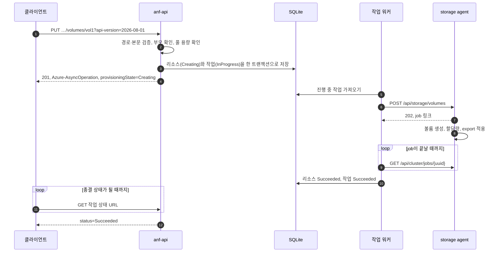
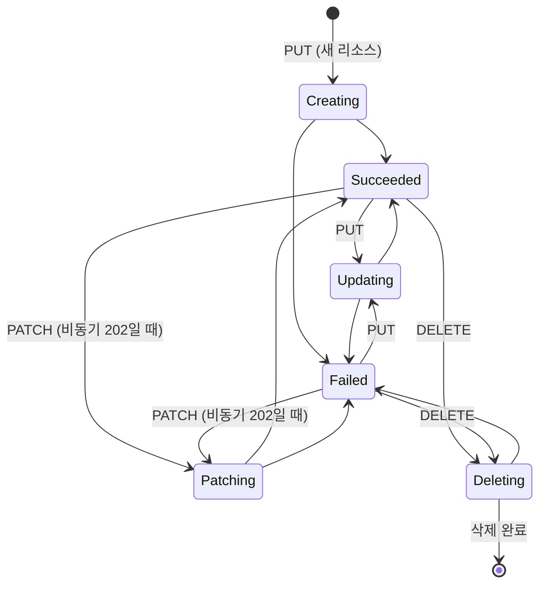

# ANF 클론 — ADR (Architecture Design Requirement, 아키텍처 설계 요구사항)

| 항목 | 내용 |
| --- | --- |
| 버전 | 1.0 |
| 작성일 | 2026-11-07 |
| 상태 | 기획 확정 (2026-11-07). D-11은 스파이크 S1로, D-12는 스파이크 S2로 확정했다 (2026-11-07). 결정별 상태는 [§11](#11-결정-기록)에 있다 |
| 관련 문서 | [PRD](PRD.md), [CLAUDE.md](../CLAUDE.md), `_workspace/netapp-account/01_researcher_brief.md` |

이 문서는 [PRD](PRD.md)의 요구사항을 **어떻게** 만족시킬지 정한다. 결정에는 상태를 붙인다.

- **확정**: 사용자가 정했다.
- **제안**: Claude가 추천했다. 사용자 확인이 필요하다.
- **보류**: 스파이크나 해당 기능의 설계 단계에서 정한다.

> ADR은 흔히 Architecture *Decision Record*의 약자로도 쓰인다. 이 문서는 설계 요구사항 문서다. 그래서 헷갈리지 않도록 안의 결정 항목은 `D-01`처럼 부른다.

근거 표시: `[S숫자]`는 문서 끝의 출처다. 위험 번호 R-nn은 이 문서 §10의 위험이다. `[추론]`은 공개 자료로 확인하지 못한 판단이다. `[확인 필요]`는 스파이크나 조사에서 확인할 기술적 가정이다.

---

## 1. 한눈에 보기

실제 ANF와 같은 층 구조를 따른다. ARM 스타일 컨트롤 플레인이 요청을 받는다. 그다음 스토리지 계층에 ONTAP 모양의 API로 작업을 시킨다. 스토리지 계층은 실제 데이터를 다룬다.


## 2. 실제 ANF 구조와 클론의 대응

### 2.1 실제 ANF (공개 자료 기준)

- 사용자는 ARM에 `Microsoft.NetApp` 리소스 공급자 경로로 요청한다. 변경 요청은 ARM의 비동기 작업(LRO) 규칙을 따른다 [S2].
- 볼륨은 Azure 데이터센터 안에 있는, ONTAP으로 동작하는 베어메탈 장비에서 제공된다 [S1]. 이 노드들은 HA 쌍으로 묶여 있다. 네트워크 계층은 이 장비의 스토리지를 고객 VNet에 넣어 준다 [S3].
- ARM 요청을 ONTAP 작업으로 바꾸는 ANF 서비스 계층의 내부는 공개되지 않았다. 구성요소가 무엇인지, ONTAP과 어떤 API로 통신하는지 알 수 없다 [추론: 공개 자료에서 찾지 못함].

### 2.2 층별 대응

| 층 | 실제 ANF | 클론 | 근거 |
| --- | --- | --- | --- |
| 관리 API | ARM과 `Microsoft.NetApp` 리소스 공급자 | anf-api가 같은 경로, 속성, 응답 코드를 제공한다 | ARM 스펙 (계정 브리프) |
| 비동기 처리 | ARM LRO [S2] | SQLite 작업 테이블과 작업 워커 | 외부 계약은 공개. 내부 구현은 클론 고유 |
| 서비스 → 스토리지 | 비공개 | 워커가 ONTAP REST 모양의 API를 호출한다 | [추론] |
| 스토리지 OS | ONTAP(WAFL), 베어메탈 [S1] | Linux 커널 기능: dm-thin 씬 풀 + 볼륨마다 ext4 (D-11), 볼륨마다 netns 안의 knfsd 인스턴스, 처리량 제한은 tc (D-12) | 클론 고유 |
| 네트워크 | VNet, 위임 서브넷, 마운트 대상 IP | Docker 사용자 정의 네트워크와 그 네트워크 쪽 호스트 IP | 클론 고유 |
| 클라이언트 | 고객 VM | 권한 있는 Docker 컨테이너 | — |

### 2.3 리소스 대응표

ONTAP REST 경로와 필드 이름은 기능마다 조사 단계에서 ONTAP REST 문서 [S7]로 확인한다. 이 표는 기능의 설계를 확정할 때 메인 세션이 고친다 (`anf-feature-cycle` 2단계). 아래 경로는 출발점이다.

| ANF 리소스·기능 | 닮은 ONTAP 개념 | storage agent API (후보) | Linux 구현 후보 | 근거 |
| --- | --- | --- | --- | --- |
| NetApp 계정 | 직접 대응 없음. 가장 가까운 것은 SVM이지만 1:1이 아닐 가능성이 크다 | 없음. **계정은 컨트롤 플레인 전용이다** (계정 설계에서 확정, `_workspace/netapp-account/02_main_design.md` 결정 1) | 없음 | [추론]. 계정 브리프의 결론 (1:1 대응 자료 없음, 테넌시는 구독·리전·VNet 기준일 가능성) |
| 용량 풀 | 직접 대응하는 공개된 객체 없음 [미확인]. 문서상 "용량·처리량 예산이자 과금 단위"이고, 볼륨 처리량 한도는 QoS policy group(Auto는 adaptive QoS)과 닮았다 [추론] | 없음. **풀은 컨트롤 플레인 전용이다** (풀 설계에서 확정, `_workspace/capacity-pool/02_main_design.md` 결정 2) | 없음. S1이 후보 C(dm-thin)를 고르면 볼륨 사이클에서 다시 본다 | 풀 브리프 "ONTAP 대응 개념" |
| 볼륨 | FlexVol. 볼륨이 담기는 물리 공간은 aggregate | `POST`·`GET`·`DELETE /api/storage/volumes`, job은 `/api/cluster/jobs/{uuid}`. 요청의 `uuid`(멱등 키)는 클론 확장이다 (**볼륨 설계에서 확정**, `_workspace/volume/02_main_design.md` §6) | 씬 풀 하나(`anf/aggr0`, aggregate 역할) 위에 볼륨마다 thin LV + ext4(`nodelalloc`). `/var/lib/anf-clone/ns/<creationToken>`에 마운트하고 그 볼륨의 knfsd 인스턴스로 export ([§7.2](#72-볼륨스냅샷-저장-방식-확정-d-11), [§7.4](#74-nfs)) | ONTAP 대응은 [추론] (볼륨 브리프) |
| 스냅샷 | 볼륨 스냅샷 (WAFL redirect-on-write) | `POST`·`GET /api/storage/volumes/{volume.uuid}/snapshots`, `GET`·`DELETE .../snapshots/{uuid}`, job 모델. 요청의 `uuid`(멱등 키)는 클론 확장이다 (**스냅샷 설계에서 확정**, `_workspace/snapshot/02_main_design.md` §6) | 읽기 전용 thin 스냅샷 LV를 `ns/<creationToken>/.snapshot/<이름>`에 `ro,noload`로 마운트하고, 볼륨 인스턴스의 export 파일에 자기 `fsid` 줄을 둔다. `.snapshot`은 `chattr +i` (S1, S4) | ONTAP REST 경로·필드는 스냅샷 브리프 [문서 15·16]. 동작 대응은 [추론] |
| 스냅샷으로 되돌리기 | SnapRestore (볼륨 단위) | `PATCH /api/storage/volumes/{uuid}?restore_to.snapshot.uuid=…`, `202` + job. `restore_to.request_uuid`(멱등 키)는 클론 확장이다 (**되돌리기 설계에서 확정**, `_workspace/snapshot-revert/02_main_design.md` §6) | 더 새 스냅샷(dm-thin id가 큰 것)을 지우고 고른 스냅샷의 쓰기 가능 스냅샷을 새 볼륨 LV로 만든다. 인스턴스 netns 입력을 잠깐 막은 채 옛 볼륨을 내리고 새 LV를 올린 뒤, 옛 LV를 지우고 새 LV가 이름을 넘겨받는다. 고른 스냅샷은 그대로 남는다. 마운트한 클라이언트는 몇 초 멈췄다 이어 간다 (S5, 되돌리기 설계 §9-1) | ONTAP REST 경로는 되돌리기 브리프 [문서 10]. 동작 대응은 [추론] |
| 새 볼륨으로 복원 | FlexClone + clone split [추론] | `POST /api/storage/volumes`에 `clone.is_flexclone`, `clone.parent_volume.uuid`, `clone.parent_snapshot.uuid`, `202` + job. split API는 없다: 처음부터 독립이다 (**새 볼륨 복원 설계에서 확정**, `_workspace/restore-new-volume/02_main_design.md` §6) | 원본 스냅샷 LV의 쓰기 가능 thin 스냅샷을 새 볼륨 LV로 만들고(블록 공유), 필요하면 `lvextend` + 온라인 `resize2fs`, `.snapshot`에 남은 원본 마운트 지점을 지운 뒤 같은 이름의 base 스냅샷을 찍는다. ext4 UUID는 원본과 같고 export `fsid`가 볼륨마다 다르다 (S6) | ONTAP REST 필드는 새 볼륨 복원 브리프 [문서 8, 10]. ANF가 FlexClone을 쓴다는 것은 [추론] |
| 클론 (FR-18) | FlexClone | 새 볼륨 복원과 같은 API 후보 | 볼륨의 쓰기 가능 thin 스냅샷 | [추론] |
| 처리량 제한 | QoS policy group (최대 처리량). Manual은 non-shared fixed 정책의 `max_throughput_mbps`와 닮았고, Auto의 할당량 비례는 adaptive QoS와 생각이 같지만 adaptive는 IOPS/TB다 [추론] | 볼륨 POST의 인라인 필드 `qos.policy.max_throughput_mbps`, `202` + job. 값은 MiB/s이고 소수를 받는다(ONTAP은 정수 Mbps). 정책 객체(`/api/storage/qos/policies`)는 없다 (**처리량 제한 설계에서 확정**, `_workspace/throughput-limit/02_main_design.md` §6) | 인스턴스 netns 안: `eth0` clsact → 양방향을 `ifb0`으로 → HTB 클래스 하나(읽기·쓰기 합산) + fq_codel. rate = 한도 ÷ 0.9564(헤더 보정). 한도는 볼륨 LV 태그 `anf_qos`이고 인스턴스를 띄울 때마다 건다 ([§7.3](#73-처리량-제한-방식-확정-d-12), S7) | ONTAP REST 필드는 처리량 브리프 [ONTAP O1]. ANF가 QoS policy를 쓰는지는 [미확인] |
| export policy | export policy와 규칙 | `/api/protocols/nfs/export-policies` | `exportfs`의 클라이언트 규칙 | [추론] |
| 마운트 대상 IP | data LIF | 볼륨 레코드의 클론 확장 필드 `data_lif.ip.address` (볼륨 설계 결정 12·18). `/api/network/ip/interfaces`는 필요해지면 만든다 | 볼륨 인스턴스의 `anf-vnet` 고정 IP(172.30.0.128/25에서 agent가 고름). ANF와 달리 볼륨마다 IP가 하나씩이다 | [추론] |
| 파일 경로 `creationToken` | SVM 네임스페이스의 junction path. 진입점은 SVM 루트 볼륨 | 볼륨 POST의 `nas.path` | nfs-utils `[exports] rootdir=/var/lib/anf-clone/ns`. export 경로 `/<creationToken>` (볼륨 설계 결정 2) | [추론] (볼륨 브리프) |
| 스냅샷 정책 | snapshot policy | `/api/storage/snapshot-policies` | 작업 워커의 스케줄러 | [추론] |
| 지역 간 복제 | SnapMirror [S3] | `/api/snapmirror/relationships` | 미정. D-11로 btrfs send/receive는 후보에서 빠졌다. thin 스냅샷 차이 전송 등을 FR-19에서 정한다 | SnapMirror 사용은 공개. 구현 대응은 [추론] |

## 3. 아키텍처 요구사항

| ID | 요구사항 | PRD 근거 | 만족시키는 곳 |
| --- | --- | --- | --- |
| AR-01 | **실제 효과.** 볼륨, 스냅샷, 처리량 제한은 커널 수준에서 실제로 동작한다. | NFR-01 | §7 |
| AR-02 | **층 분리.** 컨트롤 플레인은 storage agent의 API만 호출하고 커널 명령을 직접 실행하지 않는다. | G2 | §4, D-06 |
| AR-03 | **두 층의 비동기.** 작업 계약이 비동기인 변경 요청은 작업 완료를 기다리지 않고 응답한다. 바깥은 ARM LRO, 안쪽은 스토리지 job이다. 동기 완료 응답은 작업별 계약을 따른다 (§6.1). | G3, FR-01 | §6 |
| AR-04 | **내구성.** 프로세스가 재시작돼도 진행 중이던 작업을 잃지 않는다. 끝까지 진행하거나 `Failed`로 정리한다. | FR-01 | §6.4 |
| AR-05 | **멱등성.** 같은 요청을 다시 보내도 결과가 같다. storage agent의 작업도 재시도에 안전하다. | FR-01 | §6.4 |
| AR-06 | **권한 분리.** root가 필요한 일은 storage agent에만 둔다. | NFR-07 | §5 |
| AR-07 | **시험 가능성.** 단위 테스트는 Windows에서도 돈다(TDD 훅이 Windows 가상환경으로 실행한다, D-14). 커널이 필요한 테스트는 WSL과 CI에서 돈다. | NFR-05, FR-10 | §9 |
| AR-08 | **관측성.** 모든 백엔드 구성요소가 Prometheus 메트릭을 내고, 로그에 상관 ID를 남긴다. | FR-12, NFR-08 | §8 |
| AR-09 | **자원.** 데모 구성 전체가 WSL 메모리 약 7GB 안에서 돈다. | NFR-06 | §5, R-05 |
| AR-10 | **차이 기록.** 실제 ANF·ONTAP과 다르게 만든 곳은 결정 기록이나 개념 문서에 남긴다. | NFR-02 | §2, §11 |

## 4. 구성요소

| 구성요소 | 맡는 일 | 맡지 않는 일 | 기술 | 권한 |
| --- | --- | --- | --- | --- |
| anf-api | ARM 경로와 본문 검증, 리소스 상태 저장, 작업 생성, 작업 상태 URL 제공, 부모·자식 규칙(자식이 있으면 삭제 거절) | 커널 명령 실행 | FastAPI, pydantic | 일반 |
| 작업 워커 | 진행 중 작업을 가져와 storage agent를 호출하고 job을 폴링한다. `provisioningState`를 갱신하고, 재시작하면 남은 작업을 정리한다 | 데이터 직접 조작 | Python asyncio. anf-api와 같은 프로세스에서 돈다 (D-09) | 일반 |
| 상태 저장소 | ARM 리소스와 작업 기록 | — | SQLite (D-07) | — |
| storage agent | ONTAP REST 부분집합을 제공한다. job을 실행하고, 커널 명령을 실행하고, 볼륨 메트릭을 낸다 | ARM 개념 다루기(구독, 리소스 그룹, `provisioningState`) | FastAPI, subprocess(인자 목록으로 실행) | root |
| dashboard | 리소스 트리, 상태, 메트릭 차트 | 포털 재현 | React + TypeScript, 빌드는 Vite (D-02) | — |
| Prometheus | 메트릭 수집 | — | 컨테이너 | — |
| NFS 클라이언트 | 마운트, 읽기·쓰기, 처리량 측정 | — | 권한 있는 컨테이너, `nfs-common`, `fio` | privileged |
| (선택) CSI 드라이버 | PVC를 받아 anf-api를 호출하고 볼륨을 마운트한다 | — | FR-14를 할 때 정한다 | — |

storage agent가 ARM 개념을 모르게 하는 이유: 실제 ONTAP도 ARM을 모른다. 이 경계를 지켜야 "컨트롤 플레인은 ANF 서비스, agent는 ONTAP"이라는 대응이 성립한다.

## 5. 배치와 권한

- **실행 위치.** 백엔드 프로세스는 모두 WSL2 Ubuntu에서 돈다. knfsd와 dm-thin이 커널 기능이기 때문이다. 브라우저는 Windows에서 연다.
- **저장소 위치.** 저장소는 Windows 파일시스템(`C:\Users\mkimh\Projects\ANF-clone`)에 있고, WSL에서는 `/mnt/c/...`로 접근한다 (R-06). WSL 가상환경은 저장소 밖 `~/.venvs/anf-clone`에 둔다 (D-14).
- **스토리지 루트 (확정, 볼륨 설계).** storage agent가 쓰는 데이터는 WSL ext4 안의 고정 경로 `/var/lib/anf-clone` 아래에 둔다. 저장소처럼 `/mnt/c`(9P) 아래에 두면 느리다. S0에서 이 경로의 루프 장치와 파일시스템 생성을 확인했다.
  - `aggr0.img`: 씬 풀(aggregate)을 받치는 희소 파일. 쓴 만큼만 디스크를 쓴다.
  - `ns/`: NFS 네임스페이스 루트. 볼륨은 `ns/<creationToken>`에 마운트한다. agent가 `ns`를 shared 마운트로 만들고, 볼륨 인스턴스가 이것을 `/export`로 바인드해 `[exports] rootdir=/export`로 쓴다 (§7.4).
  - agent는 이 루트 아래의 경로만 쓴다. 볼륨 경로는 `creationToken` 패턴으로 다시 검사한다.
  - 호스트 knfsd에는 export를 두지 않는다. export는 볼륨 인스턴스 안에만 있다 (§7.4, D-12).
- **바인딩.** 서비스는 localhost에만 바인딩한다. 예외는 NFS다. 볼륨 인스턴스가 `anf-vnet`의 자기 IP에서 요청을 받는다.
- **root 작업.** root로 도는 것은 storage agent뿐이다. 커널 명령은 셸을 거치지 않고 인자 목록으로 실행한다. 리소스 이름은 anf-api가 ARM 이름 규칙으로 먼저 검증한다(예: 계정 이름 `^[a-zA-Z0-9][a-zA-Z0-9\-_]{0,127}$`, 계정 브리프). agent도 스토리지 루트 아래의 경로만 받는다.
- **네트워크.** 클라이언트 컨테이너와 볼륨 인스턴스는 사용자 정의 Docker 네트워크 `anf-vnet`(172.30.0.0/24)에 붙는다. 클라이언트는 `--ip-range 172.30.0.0/25`에서 동적으로 IP를 받고, 볼륨 인스턴스는 agent가 172.30.0.128/25에서 고른 고정 IP를 받는다. 그 IP가 볼륨의 마운트 대상 IP다 (볼륨 설계 결정 18). Docker Engine은 S0 결과에 따라 Ubuntu 안에 둔다 (D-10). 그래야 브리지가 Ubuntu 네트워크에 있고 서버가 컨테이너마다 다른 IP를 본다.
- **메모리.** 컨트롤 플레인과 agent, Prometheus, 클라이언트 컨테이너 몇 개면 WSL 7GB 안에 충분히 들어갈 것으로 본다 [추론]. 실제 사용량은 FR-13에서 쟀다: compose 스택 전체와 볼륨 3개, 클라이언트 2개로 데모를 도는 동안 used가 최대 1,095 MiB였다(agent 96, anf-api 60, Prometheus 38, 대시보드 12 MiB). Kubernetes를 띄우는 FR-14 때 다시 잰다.
- **컨테이너 배치 (FR-13, S9).** 위 구성요소를 `deploy/compose.yaml` 하나로 띄운다(`docker compose -f deploy/compose.yaml up -d --build --wait`). 모두 host 네트워크에 localhost 바인딩이다. 한 번 도는 특권 `init` 서비스가 호스트 준비(`scripts/setup-wsl-dataplane.sh`, `ns`의 rshared 바인드)를 해서 sudo가 필요 없다. storage agent는 특권 컨테이너로 돌고 `pid: host`, 재귀하지 않는 `/var/lib/anf-clone` 바인드, `ns`의 rshared 바인드, `/run/lock/lvm`, `/run/udev:ro` + `ipc: host`, `/dev`, `/lib/modules`, Docker 소켓이 모두 있어야 한다(하나씩 빠질 때의 실패는 S9). anf-api는 일반 사용자로 돌고 SQLite를 이름 있는 볼륨에 둔다. 대시보드는 nginx가 빌드 결과를 내면서 anf-api와 Prometheus를 프록시한다(8081). 볼륨 인스턴스와 `anf-vnet`은 compose 밖에 있어 `down` 뒤에도 데이터 서비스가 계속되고 다음 `up`에서 agent가 복구한다. 설계: `_workspace/containers/02_main_design.md`.

## 6. 컨트롤 플레인

### 6.1 API 계약 원칙

- **경로.** `/subscriptions/{sub}/resourceGroups/{rg}/providers/Microsoft.NetApp/netAppAccounts/{account}/capacityPools/{pool}/volumes/{volume}/snapshots/{snapshot}`
- **api-version.** `2026-08-01`(최신 stable)을 지원한다 (계정 브리프). 다른 버전은 거절한다. 오류 형식은 계정 기능 설계에서 정한다.
- **Azure 쪽 개념.** 구독과 리소스 그룹은 경로와 리소스 ID에만 쓴다. 존재 여부와 권한은 검사하지 않는다 (PRD 비목표). `Authorization` 헤더도 검사하지 않는다 (D-13).
- **오류 본문.** ARM 형식 `{"error": {"code": ..., "message": ...}}`를 쓴다.
- **응답 코드.** 작업별로 실제 스펙을 따른다 (PRD FR-01). 예를 들어 계정은 다음과 같다 (계정 브리프).
  - PUT: 201과 `Azure-AsyncOperation`
  - PATCH: 200, 또는 202와 `Location`
  - DELETE: 202와 `Location`, 또는 204
- **작업 상태 URL (계정 설계에서 확정).** `/subscriptions/{sub}/providers/Microsoft.NetApp/locations/{location}/operationResults/{operationId}` 하나를 모든 기능이 쓴다.
  - `Azure-AsyncOperation` 방식으로 조회하면 항상 `200`과 작업 본문을 준다.
  - `&operationResultResponseType=Location`을 붙이면 `Location` 방식이다. 진행 중에는 본문 없는 `202`, 끝나면 동기로 실행했을 때와 같은 응답을 준다.
  - `Retry-After`는 보내지 않는다(ANF 녹화에 없다).
  - 진행 중 충돌은 `409 AnotherOperationInProgress`다.
  - 세부와 근거는 `_workspace/netapp-account/02_main_design.md` §4에 있다.
- **작업별 응답 표.** 각 기능의 `02_main_design.md`에 최종 응답 표를 쓴다. 계정(`_workspace/netapp-account/02_main_design.md` §4.1), 용량 풀(`_workspace/capacity-pool/02_main_design.md` §4.1), 볼륨(`_workspace/volume/02_main_design.md` §4.1), 스냅샷(`_workspace/snapshot/02_main_design.md` §4.1), 볼륨 POST 액션 revert(`_workspace/snapshot-revert/02_main_design.md` §4.1)가 확정됐다. revert는 녹화 R3대로 본문 없는 `202`에 `Azure-AsyncOperation`과 `Location`을 보내고(스펙은 `Location` + `Retry-After`), 작업 상태는 `Reverting`, `action: POST`다. 끝난 뒤 `Location` 조회는 볼륨 본문을 준다(스펙의 최종 결과는 `void`). 스냅샷 PUT은 녹화 R1대로 `201`에 `Azure-AsyncOperation`과 `Location`을 함께 보내고, 같은 이름의 재전송은 `200` + `Updating`이다(근거 없음, 스냅샷 설계 결정 3). 스냅샷이 남은 볼륨의 DELETE는 스냅샷을 함께 지운다(ANF 문서, 결정 2). 볼륨은 진행 중 충돌에 녹화 V6의 `409 RequestConflict`를 쓴다 (계정·풀은 `AnotherOperationInProgress`). 스펙과 실서비스 녹화가 다르면 녹화를 따르고 차이를 기록한다 (풀 설계 결정 1). 아래는 계정 설계의 출발점이었다. 이후 기능은 해당하는 행만 정한다.

  | 작업 | 설계에서 정할 항목 |
  | --- | --- |
  | PUT 신규 생성 | `201`, 리소스 본문, `Azure-AsyncOperation`, 초기·최종 상태 |
  | PUT 기존 리소스 갱신 | `200`의 본문·상태·추적 헤더. 스펙(헤더 정의 없음)과 녹화(`Updating` + `Azure-AsyncOperation`)의 차이를 명시 |
  | PATCH | 동기 `200`과 비동기 `202` 중 클론이 제공할 경우, 본문과 추적 헤더 |
  | DELETE 기존 리소스 | `202`, 본문 유무, 추적 헤더, 완료 뒤 GET `404` |
  | DELETE 없는 리소스 | `204`, 본문 없음, 작업 생성 여부 |
  | DELETE 거절 (자식 리소스 있음) | 즉시 `409 CannotDeleteResource`, 작업을 만들지 않음. 실서비스에서는 ARM 게이트웨이가 거절했다 (녹화 R4). 클론에서 이 검사를 어느 계층에 둘지 |
  | 이후 POST 액션 | 스냅샷 되돌리기 등 각 액션의 초기 응답과 완료 조회 방식 |

- **두 층을 섞지 않는다.** 외부 ARM 작업의 상태·헤더와 내부 storage job의 상태·헤더를 섞지 않는다. 실제 서비스와 다르게 선택한 동작은 설계와 개념 문서에 이유를 남긴다. preview api-version 녹화의 관찰을 stable 계약으로 옮길 때는 버전 차이를 명시한다 (계정 녹화 R1~R4는 `2026-08-15-preview`).
- **클론에서 의미가 없는 필수 속성.** 실제 ANF 볼륨의 `subnetId`처럼 클론에서 의미가 없는 필수 속성을 어떻게 다룰지는 그 기능의 설계에서 정한다. 볼륨의 `subnetId`는 ARM 서브넷 ID 형식만 검사하고 생성 뒤 바꿀 수 없다 (볼륨 설계 결정 16).

### 6.2 요청 흐름: 볼륨 생성



볼륨 PUT이 계정과 같은 응답 형식(201과 `Azure-AsyncOperation`)인 것은 볼륨 조사에서 확인했다 (스펙과 녹화 V1). 워커는 job ID를 저장하지 않고, 볼륨 UUID를 멱등 키로 POST를 다시 보낼 수 있다 (§6.4).

### 6.3 상태 모델

ARM에서 종결 상태는 `Succeeded`, `Failed`, `Canceled` 셋이다. 나머지 값은 모두 진행 중을 뜻하고, 값 자체는 리소스 공급자가 정한다 [S2]. ANF의 `provisioningState`는 enum이 없는 문자열이다 (계정 브리프). 그래서 아래의 진행 중 상태 이름(`Creating`, `Updating`, `Patching`, `Deleting`)은 기능 조사에서 실제 응답 녹화와 대조해 확정한다. 계정에서는 `Creating`(스펙 예시, 녹화 R1), PUT 갱신의 `Updating`(녹화 R3), PATCH 202의 `Patching`(스펙 예시)이 확인됐고, `Deleting`은 확인하지 못했다.



- 작업(operation) 상태는 진행 중 값에서 시작해 `Succeeded`, `Failed`, `Canceled` 중 하나로 끝난다 [S2]. ARM 예시는 진행 중 값으로 `InProgress`를 쓰지만, ANF 녹화는 작업별 값(`Creating`, `Updating`, `Deleting`, `Patching` 등)을 썼다. 클론은 ANF를 따른다 (계정 설계 결정 4).
- PATCH는 리소스마다 다르다. 계정 PATCH(tags)는 동기 `200`이고 `provisioningState`를 바꾸지 않는다. 풀 PATCH는 tags만 바꿔도 비동기 `202`와 `Patching`이고, 작업의 `action`은 `PATCH`다 (녹화, 풀 설계 결정 1에서 확정).
- storage agent의 job 상태 이름은 ONTAP job 모델을 따른다. 정확한 값은 조사에서 확인한다.

### 6.4 내구성, 멱등성, 동시성

- **저장한 뒤 응답한다.** 리소스 상태와 작업 기록을 한 트랜잭션으로 저장하고 나서 응답한다. 저장 전에 실패하면 아무것도 남지 않는다.
- **재시작하면 조정한다.** 워커가 재시작되면 `InProgress` 작업을 다시 가져온다. storage agent의 실제 상태를 이름으로 조회해 대조한 뒤, 작업을 이어 가거나 `Failed`로 정리한다.
- **agent 작업은 재시도에 안전하다.** 이미 있는 볼륨을 다시 만들라고 하면 같은 설정일 때는 성공으로, 다른 설정일 때는 오류로 답한다.
- **한 리소스에는 작업 하나만.** 같은 리소스에 진행 중인 작업이 있으면 새 변경 요청을 `409 AnotherOperationInProgress`로 즉시 거절한다. 실제 ANF의 코드는 [미확인]이고, 이 코드는 ARM 공통 오류 목록에서 가져왔다. SQLite의 부분 유니크 인덱스(`operations.resource_id`, 진행 중인 행만)로 보장한다 (계정 설계 결정 6).
- **자식이 있으면 삭제를 거절한다.** 자식 리소스가 남아 있으면 부모 삭제는 409다. 계정에서는 `CannotDeleteResource`가 확인됐다 (계정 브리프, 녹화 R4).

**풀·볼륨 설계 전에 확정할 규칙.** 아래는 요구사항이다. 상태 저장소(D-07)와 storage agent(D-06)로 만족시킨다. 용량 예약, 예약 정리, 부모 삭제와 자식 생성의 경합은 풀 설계에서 확정했다 (`_workspace/capacity-pool/02_main_design.md` §6): 모든 검사와 쓰기를 `BEGIN IMMEDIATE` 트랜잭션 하나에서 하고, 볼륨 행 자체가 예약이며(상태 무관하게 합계에 넣는다), 위반은 동기 `400`이다. 작업 식별자와 단계별 복구는 볼륨 설계에서 확정했다 (`_workspace/volume/02_main_design.md` 결정 9, 10): 멱등 키는 볼륨 UUID(`fileSystemId`)이고 워커는 job ID를 저장하지 않는다. agent의 생성은 LV → 파일시스템 → 마운트 → 루트 권한 → export 단계마다 실제 상태를 보고 이미 된 것을 건너뛴다. 삭제는 export 제거 → knfsd 상태 해제(`unlock_filesystem`) → 언마운트 → LV 삭제 순서이고 없는 것은 건너뛴다. agent가 시작하면 남은 볼륨을 다시 마운트하고 export한다.

- **용량 예약은 원자적으로.** 풀 잔여 용량 확인·예약과 볼륨 리소스·작업 생성을 하나의 원자적 처리로 묶는다. 생성 중인 볼륨의 예약도 할당량 합계에 넣는다. 잔여 용량이 두 요청을 모두 받을 수 없는 풀에 동시 생성이 와도 할당량을 넘지 않아야 한다.
- **예약 정리.** 생성 실패·취소·삭제 완료 때 예약과 사용량을 어떻게 정리할지 정한다. 커널 자원 정리가 실패했을 때 용량을 언제 회수하는지도 정한다.
- **부모 삭제와 자식 생성의 경합.** 둘이 동시에 요청돼도 고아 리소스나 모순된 상태가 생기지 않도록 처리 순서와 충돌 응답을 정한다.
- **안정적인 작업 식별자.** storage job은 재시도해도 같은 식별자(멱등 키)로 제출한다. job ID를 저장하기 전후 어느 시점에 재시도해도 자원을 중복 생성하지 않는다.
- **단계별 복구.** 볼륨 생성을 파일시스템 생성, quota 적용, export 적용 단계로 나눈다. 재시작하면 실제 상태와 대조해 단계마다 계속 진행할지, 보상 정리할지, `Failed`로 둘지 정한다. agent 실행 중, job ID 저장 전후, 최종 상태 기록 전에 프로세스를 중단해도 재시작 후 작업이 종결되고, DB 예약과 실제 파일시스템·export 상태가 설명 가능한 상태로 일치해야 한다.

### 6.5 저장 모델 (초안)

- `resources`: ARM 리소스 ID(기본 키), 종류, 부모 ID, 이름, `location`, `properties`(JSON), `provisioningState`, 생성·수정 시각
- `operations`: 작업 ID(UUID), 리소스 ID, 종류(생성·수정·삭제), 상태, 오류, storage job ID, 시작·종료 시각, 상관 ID

계정 설계에서 확정한 스키마는 `_workspace/netapp-account/02_main_design.md` §6.1에 있다. 구현은 `backend/anf_api/state_store.py`다.

## 7. 스토리지 계층

### 7.1 storage agent API: ONTAP REST 부분집합

- **ONTAP을 따른다.** 경로, 필드 이름, job 모델은 ONTAP REST API를 따르되 기능에 필요한 부분만 만든다.
- **변경 요청은 job으로 답한다.** POST, PATCH, DELETE는 202와 job 링크로 답하고 워커가 job을 폴링한다. ONTAP REST의 비동기 job 모델을 따른 것이며 조사에서 확인한다.
- **다른 점은 표시한다.** 실제 ONTAP과 다르게 만든 필드는 agent API 문서에 표시한다 (R-04).
- **선택: 충실도 테스트.** 나중에 실제 ONTAP에 접근할 수 있게 되면 같은 호출을 실제 ONTAP에 보내 응답을 비교하는 테스트를 추가할 수 있다. 목표가 아니라 선택이다.

### 7.2 볼륨·스냅샷 저장 방식 (확정, D-11)

**결정: C.** 스파이크 S1(`_workspace/spikes/S1.md`)에서 세 후보로 같은 시나리오(마운트, `df`, 할당량 초과 쓰기, 스냅샷, `.snapshot` 읽기, 되돌리기, 새 볼륨 복원)를 돌렸다.

- **A는 실패.** NFSv3로 파일 소유자가 읽기 전용 btrfs 스냅샷의 파일에 덧붙여 썼고, 서버의 스냅샷 내용이 실제로 바뀌었다. 클라이언트 `df`는 풀 전체 크기를 보였다. 스냅샷 루트가 볼륨 루트와 같은 장치·inode 번호로 보였다 (R-02).
- **B는 C보다 나은 점이 없다.** 스냅샷 구조가 A와 같고, 새 볼륨 복원에 send/receive 복사가 필요하다.
- **C는 통과.** `df`가 볼륨 크기를 보이고, 넘는 쓰기는 ENOSPC다. 스냅샷은 v3·v4.1 모두 읽기 전용이고 다른 장치로 보인다. 새 볼륨 복원은 즉시다. 볼륨마다 블록 장치가 있다.
- **C의 조건.** export마다 `fsid`를 명시한다(thin 스냅샷은 ext4 UUID가 같다). ext4는 `nodelalloc`으로 마운트한다(기본 delalloc이면 ENOSPC 뒤 남은 데이터가 원본의 앞부분이 아니었다). 언마운트 전에 knfsd 상태를 해제한다(`/proc/fs/nfsd/unlock_filesystem`).
- **처음 제안과 다른 점.** 표의 "용량 풀마다 dm-thin 풀" 대신 씬 풀 하나를 aggregate처럼 둔다. 용량 풀은 컨트롤 플레인 예산으로 남는다 (볼륨 설계 결정 5).

아래는 S1 전의 비교 기준이다.

| 기준 | A. btrfs 하나 + 볼륨마다 서브볼륨, 할당량은 qgroup | B. 볼륨마다 btrfs 파일시스템 (희소 루프 파일) | C. 용량 풀마다 dm-thin 풀 + 볼륨마다 thin LV |
| --- | --- | --- | --- |
| 클라이언트 `df`가 할당량을 보여 주나 | 아닐 가능성이 큼. 파일시스템 전체 크기가 보인다 [확인 필요] | 예 | 예 |
| 할당량을 넘는 쓰기의 오류 | 할당량 초과(EDQUOT) [확인 필요] | 공간 부족(ENOSPC) | 공간 부족(ENOSPC) |
| 스냅샷 공간이 볼륨 사용량에 잡히나 | qgroup 설정에 따름 | 예 | 아니오. 풀에서 나간다 |
| 즉시 스냅샷 | 예 | 예 | 예 |
| 새 볼륨으로 복원, 클론 | 즉시 (같은 파일시스템 안의 쓰기 가능 스냅샷) | 파일시스템이 달라서 복사가 필요 (send/receive) | 즉시 (thin 스냅샷을 쓰기 가능으로) |
| `.snapshot` 노출 | 중첩 서브볼륨이 NFS로 어떻게 보이는지 확인 필요 (R-02) | A와 같음 | 스냅샷 LV를 볼륨 아래에 읽기 전용으로 마운트하고 하위 마운트를 내보낸다. NFSv3·v4.1 동작은 확인 필요 |
| 크기 변경 | qgroup 한도 변경 | 루프 파일을 늘리고 파일시스템 크기 변경 | `lvextend`와 파일시스템 확장 |
| 용량 풀 대응 | 없음 | 없음 | thin 풀. 단 과할당은 쓰지 않는다. ANF 풀은 볼륨 할당량 합으로 막는다 (FR-03) |

ANF가 스냅샷 공간을 볼륨 사용량에 어떻게 계산하는지는 스냅샷 조사에서 확인하고, 그 결과를 이 표의 판단에 반영한다.

**스냅샷 조사 뒤 (2026-11-08).** ANF는 스냅샷이 쓰는 공간을 볼륨 할당량에 넣는다 [스냅샷 브리프 문서 4]. C는 thin 스냅샷 공간이 씬 풀에서 나가서 볼륨 할당량·`df`에 잡히지 않는다. 이 차이는 받아들이고 개념 문서에 적는다. 대신 스냅샷이 커지면 씬 풀(aggregate)이 찰 수 있다 (R-09). 노출 방식은 S4(`_workspace/spikes/S4.md`)에서 정했다: 스냅샷마다 볼륨 인스턴스 안에 자기 `fsid`의 export 줄을 둔다(부모 `crossmnt`만으로는 v3·v4.1 모두 Stale file handle). `.snapshot`은 `chattr +i`로 클라이언트가 바꾸지 못하게 한다.

**되돌리기 (2026-11-08, S5, `_workspace/snapshot-revert/02_main_design.md`).** 볼륨 LV를 고른 스냅샷의 쓰기 가능 스냅샷으로 바꾼다(LV 교체, S5 L2). 설계는 S1이 고른 `lvconvert --merge`였지만, 구현 중 통합 테스트에서 merge 방식이 두 번째 되돌리기를 못 했다: merge 뒤 남은 스냅샷은 `origin` 표시를 잃고, LVM은 원본이 지금 볼륨인 스냅샷만 merge한다 (설계 §9-1, S5 "스파이크 뒤 발견"). 교체 방식의 규칙:
- 새 LV `vol_<uuid>_new`는 창 전에 만들고, 볼륨 태그와 진행 표시를 만들 때부터 갖는다. 그래서 어느 순간에 멈춰도 볼륨 정체성이 LVM 태그에 남고, agent는 남은 LV(옛 LV, 새 LV, 둘 다)로 어디까지 했는지 안다.
- 창 안(인스턴스 netns 입력 DROP)에서는 knfsd 상태를 풀고 스냅샷·옛 볼륨을 언마운트한 뒤 새 LV와 스냅샷을 마운트하고 export를 적용한다. 인스턴스를 재시작하거나 export를 빼면 클라이언트가 오류나 긴 멈춤을 본다 (S5 R). 옛 LV `lvremove`와 `lvrename`은 창 밖이다.
- 고른 스냅샷 LV는 원본으로만 쓰이므로 uuid·이름·시각이 그대로 남는다 (ANF와 같다). export `fsid`는 볼륨 UUID로 고정이라 마운트한 클라이언트의 파일 핸들이 이어진다.
- 더 새 스냅샷은 dm-thin 장치 id로 고른다. id는 "남은 것 중 최댓값 + 1"이라 남은 스냅샷 사이의 순서가 만든 순서와 같다 (S5 L3).

**새 볼륨으로 복원 (2026-11-09, S6, `_workspace/restore-new-volume/02_main_design.md`).** 새 볼륨 LV는 원본 스냅샷 LV의 쓰기 가능 thin 스냅샷이다(되돌리기의 새 LV와 같은 명령, 볼륨 태그와 진행 표시 `anf_cl_*`를 만들 때부터 가짐). 블록을 공유하므로 즉시이고 쓴 만큼만 씬 풀에서 나가며(R-09), 원본 스냅샷·볼륨을 지우거나 되돌려도 남는다(S6 I). 규칙:
- 저널 재생 없이 rw로 마운트된다(S6 C4). 요청 크기가 스냅샷보다 크면 `lvextend` + 온라인 `resize2fs`, 작으면 거절한다(ext4 축소는 오프라인뿐).
- `.snapshot`에는 원본 스냅샷을 찍던 때의 다른 스냅샷 마운트 지점이 남아 있어 지운다. 그다음 원본 스냅샷과 같은 이름·시각의 base 스냅샷을 찍는다. 크기를 늘린 뒤에 찍어야 base로 되돌려도 크기가 줄지 않는다(S6 B2).
- ext4 UUID는 원본과 같게 둔다. export `fsid`가 볼륨마다 `fileSystemId`라 NFS 핸들이 겹치지 않는다(S6 Ua4·Ua5). `tune2fs -U`는 "갓 검사한 파일시스템"을 요구해 `e2fsck -f`가 `lost+found`를 만든다(S6 Ub2·Ub3).

### 7.3 처리량 제한 방식 (확정, D-12)

S2(`_workspace/spikes/S2.md`)에서 정했다. 판정 기준은 ANF 문서의 계약이다: 한도는 읽기와 쓰기를 합한 값이고, 바꾸면 I/O를 끊지 않고 바로 반영되며, 볼륨마다 따로다. 실제 ONTAP은 QoS policy group으로 처리량을 제한한다(볼륨 `qos.policy`, FR-08 조사 브리프). 그 제한이 스토리지 계층에서 걸린다는 것은 [추론]이다. 브리프에 제한 위치를 적은 원문은 없다. 클론은 네트워크 경계에서 제한하므로 그 차이를 개념 문서에 남긴다.

| 후보 | 방식 | S2 결과 |
| --- | --- | --- |
| T1. 네트워크 제한 (tc) | 호스트 knfsd 하나, 볼륨마다 마운트 IP, 그 IP의 송수신을 HTB로 제한 | v3만 통과. v4.1 클라이언트는 같은 서버 신원(knfsd 하나)의 IP들을 연결 하나로 합쳐서 볼륨을 구분하지 못한다 (`notrunkdiscovery`로도 안 됨) |
| T2. 블록 I/O 제한 (cgroup v2 `io.max`) | knfsd 스레드를 cgroup에 넣고 볼륨 장치마다 `io.max` | 실패. WSL 배포판은 자기 PID 네임스페이스에서 돌아 커널 스레드가 보이지 않는다. 걸어도 효과가 없었다 (10 MiB/s 설정에 241 MiB/s) |
| T3. 볼륨별 사용자 공간 NFS 서버 | 볼륨마다 NFS-Ganesha + `io.max` | 진행하지 않음. `io.max`는 읽기·쓰기를 따로 세고(10+10=20 MiB/s) 캐시 적중 읽기를 제한하지 못한다(4310 MiB/s). 둘 다 ANF 계약과 어긋난다 |
| **T1n (채택)** | **볼륨마다 knfsd 인스턴스(자기 netns, privileged 컨테이너)와 IP. 인스턴스의 호스트 쪽 veth에 clsact → 양방향을 IFB 하나로 → HTB 클래스 하나** | 통과. v3·v4.1 모두 설정값의 약 95%(10→9.5, 30→28.5 MiB/s, 헤더 바이트 포함), 읽기+쓰기 합산(4.85+4.69=9.53), `tc class change`로 실시간 변경, 같은 클라이언트의 다른 볼륨은 영향 없음 |

- 볼륨 인스턴스와 볼륨별 IP는 볼륨 사이클(FR-04)에서 만든다 (§7.4). tc는 FR-08에서 더한다.
- **agent 인스턴스에 거는 방식 (S7 `_workspace/spikes/S7.md`, 처리량 제한 설계 결정 9~14).** S2는 실험용 인스턴스의 호스트 쪽 veth에 걸었다. FR-08은 같은 T1n 구성을 인스턴스 netns 안에 둔다. 인스턴스 `eth0`(veth의 netns 쪽 끝)에 clsact를 달고, 양방향을 netns 안 `ifb0`으로 보내 HTB 클래스 하나와 fq_codel을 지나게 한다. 명령은 호스트의 `ip`·`tc`를 `nsenter -t <pid> -n`으로 쓴다. 되돌리기 창의 iptables와 같은 경로다.
  - S7에서 정확도, 실시간 변경, 되돌리기 창과의 공존은 호스트 쪽 방식과 같았다.
  - 호스트 쪽 방식은 시작할 때마다 veth를 찾아야 했다(이름과 ifindex가 바뀐다). IFB 이름은 15자라 uuid를 못 쓰고, IFB가 볼륨 삭제 뒤에도 남았다. netns 방식은 이름이 늘 `ifb0`이고 인스턴스와 함께 사라진다.
  - 인스턴스가 `docker start`·`docker run`될 때마다 veth가 새로 생겨 tc가 사라진다. 그래서 agent가 인스턴스를 띄우는 모든 경로(생성, 재전송, 시작 복구)에서 `start` → 걸기 → `wait_ready` 순서로 다시 건다. 한도는 볼륨 LV 태그 `anf_qos`에 둔다.
  - HTB rate = 한도 ÷ 0.9564다. 0.9564 = 1448/1514는 MTU 1500에서 데이터 대 wire 바이트의 이론 상한이다. S7에서 보정 없이는 데이터가 설정의 92~95%였다. 0.9534로 보정하면 98~99%이고, 모든 회가 한도 이하였다.
  - 낮은 한도: 1 GiB Premium(0.0625 MiB/s, 검증 전용 크기)에서도 마운트, 읽기·쓰기, v4.1 lease가 오류 없이 됐다. 같은 TCP 연결의 메타데이터는 1분을 넘었고 RPC 시간 초과 로그가 나왔다. 다른 연결은 fq_codel 덕에 2 s 이내였다.
- 검증 시계: 제한기와 fio가 같은 게스트 시계를 쓰므로 게스트 단조 시계(fio `clock_gettime`)로 판정하고 호스트 시계 값은 참고로 기록한다. WSL 게스트/호스트 시계 비율은 S2에서 0.908, S7에서 0.9948~1.0009로 매번 달라서 검증 때마다 잰다. FR-08 검증(2026-11-09)에서는 한 부팅 안에서도 1.0023에서 1.0255로 바뀌었고, 게스트 벽시계가 약 32 s마다 약 0.85 s 뒤로 건너뛰었다. 벽시계로 찍은 1초 창은 건너뜀이 들어가면 한도의 1.7배로 읽힌다. 그래서 e2e의 표본 시각도 단조 시계(`time.monotonic()`)로 찍는다.

### 7.4 NFS

- **서버 (D-12와 함께 확정).** 볼륨마다 knfsd 인스턴스 하나가 그 볼륨만 NFSv3 또는 NFSv4.1로 제공한다 (D-03).
  - 인스턴스는 자기 네트워크 네임스페이스(privileged 컨테이너 `anf-nfs-<uuid>`, 이미지 `anf-nfs-server`)에서 돈다. knfsd의 스레드·export 캐시·서버 신원은 netns마다 따로다.
  - 호스트 knfsd(`nfs-server`)는 볼륨에 쓰지 않는다. 필요한 것은 nfsd 커널 모듈뿐이다.
  - 세부는 볼륨 설계 결정 17·18이다.
- **포트.** NFSv3는 rpcbind, mountd, lockd·statd 포트가 필요하다. 인스턴스가 자기 netns에서 rpcbind와 mountd를 띄운다. NFSv4.1은 2049번 하나만 쓴다.
- **export 적용과 경로 (볼륨 설계에서 확정).** 볼륨은 `<볼륨 IP>:/<creationToken>`으로 마운트한다.
  - 볼륨은 호스트 `ns/<creationToken>`에 마운트한다. 인스턴스는 `ns`를 `/export`로 바인드(rslave)하고, 이미지의 nfs-utils `[exports] rootdir=/export`로 export 경로 `/<creationToken>`을 만든다.
  - WSL의 `/`는 private 마운트라서 agent가 `ns`를 자기 자신에 바인드하고 `--make-rshared`로 만든다.
  - 인스턴스 안 `rootdir` 방식은 v3에서 확인했다. v4.1은 볼륨 구현 첫 단계에서 확인한다 (볼륨 설계 §3). 호스트 knfsd에서는 같은 `rootdir` 방식이 v3·v4.1 모두 됐다 (2026-11-07). 루트의 심볼릭 링크로는 v3만 됐다 (S1).
  - 볼륨 줄의 옵션은 `rw,sync,no_subtree_check,no_root_squash,secure,crossmnt,mp,fsid=<fileSystemId>`, 클라이언트는 `*`다 (ANF 기본 export 규칙). `0.0.0.0/0`은 mountd가 거절해서 `*`를 쓴다. `mp`는 마운트되지 않은 디렉터리의 export를 막는다.
  - **export 표는 볼륨마다 파일 하나다 (스냅샷 설계 결정 7, S4).** agent가 LVM 상태(볼륨 + 스냅샷)에서 `<스토리지 루트>/exports/<uuid>/volume.exports`를 다시 쓰고 인스턴스에서 `exportfs -ra`를 실행한다. 인스턴스는 그 디렉터리를 `/etc/exports.d`로 읽기 전용 바인드하고 시작할 때 `exportfs -ra`로 적용한다. 스냅샷 줄은 `ro,…,mp,fsid=<스냅샷 uuid>`다. 처음(볼륨 사이클)에는 진입점이 볼륨 줄 하나를 `exportfs -o`로 적용했는데, 인스턴스가 재시작하면 런타임에 더한 스냅샷 export가 사라졌다 (S4 E5).
  - **NFSv4 유예 기간 (스냅샷 설계 결정 1, S4 G).** 인스턴스의 lease·grace는 ONTAP 기본값 30 s / 45 s다(knfsd 기본 90 s / 90 s). 진입점은 nfsdcld DB에 되찾을 클라이언트가 있으면 유예 기간이 끝날 때까지 기다리고, 없는데 유예 기간이 돌면 추적 초기화 실패로 보고 knfsd를 다시 띄운다. 처음 진입점은 모든 유예 기간을 실패로 봐서, v4.1 클라이언트 기록이 남은 인스턴스가 재시작하지 못했다.
  - 인스턴스가 `protocolTypes`의 버전만 켠다(`rpc.nfsd -V 3 -N 4` 또는 `-N 3 -N 4.0 -V 4.1 -N 4.2`). 그래서 다른 버전의 마운트는 `Protocol not supported`로 실패한다. 호스트 knfsd 하나로는 export마다 버전을 막지 못했다.
  - **NFSv4 위임은 끈다 (되돌리기 설계 결정 1, S5 B2).** 준비 스크립트가 `fs.leases-enable = 0`을 설정하고 `/etc/sysctl.d/90-anf-clone.conf`에 고정한다. agent는 값이 0이 아니면 시작하지 않는다. knfsd 위임은 VFS lease 위에서 돌기 때문에 lease를 끄면 위임이 나가지 않는다. 위임을 켜 두면 되돌린 뒤 v4.1 클라이언트의 열린 fd가 16~32 s 동안 되돌리기 전 캐시를 읽었다. ONTAP REST의 v4.1 읽기·쓰기 위임 기본값도 꺼짐이다. knfsd에는 netns별 설정이 없어서 WSL VM 전체의 파일 lease가 꺼진다.

## 8. 관측성

- **메트릭 (Prometheus 형식).**
  - anf-api: 요청 수와 지연 시간(경로 템플릿, 메서드, 상태 코드별), 작업 수와 소요 시간(종류, 결과별), 진행 중 작업 수
  - storage agent: 볼륨 사용량(파일시스템에서 읽은 실제 값), 스냅샷 수, 볼륨별 처리량과 IOPS(인스턴스 netns의 `/proc/net/rpc/nfsd`. 모든 netns의 합인 `proc3`·`proc4` 줄은 내지 않는다), aggregate(thin 풀) 사용량
  - 볼륨별 처리량은 볼륨 인스턴스 netns 안의 카운터에서 얻는다 (D-12, §7.3). 값이 다른 둘이 있다. 호스트에서 `/proc/<인스턴스 pid>/net/dev`로 읽는 `ifb0` 송신 바이트는 skb 길이라 데이터 바이트에 가깝다(0.5% 안팎 크다). `nsenter … tc -s class show dev ifb0`의 HTB Sent 바이트는 GSO 묶음을 세그먼트마다 헤더를 더해 센 wire 바이트이고, 한도가 이 값에 걸린다. `ifb0` 송신보다 4.2~4.4% 크다 (S7, FR-08 e2e). **FR-12에서 정했다(S8)**: 볼륨별 처리량 메트릭은 이 둘이 아니라 인스턴스 netns의 knfsd `io` 줄(`/proc/<인스턴스 pid>/net/rpc/nfsd`)이다. 데이터 바이트이고 읽기·쓰기가 나뉘며 fio가 보고한 바이트와 같다. `ifb0`·HTB 값은 읽기·쓰기의 합이라 메트릭으로 쓰지 않는다. IOPS 합계는 같은 파일의 `rpc` 줄, 읽기·쓰기 연산 수는 `proc4ops`(NFSv4.1 볼륨만. `proc3`는 모든 netns의 합이다)에서 얻는다.
  - 메트릭 이름은 Prometheus 관례(`anf_*`, 기본 단위, 누적은 `_total`)를 따르고 Azure Monitor REST 이름과의 대응은 표로 남긴다(`_workspace/metrics/02_main_design.md` §2, `docs/concepts/metrics.md`). 원시 카운터를 내고 `rate()`로 초당 값을 만든다. 값은 스크레이프 때 읽는다.
  - Prometheus는 컨테이너(`prom/prometheus:v3.15.1`, host 네트워크, `127.0.0.1:9090`, 5 s 수집)로 띄운다(`scripts/run-prometheus.sh`). 지연과 한도 도달 메트릭은 내지 않는다(knfsd에 지연 카운터가 없고, HTB `overlimits`는 부하와 무관하게 는다).
- **로그.** JSON 구조 로그를 쓴다. ARM 관례인 `x-ms-request-id`, `x-ms-correlation-request-id` 헤더를 받거나 새로 만든다. 그 값을 워커와 storage agent 호출까지 넘긴다.
- **대시보드.** 리소스는 anf-api에서, 시계열은 Prometheus 쿼리 API에서 읽는다 (D-08). 리소스는 목록 GET을 2초마다 다시 읽고, 브라우저는 Vite 프록시를 거쳐 anf-api를 부른다(anf-api에 CORS를 두지 않는다). 읽기 전용이다 (FR-09, `_workspace/dashboard/02_main_design.md`). 차트는 FR-12에서 더했다: 볼륨을 고르면 처리량(한도 선 포함)·IOPS·사용량을, 아래에 anf-api 요청률과 진행 중 작업 수를 그린다(최근 5분, `rate(...[20s])`, 5 s마다).

## 9. 테스트와 CI

### 9.1 테스트 층

| 층 | 대상 | 실행 위치 | 필요 조건 |
| --- | --- | --- | --- |
| 단위 | 검증, 상태 전이, 대응 로직. 커널 명령은 가짜 실행기로 바꾼다 | Windows(TDD 훅), WSL, CI | 없음 |
| API 계약 | ARM 경로, 응답 코드, 헤더, LRO 흐름. storage agent는 가짜로 둔다 | Windows, WSL, CI | 없음 |
| 통합 | storage agent가 실제 커널로 볼륨, 스냅샷, export를 만든다 | WSL, CI(`data-plane` 작업) | Linux, root, 커널 모듈 |
| E2E | 컨테이너가 마운트해 PRD 수락 기준의 데이터 효과를 확인한다 | WSL, CI(`data-plane` 작업) | 위 조건과 Docker |
| E2E (컨트롤 플레인) | 실제 uvicorn 프로세스에 HTTP로 API 계약, 상태 전이, 재시작 복구를 확인한다 (계정·풀) | WSL, CI | `ANF_E2E_API_URL`. root·Docker 불필요 |

- 층은 pytest 마커 `integration`, `e2e`로 나눈다. 마커는 루트 `pyproject.toml`에 등록돼 있다 (`--strict-markers`). root agent·LVM·knfsd가 필요한 테스트에는 `dataplane` 마커를 더 붙인다. CI의 backend 작업은 `-m "not dataplane"`으로 빼고(볼륨 설계 §6.3), `data-plane` 작업이 실행기 `scripts/run-dataplane-tests.sh`로 그 테스트만 돌린다 (§9.3). 조건이 없으면 건너뛰되, 건너뛴 테스트를 통과로 보고하지 않는다. PRD §8의 UNVERIFIED 규칙과 같다. TDD 훅도 수집된 테스트가 모두 skip되면 GREEN이 아니라 SKIPPED로 보고한다.
- real-env-verifier는 E2E 층과 같은 기준으로 검증한다. 검증 스크립트는 `backend/tests/e2e/`에 둔다 (TDD 훅의 면제 대상).
- **결함 주입 (계정 설계에서 확정).** 실제 일이 없어 밀리초 안에 끝나는 작업에서도 진행 중 상태, 실패, 재시작 복구를 실환경에서 재현할 수 있게 한다. anf-api를 띄울 때 `ANF_FAULT_INJECTION`(JSON)으로 `{리소스 종류}/{create|update|patch|delete}`별 지연(`delaySeconds`)과 강제 실패(`fail`)를 켠다 (`patch`는 풀 설계에서 추가). 기본은 꺼짐이고, 켜면 시작할 때 경고 로그를 남긴다. 세부는 `_workspace/netapp-account/02_main_design.md` §6.3에 있다.

### 9.2 TDD 훅에 맞추기

- **import 시점에 Linux 전용 코드를 쓰지 않는다.** 훅은 Windows에서 `.venv-win`의 Python으로 저장소 루트에서 `python -m pytest`를 돌린다 (D-14). 짝 테스트가 모두 skip되면 훅이 구현 파일 수정을 허용하지 않는다. 그래서 단위 테스트 대상 모듈은 import할 때 Linux 전용 모듈이나 명령을 쓰지 않는다. 커널 명령은 주입받은 실행기 객체로 실행한다.
- **구현 모듈 이름이 겹치지 않게 짓는다.** 훅은 파일 이름으로 테스트를 짝짓는다(`test_models.py`가 모든 `models.py`를 연다).
- **Python 버전은 3.12로 맞춘다 (D-01).** Windows Python과 WSL Ubuntu 24.04의 기본 Python이 모두 3.12이기 때문이다. CI도 3.12로 고정한다.

### 9.3 CI (GitHub Actions)

| 작업 | 트리거 | 내용 |
| --- | --- | --- |
| backend | push, PR | 린트(ruff 0.14.0 기본 규칙), 단위·계약 테스트, 컨트롤 플레인 라이브 API e2e(테스트가 uvicorn을 직접 띄움, root 불필요), TDD 훅 테스트(`python -m pytest .claude/hooks/tests`). `dataplane` 마커 테스트는 선택에서 뺀다. skip이 하나라도 있으면 실패한다. `ubuntu-24.04`, Python 3.12. 구현: `.github/workflows/ci.yml`, 설계: `_workspace/ci/02_main_design.md` |
| frontend | push, PR | `frontend/`에서 `npm ci`, 타입 검사(`tsc --noEmit`), 단위 테스트(Vitest), 빌드. `ubuntu-24.04`, Node 22. 설계: `_workspace/dashboard/02_main_design.md` |
| data-plane | `main` 대상 PR, `main` push, 수동 실행 | GitHub 호스트 러너(`ubuntu-24.04`)에서 `scripts/setup-wsl-dataplane.sh`로 준비한 뒤 `scripts/run-dataplane-tests.sh`로 `dataplane` 테스트 전부(통합 + 데이터 플레인 e2e)를 돌린다. matrix 두 조각이 병렬로 돈다: `throughput`(처리량 데이터 파일, 전체 시간의 절반)과 `rest`(나머지 파일 전부). 판정은 실행기의 종료 코드 하나다(실패·오류·skip·남은 것이 있으면 실패). 로그, JUnit XML, dmesg를 실패해도 artifact로 올린다. 조각 제한 75분. 기능 브랜치 push에서는 돌지 않는다(조각마다 약 40분). 설계: `_workspace/ci/02_main_design_dataplane.md` |

## 10. 위험과 스파이크

스파이크는 해당 기능을 설계하기 전에 하는 짧은 실험이다. S0처럼 여러 기능에 걸치는 것이 있으므로 결과는 기능 밖의 `_workspace/spikes/S{n}.md`에 판정(통과·실패·조건부)과 함께 남기고, 각 기능의 `02_main_design.md`가 그 파일을 링크한다. 실행은 메인 세션이 맡는다 (`anf-feature-cycle` 0단계). S0의 결과로는 `CLAUDE.md`의 Environment 절을 고친다.

### 스파이크

| ID | 확인할 것 | 시점 | 실패하면 |
| --- | --- | --- | --- |
| S0 | 환경을 확인한다. `nfsd`, `btrfs`, `dm-thin` 모듈이 로드되는가? `nfs-kernel-server`가 뜨는가(systemd)? 컨테이너가 knfsd를 NFSv3와 NFSv4.1로 마운트하는가? 서버가 보는 클라이언트 IP가 컨테이너마다 다른가(export policy의 전제)? Docker Engine과 Docker Desktop 중 어느 쪽이 이 조건을 만족하는가? 스토리지 루트(§5)에서 루프 장치와 파일시스템 생성이 동작하는가? NFS LOCALIO 설정 값은 무엇인가(`CONFIG_NFS_LOCALIO`, R-08)? 지금 커널은 꺼져 있다. 커스텀 커널을 쓰게 되어 켜져 있으면 빌드에서 끄거나 `nfs` 모듈 파라미터 `localio_enabled`를 `N`으로 둔다 | 첫 데이터 플레인 기능(볼륨) 전. 계정과 용량 풀은 S0 없이 진행할 수 있다 | 모듈 문제면 WSL 커스텀 커널을 쓰거나 스토리지 방식을 재검토한다 |
| S1 | §7.2의 후보 A·B·C를 비교한다 | 볼륨 설계 전 | — |
| S2 | §7.3의 후보 중 볼륨별 제한이 클라이언트 측정으로 드러나는 것을 찾는다 (`fio`로 측정). 측정 조건(제안): 페이지 캐시 효과를 줄이려고 `fio --direct=1`을 쓰고 측정 전에 캐시를 비운다(클라이언트와 서버가 같은 커널이라 서버 쪽 캐시도 함께 영향을 받는다, R-08). 조건마다 5회 이상 반복하고 각 값과 중앙값을 남긴다. 시계(2026-11-07 관찰): WSL 게스트 단조 시계가 호스트 시계보다 약 10% 느리고, 게스트 벽시계는 약 33초마다 약 3.3초 앞으로 건너뛴다 (`_workspace/capacity-pool/04_verifier_report.md` 추가 관찰 2). 그래서 게스트 안에서 잰 MiB/s와 호스트 실시간 기준 처리량이 다를 수 있다. 어느 시계를 기준으로 잴지 S2에서 정하고, 구간은 벽시계가 아니라 단조 시계로 잰다 | 처리량 설계 전 | — |
| S3 | GitHub 호스트 러너에서 btrfs·nfsd 모듈을 로드하고 privileged 컨테이너로 마운트할 수 있는가. **조건부 통과 (2026-11-10, `_workspace/spikes/S3.md`)**: `ubuntu-24.04` 러너(커널 7.0, 4 vCPU, 16 GB)에 필요한 모듈과 패키지가 모두 있고, 준비 스크립트와 실행기가 고치지 않고 돈다. 데이터 플레인 묶음 113개가 통과했고 처리량은 한도의 99.5~100.2%였다. 조건: 러너의 `/`가 shared 마운트라 agent의 `ns` 자기 바인드가 `/`의 peer group에 들어가 그 아래 마운트가 두 번 보였다(스냅샷 테스트 8개 실패). agent가 바인드를 private으로 만든 뒤 rshared로 바꾸게 고쳤다 | CI 기능 전 | 데이터 플레인 테스트는 로컬(또는 self-hosted 러너)에서만 돌리고, 그 사실을 문서에 적는다 |
| S4 | 볼륨 인스턴스(D-12) 구조에서 `.snapshot/<이름>`이 v3·v4.1로 읽기 전용으로 보이는가, 클라이언트가 `.snapshot`을 바꿀 수 있는가, 인스턴스 재시작 뒤에도 보이는가. **조건부 통과 (2026-11-08, `_workspace/spikes/S4.md`)**: 스냅샷마다 자기 `fsid` export, `.snapshot`에 `chattr +i`, export 표를 파일로. v4.1 인스턴스 재시작 결함도 찾았다 | 스냅샷 설계 전 | — |
| S5 | 볼륨 인스턴스 구조에서 스냅샷으로 되돌리기: LVM 절차(merge·교체), 클라이언트가 마운트를 유지한 채 무엇을 보는가(다시 마운트, stale handle, 열린 fd, 창 동안의 오류). **조건부 통과 (2026-11-08, `_workspace/spikes/S5.md`)**: 인스턴스 netns 입력을 잠깐 막고 언마운트 → `lvconvert --merge` → 고른 스냅샷 다시 만들기 → 다시 올리면 v3·v4.1 모두 다시 마운트 없이 오류 0(2~5 s 멈춤). 구현 중 merge가 두 번째 되돌리기를 못 해 LVM 절차는 교체 방식(L2)으로 바꿨다(창 방식은 그대로). 스냅샷 뒤에 만든 파일을 잡은 fd·cwd만 ESTALE. export 제거는 v3에 EACCES, 인스턴스 재시작은 v4.1에 23 s와 틀린 캐시. knfsd 기본 NFSv4 위임에서는 v4.1 열린 fd가 16~32 s 옛 캐시를 읽는다 | 되돌리기 설계 전 | — |
| S6 | 볼륨 인스턴스 구조에서 스냅샷으로 새 볼륨 만들기 (FR-07): 읽기 전용 스냅샷 LV의 쓰기 가능 스냅샷, ext4 UUID 중복, `.snapshot`에 남은 원본의 마운트 지점, 원본보다 큰 크기, 다른 프로토콜, 원본 스냅샷·볼륨 삭제와 되돌리기 뒤의 독립성, base 스냅샷 | 새 볼륨 복원 설계 전 (`_workspace/spikes/S6.md`) | — |
| S7 | agent 볼륨 인스턴스(`anf-nfs-<uuid>`)에서 처리량 제한 (FR-08): S2 T1n(veth clsact → IFB → HTB)을 실제 인스턴스에 걸 때의 veth 찾기, v3·v4.1 정확도, 실시간 변경, 작은 볼륨의 낮은 한도(0.0625~3.125 MiB/s)에서 NFS 동작, 인스턴스 재시작·되돌리기 창·복구와 tc 수명, 헤더 보정. **조건부 통과 (2026-11-09, `_workspace/spikes/S7.md`)**: 실제 인스턴스에서 v3·v4.1 모두 설정의 92~95%(보정하면 98~99%, 모든 회 한도 이하), 읽기+쓰기 합산, 1초 안의 실시간 변경, 볼륨 독립, 되돌리기 창과 공존. 인스턴스가 다시 뜰 때마다 tc를 다시 걸어야 한다. 0.0625 MiB/s에서도 오류는 없지만 같은 연결의 메타데이터가 1분을 넘는다. tc를 인스턴스 netns 안에 두는 변형도 같은 결과였다 | 처리량 설계 전 (`_workspace/spikes/S7.md`) | — |
| S8 | 메트릭의 Linux 출처 (FR-12): knfsd 통계가 netns(볼륨)별로 나뉘는가, 처리량 출처 비교, IOPS, 한도 도달 신호, 사용량, 수집 비용, Prometheus 컨테이너. **조건부 통과 (2026-11-10, `_workspace/spikes/S8.md`)**: `/proc/<pid>/net/rpc/nfsd`의 `io`·`rpc`·`proc4ops`는 netns별이고 `io`는 fio 바이트와 같다. 조건: `proc3`·`proc4`는 모든 netns의 합이라 v3 볼륨의 읽기·쓰기 연산 수는 볼륨별로 얻지 못한다. HTB `overlimits`는 절반 부하에서도 늘어 한도 도달 신호가 못 된다. `docker inspect` CLI는 호출마다 약 150 ms라 Docker API 소켓을 쓴다. 인스턴스가 다시 뜨면 카운터가 0부터 시작한다 | 메트릭 설계 전 (`_workspace/spikes/S8.md`) | — |
| S9 | 구성요소를 컨테이너로 (FR-13): compose가 있는가, storage agent를 컨테이너로 돌릴 때의 최소 설정, anf-api·대시보드 컨테이너, 한 번에 띄우기, 메모리, 데모 대본 시간. **조건부 통과 (2026-11-10, `_workspace/spikes/S9.md`)**: 전부 컨테이너로 떠서 데모 1~6단계가 62 s, sudo 없이 돌았다. 조건: 이 기기에 compose가 없었다(사용자 결정으로 `docker-compose-v2`·`docker-buildx` 설치). agent 컨테이너는 `pid: host`, 재귀하지 않는 바인드, `ns` rshared 바인드, `/run/lock/lvm`이 모두 필요하다. udev는 구현 중 `/run/udev:ro` + `ipc: host`로 정했다(없으면 `lvcreate` 직후 mount가 경합하고, `/run/udev`만 붙이면 `lvcreate`가 4분 넘게 멈춘다) | 컨테이너 설계 전 (`_workspace/spikes/S9.md`) | — |

### 위험

| ID | 위험 | 영향 | 대응 |
| --- | --- | --- | --- |
| R-01 | knfsd는 커널 스레드라 볼륨별 cgroup에 넣기 어렵다. 그래서 `io.max`로는 볼륨별 제한이 안 될 수 있다. **S2에서 현실화(WSL에서는 커널 스레드가 보이지 않음)** | FR-08 | 해소: D-12 = T1n (네트워크 제한) |
| R-02 | btrfs 중첩 서브볼륨을 NFS로 내보내면 inode 번호가 겹쳐 `.snapshot`이 이상하게 보일 수 있다. S1에서 확인됐다(같은 dev, 같은 inode). NFSv3로 읽기 전용 스냅샷이 수정되는 문제도 나왔다 | FR-05 | 해소: D-11에서 C를 골라 btrfs 서브볼륨을 쓰지 않는다 |
| R-03 | 되돌리기를 서브볼륨이나 LV 교체로 구현하면, 이미 마운트한 클라이언트가 stale file handle 오류를 볼 수 있다 | FR-06 | 해소 (S5, 되돌리기 구현): export `fsid`가 볼륨 UUID로 고정이고, merge든 LV 교체든 되돌린 ext4는 고른 스냅샷의 inode 번호·세대를 그대로 가져서 스냅샷에 있던 파일·디렉터리의 핸들이 이어진다. 구현은 LV 교체다 (되돌리기 설계 §9-1). 스냅샷 뒤에 만든 것을 잡은 핸들만 `Stale file handle`이다. 이 동작을 되돌리기 개념 문서에 남긴다 |
| R-04 | storage agent API가 실제 ONTAP REST와 어긋나면 면접에서 오해를 줄 수 있다 | G2 | 기능 조사에서 ONTAP 문서로 확인하고 다른 점을 표시한다. 선택적으로 실제 ONTAP으로 충실도 테스트를 한다 |
| R-05 | WSL 메모리(약 7GB)가 모자랄 수 있다 | NFR-06 | 구성요소별 사용량을 잰다. Kubernetes는 FR-14 때만 띄운다 |
| R-06 | 저장소가 `/mnt/c`에 있어 WSL에서 파일 I/O가 느리고 실행 권한 비트가 다를 수 있다 | 개발 속도 | WSL 가상환경은 저장소 밖(`~/.venvs/anf-clone`)에 두고(D-14), 스토리지 데이터는 스토리지 루트(§5)에 둔다. 그래도 느리면 저장소를 WSL 안에 두는 방법을 검토한다. 이때 TDD 훅이 Windows 가상환경을 쓰는 점도 함께 고려한다 |
| R-07 | 데이터 플레인 명령이 root로 돈다 | 보안 | 인자 목록으로 실행하고, 이름을 검증하고, 로컬에만 바인딩한다 |
| R-09 | **스냅샷이 씬 풀을 채울 수 있다.** 클론의 스냅샷 공간은 볼륨 할당량이 아니라 씬 풀(aggregate)에서 나간다 (D-11, S1 #7). agent는 볼륨 할당량 합만 풀 크기 안으로 막으므로, 스냅샷 뒤 많이 덮어쓰면 풀이 찰 수 있다. 풀이 차면 모든 볼륨의 쓰기가 멈추거나 실패한다 [추론: dm-thin 기본 동작] | FR-05, FR-07 | 데모 규모(1 TiB 희소 파일, GiB 단위 볼륨)에서는 일어나기 어렵다. 스냅샷 개념 문서의 "실제 ANF와 다른 점"에 적고, 풀 사용률은 FR-12 메트릭에서 보인다 |
| R-08 | **클라이언트와 서버가 같은 커널을 쓴다.** 클라이언트 컨테이너와 knfsd가 같은 WSL 커널과 메모리를 쓴다. 실제 ANF의 클라이언트는 별도 VM이고 네트워크를 거친다. 그래서 처리량 측정, 페이지 캐시 효과, 메모리 압박 때의 동작이 실제와 다를 수 있다. 한 호스트에서 NFS 서버와 클라이언트를 함께 돌리면 메모리 압박 때 교착 위험이 있다고 알려져 있다 [확인 필요]. 또 NFS LOCALIO가 켜진 커널에서는 같은 호스트의 클라이언트가 read·write·commit에서 네트워크 RPC를 건너뛰므로 [S8], T1(tc 네트워크 제한)이 데이터 I/O에 걸리지 않을 수 있다 | FR-04, FR-08 | S0에서 LOCALIO 설정을 확인하고 꺼 둔다. S2의 측정 조건으로 캐시 효과를 줄인다. 처리량·스냅샷 개념 문서의 "실제 ANF와 다른 점"에 적는다 |

## 11. 결정 기록

| ID | 결정 | 상태 |
| --- | --- | --- |
| D-01 | 백엔드는 Python 3.12(CI 포함), 웹 프레임워크는 FastAPI | 확정 (2026-11-07) |
| D-02 | 대시보드는 React + TypeScript, 빌드 도구는 Vite | 확정 (2026-11-07) |
| D-03 | 프로토콜은 NFSv3와 NFSv4.1. SMB는 나중 | 확정 (2026-11-07) |
| D-04 | 검증 클라이언트는 Docker 컨테이너 | 확정 (2026-11-07) |
| D-05 | 컨트롤 플레인은 ARM LRO 스타일의 비동기 | 확정 (CLAUDE.md) |
| D-06 | 스토리지 계층은 Linux 위의 ONTAP 모양 storage agent | 확정 (2026-11-07). 커널 쪽 전제는 S0에서 확인 (`_workspace/spikes/S0.md`) |
| D-07 | 상태 저장소는 SQLite | 확정 (2026-11-07) |
| D-08 | 메트릭은 Prometheus. 대시보드가 Prometheus 쿼리 API로 차트를 그린다 | 확정 (2026-11-07) |
| D-09 | 작업 워커는 anf-api 프로세스 안에서 돈다. 작업은 SQLite에 저장한다 | 확정 (2026-11-07) |
| D-10 | Docker Engine은 Ubuntu 안에 둔다 (`docker.io`). Docker Desktop은 서버가 모든 컨테이너를 같은 Windows NAT IP로 봐서 클라이언트를 구분하지 못한다 | 확정 (2026-11-07, S0: `_workspace/spikes/S0.md`) |
| D-11 | 볼륨·스냅샷 저장 방식: **C.** 씬 풀 하나(aggregate 역할) 위에 볼륨마다 thin LV + ext4(`nodelalloc`). 스냅샷은 읽기 전용 thin 스냅샷이고 `.snapshot/<이름>`에 마운트해 자기 `fsid`로 export한다. 근거와 버린 대안은 [§7.2](#72-볼륨스냅샷-저장-방식-확정-d-11) | 확정 (2026-11-07, S1: `_workspace/spikes/S1.md`). 스냅샷 노출은 S4로 확정 (2026-11-08, `_workspace/spikes/S4.md`). 되돌리기 절차는 S5로 확정 (2026-11-08, `_workspace/spikes/S5.md`, §7.2). 새 볼륨 복원은 S6로 확정 (2026-11-09, `_workspace/spikes/S6.md`, §7.2) |
| D-12 | 처리량 제한 방식 = T1n: 볼륨마다 knfsd 인스턴스(자기 netns)와 IP를 두고, 인스턴스 veth를 tc HTB로 제한한다(읽기·쓰기 합산). 인스턴스와 IP는 볼륨 사이클에서 만든다. NFSv4 위임은 끈다(§7.4) | 확정 (2026-11-07, S2: `_workspace/spikes/S2.md`). 위임 끄기는 2026-11-08 (S5). agent 인스턴스에서 tc 위치(netns 안 `ifb0`)·수명·헤더 보정은 2026-11-09 (S7, §7.3) |
| D-13 | 인증 없음. anf-api는 `Authorization` 헤더를 검사하지 않고, 서비스는 localhost에만 바인딩한다 (§5). 실제 Azure에서는 토큰 검증과 RBAC를 ARM이 맡고 ANF 리소스 공급자는 그 뒤에서 요청을 받는다. 그래서 구독·RBAC 검사를 생략한 것과 같은 선에서 생략한다. 버린 대안: 고정 Bearer 토큰(모든 클라이언트가 헤더를 보내야 하는데 데이터 플레인 설명에 보탬이 없다), Entra ID 모양 JWT(비용이 가장 크다) | 확정 (2026-11-07) |
| D-14 | Python 프로젝트 설정은 루트 `pyproject.toml` 하나에 둔다(의존성, pytest 설정). 코드는 `backend/` 아래에 둔다. 가상환경은 OS별로 Windows `.venv-win/`(저장소 안), WSL `~/.venvs/anf-clone`(저장소 밖, `ANF_CLONE_VENV`로 바꿀 수 있음) | 확정 (2026-11-07) |

### D-06. 스토리지 계층 (확정)

**맥락.** 사용자는 "NetApp 팀이 실제로 하는 것과 비슷하게" 만들기를 원한다. 실제 ANF에서 데이터를 다루는 것은 ONTAP이고 [S1], ANF 서비스는 그 위에서 리소스를 관리한다. 그래서 가장 비슷한 구조는 컨트롤 플레인이 ONTAP 관리 API를 호출해 일을 시키는 구조다.

**선택지 1: ONTAP Simulator를 직접 쓴다.** 클론은 컨트롤 플레인만 만들고, ONTAP REST로 진짜 ONTAP을 제어한다.
- 장점: 진짜 WAFL 스냅샷과 진짜 QoS가 데이터에 효과를 낸다. 실무와 가장 같다.
- 막는 점:
  - 다운로드하려면 NetApp 고객이나 파트너 계정이 필요하다고 알려져 있다 [S4].
  - 인스턴스 하나에 RAM 6GB 이상이 필요하다는 자료가 있고, 12GB로 늘려서 문제를 해결한 사례도 있다 [S5][S6]. 이 PC는 RAM이 15.7GB이고, 그중 약 7GB를 WSL이 쓴다.
  - 설치된 하이퍼바이저는 VirtualBox뿐인데, VirtualBox에서 시뮬레이터를 돌리는 것은 지원되지 않는다 [S6].
  - GitHub 호스트 러너에서도 돌릴 수 없다.

**선택지 2: Linux 위에 클론 전용 내부 API를 둔다.**
- 장점: 가장 단순하다.
- 단점: NetApp 실무 어휘(SVM, FlexVol, QoS policy group, export policy, job)와 연결이 끊긴다.

**선택지 3 (추천): Linux 위에 ONTAP REST API의 부분집합을 제공하는 storage agent를 둔다.** 컨트롤 플레인은 ONTAP을 상대하듯 이 API만 호출하고, agent가 Linux 기능으로 실제 효과를 낸다.
- 장점:
  - 구조가 실제 ANF와 같다. ARM 계약, 서비스, ONTAP 모양 API, 스토리지 순서다.
  - 비동기도 실제처럼 두 층이 된다(ARM LRO와 스토리지 job).
  - 면접에서 각 기능을 ONTAP 객체 이름으로 설명할 수 있다.
  - 지금 이 PC와 CI에서 돌릴 수 있다.
- 비용: ONTAP REST 스키마를 기능마다 조사해야 한다. 실제와 어긋나면 오해를 줄 수 있으므로 "부분집합이고, 다른 점은 표시한다"를 원칙으로 둔다 (R-04).
- 나중에 갈 수 있는 길: 시뮬레이터나 실제 ONTAP(예: 유료 관리형 서비스인 Amazon FSx for NetApp ONTAP)에 접근할 수 있게 되면, 같은 호출을 보내 응답을 비교할 수 있다 (§7.1).

**백엔드 드라이버 추상화(구현 두 개)를 지금 두지 않는 이유.** 지금은 구현이 하나뿐이다. 그리고 경계가 이미 HTTP API로 나뉘어 있어서 추상화 계층을 따로 둘 필요가 없다.

**채택하면.** AR-02를 만족한다. 볼륨과 처리량의 구현 방식은 D-11, D-12에서 정한다.

### D-07 ~ D-09 (확정)

- **D-07 SQLite.** 별도 서버가 필요 없다. 트랜잭션이 있어 AR-04를 만족한다. Windows 단위 테스트에서도 그대로 쓸 수 있다. 버린 대안은 둘이다. PostgreSQL은 띄울 서비스가 하나 늘어난다. 메모리 저장은 재시작하면 작업을 잃는다.
- **D-08 Prometheus.** 공고가 관측성을 강조하고, 업계에서 널리 쓰며, 컨테이너 하나로 띄울 수 있다. Grafana는 UI가 둘이 되므로 지금은 넣지 않는다. 필요해지면 나중에 추가한다.
- **D-09 같은 프로세스 안의 워커.** 프로세스가 하나라서 단순하다. 작업이 SQLite에 있으므로 나중에 워커를 분리하기 쉽다. 별도 워커 프로세스나 메시지 큐(Celery, Redis)는 지금 규모에 과하다.

## 12. 저장소 구조 (제안)

첫 구현 때 확정한다. Python 설정의 위치는 D-14로 확정됐다.

```text
anf-clone/
├─ pyproject.toml      # 의존성과 pytest 설정 (D-14). 훅·수동 실행·CI가 루트에서 읽는다
├─ backend/
│  ├─ anf_api/         # ARM 스타일 REST, 작업 워커, SQLite 저장소
│  ├─ storage_agent/   # ONTAP REST 부분집합, Linux 명령 실행기
│  └─ tests/
│     ├─ unit/
│     ├─ contract/
│     ├─ integration/  # Linux와 root가 필요
│     └─ e2e/          # Docker 클라이언트로 마운트. real-env-verifier의 검증 스크립트도 여기에 둔다
├─ frontend/           # Vite + React + TypeScript
├─ deploy/             # docker compose, 클라이언트 이미지, Prometheus 설정
├─ scripts/            # WSL 환경 준비, 데모 대본 실행
├─ _workspace/         # 기능별 사이클 산출물. spikes/에 기능 밖 스파이크 결과. */sources/는 커밋하지 않는다
└─ docs/
   ├─ PRD.md
   ├─ ADR.md
   ├─ feature-status.md
   └─ concepts/
```

## 13. 미정 사항

- 보류: 없음 (D-12는 S2로 확정, 2026-11-07)

## 출처

- [S1] Microsoft Learn, "What is Azure NetApp Files?" — https://learn.microsoft.com/azure/azure-netapp-files/azure-netapp-files-introduction
- [S2] Microsoft Learn, "Status of asynchronous operations — Azure Resource Manager" (2026-02-27 갱신) — https://learn.microsoft.com/azure/azure-resource-manager/management/async-operations
- [S3] NetApp BlueXP 블로그, "Fault tolerance, high availability, and resilience with Azure NetApp Files" — https://bluexp.netapp.com/blog/azure-anf-blg-fault-tolerance-high-availability-and-resilience-with-azure-netapp-files
- [S4] Flackbox, "Where to Download and How to Set Up Free Storage Simulators and VSA" (시뮬레이터 다운로드에 고객·파트너 로그인 필요) — https://www.flackbox.com/list-vsa-virtual-storage-appliances-storage-simulators-san-nas-demos
- [S5] Utimaco, "NetApp ONTAP and ESKM — Hardware Requirements" (시뮬레이터 인스턴스당 RAM 6GB) — https://integration-guides.utimaco.com/netapp-ontap-and-eskm/2.0.0/hardware-requirements
- [S6] NetApp Community, "ONTAP Simulator 9.2 running on VirtualBox or RedHat Enterprise Virtualization" (VirtualBox는 지원 대상 아님) — https://community.netapp.com/t5/Simulator-Discussions/ONTAP-Simulator-9-2-running-on-VirtualBox-or-RedHat-Enterprise-Virtualization/m-p/137231
- [S7] NetApp, ONTAP 자동화(REST API) 문서 — https://docs.netapp.com/us-en/ontap-automation/ (이번 작성 중에는 자동 접근이 403으로 막혀 내용을 직접 확인하지 못했다. 기능 조사 때 확인한다)
- [S8] Linux kernel documentation, "NFS LOCALIO" — https://docs.kernel.org/filesystems/nfs/localio.html (제안서 점검에서 확인. `CONFIG_NFS_LOCALIO`, `localio_enabled` 모듈 파라미터, 컨테이너 환경이 주요 사용처)
- 내부: `_workspace/netapp-account/01_researcher_brief.md` (api-version, 계정 LRO 응답 코드, 이름 규칙, 자식이 있을 때의 409)
